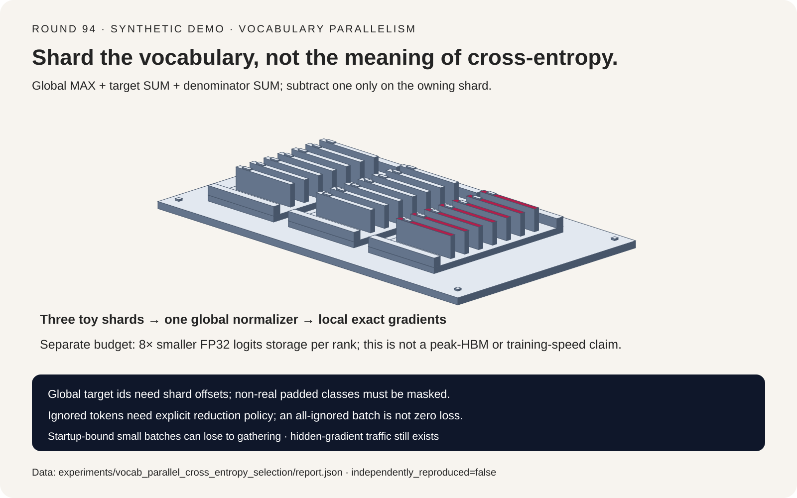
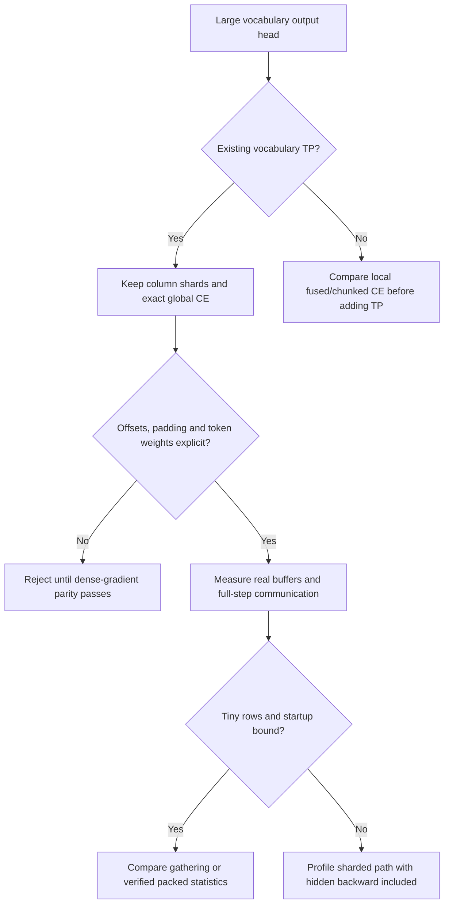
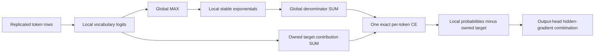
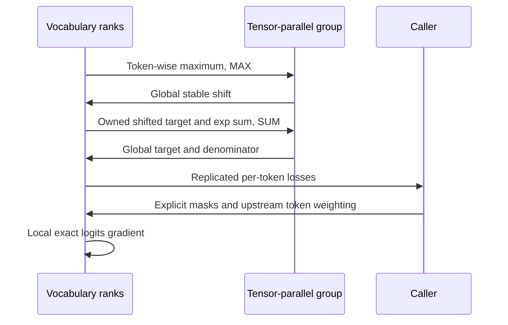

# Vocabulary-parallel cross-entropy FAQ: global log-sum-exp, target ownership and exact gradients

> **Language**: [中文](vocabulary-parallel-cross-entropy-global-logsumexp-selection-faq.md) | English
>
> **Round 94 · 2026-11-14 (third round of the November 13 night)** · [SVG](../../assets/svg/vocabulary-parallel-cross-entropy-global-logsumexp-selection-faq-summary.svg) · [7-card report](../reports/vocabulary-parallel-cross-entropy-global-logsumexp-selection-cards.html) · [H5 workbench](../reports/vocabulary-parallel-cross-entropy-global-logsumexp-sizer.html) · [Sealed data](../../experiments/vocab_parallel_cross_entropy_selection/report.json)
>
> **`synthetic` · `independently_reproduced=false`**: original numerical loss checks and separate communication/storage accounting. No GPU execution, measured peak HBM, language-model quality or end-to-end speedup.



## 1. Executive summary: shard vocabulary columns without replacing the objective

**Vocabulary-parallel CE keeps one full-vocabulary softmax while storing only
local output columns.** A rank cannot substitute its local denominator, average
the global denominator, or subtract the target on every shard.

| Requirement | Correct mechanism | Incorrect shortcut |
| :--- | :--- | :--- |
| Full-vocabulary denominator | Global stable maximum and SUM of local exponentials | Owner-local softmax |
| Global target label | Unique owner, explicit shard offset | Apply `target % shard_width` on every rank |
| Exact local backward | Local global-normalized probabilities minus the owned one-hot | Replicate the target subtraction |
| Masked mean over tokens | Explicit valid-token numerator/count reduction | Divide again by vocabulary TP size |
| Smaller output-head memory | Column-sharded logits and deliberate buffer lifetimes | Claim the entire training peak falls by TP size |

With `4,096` rows, `131,072` classes and eight vocabulary ranks, the FP32
logits-only comparison is **2 GiB gathered versus 256 MiB local**. That is
an `8×` storage ratio for this tensor, not a measured peak-HBM ratio.

The current first-party source is pinned to commit
`df3a6ebe1841d9b26ab27b2cb1dcaf70b2835726`. Its old
`tensor_parallel/cross_entropy.py` path is now a compatibility alias; the
implementation lives in `core/ops/loss/cross_entropy.py`. This source-location
change was inspected rather than treating an old filename as current evidence.
The algorithm is established, not claimed as a new launch or popularity winner.

This study is distinct from [token-chunked linear CE in the SFT FAQ](sft-sequence-packing-cross-sample-mask-liger-rslora-selection-faq.en.md).
Token chunking bounds live rows; vocabulary TP partitions columns across ranks.
They may be combined, but their correctness and communication contracts differ.

## 2. Architect Q&A: what crosses ranks, and which rank owns the target?

### Q1: How can exact CE avoid gathering the vocabulary matrix?

For one token, rank `r` owns columns `J_r`. Let `y` be the global target:

```text
m = MAX_r max_{j in J_r} z_j
s = SUM_r sum_{j in J_r} exp(z_j - m)
t = SUM_r [1(y in J_r) * (z_y - m)]
L = log(s) - t
```

Only token-wise statistics cross ranks. Subtracting the same global maximum
keeps the exponentials stable, including this fixture's logits near `+1000`
and `-1000`. Three sequential logical reductions are modeled: MAX, target SUM
and denominator SUM. This is not a claim that every optimized backend uses
three separate launches; target and denominator statistics might be packed.

The pinned implementation casts logits to FP32, computes local maxima,
reduces MAX on the **tensor-parallel group**, constructs a target ownership
mask, sums the target contribution and denominator, and normalizes local
exponentials. An in-place operation or `.float()` call is not a guarantee of
free dtype conversion or identical live-buffer lifetimes.

### Q2: Why does the target require a global-to-local offset?

If a shard owns `[start, end)`, only `start <= y < end` contributes
`z_local[y-start]`. A non-owner may use a safe temporary index for gathering,
but must zero that temporary target contribution afterward. Using a valid
local index does not establish ownership.

In the original toy, 12 physical columns are split into three equal shards,
with ten real classes and targets `0`, `4`, `9`, plus an ignored row. The
global label `4` belongs to the second shard, not local column four or the
same modulo column on all three shards.

Backward on real local column `j` is:

```text
dL/dz_j = (exp(z_j - m) / s - 1[j = y]) * upstream_token_gradient
```

The “target-on-every-shard” control deliberately keeps the correct scalar
forward loss `1.5278837800` but subtracts the target on all shards. Its maximum
gradient error is `0.3333333333`. **Forward parity alone misses this bug.**

### Q3: Why are TP averaging and DP token normalization different?

Vocabulary TP ranks hold different columns of the **same token rows**.
The sum of exponentials must be SUM, not AVG. The scalar per-token loss is
replicated across these ranks; averaging replicated scalar values for logging
does not license dividing the denominator or backward by TP size.

The toy's AVG-denominator control also uses that wrong denominator in its
hand-written backward. It has a loss offset `-log(3)` and maximum derivative
error `0.4203796047`. It models a broken custom forward/backward protocol;
it is not claimed to be the mathematical derivative of the offset scalar loss.

DP ranks can instead own different numbers of valid token rows. Derive the
global token-weighted objective from local valid-token sums/counts and the
actual DP gradient-reduction convention. Averaging equal-weight microbatch
means with unequal valid counts changes the objective. Sequence-parallel
row ownership, vocabulary TP and DP are separate axes.

### Q4: Do vocabulary padding and ignored labels just work automatically?

No. The original harness explicitly excludes physical columns outside the
real vocabulary **before** MAX and denominator reductions. Zeroing only their
backward after including them in softmax is insufficient: they already stole
probability mass. Pad token semantics and non-real vocabulary padding are not
the same concept.

`ignore_index=-100` is an explicit harness policy: ignored rows contribute
neither loss nor the valid-token denominator and have zero gradients.
An all-ignored batch yields `loss=null` and an explicit **skip optimizer step**
status, not a pretend zero training loss. Other out-of-range labels fail.

These policies are not an API support claim for the pinned Megatron kernel.
The reference source returns per-token losses; masking and final reduction
belong to the caller. Label smoothing, class weights and z-loss are **not
implemented or validated here**. Do not extrapolate unsmoothed parity to
their normalization paths.

### Q5: Does avoiding the logits gather remove output-head communication?

No. A vocabulary-parallel linear head still needs correct input ownership,
weight partitioning and hidden-state gradients. Local contributions to
`dL/dhidden` generally need their own TP combination, or an equivalent
reduce-scatter arrangement. This budget does not count that traffic.

The logit storage ratio also excludes model/optimizer state, cast coexistence,
softmax temporaries, allocator fragmentation and output projection workspace.
Chunked or fused linear-CE kernels have different materialization lifetimes.
Compare actual peaks and end-to-end traces before making a hardware decision.

## 3. Visual architecture: selection tree, statistics and backward sequence







## 4. Selection matrix and fit boundaries

| Path | Objective | Memory/communication boundary | Decision |
| :--- | :--- | :--- | :--- |
| Gather all columns then dense CE | Exact with correct masking | Full logits on each rank; gather traffic | Reference, sometimes sensible at tiny row counts |
| Vocabulary-sharded exact CE | Same full-vocabulary objective | Local logits plus statistic reductions | Good fit for an existing vocabulary-TP head |
| Owner-local softmax | Different denominator/candidate set | Less communication but missing classes | Not an exact replacement |
| Sampled/adaptive objective | Different optimization contract | Potentially less work; quality must be evaluated | Separate experiment, not parity |
| Token-chunked/fused linear CE | Can be exact with verified backward | Reduces live rows/intermediates, not necessarily TP traffic | Orthogonal optimization |

Hold labels, real vocabulary, weighting, masks, dtype and optimizer constant
for an A/B. Compare all logits-gradient coordinates, then hidden and weight
gradients, then a short training trace. The local toy reaches the first gate;
it does not simulate real distributed GEMMs or framework communication.

## 5. Worked example and seven cards: bytes can fall while startup loses

Every reported coordinate comes from the [sealed JSON](../../experiments/vocab_parallel_cross_entropy_selection/report.json).
The reference mean uses three valid rows and tolerance `1e-10`.

| Original protocol control | Mean loss | Maximum gradient error | Reference gate |
| :--- | ---: | ---: | :--- |
| Exact global statistics | `1.5278837800` | `2.78e-17` | Pass |
| AVG denominator and broken custom backward | `0.4292714914` | `0.4203796047` | Fail |
| Target subtraction on every shard | `1.5278837800` | `0.3333333333` | Fail despite equal loss |
| Non-real padded classes included | `8.3161423019` | `0.2435861536` | Fail |
| Owner-local softmax | `0.9024958273` | `0.1816754619` | Different objective |

Independent dense central differences check every coordinate, including
ignored rows and padding, with `epsilon=1e-3`. Shard-order reversal and a
common `+123` logit shift preserve the loss in this fixture.

For `N` rows, padded vocabulary `V_p`, `P` equal shards, FP32 scalars,
effective byte bandwidth `B` and per-hop startup `alpha`:

```text
local_logits_bytes = 4 N V_p / P
gathered_logits_bytes = 4 N V_p
gather_send_per_rank = (P-1)/P × 4 N V_p
three_stats_send_per_rank = 3 × 2(P-1)/P × 4 N

t_gather = gather_send / B + (P-1) alpha
t_stats  = stats_send  / B + 6(P-1) alpha
```

These are ideal-ring forward-communication assumptions, **not NCCL timing
predictions**. With `50 GB/s`, `alpha=2 µs` and eight ranks:

| Token rows | Full-logit gather, modeled ms | Three statistics, modeled ms |
| ---: | ---: | ---: |
| `1` | `0.02318` | `0.08400` |
| `32` | `0.30760` | `0.08401` |
| `1,024` | `9.40924` | `0.08443` |
| `4,096` | `37.59496` | `0.08572` |

At one row, three reductions lose despite far fewer bytes. At 4,096 rows,
the ideal per-rank send-byte ratio is `21,845.33×`; this is emphatically not
a training-step speedup. Single-rank wire ratios remain `null`. GPU latency,
model quality and confidence are unmeasured, not zero.

## 6. Reproduction, source anchors and deployment checklist

```powershell
python -m experiments.vocab_parallel_cross_entropy_selection.run
python -m experiments.vocab_parallel_cross_entropy_selection.run --check
python -m unittest tests.test_vocab_parallel_cross_entropy_selection
```

Open the [self-contained workbench](../reports/vocabulary-parallel-cross-entropy-global-logsumexp-sizer.html)
to vary vocabulary, TP, token rows, bandwidth and startup. Static seven cards
use `default-src 'none'; style-src 'unsafe-inline'`, without scripts, external
fonts or requests. Only the local calculator permits inline JavaScript.
Browser visual inspection was not performed because browser access was denied;
artifact determinism, JS budget parity and SVG geometric clearance are checked
locally without bypassing that refusal.

First-party anchors at the fixed commit:

- [Actual loss implementation](https://github.com/NVIDIA/Megatron-LM/blob/df3a6ebe1841d9b26ab27b2cb1dcaf70b2835726/megatron/core/ops/loss/cross_entropy.py): FP32 maxima, target ownership, three reductions and local backward; unsmoothed path only.
- [Legacy compatibility path](https://github.com/NVIDIA/Megatron-LM/blob/df3a6ebe1841d9b26ab27b2cb1dcaf70b2835726/megatron/core/tensor_parallel/cross_entropy.py): not the implementation body.
- [Upstream license](https://github.com/NVIDIA/Megatron-LM/blob/df3a6ebe1841d9b26ab27b2cb1dcaf70b2835726/LICENSE): original rights and file-specific exceptions remain upstream; no source or license text mirrored.

Before deployment, verify real label boundaries, non-real padding exclusion,
the all-ignored policy, TP/DP/sequence-group membership, token-count weights,
all upstream gradient factors, actual buffer lifetimes and complete output-head
backward traffic. Do not enable untested smoothing or claim quality equivalence
from this numerical toy.
