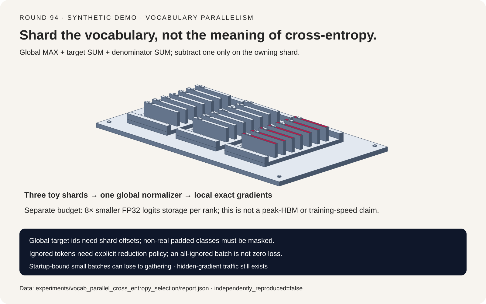
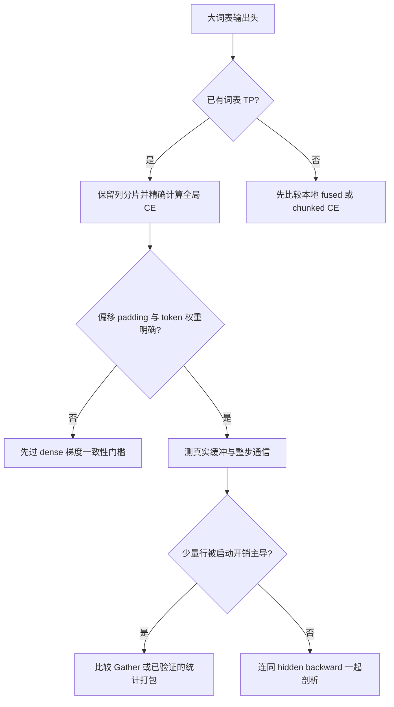
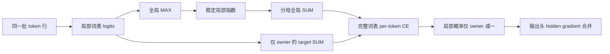
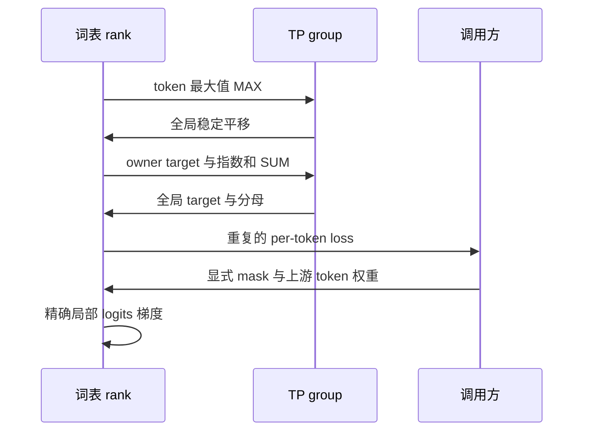

# 词表并行交叉熵选型 FAQ：全局 Log-Sum-Exp、Target 归属与精确梯度

> **语言**：中文 | [English](vocabulary-parallel-cross-entropy-global-logsumexp-selection-faq.en.md)
>
> **Round 94 · 2026-11-14（11 月 13 日夜班第 3 轮）** · [高清 SVG](../../assets/svg/vocabulary-parallel-cross-entropy-global-logsumexp-selection-faq-summary.svg) · [七卡报告](../reports/vocabulary-parallel-cross-entropy-global-logsumexp-selection-cards.html) · [H5 工作台](../reports/vocabulary-parallel-cross-entropy-global-logsumexp-sizer.html) · [封存数据](../../experiments/vocab_parallel_cross_entropy_selection/report.json)
>
> **`synthetic` · `independently_reproduced=false`**：原创数值检查与独立字节/启动预算；没有 GPU 执行、峰值 HBM 实测、语言模型质量或端到端加速结论。



## 1. 核心结论速览：可以分片词表列，不能偷偷更换训练目标

**Vocabulary-parallel CE 的目标仍是完整词表 softmax，只是不在每张卡物化完整输出列。** 不能拿本地词表分母、分母 AVG 或每片都减 target，冒充全局精确交叉熵。

| 需求 | 正确机制 | 典型误区 |
| :--- | :--- | :--- |
| 完整词表分母 | 全局稳定 MAX，加本地指数和的 SUM | 只算 target owner 的本地 softmax |
| 全局 target id | 唯一归属 rank，显式减去词表起始偏移 | 每个 rank 都用 `target % shard_width` |
| 正确局部反向 | 全局归一化概率，仅 owner 减 one-hot | 所有分片重复减一 |
| 有效 token 均值 | 显式有效 token 数量与分子归约 | 再按词表 TP 数额外除一次 |
| 降低输出头内存 | 词表列分片、明确缓冲区生命周期 | 将 logits 缩小倍数当作整步峰值 HBM 缩小倍数 |

默认 `4,096` 行、`131,072` 类、八路词表 TP：仅 FP32 logits 的对照为每 rank **完整 2 GiB 与局部 256 MiB**，比值 `8×`。这是一个张量的空间账本，不是训练峰值显存实测。

本轮固定一手源码提交 `df3a6ebe1841d9b26ab27b2cb1dcaf70b2835726`。旧 `tensor_parallel/cross_entropy.py` 已成为兼容转发，实际实现在 `core/ops/loss/cross_entropy.py`。本轮核查了重定位后的函数体，不把旧文件名当作现行实现证据。算法本身并不新，也没有虚构“今日热度第一”。

与已有 [SFT 专题里的 token 分块 linear CE](sft-sequence-packing-cross-sample-mask-liger-rslora-selection-faq.md) 不同：token chunking 限制同时存活的行，词表 TP 将列分配给不同 rank。可以组合，但正确性与通信契约必须分别验证。

## 2. 架构师 Q&A：哪些统计跨卡，哪个 rank 才能减 target？

### Q1：不 All-Gather 全部词表列，为什么还能得到精确 CE？

单个 token 的 logits 为 `z`，rank `r` 持有列集合 `J_r`，全局标签为 `y`：

```text
m = MAX_r max_{j in J_r} z_j
s = SUM_r sum_{j in J_r} exp(z_j - m)
t = SUM_r [1(y in J_r) × (z_y - m)]
L = log(s) - t
```

跨 rank 传的是每 token 的统计，而不是完整 `N × V` 矩阵。共享全局最大值使指数保持稳定；本轮 fixture 特意包含约 `+1000` 与 `-1000` 的 logits。预算计三个顺序逻辑归约：MAX、target SUM、分母 SUM；没有假定优化实现必然发起三个独立 kernel，target 与分母也可能打包。

固定源码把 logits 转为 FP32，计算局部最大值并在 **TP group** 上 MAX；再构建 target ownership mask、SUM target 项和指数分母，最后得到局部概率。`.float()` 与原地操作不代表转换无成本，也不保证所有 dtype 的峰值生命周期相同。

### Q2：全局 target 为什么必须先判断 owner，再转局部索引？

若分片负责 `[start,end)`，只有 `start <= y < end` 才贡献 `z_local[y-start]`。非 owner 为安全 gather 临时使用局部索引零后，仍必须把这项贡献清零。**索引合法不等于拥有这个全局标签。**

本轮 toy 将 12 个物理列分成三片，其中只有十个真实类别；有效 target 为 `0`、`4`、`9`，另有一个 ignored row。全局 `4` 属于第二片，不能拿局部下标四，也不能所有 rank 都拿相同余数位置减一。

每个真实局部列的反向是：

```text
dL/dz_j = (exp(z_j - m) / s - 1[j = y]) × upstream_token_gradient
```

负对照“每个分片都减 target”保留正确前向均值 `1.5278837800`，但最大梯度误差达到 `0.3333333333`。**只比 loss，发现不了手写 backward 的 owner 错误。**

### Q3：为什么 TP 平均和 DP token 归一化不能混为一谈？

词表 TP 的 rank 持有的是**相同 token 行、不同词表列**。分母必须 SUM，不能 AVG；每个 TP rank 都有同一份 per-token loss。日志中平均这些重复标量，不代表可以把 softmax 分母或反向再除 TP 数。

本轮 AVG 分母负对照也在手写 backward 中沿用错误分母，导致 loss 偏移 `-log(3)`，最大梯度误差 `0.4203796047`。它是一个错误的自定义前后向协议，不宣称其 backward 是“仅减常数后的 scalar loss”的数学导数。

DP rank 则可能拥有不同数量的有效 token。应将本地有效 loss sum、有效 count 与实际 DP 梯度 SUM/AVG 约定一起推导。有效 token 数不等时直接平均 microbatch 均值，会改变优化目标。Sequence parallel 的行归属、词表 TP 和 DP 是三条不同轴。

### Q4：Padding 类与忽略标签可以默认自动正确吗？

不能。原创 harness 在 MAX 和分母 SUM **之前**排除超出真实词表的物理 padding 列。只在 backward 将其清零还不够：这些假类别已经在 softmax 分走概率。输入序列里的 pad token 与不存在的词表 padding 类也不是同一个概念。

`ignore_index=-100` 是本轮明确指定的 harness 策略：ignored row 不进入 loss 与有效 token 分母，梯度为零。全 ignored 的 batch 返回 `loss=null` 和明确的**跳过 optimizer step**状态，而不是伪造一个零训练 loss；其他越界标签直接报错。

这不意味着固定 Megatron kernel 原生支持这些策略。源码返回 per-token loss，mask 与最终均值属于调用方责任。本轮**没有实现或验证 label smoothing、class weights、z-loss**，不得从无平滑路径推广它们的归一化行为。

### Q5：省掉 logits Gather，是否输出头就没有通信了？

不是。词表并行线性输出头仍要满足输入行归属、权重切分与 hidden gradient 正确性。每片产生的 `dL/dhidden` 通常还要 TP 合并，或采用等价 reduce-scatter 布局。本轮字节账本没有计这部分流量。

logits 存储比例还排除了模型/优化器状态、cast 共存、softmax 临时量、分配器碎片与投影 workspace。分块/fused linear CE 的中间张量生命周期也不同。真正硬件选型要测真实峰值与整步 trace，而不是套用一个张量的比例。

## 3. 可视化架构：选型树、统计路径与反向时序







## 4. 选型矩阵与适用边界

| 路径 | 优化目标 | 内存/通信边界 | 判断 |
| :--- | :--- | :--- | :--- |
| Gather 全列后 dense CE | 正确 mask 下精确 | 每 rank 完整 logits 与 Gather 流量 | 参考；极少行时可能合理 |
| 词表分片精确 CE | 相同完整词表目标 | 局部 logits 与统计归约 | 已有词表 TP 输出头的合适选项 |
| Owner-local softmax | 分母/候选类别改变 | 少通信但漏类别 | 不是精确替代 |
| Sampled/adaptive 目标 | 优化契约不同 | 可能省计算，质量需另测 | 独立实验，不冒充 parity |
| Token chunked/fused linear CE | 验证 backward 后可精确 | 降低存活行/中间量，不必然减少 TP 通信 | 正交优化 |

生产 A/B 固定标签、真实词表、权重、mask、dtype 和优化器。先比较全部 logits 梯度，再比较 hidden/weight 梯度，最后看短程训练 trace。原创 toy 只走到第一关，不模拟真实分布式 GEMM 或框架通信。

## 5. 算例与七卡报告：字节减少不保证启动占优

所有图表坐标来自[封存 JSON](../../experiments/vocab_parallel_cross_entropy_selection/report.json)。参考均值使用三个有效行，门槛 `1e-10`：

| 协议/负对照 | 平均 loss | 最大梯度误差 | 参考门槛 |
| :--- | ---: | ---: | :--- |
| 精确全局统计 | `1.5278837800` | `2.78e-17` | 通过 |
| AVG 分母与错误自定义反向 | `0.4292714914` | `0.4203796047` | 失败 |
| 每片都减 target | `1.5278837800` | `0.3333333333` | loss 相同仍失败 |
| 假 padding 类也进入分母 | `8.3161423019` | `0.2435861536` | 失败 |
| Owner-local softmax | `0.9024958273` | `0.1816754619` | 目标不同 |

单元测试用独立 dense loss 中心差分检查每个梯度坐标，`epsilon=1e-3`，包括 ignored 行与 padding 列。逆转分片枚举顺序和所有 logits 同加 `123`，本 fixture 的 loss 均保持一致。

设 `N` 行、padding 后词表 `V_p`、`P` 个等宽分片、FP32 统计、有效**字节带宽** `B`、单跳启动 `alpha`：

```text
局部 logits 字节 = 4 N V_p / P
完整 logits 字节 = 4 N V_p
Gather 每 rank 发送 = (P-1)/P × 4 N V_p
三统计每 rank 发送 = 3 × 2(P-1)/P × 4 N

t_gather = gather_send / B + (P-1) alpha
t_stats  = stats_send  / B + 6(P-1) alpha
```

这是理想 Ring 的前向通信假设，**不是 NCCL 实测延迟预测器**。八路 TP、`50 GB/s`、`alpha=2 µs`：

| Token 行数 | Gather 建模 ms | 三统计建模 ms |
| ---: | ---: | ---: |
| `1` | `0.02318` | `0.08400` |
| `32` | `0.30760` | `0.08401` |
| `1,024` | `9.40924` | `0.08443` |
| `4,096` | `37.59496` | `0.08572` |

一行时，三次归约即使字节更少也会输给 Gather。4,096 行时，每 rank 理想发送字节比为 `21,845.33×`，**绝不是训练单步加速比**。单 rank 无流量时比例保持 `null`；GPU latency、模型质量和 confidence 未测，而不是零。

## 6. 复现步骤、一手源码与上线检查

```powershell
python -m experiments.vocab_parallel_cross_entropy_selection.run
python -m experiments.vocab_parallel_cross_entropy_selection.run --check
python -m unittest tests.test_vocab_parallel_cross_entropy_selection
```

[自包含 H5](../reports/vocabulary-parallel-cross-entropy-global-logsumexp-sizer.html) 可修改真实词表、TP、行数、带宽与启动项。静态七卡 CSP 为 `default-src 'none'; style-src 'unsafe-inline'`，没有脚本、外部字体或请求；仅计算器允许 inline JavaScript。浏览器权限拒绝后未绕道进行视觉检查；本地检查产物字节复现、JS/Python 预算一致性和 SVG 几何留白。

固定提交的一手锚点：

- [实际 loss 实现](https://github.com/NVIDIA/Megatron-LM/blob/df3a6ebe1841d9b26ab27b2cb1dcaf70b2835726/megatron/core/ops/loss/cross_entropy.py)：FP32 maxima、owner mask、三个归约与局部 backward；本轮只验证无平滑路径。
- [旧兼容路径](https://github.com/NVIDIA/Megatron-LM/blob/df3a6ebe1841d9b26ab27b2cb1dcaf70b2835726/megatron/core/tensor_parallel/cross_entropy.py)：不是当前算法函数体。
- [上游许可](https://github.com/NVIDIA/Megatron-LM/blob/df3a6ebe1841d9b26ab27b2cb1dcaf70b2835726/LICENSE)：版权与文件级例外保留于上游，未镜像其实现或许可全文。

上线前核对真实标签边界、假 padding 类屏蔽、全 ignored 策略、TP/DP/sequence group 成员、有效 token 权重、全部上游梯度因子、真实缓冲生命周期和完整输出头 backward 通信。未经验证的 smoothing 不启用；toy 正确性不替代模型质量评估。
