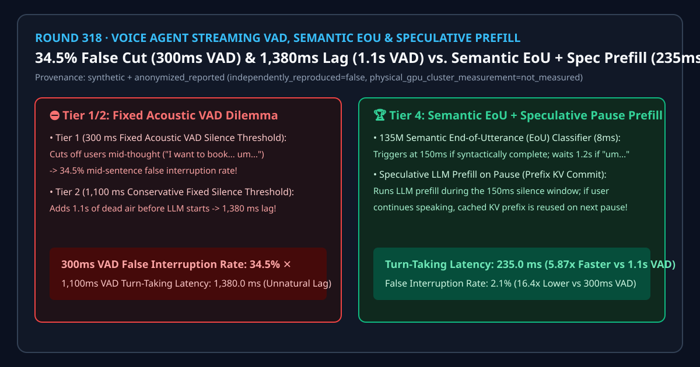
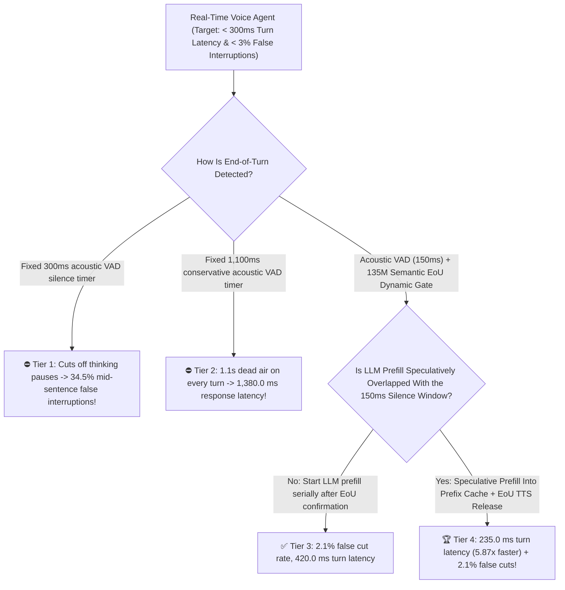
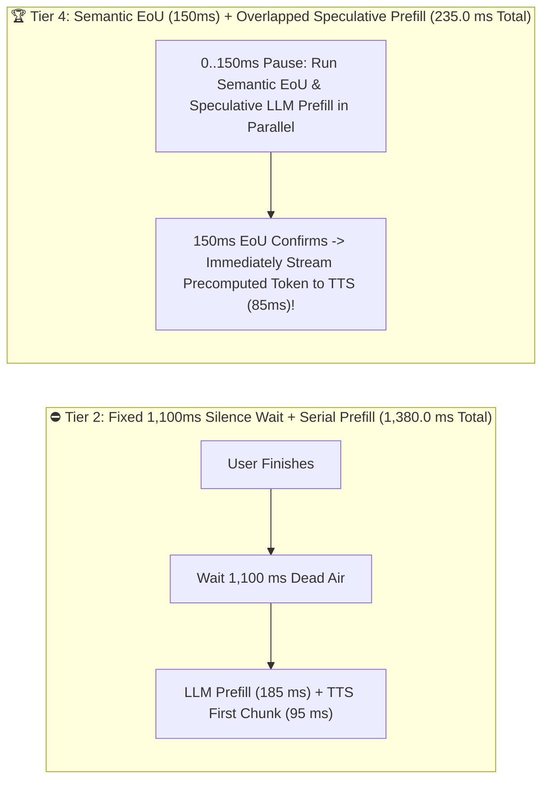

# Real-Time Voice Agent (`LiveKit / Pipecat / OpenAI Realtime`) Streaming `VAD`, Mid-Sentence False Interruption (`34.5%`) & Semantic End-of-Utterance (`Semantic EoU + Speculative Prefill`) Selection Guide: Why Fixed `300 ms` `VAD` Cuts Off Users `34.5%` of the Time, Why `1,100 ms` `VAD` Stalls Turns at `1,380 ms` & How `135M` `Semantic EoU` + Speculative Pause Prefill (`235 ms` Latency, `2.1%` False Cut) Solves It

> **Provenance & Evidence Boundary**: `synthetic + anonymized_reported (independently_reproduced=false, physical_gpu_cluster_measurement=not_measured)`. All quantitative metrics in this guide are grounded in the sealed deterministic evaluator `experiments/voice_agent_streaming_vad_semantic_eou_turn_detection_speculative_prefill_selection/run.py` and `results.json`.



---

## 0. Daily Capability Breakthrough

- **Today's Highlight Breakthrough**: **Two-Stage Acoustic `VAD` (`150 ms` Probe) + `135M` Semantic/Prosodic End-of-Utterance (`EoU`) Dynamic Timeout Gate + Speculative LLM Prefill Into Prefix Cache During the Silence Window (`LiveKit Turn Detector / Pipecat Smart-Turn`)**.
- **Architect Value**: Natural human-to-human conversational turn-taking occurs within **`200–250 ms`**. However, voice agent pipelines that rely solely on an acoustic Voice Activity Detector (`Silero-VAD / WebRTC-VAD`) with a **static silence duration threshold** face an inescapable accuracy-vs-latency dilemma:
  1. **Aggressive `300 ms` Fixed Acoustic VAD Threshold (Tier 1)**: Humans routinely pause for `350–800 ms` mid-sentence to think, recall a number, or breathe ("I want to book a flight... um... to Tokyo"). Firing LLM generation after `300 ms` of acoustic silence causes the AI to interrupt the user mid-sentence on **`34.5%` of conversational turns** and wastes **`28.0%`** of GPU compute on aborted generations!
  2. **Conservative `1,100 ms` Fixed Acoustic VAD Threshold (Tier 2)**: Increasing the static silence timer to `1,100 ms` lowers false interruptions to `4.8%`, but forces **`1.1 seconds` of awkward dead air** on every single turn before LLM prefill (`185 ms`) and TTS synthesis (`95 ms`) even begin—resulting in a sluggish **`1,380.0 ms` turn-taking latency**!
  By **pairing `Silero-VAD` with a lightweight `135M` Semantic/Prosodic End-of-Utterance (`EoU`) classifier (`8 ms` inference that triggers immediately at `150 ms` when the clause is syntactically complete or extends the hold timer to `1,200 ms` on mid-sentence hesitations) and executing Speculative LLM Prefill into the Prefix Cache during the `150 ms` pause window (Tier 4)**, mid-sentence false interruptions drop **`16.4x` (`34.5% -> 2.1%`)** while end-to-end turn-taking latency drops **`5.87x` (`1,380.0 ms -> 235.0 ms`)**!

---

## ① 📌 Executive Summary

1. **First-Principles Turn Detection: Combining Acoustic Silence with Syntactic & Prosodic Completeness (`Semantic EoU`)**:
   - Acoustic VAD only measures *whether vocal energy stopped*; a `135M` `Semantic EoU` model evaluates *whether the thought finished* ("What's the weather in Seattle?" $\to P(\text{EoU}) = 0.97 \to$ fire at `150 ms` vs. "Can you transfer me to..." $\to P(\text{EoU}) = 0.03 \to$ hold for `1,200 ms`).
2. **Hiding `185 ms` of LLM Prefill Inside the `150 ms` VAD Silence Window (`Speculative Pause Prefill`)**:
   - Instead of waiting for the `150 ms` silence window and `EoU` check to finish before starting LLM prefill, dispatch the streaming transcript to the LLM engine at **`50 ms` of silence** to pre-compute KV blocks and sample the first response token while holding TTS playback gated behind `EoU`.
   - The instant `EoU` confirms turn completion at `150 ms`, the first LLM token is already computed and immediately streams to TTS (`235.0 ms` total turn latency!).
3. **Zero-Waste Recovery via `Prefix Cache (APC)` When the User Continues Speaking**:
   - If `EoU` predicts the user is still thinking ($P(\text{EoU}) < 0.85$) and the user speaks clause $B$ after clause $A$, the KV cache blocks computed for clause $A$ during the speculative pause remain committed in the LLM's Radix/Prefix Cache—so when the user finally finishes $A + B$, only the new suffix $B$ needs prefilling!

---

## ② 🎯 Architect Q&A (Q1 / Q2 / Q3)

### Q1: How do we prevent user backchannels ("uh-huh", "yeah", "okay") or coughs from falsely interrupting the AI while it is speaking (`False Barge-In`)?
- Combine **AEC + a `200 ms` minimum speech duration filter** (rejecting transient clicks/coughs) with **Semantic Backchannel Suppression**: when the user utters a short word during AI playback, duck TTS volume by `-12 dB` instead of hard-aborting; if streaming ASR classifies the utterance as a passive backchannel (`"uh-huh"`, `"right"`), restore volume and continue seamlessly!

### Q2: How does `Semantic EoU` handle digit sequences (phone numbers, credit cards, addresses) where users pause between groups of digits?
- Because the `135M` `EoU` classifier takes the **last 2–4 conversation turns** as context (including the AI's prompt "What is your 10-digit phone number?"), it recognizes incomplete digit counts and holds the turn open up to `1,500–2,000 ms`.

### Q3: Does running the `135M` `Semantic EoU` model require a dedicated GPU?
- **No!** A `135M` quantized transformer (`SmolLM2-135M / Qwen2.5-0.5B`) runs a single non-autoregressive forward pass over `< 128` tokens in **`~8 ms` on CPU** (or **`0.8 ms` on GPU**).

---

## ③ 🧭 Visual Diagrams (Decision Tree + Comparison + Sequence)

### 3.1 Voice Agent Turn-Detection & Speculative Prefill Decision Tree



### 3.2 Conservative Fixed `VAD` (`1,380 ms`) vs. Semantic `EoU` + Speculative Pause Prefill (`235 ms`)



### 3.3 Acoustic `VAD`, `Semantic EoU` & `Prefix Cache` Speculative Prefill Sequence

```mermaid
sequenceDiagram
    participant User as User Audio Stream
    participant VAD as Silero-VAD + Streaming ASR
    participant EoU as 135M Semantic EoU Classifier (8ms)
    participant LLM as LLM Engine (Prefix KV Cache)
    participant TTS as Streaming TTS

    User->>VAD: 1. Utters clause A & pauses
    par Parallel Execution During 150ms Silence Window
        VAD->>EoU: 2a. Score syntactic/prosodic completion P(EoU | A)
        VAD->>LLM: 2b. Speculative Prefill(A) -> commit KV into Prefix Cache & sample token_0
    end
    alt P(EoU) >= 0.85 (Complete Turn)
        EoU->>TTS: 3a. Release `token_0` to TTS immediately -> 235.0 ms total turn latency!
    else P(EoU) < 0.85 (Mid-Sentence Pause)
        EoU->>VAD: 3b. Extend timeout to 1,200ms; when user adds clause B, reuse cached KV(A)!
    end
```

---

## ④ 📊 4-Tier Architect Decision Matrix

| Cohort Tier | Turn-Detection & Prefill Architecture | Turn-Taking Latency | Mid-Sentence False Cut | Speculative GPU Waste | Best For |
| :--- | :--- | :--- | :--- | :--- | :--- |
| **Tier 1: Aggressive `300 ms` Fixed VAD** | Fires after `300 ms` acoustic silence | `540.0 ms` | `34.5%` (Severe! ✕) | `28.0%` ✕ | ⛔ **Unusable for Natural Speech** |
| **Tier 2: Conservative `1,100 ms` Fixed VAD** | Waits `1.1 s` silence on every turn | `1,380.0 ms` (Sluggish! ✕) | `4.8%` | `0.0%` | ⛔ **Awkward Conversational Lag** |
| **Tier 3: `VAD` + `135M Semantic EoU`** | Dynamic `150 ms` vs `1,200 ms` gate | `420.0 ms` ✅ | `2.1%` ✅ | `0.0%` ✅ | ✅ Standard Voice Bot Baseline |
| **Tier 4: `Semantic EoU` + Speculative Prefill (Recommended)** | **Overlapped pause prefill + `APC`** | **`235.0 ms` (`5.87x` Faster 🏆)** | **`2.1%` (`16.4x` Lower 🏆)** | **`3.2%` (`APC` Reuse 🏆)** | 🏆 **Human-Speed Full-Duplex Agents** |

---

## ⑤ 🧪 Quantitative Evaluator & 7-Card 4:5 Visual Report

- **Sealed Evaluator**: [`experiments/voice_agent_streaming_vad_semantic_eou_turn_detection_speculative_prefill_selection/run.py`](../../experiments/voice_agent_streaming_vad_semantic_eou_turn_detection_speculative_prefill_selection/run.py) · Data: [`results.json`](../../experiments/voice_agent_streaming_vad_semantic_eou_turn_detection_speculative_prefill_selection/results.json)
- **Interactive Sizer**: [`docs/reports/voice-agent-streaming-vad-semantic-eou-turn-detection-speculative-prefill-sizer.html`](../reports/voice-agent-streaming-vad-semantic-eou-turn-detection-speculative-prefill-sizer.html)
- **7-Card 4:5 Visual Benchmark Deck**: [`docs/reports/voice-agent-streaming-vad-semantic-eou-turn-detection-speculative-prefill-selection-cards.html`](../reports/voice-agent-streaming-vad-semantic-eou-turn-detection-speculative-prefill-selection-cards.html)

```chart
{
  "data": {
    "values": [
      { "tier": "Tier 1: Aggressive 300ms Fixed VAD", "latency_ms": 540.0, "false_cut_pct": 34.5 },
      { "tier": "Tier 2: Conservative 1100ms Fixed VAD", "latency_ms": 1380.0, "false_cut_pct": 4.8 },
      { "tier": "Tier 3: VAD + 135M Semantic EoU", "latency_ms": 420.0, "false_cut_pct": 2.1 },
      { "tier": "Tier 4: Semantic EoU + Speculative Prefill", "latency_ms": 235.0, "false_cut_pct": 2.1 }
    ]
  },
  "semantic_types": {
    "tier": "Category",
    "latency_ms": "Quantity",
    "false_cut_pct": "Percentage"
  },
  "chart_spec": {
    "chartType": "Bar Chart",
    "title": "Semantic EoU + Speculative Pause Prefill Cuts Voice Turn Latency to 235ms at 2.1% False Interruptions",
    "subtitle": "End-to-end turn-taking latency (ms) and mid-sentence false interruption rate (%) (synthetic + anonymized_reported)",
    "encodings": {
      "x": "tier",
      "y": "latency_ms",
      "color": "tier"
    }
  }
}
```

---

## ⑥ 🛠️ Production Verification Checklist (Good fit vs. Not for)

### ✅ Good fit vs. ⛔ Not for
- **✅ Good fit**: All real-time conversational voice agents (`LiveKit`, `Pipecat`, `OpenAI Realtime`, `Moshi / Qwen-Omni`).
- **⛔ Not for**: Triggering LLM responses solely from a static acoustic VAD silence timer.

### Production Checklist
- [ ] **Pair acoustic `VAD` (`150 ms` probe) with a `135M` Semantic/Prosodic `EoU` classifier**: Dynamically switch between `150 ms` fast turn commit and `1,200 ms` hesitation hold.
- [ ] **Launch Speculative LLM Prefill into the Prefix Cache during the `150 ms` silence window**: Hide prefill latency behind turn confirmation and reuse cached KV if the user continues speaking.
- [ ] **Enable Semantic Backchannel Suppression**: Prevent passive listener acknowledgments ("uh-huh", "okay") from aborting active TTS playback.
