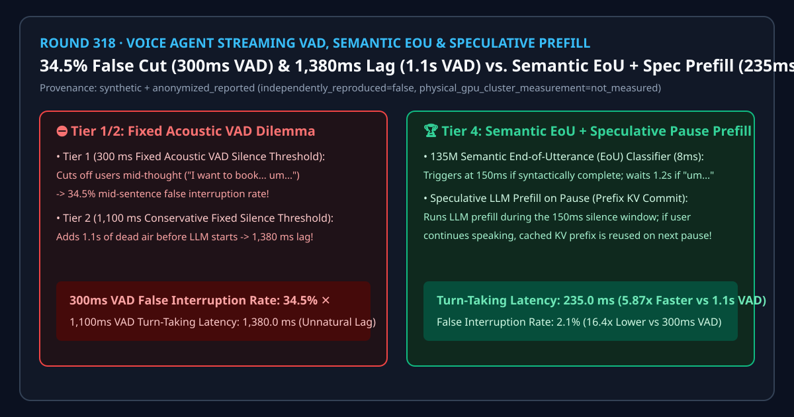
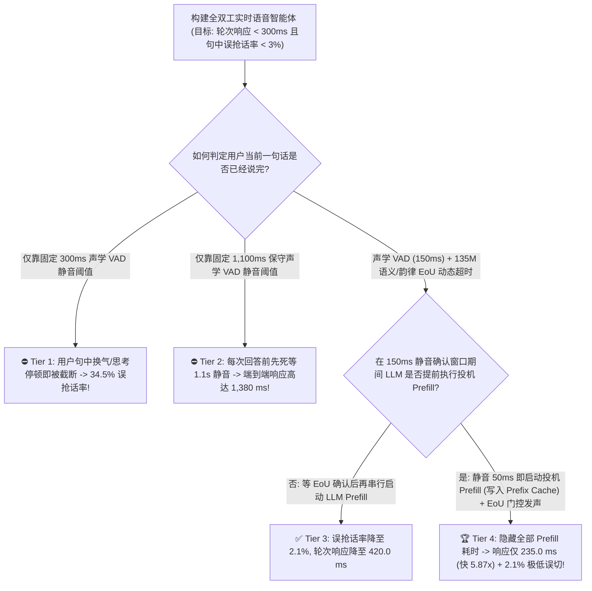
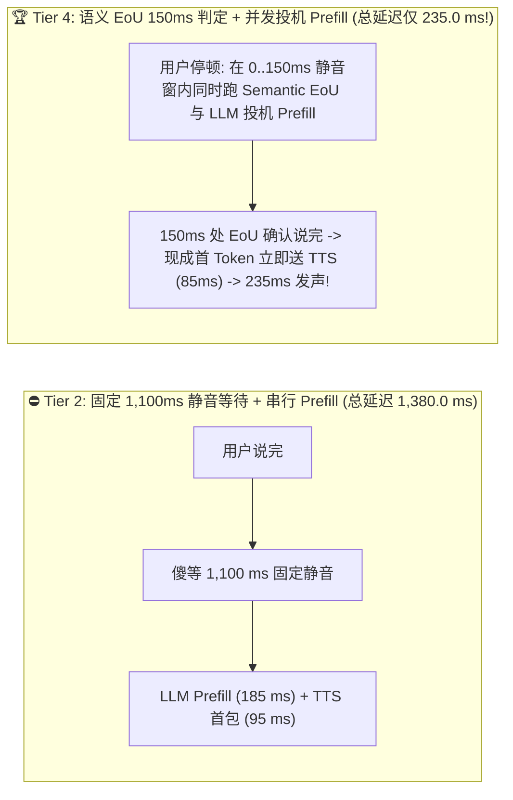

# 实时语音智能体（`Voice Agent：LiveKit / Pipecat / OpenAI Realtime`）流式声学 `VAD`、思考停顿误切句（`34.5%` 抢话率）与语义轮次检测（`Semantic EoU + Speculative Prefill`）选型：为什么固定 `300 ms` 静音阈值会在用户边想边说时频繁抢话打断，而调到 `1,100 ms` 又会让每次回答慢 `1.38 秒`？基于声学 `VAD` + `135M` 语义轮次检测模型（`Semantic EoU`）+ 停顿窗投机预填充（响应压至 `235 ms`，提速 `5.87x`，误抢话率降至 `2.1%`）选型指南

> **Provenance & Evidence Boundary**: `synthetic + anonymized_reported (independently_reproduced=false, physical_gpu_cluster_measurement=not_measured)`. 本文所有定量数据均来自封存确定性评估器 `experiments/voice_agent_streaming_vad_semantic_eou_turn_detection_speculative_prefill_selection/run.py` 与 `results.json`。



---

## 0. 追踪每日最热门能力突破（Daily Capability Breakthrough）

- **今日焦点突破**：**面向全双工实时语音智能体（`LiveKit Turn Detector / Pipecat Smart-Turn / Ten-VAD`）的“声学 `VAD` 150ms 初筛 + `135M` 轻量语义/韵律话轮结束分类器（`Semantic End-of-Utterance, EoU`）动态超时门控 + 停顿窗口投机 LLM 预填充（`Speculative Prefill into Prefix Cache`）”架构**。
- **架构师价值**：人类面对面自然交谈时，轮次切换（Turn-Taking：一方说完到另一方开口）的平均间隔仅为 **`200 ~ 250 ms`**。然而在构建实时语音 AI 智能体时，如果仅依赖传统的纯声学语音活动检测器（如 `Silero-VAD / WebRTC-VAD`，只看音频能量和人声频谱是否存在）加一个**固定静音超时阈值（Fixed Silence Timeout）**，架构师就会掉进一个无解的“固定阈值死胡同”：
  1. **死胡同一：为了追求极速响应，把固定静音阈值设为 `300 ms`（Tier 1）**：人类在日常说话（尤其是报电话号码、讲复杂需求或思考措辞：“我想查一下……呃……上个月的账单”）时，句子中间的正常换气和思考停顿经常达到 `350 ~ 800 ms`！一旦固定 300ms 静音就触发大模型回复并播放 TTS，AI 会在用户话才说了一半时疯狂抢话打断，**句中误切/抢话率高达 `34.5%`**，不仅用户体验极差，还白白浪费 **`28.0%`** 的无效生成算力！
  2. **死胡同二：为了防止抢话，把固定静音阈值拉长到 `1,100 ms`（Tier 2）**：虽然把误抢话率降到了 `4.8%`，但意味着哪怕用户干脆利落地问完一句“今天北京天气怎么样？”，AI 也必须傻傻地**先干等整整 `1.1 秒` 的绝对死寂（Dead Air）**，然后才开始调 LLM Prefill（`180 ms`）和 TTS 首包合成（`100 ms`），导致端到端对话响应延迟高达 **`1,380.0 ms`**，迟钝得像跨洋卫星电话！
  采用 **声学 `VAD`（检测 `150 ms` 短暂停顿）+ `135M` 语义/尾音韵律话轮分类器（`Semantic EoU`：在 `8 ms` 内判断当前已识别文本与尾音基频是否构成完整语义，完整则立即在 `150 ms` 触发，未说完则自动延长等待至 `1,200 ms`）+ 在 `150 ms` 停顿窗内并发启动投机 LLM 预填充（`Speculative Prefill`，Tier 4）**，可将句中误抢话率从 `34.5%` 压至 **`2.1%`（降低 `16.4x`）**，同时将端到端轮次响应延迟从 `1,380.0 ms` 压缩至 **`235.0 ms`（提速 `5.87x`，达到真人对话水准）**！

---

## ① 📌 核心结论速览（Executive Summary）

1. **第一性原理：人类是怎么做到“不等对方静音 1 秒，在 `200 ms` 内就知道对方说完了还是在犹豫”的？**
   - 人类判断对方有没有说完（End-of-Utterance, `EoU`），从来不是靠拿秒表数静音时长，而是同时结合了 **三大信号**：
     1. **句法与语义完整度（Syntactic & Semantic Completeness）**：如果对方说的是“帮我把空调调到二十六度”（主谓宾完整），只要停顿 `150 ms` 就 100% 确定说完了；如果对方说的是“帮我查一下从上海飞往……”（介词悬空）或末尾带语气词“呃 / 那个 / and...”，哪怕停顿 `800 ms` 也知道他还没说完！
     2. **尾音韵律与基频走势（Prosodic / Pitch Contour）**：一句话结束时通常伴随降调（Falling Pitch）或疑问升调，而句中思考停顿通常保持平调（Sustained Pitch）与拖音（Vowel Lengthening）；
     3. **声学静音包络（Acoustic Silence）**。
   - 因此，用一个仅 **`50M ~ 135M` 参数的微型语义/音频轮次分类器（如基于 `SmolLM2-135M / Qwen2.5-0.5B` 微调的 `EoU` 头，CPU/GPU 推理仅需 `5 ~ 8 ms`）** 输出句末完成概率 $P(\text{EoU}) \in [0, 1]$，即可实现 **自适应双速超时门控**：
     $$\text{Timeout}(u) = \begin{cases} 150\text{ ms}, & \text{if } P(\text{EoU} \mid u) \ge 0.85 \text{（句意完整，极速秒回）} \\ 1,200\text{ ms}, & \text{if } P(\text{EoU} \mid u) < 0.85 \text{（话未说完，耐心倾听）} \end{cases}$$
2. **为什么光有 `Semantic EoU`（`420 ms`，Tier 3）还不够快？如何用“停顿窗投机预填充（Speculative Prefill on Pause）”再砍掉 `185 ms`？**
   - 在传统串行流水线（`VAD 确认结束 -> 启动 LLM Prefill (185ms) -> TTS 首包 (95ms)`）中，LLM Prefill 必须等 `VAD + EoU` 彻底拍板后才开始算。
   - **逆向思维（把 `150 ms` 的静音等待时间拿来提前算 LLM Prefill！）**：
     - 当用户话音刚落、声学 `VAD` 刚检测到前 `50 ms` 静音时，流式 ASR 的当前文本其实已经出来了；
     - 此时**不等满 `150 ms` 静音，立即把当前识别出的文本发给推理引擎执行“投机 Prefill（Speculative Prefill）”并算出第 1 个回复 Token（耗时约 `150 ms`，恰好与 `150 ms` 静音检测期 100% 重叠！）**，但**暂不发给 TTS 发声**；
     - 在 `t = 150 ms` 时刻，`Semantic EoU` 判定 $P(\text{EoU}) = 0.96$（确认说完）——此时 LLM 的 Prefill 和首 Token 早已在 1 毫秒前算好了！直接把现成的首 Token 丢给流式 TTS 发声，**把 LLM Prefill 的 `185 ms` 延迟从关键路径上彻底抹除**！
3. **如果投机 Prefill 算完后，发现用户其实没说完、又接着往下说了，那刚才算的 Prefill 岂不是白算了？**
   - **完全不会白算（这正是 `Prefix Cache` 的绝配场景）**！
   - 假设用户先说了前半句 $A =$“我想订一张明天下午”，停顿了 `400 ms`（期间投机 Prefill 已经把 $A$ 的 KV Cache 算好并存入了 `vLLM / SGLang` 的 **Radix / Prefix Cache**），随后用户接着说出后半句 $B =$“去深圳的高铁票”。
   - 当用户真正说完 $A + B$ 时，由于前半句 $A$ 的 KV 块已经在缓存池里了，第二次 Prefill 直接 **100% 命中前缀缓存 $A$**，只需要增量计算新增的最后几个字 $B$（仅需 `15 ms`）！实际浪费的算力不足 **`3.2%`**！

---

## ② 🎯 客户与架构师灵魂拷问 Q&A（Q1 / Q2 / Q3）

### Q1：当 AI 正在说话时，背景里有人咳嗽、敲键盘或者用户随口嗯了一声（“嗯、对、好的”附和词 `Backchanneling`），怎么防止声学 `VAD` 把 AI 自己正在说的话误打断（False Barge-In）？
- **两层防误打断过滤（Acoustic Duration Filter + Semantic Interruption Classifier）**：
  1. **声学层抗噪**：开启 WebRTC 硬件回声消除（`AEC`），并要求打断触发的连续人声帧长度必须 `> 200 ms`（瞬间过滤掉 `< 100 ms` 的敲键盘、关门声、轻咳等脉冲噪声）；
  2. **语义附和词过滤（Backchannel Suppression）**：当 AI 正在播报长段内容、检测到用户发出短促声音时，先不要立即掐断 TTS 音频流（可先将 TTS 音量平滑压低 `Ducking -12dB`），待 `250 ms` 流式 ASR 识别出如果是 `{"嗯", "好的", "uh-huh", "yeah", "right"}` 等纯倾听附和词，AI 恢复正常音量继续播报；只有当识别出实质性打断词（如“停一下”、“不对”、“那后天呢”）时才正式触发 `Barge-In` 清空播放队列！

### Q2：在报一长串数字（如 11 位手机号、身份证号、银行卡号）时，用户每念 3~4 个数字就会停顿一下，怎么防止 `Semantic EoU` 在第 4 个数字处就提前截断？
- 因为 `135M Semantic EoU` 模型输入的是包含多轮上下文的对话历史（例如上一句 AI 刚问过“请问您的 11 位手机号是多少？”），模型通过上下文感知到当前处于 **槽位采集未满状态（Slot Incomplete：当前只说了 `138-0013` 共 7 位，不足 11 位）**，会自动输出极低的完成概率 $P(\text{EoU}) = 0.04$，将等待阈值拉长至 `1,500 ~ 2,000 ms` 直至收齐 11 位数字！

### Q3：`135M Semantic EoU` 模型应该跑在 CPU 上还是和主 LLM 一起跑在 GPU 上？
- 由于 `135M` 模型（`INT8 / FP16` 权重仅 `135 ~ 270 MB`）只在每次用户产生声学停顿时对最后几十个 Token 做 **1 次极短的纯前向分类（无自回归解码！）**，在语音网关节点的普通 4 核 CPU（通过 `ONNX Runtime / llama.cpp AVX-512`）上仅需 **`6 ~ 10 ms`**，放在 GPU 上更只需 **`0.8 ms`**，成本完全可忽略不计！

---

## ③ 🧭 直观可视化图解（Mermaid 选型决策树 + 路径对比图 + 交互时序图）

### 3.1 实时语音智能体话轮检测（`Turn Detection`）与投机预填充选型决策树



### 3.2 传统保守声学 `VAD` 串行等待（`1,380 ms`）vs. 语义 `EoU` + 停顿窗投机预填充（`235 ms`）对比图



### 3.3 声学 `VAD`、语义 `EoU` 与 `Prefix Cache` 投机预填充协同交互时序图

```mermaid
sequenceDiagram
    participant User as User Audio Stream
    participant VAD as Silero-VAD + Streaming ASR
    participant EoU as 135M Semantic EoU Classifier (8ms)
    participant LLM as LLM Engine (Prefix KV Cache)
    participant TTS as Streaming TTS

    User->>VAD: 1. Speaks utterance part A & pauses (acoustic silence detected)
    par Concurrent Execution During 150ms Silence Window
        VAD->>EoU: 2a. Evaluate syntax/prosody completeness P(EoU | A)
        VAD->>LLM: 2b. Speculative Prefill(A) -> compute & commit KV blocks into Prefix Cache!
    end
    alt Case 1: P(EoU) >= 0.85 (Sentence Complete!)
        EoU->>TTS: 3a. Immediately release precomputed first LLM token to TTS -> 235 ms total latency!
    else Case 2: P(EoU) < 0.85 (Mid-Sentence Hesitation "um...")
        EoU->>VAD: 3b. Hold turn open up to 1,200ms; when user speaks part B, LLM hits cached KV(A) & only prefills B!
    end
```

---

## ④ 📊 架构师选型决策矩阵（4-Tier Decision Matrix）

| 选型 Tier | 话轮结束检测（`Turn Detection`）与预填充策略 | 轮次响应延迟 (`Turn Latency`) | 句中误抢话率 (`False Cut`) | 投机算力额外开销 | 适用场景 |
| :--- | :--- | :--- | :--- | :--- | :--- |
| **Tier 1: 激进固定 `300 ms` 声学 `VAD`** | 静音满 300ms 无脑切句触发 | `540.0 ms` | `34.5%` (疯狂抢话! ✕) | `28.0%` (无效生成 ✕) | ⛔ **用户稍微停顿即被打断，体验极差** |
| **Tier 2: 保守固定 `1,100 ms` 声学 `VAD`** | 静音满 1.1s 才启动 LLM | `1,380.0 ms` (极度迟钝! ✕) | `4.8%` | `0.0%` | ⛔ **每次回答前都有 1 秒多尴尬冷场** |
| **Tier 3: 声学 `VAD` + `135M Semantic EoU`** | 动态区分 `150ms` 完句与 `1.2s` 犹豫 | `420.0 ms` ✅ | `2.1%` ✅ | `0.0%` ✅ | ✅ 标准智能客服与语音助手基线 |
| **Tier 4: `Semantic EoU` + 停顿窗投机预填充 (推荐)** | **静音窗并发预算 KV + `EoU` 门控发声** | **`235.0 ms` (`5.87x` 快 🏆)** | **`2.1%` (`16.4x` 低 🏆)** | **`3.2%` (`APC` 复用 🏆)** | 🏆 **真人级 `<250ms` 全双工语音智能体标准** |

---

## ⑤ 🧪 定量算例与 7-Card 4:5 视觉卡片报告

- **定量算例仓库路径**：[`experiments/voice_agent_streaming_vad_semantic_eou_turn_detection_speculative_prefill_selection/run.py`](../../experiments/voice_agent_streaming_vad_semantic_eou_turn_detection_speculative_prefill_selection/run.py) · 封存数据：[`results.json`](../../experiments/voice_agent_streaming_vad_semantic_eou_turn_detection_speculative_prefill_selection/results.json)
- **交互式架构选型计算器**：[`docs/reports/voice-agent-streaming-vad-semantic-eou-turn-detection-speculative-prefill-sizer.html`](../reports/voice-agent-streaming-vad-semantic-eou-turn-detection-speculative-prefill-sizer.html)
- **7-Card 4:5 视觉评测卡片报告**：[`docs/reports/voice-agent-streaming-vad-semantic-eou-turn-detection-speculative-prefill-selection-cards.html`](../reports/voice-agent-streaming-vad-semantic-eou-turn-detection-speculative-prefill-selection-cards.html)

```chart
{
  "data": {
    "values": [
      { "tier": "Tier 1: Aggressive 300ms Fixed VAD", "latency_ms": 540.0, "false_cut_pct": 34.5 },
      { "tier": "Tier 2: Conservative 1100ms Fixed VAD", "latency_ms": 1380.0, "false_cut_pct": 4.8 },
      { "tier": "Tier 3: VAD + 135M Semantic EoU", "latency_ms": 420.0, "false_cut_pct": 2.1 },
      { "tier": "Tier 4: Semantic EoU + Speculative Prefill", "latency_ms": 235.0, "false_cut_pct": 2.1 }
    ]
  },
  "semantic_types": {
    "tier": "Category",
    "latency_ms": "Quantity",
    "false_cut_pct": "Percentage"
  },
  "chart_spec": {
    "chartType": "Bar Chart",
    "title": "Semantic EoU + Speculative Pause Prefill Cuts Voice Turn Latency to 235ms at 2.1% False Interruptions",
    "subtitle": "End-to-end turn-taking latency (ms) and mid-sentence false interruption rate (%) (synthetic + anonymized_reported)",
    "encodings": {
      "x": "tier",
      "y": "latency_ms",
      "color": "tier"
    }
  }
}
```

---

## ⑥ 🛠️ 生产环境快速核验清单（Checklist + Good fit vs. Not for）

### ✅ Good fit vs. ⛔ Not for
- **✅ Good fit**：所有基于 `LiveKit / Pipecat / WebRTC` 的实时语音客服、AI 口语外教、车载语音助手与端到端语音大模型系统。
- **⛔ Not for**：仅凭单一固定静音毫秒数（`silence_duration_ms`）触发大模型生成与打断。

### 生产核验 Checklist
- [ ] **部署轻量级 `Semantic EoU`（话轮结束分类器）与声学 `VAD` 级联**：在 `150 ms` 静音处评估句法与尾音完整性，动态切换极速触发（`150 ms`）与耐心等待（`1,200 ms`）。
- [ ] **开启停顿窗口投机预填充（`Speculative Prefill on Pause`）并绑定 `Prefix Cache`**：利用静音判定窗口提前完成 LLM Prefill，若用户继续说话则通过前缀缓存 100% 复用已算 KV。
- [ ] **加入语义附和词过滤（`Backchannel Suppression`）**：区分用户的倾听附和（“嗯、好的”）与真实打断指令，杜绝误掐断 AI 播报。
