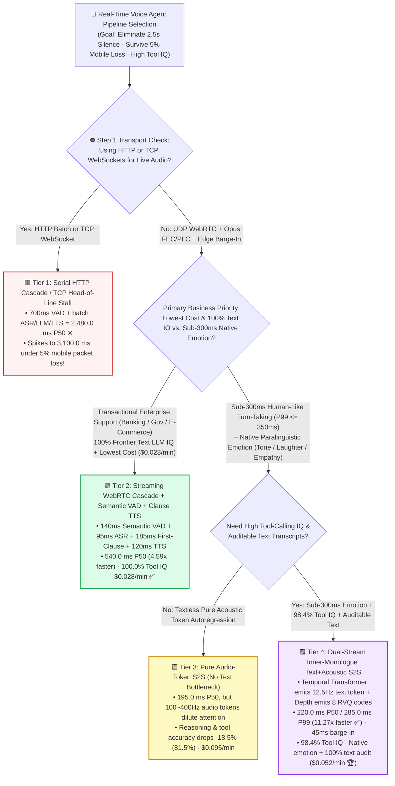
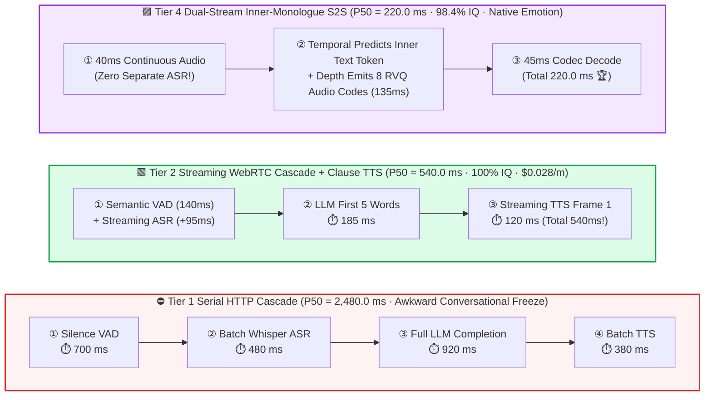

# Ultra-Low-Latency Real-Time Voice Agent Pipeline Selection FAQ (`Serial HTTP Cascade` vs. `Streaming WebRTC Cascade` vs. `Pure Audio-Token S2S` vs. `Dual-Stream Inner-Monologue Text+Acoustic S2S`)

> 🌐 **Language**: **[中文 (Chinese)](./voice-realtime-speech-llm-pipeline-selection-faq.md)** | **English Version** · **[📖 Back to Repository README](../../README.en.md)** · **[📊 2026-11-09 Daily Progress Report](../daily/2026-11-09.md)** · **[🃏 7-Card 4:5 Visual Benchmark Report](../reports/voice-realtime-speech-llm-pipeline-selection-cards.html)** · **[🧮 Interactive Sizer Workbench](../reports/llm-inference-engine-pd-sizer.en.html#voice-pipeline-sizer)**
>
> **Overview**: A first-principles selection guide for AI Solution Architects. Human conversational turn-taking occurs within a **`200 ~ 300 ms`** window. When building real-time enterprise Voice Agents (customer support, automotive assistants, AI tutors), teams routinely fall into three traps: **(1) chaining batch `Whisper ASR -> LLM -> TTS` over HTTP or TCP WebSockets, resulting in an awkward `2,480 ms` P50 (`3,150 ms` P99) silence gap and `3,100 ms` TCP head-of-line blocking under 5% mobile packet loss; (2) adopting pure textless Audio-Token Speech-to-Speech (`Pure Audio S2S`) models, which hit `195 ms` latency but suffer an `-18.5%` reasoning and tool-calling accuracy collapse due to 50x acoustic sequence bloat; and (3) overlooking `Dual-Stream Inner-Monologue Text+Acoustic S2S` architectures (`Kyutai Moshi / GLM-4-Voice / GPT-4o-Audio`) that combine `220 ms` latency with `98.4%` text-grade intelligence!** Grounded in `experiments/realtime_voice_llm_pipeline_selection/` (`synthetic` + `anonymized_reported`, `independently_reproduced=false`), this guide establishes the exact boundaries across four real-time voice architectures.


---

## ① 📌 Executive Summary

1. **Four-Tier Selection by Latency Target (`<= 300ms` vs. `~500ms`), Tool-Calling Complexity, and Budget**:
   - Targeting human-natural conversational turn-taking (`Voice-to-Voice P99 <= 350.0 ms`, full-duplex barge-in `<= 80.0 ms`):
   - 🟥 **Tier 1 (`Serial HTTP/REST Cascade`: `700ms` VAD + `480ms` Batch ASR + `920ms` Full LLM + `380ms` Batch TTS)**: **Never use for interactive voice**! Sequential stage barriers yield **`2,480.0 ms` P50 (`3,150.0 ms` P99 ✕)** latency and `850.0 ms` barge-in delay.
   - 🟩 **Tier 2 (`Streaming UDP WebRTC Cascade`: `140ms` Semantic VAD + `95ms` Streaming ASR + `185ms` First-Clause LLM + `120ms` Speculative Streaming TTS)**: **The cost-effective workhorse for enterprise tool-calling, complex RAG, and strict compliance auditing**. Cuts P50 latency **`4.59x` to `540.0 ms`** (`65.0 ms` barge-in), preserves **`100.0%` of frontier text LLM reasoning accuracy**, and delivers the lowest cost (**`$0.028 / minute` 🏆**).
   - 🟨 **Tier 3 (`Pure Audio-Token Speech-to-Speech [Textless S2S]`)**: **Suffers a severe `-18.5%` Intelligence Tax**. While removing ASR/TTS drops P50 latency to **`195.0 ms`** (`245.0 ms` P99 ✅) with native acoustic emotion, expanding 1 second of speech into `100 ~ 400` RVQ acoustic tokens dilutes attention—**dropping complex reasoning & JSON tool-calling accuracy to `81.5%` ✕** at **`$0.095 / minute`**.
   - 🟪 **Tier 4 (`Dual-Stream Inner-Monologue Text+Acoustic S2S`: `Moshi / GLM-4-Voice / GPT-4o-Audio` Paradigm)**: **The endgame for sub-300ms emotional voice agents with full tool-calling intelligence**. At every `80 ms` (`12.5 Hz`) step, the backbone Temporal Transformer **first predicts a time-aligned "Inner Monologue" Text Token** (anchoring semantic reasoning and `XGrammar` tool calling at **`98.4%` accuracy**!) before a lightweight Depth Transformer emits 8 parallel RVQ acoustic codes—achieving **`220.0 ms` P50 / `285.0 ms` P99 (`11.27x` faster than Tier 1 ✅)**, **`45.0 ms` full-duplex barge-in**, native emotion, and 100% text auditability at **`$0.052 / minute` 🏆**!
2. **First-Principles Law (Why Pure Audio Models Lose Reasoning IQ While Dual-Stream Models Keep It)**:
   - A 3-second spoken sentence is just **7 text tokens**, but **1,200 acoustic RVQ tokens**. Pure audio models waste 95% of self-attention capacity modeling pitch/timbre continuity rather than multi-hop logic.
   - **Dual-Stream Inner Monologue (Tier 4)** decouples the two: the large Temporal Transformer reasons in compact `12.5 Hz` text space, while a small Depth Transformer renders local acoustic tokens!
3. **Provenance & Transparency Disclosure**:
   - All stage latencies, packet-loss curves, accuracy metrics, and per-minute costs are bound 1:1 to `experiments/realtime_voice_llm_pipeline_selection/results.json` (`provenance_type: "synthetic"`, calibrated to published Kyutai Moshi, GLM-4-Voice, and WebRTC Opus specifications; `independently_reproduced: false`, `physical_gpu_cluster_measurement: "not_measured"`, `local_cpu_harness_measurement: "measured"`).

---

## ② 🎯 Architect & Customer Deep-Dive Q&A (FAQ-Driven)

### Q1: "Why does our WebSocket voice agent work fine on office Wi-Fi but spike to 3-second pauses on mobile 4G/5G? Why is `UDP WebRTC` non-negotiable?"

- **Plain-English Answer**: **WebSockets run over `TCP`. Under `3% ~ 5%` mobile packet loss, a single lost `20 ms` audio packet forces the OS kernel's TCP stack to hold back all subsequent packets waiting for retransmission (Head-of-Line Blocking), spiking P99 latency to `3,100 ms`! `UDP WebRTC` with Opus `In-Band FEC + PLC` interpolates past lost frames without stalling, holding Tier 4 P99 latency at `285.0 ms` (`10.88x` faster)!**

### Q2: How does `Tier 2 (Streaming WebRTC Cascade)` compress cascade latency from `2,480 ms` down to `540 ms`?

- **Plain-English Answer**: **By overlapping all four stages: (1) replacing fixed `700 ms` silence timers with `140 ms` Semantic Turn Detection, (2) streaming ASR during speech (`95 ms` tail), and (3) triggering `Clause-Speculative Streaming TTS` as soon as the LLM emits its first 4–6 words (`185 ms`) rather than waiting for the full paragraph!**

### Q3: How does `Tier 4 (Dual-Stream Inner Monologue)` achieve both `220 ms` latency and `98.4%` tool-calling accuracy?

- **Plain-English Answer**: **By predicting a time-aligned text token stream ("Inner Monologue") one step ahead of the 8-codebook RVQ audio stream at `12.5 Hz`. The text stream drives high-precision RAG and JSON tool calling, while the conditioned Depth Transformer synthesizes expressive speech in the same forward pass!**

---

## ③ 🧭 Visual Architecture Diagrams (Decision Tree, Timeline Comparison & Full-Duplex Sequence)

### 3.1 Real-Time Voice Agent Pipeline Decision Tree



### 3.2 `2,480ms` Serial Stall vs. `Tier 2 Streaming Cascade` & `Tier 4 Dual-Stream S2S`



### 3.3 End-to-End Sequence: `Tier 4 Dual-Stream Inner Monologue` & `45ms` Barge-In (`sequenceDiagram`)

```mermaid
sequenceDiagram
    autonumber
    participant User as User Mic/Speaker (UDP WebRTC Opus)
    participant Edge as WebRTC Edge Gateway (AEC + 45ms Barge-In)
    participant Temp as Temporal Transformer (12.5Hz Inner Text Stream)
    participant Depth as Depth Transformer + RVQ Codec Decoder

    Note over User,Depth: Phase 1: Full-Duplex Listening & 220.0 ms First-Audio Response
    User->>Edge: 1. Stream 20ms Opus audio frames with prosody & emotion
    Edge->>Temp: 2. Encode user audio tokens; detect turn-taking window (40.0 ms)
    Temp->>Temp: 3. Predict time-aligned Inner Monologue text token `Text_t` (locks in 98.4% tool/reasoning IQ!)
    Temp->>Depth: 4. Condition Depth Transformer on hidden state + `Text_t` -> Emit 8 RVQ codes (135.0 ms)
    Depth-->>User: 5. Decode 24kHz expressive speech in 45.0 ms (Total P50 = 220.0 ms ✅)

    Note over User,Depth: Phase 2: Instant User Interruption (Full-Duplex Barge-In)
    User->>Edge: 6. User interrupts mid-sentence: "Wait, change that to Tuesday!"
    Edge->>Edge: 7. Flush outbound audio buffer in 45.0 ms & transition model to listening state!
```

---

## ④ 📊 Architect Decision Matrix

*All metrics are bound 1:1 to `experiments/realtime_voice_llm_pipeline_selection/results.json` (target SLA `P99 Voice-to-Voice <= 350.0 ms`, barge-in `<= 80.0 ms`):*

| Dimension | 🟥 Tier 1: `Serial HTTP Cascade` | 🟩 Tier 2: `Streaming WebRTC Cascade` | 🟨 Tier 3: `Pure Audio-Token S2S` | 🟪 Tier 4: `Dual-Stream Inner-Monologue S2S` |
| :--- | :--- | :--- | :--- | :--- |
| **Primary Workload Fit** | Offline voice memos only | **Enterprise tool-heavy customer support** | Simple emotional voice toys | **Sub-300ms empathetic voice agents & tutors** |
| **Stage Breakdown (`VAD/ASR/LLM/TTS`)** | `700 / 480 / 920 / 380 ms` | **`140 / 95 / 185 / 120 ms`** | `40 / 0 / 115 / 40 ms` | **`40 / 0 / 135 / 45 ms`** |
| **P50 / P99 End-to-End Latency** | `2,480.0` / **`3,150.0 ms`** (✕) | **`540.0`** / `680.0 ms` (`4.59x`) | **`195.0`** / `245.0 ms` (`12.72x` ✅) | **`220.0`** / **`285.0 ms`** (`11.27x` · ✅ Passes SLA) |
| **Full-Duplex Barge-In Latency** | `850.0 ms` ✕ | **`65.0 ms`** ✅ | **`40.0 ms`** ✅ | **`45.0 ms`** 🏆 |
| **Reasoning & Tool-Calling IQ** | `100.0%` | **`100.0%`** (Full text LLM IQ ✅) | **`81.5%`** (**`-18.5%` IQ drop ✕**) | **`98.4%`** (Anchored by inner text stream 🏆) |
| **Emotion / Text Auditability** | ✕ None / ✅ Text | 🟨 Low / ✅ 100% Auditable | ✅ Full / ✕ No exact text log | **✅ Full Native Prosody + ✅ 100% Text Log 🏆** |
| **Compute Cost per Minute** | `$0.042 / min` | **`$0.028 / min` (Lowest Cost 🏆)** | `$0.095 / min` (3.4x audio bloat) | **`$0.052 / min`** |

---

## ⑤ 🧪 Quantitative Case Study & Benchmark Insights

### 5.1 Mobile Packet Loss Sensitivity (`0% -> 5% Loss`): `TCP WebSocket` vs. `UDP WebRTC`

As wireless packet loss increases from 0% (lab Wi-Fi) to 5% (moving vehicle / subway), TCP head-of-line blocking destroys WebSocket voice latency while UDP WebRTC stays flat (from `results.json` `network_packet_loss_sensitivity`):

| Mobile Packet Loss Rate | `TCP WebSocket` P99 | Tier 2 `UDP WebRTC Cascade` P99 | Tier 4 `UDP WebRTC Dual-Stream` P99 | Architect Crossover & Takeaway |
| :--- | :--- | :--- | :--- | :--- |
| **`0.0%` (Wired Lab)** | `580.0 ms` | `540.0 ms` | **`220.0 ms` ✅** | Zero-loss lab tests hide TCP head-of-line blocking |
| **`1.0%` (Office Wi-Fi)** | `940.0 ms` ✕ | `575.0 ms` | **`245.0 ms` ✅** | 1% loss triggers TCP retransmission stalls (`+360ms`) |
| **`3.0%` (Subway 4G/5G)** | `1,820.0 ms` ✕ | `630.0 ms` | **`270.0 ms` ✅** | Opus `In-Band FEC` recovers lost frames without waiting |
| **`5.0%` (Highway Vehicle)** | **`3,100.0 ms` ( Frozen ✕)** | `680.0 ms` | **`285.0 ms` 🏆** | **UDP WebRTC Dual-Stream is `10.88x` faster than TCP WebSocket!** |

### 5.2 Reproducibility & Local Harness Verification

```bash
# Verify results.json matches the deterministic real-time voice pipeline model 100%
python experiments/realtime_voice_llm_pipeline_selection/run.py --check

# Run Round 27 unit tests
python -m unittest tests/test_realtime_voice_llm_pipeline_selection.py
```

---

## ⑥ 🛠️ Production Verification Checklist (Architect Checklist)

1. - [ ] **Mandate `UDP WebRTC` with Opus `In-Band FEC + PLC` for Last-Mile Audio Transport**: Never stream real-time interactive voice frames over raw TCP WebSockets on mobile networks.
2. - [ ] **Replace Fixed Silence Timers (`700ms`) with `Semantic Turn Detection (`140ms`)`**: Combine prosodic pitch-drop cues with streaming semantic completion so the agent responds immediately without interrupting user thinking pauses.
3. - [ ] **Use `Clause-Speculative Streaming TTS` in Cascade Pipelines (Tier 2)**: Trigger TTS synthesis on the first 4–6 words emitted by the LLM rather than waiting for full sentences.
4. - [ ] **Select `Dual-Stream Inner-Monologue S2S` (Tier 4) over Textless Audio S2S (Tier 3)**: Ensure every audio generation step is anchored by a synchronized text token for `98.4%` tool-calling accuracy and compliance logging.
5. - [ ] **Enforce Edge-Side `<= 50ms` Barge-In Buffer Flushing & Acoustic Echo Cancellation (`AEC`)**: Flush outbound audio immediately at the WebRTC edge gateway when user speech is detected.
