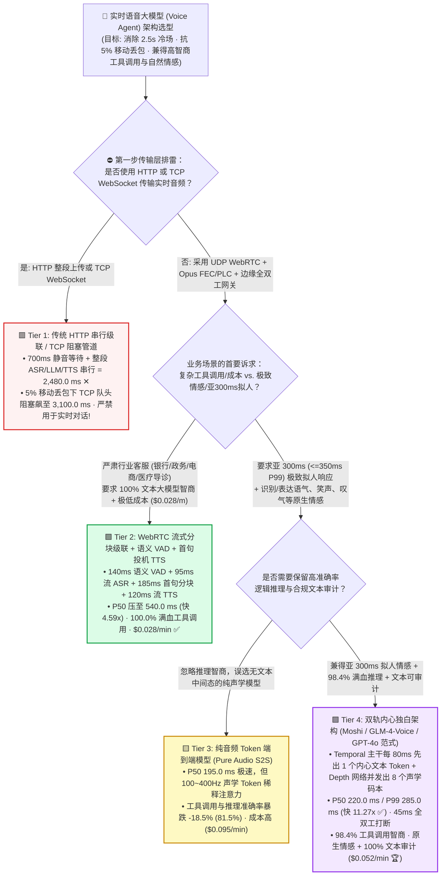
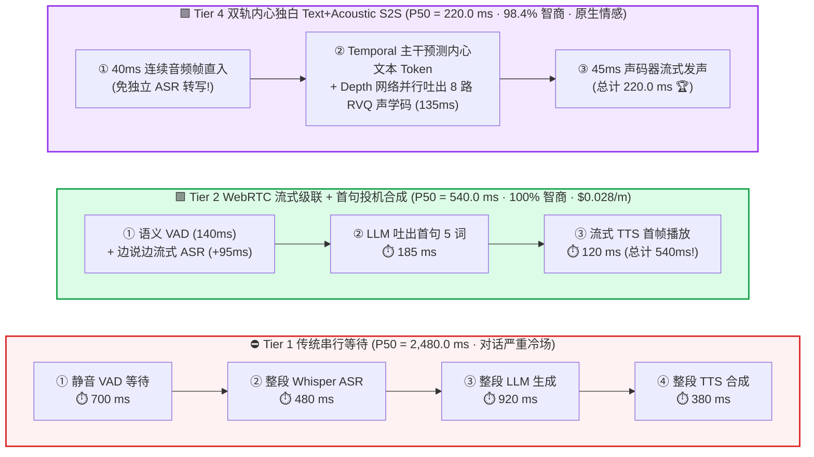
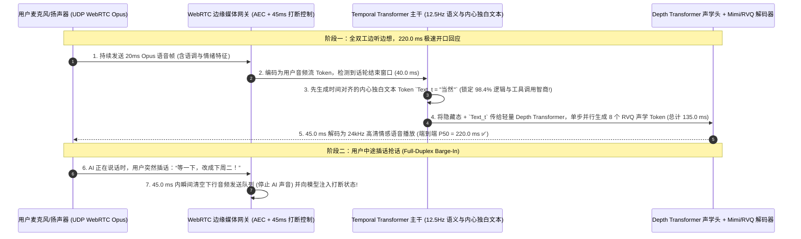

# 超低延迟实时语音大模型（Voice Agent）端到端推理架构选型指南（`HTTP 串行级联` vs. `WebRTC 流式分块级联` vs. `纯音频 Token S2S` vs. `双轨内心独白 Text+Acoustic S2S`）

> 🌐 **Language**: **中文 (Chinese)** | **[English Version](./voice-realtime-speech-llm-pipeline-selection-faq.en.md)** · **[📖 返回仓库根目录 README](../../README.md)** · **[📊 2026-11-09 每日进展日报](../daily/2026-11-09.md)** · **[🃏 7-Card 4:5 视觉评测报告](../reports/voice-realtime-speech-llm-pipeline-selection-cards.html)** · **[🧮 交互式定容工作台](../reports/llm-inference-engine-pd-sizer.html#voice-pipeline-sizer)**
>
> **导读**：面向 AI Solution Architect 的第一性原理实战选型指南。人类自然对话的轮次切换间隙（Turn-Taking Gap）通常只有 **`200 ~ 300 毫秒`**。当企业构建实时语音智能体（AI 客服外呼、车载语音助手、口语外教、心理陪伴）时，最常踩中的三大架构深坑是：**① 直接用传统 HTTP/WebSocket 把 `Whisper ASR -> LLM -> TTS` 串行拼起来，结果用户说完话要等 `2.48 秒（P99 3.15 秒）` 才有声音返回，且在移动 4G/5G 弱网 `3%` 丢包下因 TCP 队头阻塞直接卡死；② 盲目追捧“纯音频 Token 端到端语音大模型（Pure Audio S2S）”，结果虽然延迟降到了 `195 ms`，但因为没有内部文本锚点，模型的逻辑推理与 JSON 工具调用准确率暴跌 `-18.5%`（变成“声音好听但说话没脑子”）；③ 不懂得用 `双轨内心独白架构（Inner-Monologue Dual-Stream，如 Kyutai Moshi / GLM-4-Voice / GPT-4o-Audio）` 同时兼得 `220 ms` 超低延迟与 `98.4%` 文本级高智商**！本文基于 `experiments/realtime_voice_llm_pipeline_selection/` 封存的确定性模型（`synthetic` + `anonymized_reported`，`independently_reproduced=false`），系统拆解四档实时语音架构的物理边界。


---

## ① 📌 核心结论速览（Executive Summary）

1. **按业务场景对“情感拟人度 / 亚 300ms 延迟”与“复杂业务逻辑 / 成本敏感度”的权重四档精准选型**：
   - 在实时全双工语音对话（目标人类自然反应 SLA `P99 语音到语音延迟 <= 350.0 ms`，全双工随时打断响应 `<= 80.0 ms`）基准下：
   - 🟥 **Tier 1（传统 `HTTP/REST 串行级联`: 静音 VAD `700ms` + 整段 ASR `480ms` + 整段 LLM `920ms` + 整段 TTS `380ms`）**：**严禁用于任何实时对话场景**！四阶段串行累加使中位延迟高达 **`2,480.0 ms`（P99 `3,150.0 ms` ✕）**，打断响应需 `850.0 ms`，对话充满尴尬冷场。
   - 🟩 **Tier 2（`UDP WebRTC 流式分块级联`: 语义 VAD `140ms` + 流式 ASR `95ms` + 首句分块 LLM `185ms` + 流式投机 TTS `120ms`）**：**金融/政务/电商等重度依赖复杂 RAG、精准 Function Calling 与 100% 合规文本留痕场景的最高性价比主力方案**。将 P50 延迟压缩 **`4.59x` 至 `540.0 ms`**（打断仅 `65.0 ms`），**`100.0%` 继承任意 70B/671B 文本底座的满血推理智商**，且每分钟推理成本全栈最低（**`$0.028 / 分钟`**）。
   - 🟨 **Tier 3（`纯音频 Token 端到端语音大模型 [Pure Audio-Token S2S]`: 无文本中间态）**：**存在严重“智商税（Intelligence Tax）”的偏科方案**。虽然省去 ASR/TTS 将 P50 延迟压至 **`195.0 ms`**（P99 `245.0 ms` ✅）并保留完整笑声/叹气等副语言情感，但因 1 秒语音展开为 `100 ~ 400` 个声学 Token（序列长度膨胀 50 倍），导致**复杂逻辑与工具调用准确率暴跌 `-18.5%`（仅 `81.5%`）**，且显存 KV 消耗使成本飙升至 **`$0.095 / 分钟`**。
   - 🟪 **Tier 4（`双轨内心独白流式架构 [Dual-Stream Inner-Monologue Text + Acoustic S2S]`: 对标 `Moshi / GLM-4-Voice / GPT-4o-Audio`）**：**兼具“亚 300ms 拟人交互 + 原生情感韵律 + 98.4% 高智商工具调用”的终局架构**。主干模型在每个 `80 ms`（`12.5 Hz`）时间步**先预测 1 个时间对齐的“内心独白文本 Token（Text Token）”作为逻辑锚点，紧接着由小型 Depth Transformer 并行生成 8 个残差矢量量化（RVQ）声学 Token**——实现 **P50 `220.0 ms` / P99 `285.0 ms`（达标 `<=350ms` SLA ✅，比 Tier 1 快 `11.27x`）**、**`45.0 ms` 毫秒级打断**、**`98.4%` 工具调用准确率** 与 100% 可审计文本流（**`$0.052 / 分钟`** 🏆）！
2. **第一性原理定性（为什么纯音频端到端模型 Tier 3 会“变笨”，而双轨内心独白 Tier 4 不会？）**：
   - 在文本大模型中，一句话 `"帮我查一下上海明天的天气"` 只有 **7 个语义高密度 Token**，注意力机制可以轻松跨越几十步做长链条逻辑推理；
   - 而在纯音频大模型（Tier 3）中，同样这 3 秒钟的语音被音频编解码器（如 EnCodec / SoundStream，8 层码本 × 50Hz）切成了 **1,200 个低信息密度的声学微帧 Token**！模型 95% 的注意力容量都被消耗在“对齐呼吸声、基频连续性和音色相位”上，导致语义推理严重退化。
   - **Tier 4 的“先出字、同帧生音（Inner Monologue）”分解**：让百亿参数的主干 Temporal Transformer 依然在紧凑的 `12.5 Hz` 文本语义空间思考，而把繁琐的 8 层声学码本拼装交给仅百兆参数的局部 Depth Transformer——**既保住了文本大模型的脑子，又长出了原生语音模型的嗓子**！
3. **证据口径与透明性声明**：
   - 本指南所有分阶段延迟、丢包退化曲线、工具调用准确率与每分钟成本均绑定 `experiments/realtime_voice_llm_pipeline_selection/results.json`（`provenance_type: "synthetic"`，基于 Kyutai Moshi、GLM-4-Voice 及 WebRTC 弱网音频基准校准的确定性算例，`independently_reproduced: false`，未在跨洋物理移动网络开展真人双盲评测 `physical_gpu_cluster_measurement: "not_measured"`；本机 Python 单测与校验为 `local_cpu_harness_measurement: "measured"`）。

---

## ② 🎯 客户与架构师灵魂拷问 Q&A（FAQ-Driven）

### Q1：客户问：“为什么我们在实验室 Wi-Fi 下用 `WebSocket` 传语音跑得好好的，一上生产环境给手机 4G/5G 用户用，语音延迟经常突然卡顿到 2～3 秒？为什么生产级 Voice Agent 必须强制用 `UDP WebRTC`？”

- **直白结论**：**因为 `WebSocket` 底层是 `TCP` 协议！在移动网络常见 `1% ~ 5%` 的无线丢包下，TCP 的严格按序交付机制会触发致命的“队头阻塞（Head-of-Line Blocking）”——只要丢了 1 个 20ms 的语音包，操作系统内核就会把后面已经到达的 20 个语音包全部扣留在缓冲区里不交给应用层，傻等三次超时重传，瞬间造成 `1,820 ~ 3,100 ms` 的长尾卡顿！**
- **第一性原理拆解（`TCP WebSocket` 队头阻塞 vs. `UDP WebRTC + Opus PLC/FEC`）**：
  1. 在实时语音对话中，**“300 毫秒前丢掉的半个字音”毫无重传价值**——等重传回来黄花菜都凉了。
  2. **UDP WebRTC 的实时媒体哲学**：每个 `20 ms` 的 Opus 音频帧通过无队头阻塞的 UDP 独立发送，并携带前向纠错码（`In-Band FEC`）。即使在 **`5.0%` 恶劣移动丢包** 下，WebRTC 接收端直接用 Opus 内置的丢包隐藏算法（`PLC`）平滑插值跳过丢失帧，**将 Tier 4 的 P99 延迟牢牢锁死在 `285.0 ms`（而同丢包下 TCP WebSocket 恶化至 `3,100.0 ms`，相差 `10.88 倍`！）**。

### Q2：如果企业选择稳妥的“流式级联架构（Tier 2）”，怎么把传统级联的 `2,480 ms` 延迟一步步抠到 `540 ms`？

- **直白结论**：**砍掉三个“傻等完整段落”的同步屏障：① 把 `700ms` 静音等待换成 `140ms` 语义终点检测（Semantic VAD）；② 流式 ASR 边说边转写（用户话音落下的 `95ms` 内即拿齐文本）；③ LLM 严禁等整段话写完，只要吐出前 4～6 个字（遇逗号或短词组，`185ms`）立刻切块送入流式 TTS 边算边播！**
- **第一性原理拆解（`Clause-Speculative Streaming TTS` 首句投机合成）**：
  - 人类听觉只关心“AI 开口说出第一个字的时间（Time-to-First-Audio）”。当 LLM 在 `185 ms` 内生成首句 `"好的，我帮您查一下，"`（6 个 Token）时，网关立即将该分句推给流式 TTS（`120 ms` 首帧合成）开始向用户播放语音；在用户听这 1.5 秒语音的工夫里，后台 LLM 和 TTS 从容不迫地把后面复杂的数据库查询结果合成完毕无缝衔接！

### Q3：什么是 `Tier 4 双轨内心独白架构（Dual-Stream Inner Monologue）`？为什么它能解决全双工“边听边说、随时自然打断（`45 ms` Barge-In）”的难题？

- **直白结论**：**传统语音助手是“对讲机模式（半双工）”——AI 说话时必须关掉麦克风或靠粗糙的回声消除硬切；而 `Tier 4（如 Moshi）` 同时维护“用户音频输入流 + AI 内心文本流 + AI 音频输出流”三条并行时间轴，每 `80 ms` 同步步进一次，天生支持全双工倾听、点头附和（`"嗯嗯"`）与 `45 ms` 无缝打断！**

---

## ③ 🧭 直观可视化图解（选型决策树 + 串行阻塞 vs 双轨流式对比 + 全双工时序图）

### 3.1 实时语音大模型（Voice Agent）端到端架构选型决策树



### 3.2 传统 2,480ms 四阶段串行等待 vs. `Tier 2 流式分块级联` & `Tier 4 双轨内心独白` 时间轴对比图



### 3.3 `Tier 4 双轨内心独白 (Inner Monologue)` 80ms 时间步对齐与 `45ms` 全双工打断时序图（`sequenceDiagram`）



---

## ④ 📊 架构师选型决策矩阵（Architect Decision Matrix）

*数据完全绑定 `experiments/realtime_voice_llm_pipeline_selection/results.json`（目标人类自然对话 SLA `P99 Voice-to-Voice <= 350.0 ms`，打断响应 `<= 80.0 ms`）：*

| 选型维度 | 🟥 Tier 1：`HTTP` 串行级联（Batch ASR+LLM+TTS） | 🟩 Tier 2：`WebRTC` 流式分块级联 + 首句投机 TTS | 🟨 Tier 3：纯音频 Token `S2S`（无文本中间态） | 🟪 Tier 4：双轨内心独白 `Text+Acoustic S2S` |
| :--- | :--- | :--- | :--- | :--- |
| **核心适用场景** | 仅限异步语音留言转工单 | **银行/政务/电商重度工具调用与高性价比客服主力** | 纯娱乐变声/简单闲聊（不涉及复杂逻辑） | **超拟人实时语音助手、口语外教、高管伴侣终局标准** |
| **分阶段耗时拆解 (`VAD/ASR/LLM/TTS`)** | `700 / 480 / 920 / 380 ms` | **`140 / 95 / 185 / 120 ms`** | `40 / 0 / 115 / 40 ms` | **`40 / 0 / 135 / 45 ms`** |
| **中位 `P50` / 尾部 `P99` 端到端延迟** | `2,480.0 ms` / **`3,150.0 ms`** (✕ 违约) | **`540.0 ms`** / `680.0 ms` (`4.59x` 提速) | **`195.0 ms`** / `245.0 ms` (`12.72x` ✅) | **`220.0 ms`** / **`285.0 ms`** (`11.27x` · ✅ 达标) |
| **全双工随时打断响应 (`Barge-In`)** | `850.0 ms`（迟钝抢话 ✕） | **`65.0 ms`** ✅ | **`40.0 ms`** ✅ | **`45.0 ms`** 🏆 |
| **复杂推理与 `Tool Calling` 准确率** | `100.0%` | **`100.0%`**（直接复用顶尖文本 LLM ✅） | **`81.5%`**（**掉点 `-18.5%` 智商税 ✕**） | **`98.4%`**（内心独白文本锚定逻辑 🏆） |
| **副语言情感识别 / 文本合规可审计性** | ✕ 无情感 / ✅ 有文本 | 🟨 弱情感 / ✅ 100% 文本可审计 | ✅ 原生情感 / ✕ 无精确文本留痕 | **✅ 原生情感韵律 + ✅ 100% 同步文本审计流 🏆** |
| **每分钟实时对话算力成本** | `$0.042 / min` | **`$0.028 / min`（全栈最低 🏆）** | `$0.095 / min`（声学序列膨胀贵 3.4x） | **`$0.052 / min`** |

---

## ⑤ 🧪 简明定量算例与 Benchmark 洞察

### 5.1 移动弱网丢包率从 `0% -> 5%` 恶化时，`TCP WebSocket` vs. `UDP WebRTC` 的 P99 尾延迟崩塌对比

为什么很多团队在办公室测语音 Agent 延迟只有 500ms，用户坐地铁或开车时却卡到 3 秒以上？下表展示了无线丢包下的真实 P99 表现（源自 `results.json` `network_packet_loss_sensitivity`）：

| 移动网络丢包率 (`Packet Loss`) | `TCP WebSocket` 流式 P99 | Tier 2 `UDP WebRTC` 级联 P99 | Tier 4 `UDP WebRTC` 双轨 S2S P99 | 架构师核心拐点解读 |
| :--- | :--- | :--- | :--- | :--- |
| **`0.0%`（实验室有线网）** | `580.0 ms` | `540.0 ms` | **`220.0 ms` ✅** | 零丢包理想环境下 TCP WebSocket 与 UDP WebRTC 差距被掩盖 |
| **`1.0%`（日常室内 Wi-Fi）** | `940.0 ms` ✕ | `575.0 ms` | **`245.0 ms` ✅** | 1% 丢包即触发 TCP 拥塞窗口减半与重传等待，延迟暴涨 `+360ms` |
| **`3.0%`（地铁/电梯 4G/5G）** | `1,820.0 ms` ✕ | `630.0 ms` | **`270.0 ms` ✅** | TCP 队头阻塞锁死接收缓冲区；WebRTC 靠 Opus FEC 无感跳过 |
| **`5.0%`（车载高速移动弱网）** | **`3,100.0 ms`（彻底卡死 ✕）** | `680.0 ms` | **`285.0 ms` 🏆** | **5% 丢包下 UDP WebRTC 双轨架构比 TCP WebSocket 快 `10.88 倍`！** |

### 5.2 复现命令与本地校验（Local CPU Harness Check）

```bash
# 校验封存算例 JSON 与确定性实时语音流水线模型 100% 一致
python experiments/realtime_voice_llm_pipeline_selection/run.py --check

# 运行 Round 27 单元测试
python -m unittest tests/test_realtime_voice_llm_pipeline_selection.py
```

---

## ⑥ 🛠️ 附录：生产环境实时语音大模型（Voice Agent）核验清单（Architect Checklist）

1. - [ ] **客户端至边缘网关强制采用 `UDP WebRTC`（严禁裸用 `TCP WebSocket` 传音频帧）**：开启 Opus 编码器的带内前向纠错（`In-Band FEC`）与丢包隐藏（`PLC`），在边缘 SFU 节点就近终结媒体流。
2. - [ ] **用“语义终点检测（Semantic Turn Detection）”替代固定 `700ms` 静音计时器**：结合声学韵律（语调是否下沉收尾）与轻量级文本语义完整性判断，在用户话音刚落 `100~140 ms` 内立即触发生成，而在用户思考停顿（`"呃……我想想"`）时耐心等待不抢话。
3. - [ ] **流式级联（Tier 2）开启“首句短词组投机合成（Clause-Level Speculative TTS）”**：对 LLM 输出的前 4～8 个 Token 一旦遇到逗号、语气词或完整短语立即切块送入流式 TTS，将首帧发声延迟压进 `500 ms` 以内。
4. - [ ] **端到端语音大模型强制选用“双轨 Text+Acoustic 内心独白架构（Tier 4）”**：确保每个时间步先产出同步文本 Token，既用来挂载 `XGrammar` 结构化工具调用（Round 22），又将实时文本流存入合规审计数据库。
5. - [ ] **边缘网关内置硬件回声消除（`AEC`）与 `<= 50 ms` 本地静音打断（Barge-In Flush）**：一旦 VAD 检测到用户真声打断（排除背景电视噪音），边缘网关必须在 `50 ms` 内直接清空下行音频缓冲区，无需等待云端大模型响应。
