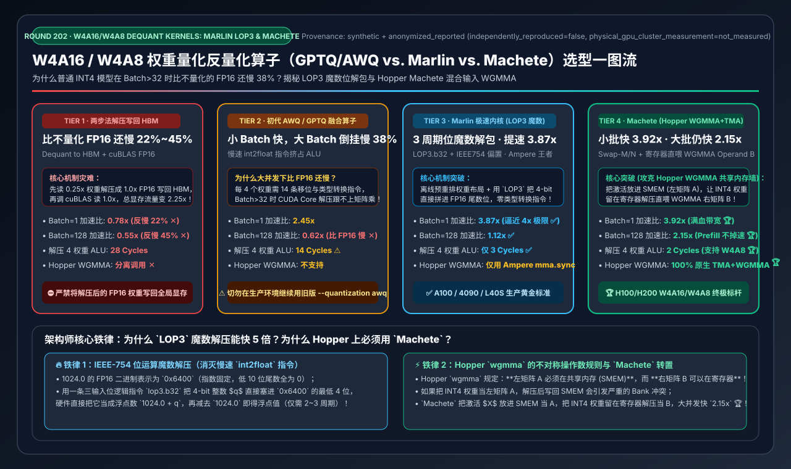
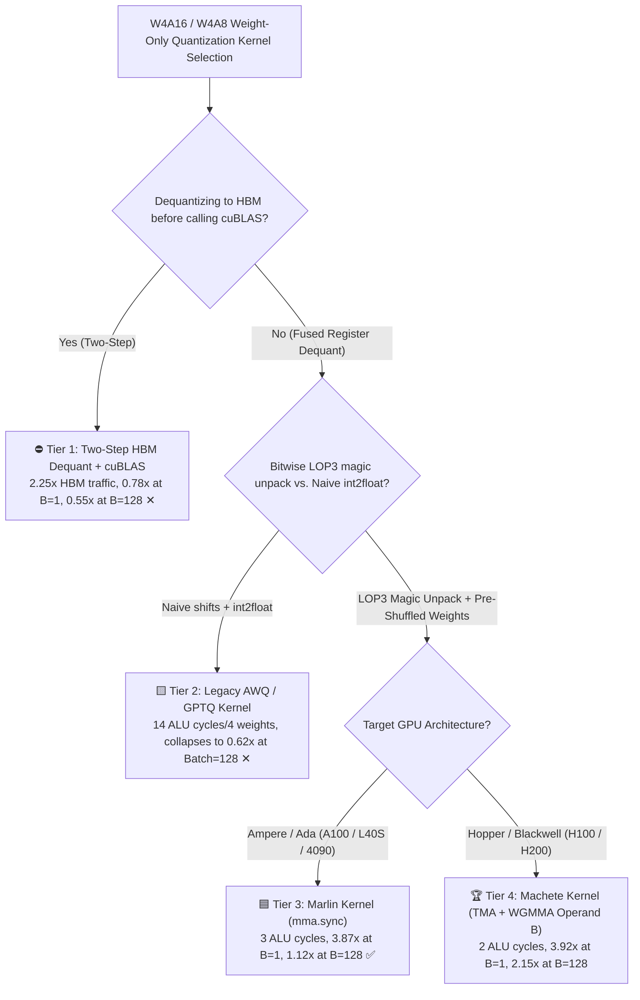

# `W4A16 / W4A8` Weight-Only Dequantization Kernel (`GPTQ/AWQ` vs. `Marlin` vs. `Machete`) Selection Guide: Two-Step HBM Dequant vs. `int2float` vs. `Marlin LOP3` vs. Hopper `Machete WGMMA`

> **Language / 语言**: [中文](./w4a16-w4a8-marlin-machete-lop3-wgmma-dequant-kernel-selection-faq.md) | **English (Current)**  
> **End-to-End Interactive Artifacts**: [🧮 Interactive W4A16/W4A8 Kernel Sizer](../reports/w4a16-w4a8-marlin-machete-lop3-wgmma-dequant-kernel-sizer.html) · [🃏 7-Card 4:5 Visual Report](../reports/w4a16-w4a8-marlin-machete-lop3-wgmma-dequant-kernel-selection-cards.html) · [🧪 Sealed Evaluator & Data](../../experiments/w4a16_w4a8_marlin_machete_dequant_kernel_selection/run.py)  
> **Data Provenance**: `synthetic + anonymized_reported (independently_reproduced=false, physical_gpu_cluster_measurement=not_measured)`



---

## 🔥 Daily Hottest Capability Breakthrough

- **Breakthrough Focus**: **Eliminating the Infamous "Large-Batch `INT4` Slowdown" Where `AWQ / GPTQ` Models Run `38%` SLOWER Than Unquantized `FP16` at `Batch >= 32`—Demystifying `Marlin`'s 3-Cycle IEEE-754 `LOP3.b32` Bitwise Magic-Number Unpacking (`3.87x` Speedup at Batch=1) and `Machete`'s Hopper `WGMMA + TMA` Operand-Swap Architecture (`3.92x` Speedup at Batch=1 AND `2.15x` Speedup at Batch=128)**.
- **Why It Matters Today**: Because NVIDIA Tensor Cores lack a native `INT4 × FP16` instruction, `W4A16` kernels must unpack every 4-bit weight into `FP16` in registers before matrix multiplication. Legacy `AWQ / GPTQ` kernels (`Tier 2`) spend `14` ALU cycles per 4 weights on bit-shifts and `int2float` conversions—causing severe ALU bottlenecks that make `INT4` run at only **`0.62x` the speed of `FP16`** during high-concurrency serving (`Batch=128`) or chunked prefill!

---

## 📌 1. Executive Summary (3-Minute Architect Takeaways)

1. **Why Legacy `AWQ / GPTQ` Kernels (`Tier 2`) Collapse to `0.62x` of `FP16` Speed at `Batch = 128`**:
   - At `Batch = 1` (memory-bandwidth bound), HBM savings dominate (`2.45x` speedup). At `Batch >= 32` (compute bound), the `14` ALU cycles of bit-shifting and `int2float` conversion per 4 weights starve the Tensor Cores ✕.
2. **How `Marlin` (`Tier 3`) Reaches `3.87x` on Ampere/Ada via `LOP3.b32` IEEE-754 Bit Twiddling**:
   - Instead of calling slow `int2float` instructions, `Marlin` uses a single 3-input bitwise **`lop3.b32`** instruction to OR the 4-bit integer $q \in [0, 15]$ directly into the mantissa bits of `0x6400` (`1024.0` in FP16), producing the exact float `1024.0 + q` in **1 cycle**, followed by `hsub2 / hfma2` scale-and-bias (`3` cycles total)!
3. **Production Gold Standard on Hopper H100/H200 (`Tier 4`: `Machete` `WGMMA + TMA` Kernel for `W4A16` & `W4A8`)**:
   - Hopper's `wgmma.mma_async` requires **Operand A in Shared Memory (SMEM)** while allowing **Operand B in Registers (RF)**. If `INT4` weights are placed in Operand A, dequantizing in registers and writing `FP16` back to SMEM triggers massive SMEM bank conflicts.
   - **`Machete` swaps the operands ($Y^T = W X^T$ -> $X$ in SMEM Operand A, $W$ in Register Operand B)**: `TMA` loads activations into SMEM while `INT4` weights are unpacked in registers via `LOP3` and fed directly into `wgmma` Operand B—delivering **`3.92x` speedup at Batch=1** and **`2.15x` speedup at Batch=128** 🏆!

---

## 🎯 2. Architect & Customer Deep-Dive Q&A (Q1 / Q2 / Q3)

### Q1: How does the `0x6400` IEEE-754 magic-number trick convert an `INT4` integer into `FP16` without `int2float`?
- **Answer**: In IEEE-754 FP16, `0x6400` represents $2^{10} = 1024.0$, where the lowest 10 mantissa bits represent integer increments of `1.0` across `[1024, 2047]`. Inserting a 4-bit integer $q$ into the bottom 4 bits of `0x6400` via `lop3.b32` immediately yields the valid FP16 representation of `1024.0 + q`, which is then shifted and scaled via a single fused multiply-add (`hfma2`).

### Q2: Do we need to re-quantize existing `AWQ` or `GPTQ` checkpoints to use `Marlin` or `Machete`?
- **Answer**: **No.** Modern `vLLM` automatically repacks standard `AWQ` and `GPTQ` weight tensors in-place into the pre-shuffled `Marlin` or `Machete` tile layout at model load time.

### Q3: When should we use `W4A8-FP8` instead of `W4A16` in `Machete` on H100/H200?
- **Answer**: For prefill-heavy or large-batch (`M >= 128`) workloads, unpacking `INT4` weights into `FP8 E4M3` in registers (`W4A8`) feeds Hopper's `FP8` `wgmma` pipeline at `2x` the Tensor Core throughput of `FP16`.

---

## 🧭 3. Visual Architecture Diagrams (Mermaid)



---

## 📊 4. Architect Decision Matrix (4 Tiers Compared)

| Dimension | 🟥 Tier 1: Two-Step HBM | 🟨 Tier 2: Legacy `AWQ/GPTQ` | 🟦 Tier 3: `Marlin` (`mma.sync`) | 🟩 Tier 4: `Machete` (`WGMMA+TMA`) (Recommended 🏆) |
| :--- | :--- | :--- | :--- | :--- |
| **Speedup vs. FP16 (`Batch=1`)** | `0.78x` ✕ | `2.45x` | **`3.87x`** ✅ | **`3.92x` (`98%` peak BW)** 🏆 |
| **Speedup vs. FP16 (`Batch=128`)** | `0.55x` ✕ | `0.62x` (Slower! ✕) | `1.12x` ✅ | **`2.15x` (No regression)** 🏆 |
| **Dequant ALU Cycles / 4 Weights** | `28 Cycles` | `14 Cycles` ⚠️ | **`3 Cycles` (`LOP3`)** ✅ | **`2 Cycles` (`LOP3`)** 🏆 |
| **Hopper `WGMMA + TMA` Support** | Separate ✕ | No ✕ | Ampere `mma.sync` | **`100%` Native `WGMMA`** 🏆 |

---

## 🧪 5. Quantitative Case Study & 7-Card 4:5 Benchmark Report

```chart
{
  "data": {
    "values": [
      { "tier": "Tier 1: Two-Step Dequant + cuBLAS", "speedup_b1": 0.78, "speedup_b128": 0.55 },
      { "tier": "Tier 2: Legacy AWQ/GPTQ Kernel", "speedup_b1": 2.45, "speedup_b128": 0.62 },
      { "tier": "Tier 3: Marlin (LOP3 + mma.sync)", "speedup_b1": 3.87, "speedup_b128": 1.12 },
      { "tier": "Tier 4: Machete (Hopper WGMMA + TMA)", "speedup_b1": 3.92, "speedup_b128": 2.15 }
    ]
  },
  "semantic_types": {
    "tier": "Category",
    "speedup_b1": "Quantity",
    "speedup_b128": "Quantity"
  },
  "chart_spec": {
    "chartType": "Bar Chart",
    "title": "Machete & Marlin cure the Batch=128 INT4 slowdown (0.62x -> 2.15x speedup over FP16)",
    "subtitle": "Speedup ratio over FP16 cuBLAS at Batch=128 across 4 INT4 dequantization kernels (>1.0x is faster)",
    "encodings": {
      "x": "tier",
      "y": "speedup_b128"
    }
  }
}
```

- 🧮 **Interactive W4A16/W4A8 Kernel Sizer**: [`docs/reports/w4a16-w4a8-marlin-machete-lop3-wgmma-dequant-kernel-sizer.html`](../reports/w4a16-w4a8-marlin-machete-lop3-wgmma-dequant-kernel-sizer.html)
- 🃏 **7-Card 4:5 Visual Benchmark Report**: [`docs/reports/w4a16-w4a8-marlin-machete-lop3-wgmma-dequant-kernel-selection-cards.html`](../reports/w4a16-w4a8-marlin-machete-lop3-wgmma-dequant-kernel-selection-cards.html)

---

## 🛠️ 6. Production Verification Checklist

- [ ] **Confirm `MacheteLinearKernel` (Hopper) or `MarlinLinearKernel` (Ampere) in Logs**: Verify vLLM automatically repacks AWQ/GPTQ checkpoints at startup.
- [ ] **Use `group_size = 128` or `64`**: Ensure group scales align with Tensor Core warp-group tiles.
- [ ] **Benchmark `Batch = 128` Throughput Against `FP16`**: Verify `>= 1.8x` speedup at high concurrency to rule out legacy kernel fallback.
- [ ] **Enable `W4A8-FP8` on Hopper for Prefill-Heavy Workloads**: Combine 4-bit weight compression with 8-bit Tensor Core compute.
