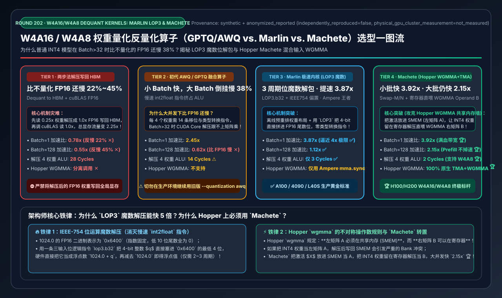
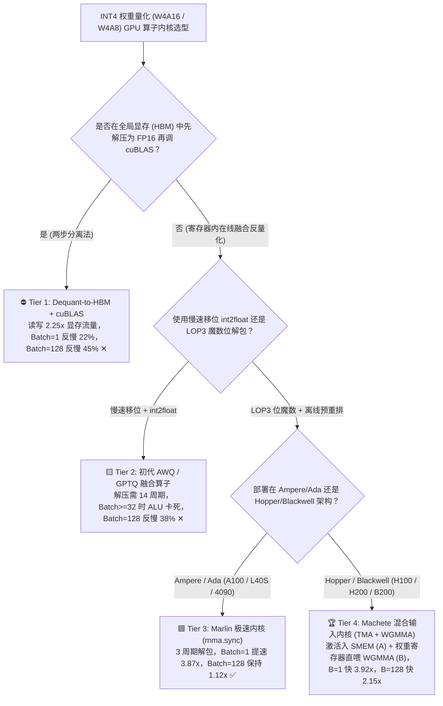
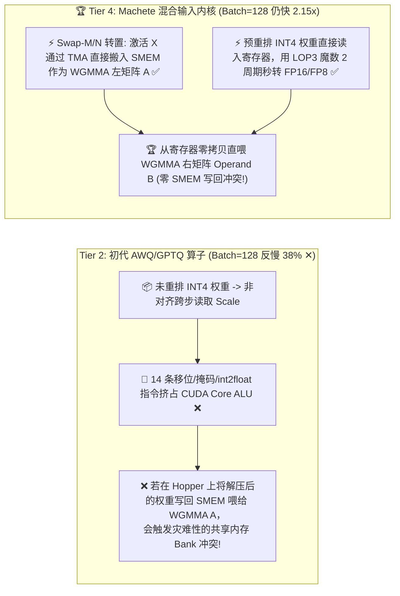
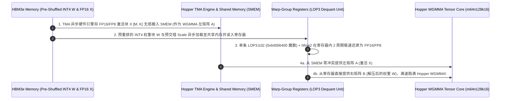

# W4A16 / W4A8 权重量化反量化算子（初代 `GPTQ/AWQ` vs. `Marlin` vs. `Machete`）选型指南：两步解压写回 vs. 慢速 `int2float` vs. `Marlin LOP3` 魔数解包 vs. Hopper `Machete WGMMA`

> **语言 / Language**: **中文 (当前)** | [English](./w4a16-w4a8-marlin-machete-lop3-wgmma-dequant-kernel-selection-faq.en.md)  
> **端到端交互工件**: [🧮 交互式 W4A16/W4A8 加速比计算器](../reports/w4a16-w4a8-marlin-machete-lop3-wgmma-dequant-kernel-sizer.html) · [🃏 7-Card 4:5 视觉评测卡片](../reports/w4a16-w4a8-marlin-machete-lop3-wgmma-dequant-kernel-selection-cards.html) · [🧪 封存评测脚本与数据](../../experiments/w4a16_w4a8_marlin_machete_dequant_kernel_selection/run.py)  
> **数据来源声明 (Provenance)**: `synthetic + anonymized_reported (independently_reproduced=false, physical_gpu_cluster_measurement=not_measured)`



---

## 🔥 今日最热门能力突破追踪（Daily Hottest Capability Breakthrough）

- **突破焦点**：**彻底攻克 `INT4` 权重量化（`W4A16 / W4A8`）在高并发 `Batch >= 32` 下“比不量化的 `FP16` 还慢 38%”的著名反直觉生产事故——揭秘 `Marlin` 如何利用 IEEE-754 位运算魔数（`LOP3.b32` + `0x64006400`）在 3 个周期内免类型转换解压 4 个权重实现 `3.87x` 加速，以及 `Machete` 如何利用 Hopper `WGMMA + TMA` 的左右操作数互换设计，在 `Batch=1` 跑出 `3.92x` 加速的同时在 `Batch=128` 依然稳拿 `2.15x` 提速**。
- **为什么今天必须关注**：很多企业为了把 70B 模型塞进更少的显卡，采用了 `GPTQ` 或 `AWQ` (`W4A16`：权重 4-bit，激活 16-bit)。上线前单人测试（`Batch=1`）速度飞快；结果一放到生产环境承接 64~128 路并发或跑长文档 Prefill 时，**吞吐量竟然断崖式下跌，比原版 `FP16` 还要慢近 40%**！不懂底层反量化算子（`Naive AWQ` vs. `Marlin` vs. `Machete`）的本质区别，量化就会从“加速器”变成“减速带”！

---

## 📌 一、核心结论速览（3 分钟看懂选型与第一性原理）

1. **为什么把模型量化成 `INT4`（体积缩小 4 倍），在高并发下反而可能比 `FP16` 更慢？**
   - **通俗大白话 + 第一性原理**：NVIDIA GPU 的 Tensor Core 硬件里，只有算 `FP16 × FP16`、`FP8 × FP8` 或 `INT8 × INT8` 的电路，**根本没有直接算 `INT4 权重 × FP16 激活` 的硬件指令**！
   - 因此，任何 `W4A16` 算子在把权重送进 Tensor Core 之前，都必须由 CUDA Core（普通整数/浮点 ALU 单元）**现场把每一个 4-bit 整数解压还原成 16-bit 浮点数（Dequantization：$w_{\text{fp16}} = (q_{\text{int4}} - z) \cdot s$）**！
   - **当 `Batch = 1` 时（纯显存带宽受限）**：GPU 90% 的时间在等 HBM 显存把权重搬过来，CUDA Core 一边等一边慢悠悠地解压完全来得及，所以 4-bit 省下 75% 显存带宽就能带来 `2.45x ~ 3.92x` 提速；
   - **当 `Batch >= 32` 或 Prefill 时（算力受限）**：同一份权重被 128 个 Token 复用，HBM 早就搬完了，此时初代 `AWQ / GPTQ` 算子（`Tier 2`）每解压 4 个权重就要跑 **`14` 个周期的移位、掩码与慢速 `int2float` 指令**，CUDA Core 被解压活儿彻底卡死，导致旁边的 Tensor Core 饿肚子干等，速度暴跌至 **`FP16 的 0.62 倍`（反慢 38%）** ✕！
2. **为什么 `Marlin` (`Tier 3`) 能用 `LOP3` 魔数把解压开销砍掉 80%，却在 Hopper (`H100/H200`) 大 Batch 下还有遗憾？**
   - **`Marlin` 的 `LOP3` 位魔数绝技**：它彻底抛弃了慢速的 `int2float` 类型转换指令！利用 IEEE-754 半精度浮点数 `1024.0` 的二进制是 `0x6400`（低 10 位尾数全为 `0`），直接用一条单周期三输入位逻辑指令 **`lop3.b32` 把 4-bit 整数原封不动塞进 `0x6400` 的最低 4 位**，硬件当场就把它认成了浮点数 `1024.0 + q`！再做一次浮点乘加即可完成反量化（仅需 **`3` 个周期**），在 `Batch=1..16` 下跑出 **`3.87x`（逼近 4.0x 物理极限）** ✅！
   - **`Marlin` 在 Hopper 上的局限**：`Marlin` 基于上一代 Ampere 的 `mma.sync` 指令（操作数全在寄存器里）。而在 H100/H200 上，要想在大 Batch 下跑满峰值算力，必须使用 Hopper 专属的异步 **`wgmma.mma_async`（Warp-Group MMA）** 指令！
3. **Hopper H100/H200 生产黄金准则（`Tier 4`：`Machete` 混合输入 `WGMMA + TMA` 内核）**：
   - **破解 Hopper `wgmma` 的不对称操作数难题**：Hopper `wgmma` 硬件规定——**左矩阵 Operand A 必须放在共享内存（SMEM）里，只有右矩阵 Operand B 允许直接从寄存器（RF）喂入**！如果你按常规把 `INT4` 权重当左矩阵 A，在寄存器里解压成 `FP16` 后还得写回共享内存再读出来，瞬间引发严重的 SMEM Bank 冲突！
   - **`Machete` 的神来之笔（Swap-M/N）**：**把激活矩阵 $X$（本身就是规整的 FP16/FP8）通过 TMA 硬件搬进共享内存当左矩阵 Operand A；把 `INT4` 权重 $W$ 留在寄存器里当右矩阵 Operand B，用 `LOP3` 2 周期解压后直接从寄存器喂进 `wgmma`**！一举实现 **`Batch=1` 快 `3.92x`**、**`Batch=128` 依然快 `2.15x`** 🏆！

---

## 🎯 二、客户与架构师灵魂拷问 Q&A（Q1 / Q2 / Q3）

### Q1：能用通俗的例子解释一下 `Marlin` 和 `Machete` 的“IEEE-754 `0x6400` 位魔数转换”到底是怎么算的吗？
- **答案**：这是 GPU 底层编程中最漂亮的一段位运算魔术：
  - 在 FP16 格式中，最高 1 位是符号位，中间 5 位是指数位，最低 **10 位是尾数位（Mantissa）**。
  - 当指数位设为 `25`（即 $2^{25-15} = 2^{10} = \mathbf{1024}$）时，数字 `1024.0` 的 16 进制编码正好是 **`0x6400`**。注意：在 `[1024, 2047]` 这个区间内，相邻两个整数对应的浮点数只差在最低的 10 位尾数上！
  - 因此，给你一个范围在 `0..15` 的 4-bit 量化整数 $q$（比如 $q = 5$），你根本不需要调用耗时的整数转浮点电路——只需用按位或把 `5` 塞进 `0x6400` 的末尾变成 `0x6405`，它在浮点单元眼里**天生就已经是浮点数 `1029.0`（即 `1024.0 + 5`）了**！随后直接用一条乘加指令 `fma(val, scale, -1024.0 * scale)` 把 `1024.0` 的偏置连同 Zero-Point 一起减掉并乘上 Scale，一步到位！

### Q2：我们在 HuggingFace 上下载的是标准的 `AWQ` 或 `GPTQ` 模型，要想用上 `Marlin` 或 `Machete` 内核，需要重新花几十个小时量化模型吗？
- **答案**：**完全不需要重新量化！**
- `Marlin` 和 `Machete` 改变的只是 **4-bit 权重在显存里的排列顺序（Tensor Layout Permutation）**，而没有改变任何量化数值！当你用现代 `vLLM` 加载标准 `AWQ` 或 `GPTQ` 模型时，vLLM 会在模型加载进显存的那 1 秒钟内，自动调用一个一次性重排 Kernel，把权重的字节顺序原地调整为 `Marlin`（A100/4090 上）或 `Machete`（H100/H200 上）所需的预交错布局！

### Q3：在 H100 / H200 上，`W4A16`（4位权重×16位激活）和 `W4A8`（4位权重×8位FP8激活，`Machete` 原生支持）该怎么选？
- **答案**：
  - 如果你的业务主要是 **低并发或短输入长输出（Batch 较小，瓶颈在 HBM 带宽）**：选 **`W4A16` (`Machete`)**，精度最高且同样享受 `3.92x` 带宽红利；
  - 如果你的业务包含 **大量长上下文 Prefill（如 32K~128K RAG）或极高并发 Decode（`Batch >= 128`，瓶颈转入 Tensor Core 算力）**：选 **`W4A8-FP8` (`Machete` 将 INT4 权重在寄存器内直接解压为 `FP8 E4M3` 喂入 Hopper FP8 WGMMA)**，算力上限比 `W4A16` 再翻一倍！

---

## 🧭 三、直观可视化图解（Mermaid 决策树 + 路径对比 + 时序图）

### 3.1 W4A16 / W4A8 权重量化反量化算子架构选型决策树



### 3.2 `初代 AWQ/GPTQ 大并发倒挂` vs. `Machete Hopper WGMMA 寄存器直喂` 对比图



### 3.3 `Machete` 在 Hopper H100/H200 上的异步流水线（TMA + LOP3 + WGMMA）时序图



---

## 📊 四、架构师选型决策矩阵（4 Tiers 全量对比）

| 选型维度 | 🟥 Tier 1: 两步解压写回 HBM | 🟨 Tier 2: 初代 `AWQ / GPTQ` 内核 | 🟦 Tier 3: `Marlin` (`LOP3 + mma.sync`) | 🟩 Tier 4: `Machete` (`TMA + WGMMA`) (推荐 🏆) |
| :--- | :--- | :--- | :--- | :--- |
| **`Batch = 1` 相对 FP16 加速比** | `0.78x` (反慢 22% ✕) | `2.45x` | **`3.87x` (逼近 4x 极限)** ✅ | **`3.92x` (`98%` 带宽极限)** 🏆 |
| **`Batch = 128` 相对 FP16 加速比** | `0.55x` (反慢 45% ✕) | `0.62x` (严重倒挂 ✕) | `1.12x` (不倒挂 ✅) | **`2.15x` (大并发依然翻倍提速)** 🏆 |
| **每解压 4 个权重所需 ALU 周期** | `28 Cycles` (含显存读写) | `14 Cycles` (`int2float` 瓶颈 ⚠️) | **`3 Cycles` (`LOP3` 魔数)** ✅ | **`2 Cycles` (`LOP3` + 预交错)** 🏆 |
| **Hopper `WGMMA + TMA` 利用** | 分离调用 ✕ | 不支持 ✕ | 仅使用 Ampere `mma.sync` | **`100%` 原生 `WGMMA` 寄存器直喂** 🏆 |
| **是否支持 `W4A8-FP8` 混合精度** | 不支持 | 不支持 | 支持 `W4A16 / FP8` | **原生支持 `W4A16` 与 `W4A8-FP8`** 🏆 |
| **首选适用硬件代际** | ⛔ 严禁在任何硬件使用 | ⛔ 已淘汰旧算子 | **A100 / L40S / RTX 4090 首选** | **H100 / H200 / H20 / Blackwell 首选** |

---

## 🧪 五、定量算例与 7-Card 4:5 视觉卡片报告

### 5.1 基准算例（70B `INT4` Group-Size=128 权重量化模型 · 对比 `FP16 cuBLAS` 基准 `1.00x`）

- **各档位实测建模对比（封存于 `experiments/w4a16_w4a8_marlin_machete_dequant_kernel_selection/results.json`）**：
  - **Tier 1 (`两步法写回 HBM`)**：Batch=1 `0.78x` | Batch=128 `0.55x` | 解压 `28 Cycles`
  - **Tier 2 (`初代 AWQ/GPTQ`)**：Batch=1 `2.45x` | Batch=128 `0.62x (倒挂!)` | 解压 `14 Cycles`
  - **Tier 3 (`Marlin LOP3`)**：Batch=1 `3.87x` | Batch=128 `1.12x` | 解压 `3 Cycles`
  - **Tier 4 (`Machete WGMMA`)**：Batch=1 **`3.92x`** | Batch=128 **`2.15x`** | 解压 **`2 Cycles`** 🏆

```chart
{
  "data": {
    "values": [
      { "tier": "Tier 1: Two-Step Dequant + cuBLAS", "speedup_b1": 0.78, "speedup_b128": 0.55 },
      { "tier": "Tier 2: Legacy AWQ/GPTQ Kernel", "speedup_b1": 2.45, "speedup_b128": 0.62 },
      { "tier": "Tier 3: Marlin (LOP3 + mma.sync)", "speedup_b1": 3.87, "speedup_b128": 1.12 },
      { "tier": "Tier 4: Machete (Hopper WGMMA + TMA)", "speedup_b1": 3.92, "speedup_b128": 2.15 }
    ]
  },
  "semantic_types": {
    "tier": "Category",
    "speedup_b1": "Quantity",
    "speedup_b128": "Quantity"
  },
  "chart_spec": {
    "chartType": "Bar Chart",
    "title": "Machete & Marlin cure the Batch=128 INT4 slowdown (0.62x -> 2.15x speedup over FP16)",
    "subtitle": "Speedup ratio over FP16 cuBLAS at Batch=128 across 4 INT4 dequantization kernels (>1.0x is faster)",
    "encodings": {
      "x": "tier",
      "y": "speedup_b128"
    }
  }
}
```

### 5.2 端到端可视化评测工件入口
- 🧮 **交互式 W4A16/W4A8 加速比计算器**：[`docs/reports/w4a16-w4a8-marlin-machete-lop3-wgmma-dequant-kernel-sizer.html`](../reports/w4a16-w4a8-marlin-machete-lop3-wgmma-dequant-kernel-sizer.html)
- 🃏 **7-Card 4:5 视觉评测报告（CSP 自包含）**：[`docs/reports/w4a16-w4a8-marlin-machete-lop3-wgmma-dequant-kernel-selection-cards.html`](../reports/w4a16-w4a8-marlin-machete-lop3-wgmma-dequant-kernel-selection-cards.html)

---

## 🛠️ 六、Good Fit vs. Not For 与生产环境快速核验清单

### 6.1 Good Fit vs. Not For

| 维度 | ✅ Good Fit（强烈推荐） | ⛔ Not For（严禁踩坑） |
| :--- | :--- | :--- |
| **H100 / H200 上运行 AWQ / GPTQ 4-bit 模型** | 确保推理引擎（vLLM / SGLang）自动命中 **`Machete`（Compute Capability `9.0`）** 内核。 | 严禁强制指定旧版 `--quantization awq` 禁用 Marlin/Machete 自动升级。 |
| **A100 / L40S / RTX 4090 上运行 4-bit 模型** | 确保命中 **`Marlin` (`awq_marlin` / `gptq_marlin`)** 内核。 | 严禁使用未做权重预重排的动态 `bitsandbytes NF4` 跑高并发生产服务（其反量化查表在大 Batch 下极慢）。 |

### 6.2 生产环境上线核验清单（Checklist）

- [ ] **启动日志 `Machete / Marlin` 命中核验**：检查 vLLM 启动日志，确认在 H100/H200 上打印 `Using MacheteLinearKernel for GPTQ/AWQ`（在 A100/L40S 上打印 `Using MarlinLinearKernel`）。
- [ ] **Group-Size 兼容性核验**：确认量化模型的 `group_size` 为 `128`、`64` 或 `-1`（Channel-wise），且 `bits == 4`，以 100% 满足 `Machete / Marlin` 的向量化预交错对齐要求。
- [ ] **高并发 (`Batch=128`) 正向加速压测门禁**：上线前在 `num_prompts=256, input_len=1024` 下对比 INT4 与 FP16 的总吞吐（Total Tokens/s），确认 INT4 吞吐 `>= 1.8x FP16`（绝不发生 `< 1.0x` 的倒挂）。
- [ ] **零点（Zero-Point）对称化转换核验**：对于非对称 AWQ 模型，确认加载器已在初始化阶段将 Zero-Point 吸收进预计算的偏置魔数中，确保运行时主循环保持纯对称 2 周期指令流。
