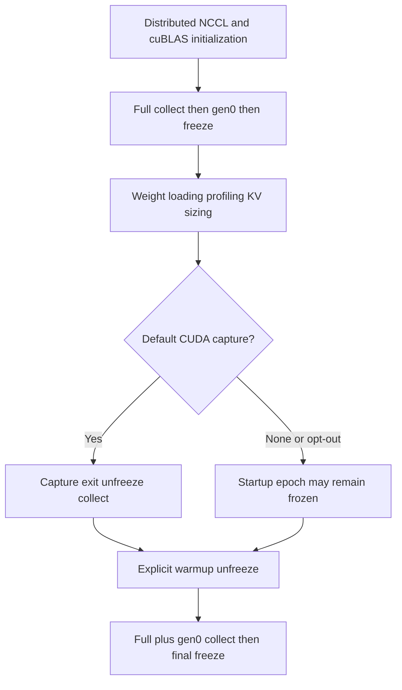
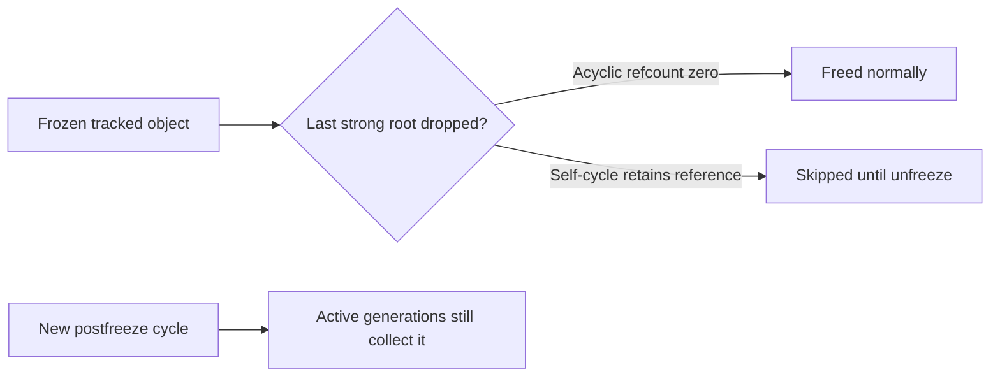
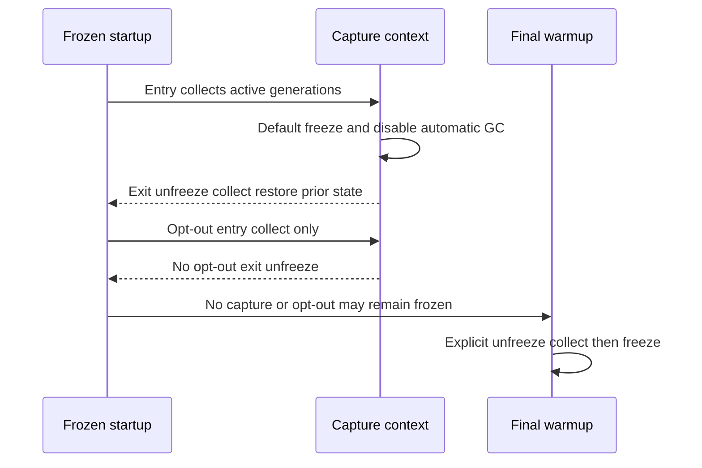

# Worker startup FAQ:GC freeze epochs,reference counting and warmup reset

> **Language**:English | [中文](worker-startup-gc-freeze-epochs-refcount-warmup-selection-faq.md)  
> **Round164 · actualNov14**:vLLM freezes after distributed/cuBLAS initialization,before weights/snapshot,and explicitly unfreezes/refreezes at final warmup. Original64nodes×3collections gives **modeled visits192→0,not scanner telemetry**. Isolated CPython3.12.10retains64frozen cycles after root drop,then0after unfreeze/collect.
>
> [H5](../reports/worker-startup-gc-freeze-epochs-refcount-warmup-sizer.html) · [7-Card](../reports/worker-startup-gc-freeze-epochs-refcount-warmup-selection-cards.html) · [1600pxSVG](../../assets/svg/worker-startup-gc-freeze-epochs-refcount-warmup-selection-faq-summary.svg) · [Experiment/evidence](../../experiments/gc_heap_epoch_selection/README.md)

## Q1: Why freeze during startup rather than only before serving?

Weight loading,profiling and KV sizing collections can repeatedly traverse already-static startup objects. Early freeze removes them from later cyclic scans;final warmup still prepares the final heap. It is not removal of serving-time freeze or automatic GCdisable.

Native worker placement is source-verified,not locally executed. Early freeze has startup cost;cheaper later collections do not alone establish faster overall startup.

## Q2: Does freeze make objects immutable,disable reference counting or stop all GC?

No. `gc.freeze()` puts currently tracked objects into a permanent generation ignored by later cyclic collections. Reference counting still works;freeze_heap itself does not call `gc.disable()`.

In the disposable child,64self-cycles remain alive after dropping roots/collecting,and0remain after unfreeze/collect. A frozen acyclic object is freed by refcount;new postfreeze cycles can be collected. Measured total freeze count covers **the whole child interpreter**,not only64named nodes.

## Q3: Why full collect followed by gen0 instead of 0/1/2?

Full collection cleans all generations;the following gen0pass cleans young cyclic garbage created by that collection/finalizers before freeze.

Original CPython3.12.10promotes a finalizer cycle to old generation. Its finalizer creates one new gen0cycle. Old0/1/2triggers the finalizer in the lastpass and leaves1cycle alive at freeze;full-then0leaves0. This is an original Python witness,**not native vLLM objects**;other Python generation implementations require revalidation.

## Q4: How do capture opt-out and prior automatic-GC state affect the epoch?

`VLLM_ENABLE_CUDAGRAPH_GC=1`opts out:that context does not freeze/disable or unfreeze at exit. Default exit restores the prior enabled state,including prior-disabled. Startup unfreeze happens at default capture **exit**,not entry.

The original no-capture case leaves16unreachable frozen cycles if warmup reset is omitted. Default capture may already release them,so not every configuration has the same leftover result.

## Q5: How were probes isolated,and what does timing mean?

Actual freeze runs only in disposable CLI children/independent benchmark processes. Unit tests never freeze their own runner heap. Probes record actualPython,freeze count,weakref lifetimes and finalizers;cleanup unfreezes/restores prior automatic state.

Eight tests cover epochs,capture/opt-out,prior-disabled,zero/invalid inputs,isolated cycle/refcount/finalizer behavior and65Nodeconfigs/195outcomes. The ledger does not simulate unmodeled automatic collections;`actual_gc_scanned_objects=null`.

CPU samples compare same-child frozen/unfrozen `gc.collect()` for64/256/1024/4096rooted cycles. Two warmups,seven alternating repeats,three collections/sample and median repeat means are used. Freeze/setup are excluded. The whole child heap is frozen and automatic GCdisabled only for measurement isolation,not as claimed native freeze_heap behavior.

## Q6: How should production avoid confusing Python collection with GPU release?

Verify actual early placement before weights/snapshot and mandatory reset for eager/no-capture/opt-out. Observe cyclic churn,prior automatic state,finalizer side effects and complete startup timings.

Python reachability and `torch.accelerator.empty_cache()` are distinct. Weakref release does not establish NCCL/graph/GPU memory return. Do not freeze long-term churn permanently or infer TTFT/overallstartup speed from cheaper isolated collections.

Main report is `synthetic`,`independently_reproduced=false`;CPython probes/timing separately `measured`. Native vLLM/weights/CUDA and browser acceptance remain null.

**Pinned primary evidence**:[Actualcommit](https://github.com/vllm-project/vllm/commit/449576cd736544461357e835ca74b44a993668ea) · [Worker](https://github.com/vllm-project/vllm/blob/449576cd736544461357e835ca74b44a993668ea/vllm/v1/worker/gpu_worker.py) · [GC helpers/capture](https://github.com/vllm-project/vllm/blob/449576cd736544461357e835ca74b44a993668ea/vllm/utils/gc_utils.py) · [Nativeweight-loadingtest](https://github.com/vllm-project/vllm/blob/449576cd736544461357e835ca74b44a993668ea/tests/v1/worker/test_gpu_worker.py) · [Python GC](https://docs.python.org/3.12/library/gc.html) · [Apache-2.0LICENSE](https://github.com/vllm-project/vllm/blob/449576cd736544461357e835ca74b44a993668ea/LICENSE). Rights retained;original model/probe,not an implementation mirror.
