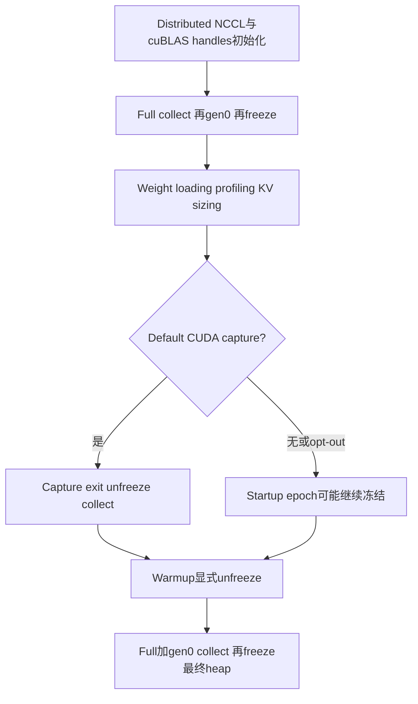
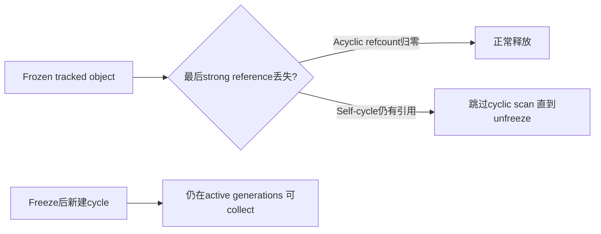
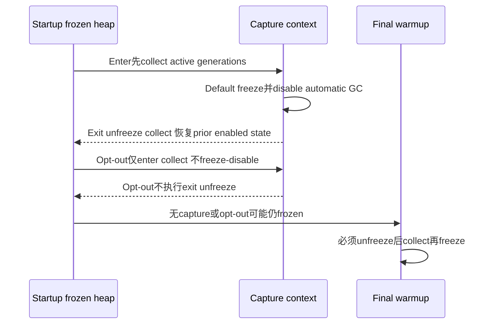

# AI Infra Worker 启动架构 FAQ：GC Freeze Epoch、Reference Counting 与 Warmup Reset

> **语言**：中文 | [English](worker-startup-gc-freeze-epochs-refcount-warmup-selection-faq.en.md)  
> **Round164 · actualNov14**：vLLM在distributed/cuBLAS初始化之后、weights与snapshot之前freeze startup heap；warmup显式unfreeze/refreeze。原创64nodes×3collections的**模型visits192→0，不是实际scanner telemetry**；独立CPython3.12.10child验证64frozen cycles仍存活，unfreeze/collect后0。
>
> [H5 epoch ledger](../reports/worker-startup-gc-freeze-epochs-refcount-warmup-sizer.html) · [7-Card](../reports/worker-startup-gc-freeze-epochs-refcount-warmup-selection-cards.html) · [1600pxSVG](../../assets/svg/worker-startup-gc-freeze-epochs-refcount-warmup-selection-faq-summary.svg) · [实验/封存证据](../../experiments/gc_heap_epoch_selection/README.md)

## Q1：为什么在startup freeze，而不是只在serving前freeze？

weight loading、memory profiling与KV sizing中的后续`gc.collect()`可能重复扫描已经形成的static startup heap。新增early freeze让后续cyclic collections跳过这些对象；final warmup再整理最终heap。它不等于把原来serving前的freeze移走，也不等于关闭GC。

本机没有vLLM/GPUworker执行；位置由固定源码核验。early freeze成本发生在startup，不能从“后续GC便宜”直接宣布整个startup更快。

## Q2：freeze会让对象immutable、refcount失效或所有GC停止吗？

不会。`gc.freeze()`把当前GC-tracked objects移到permanent generation，让后续cyclic GC忽略它们；reference counting仍正常，且freeze_heap本身不`gc.disable()`。

独立child中64原创self-cycles在dropping roots后collect仍全部alive；unfreeze/collect后0。一个frozen acyclic对象按refcount释放，freeze后新cycle也可被collect。`actual_total_freeze_count`记录的是**整个child interpreter**，大于64，不能伪装为只冻结这64nodes。

## Q3：为什么helper改为full collect再gen0，而不是0、1、2各collect一次？

新的helper先`gc.collect()`清理全部generations，再`gc.collect(0)`处理第一次collection/finalizers新创建的young cyclic garbage，最后freeze。不能只把新创建garbage一起永久冻结。

原创CPython3.12.10probe将一个有finalizer的cycle先promote到old generation；finalizer创建一个新gen0cycle。old0/1/2顺序在最后gen2触发finalizer，freeze时新cycle仍1alive；full-then0模式为0alive。**它是原创Python见证，不是nativevLLM对象复现**；不同Python版本/generation实现需重新验证。

## Q4：capture opt-out和prior automatic-GC state如何影响epoch？

`VLLM_ENABLE_CUDAGRAPH_GC=1`是opt-out，使该context不freeze/disable，也不在exit unfreeze。default exit恢复原来enabled状态：之前disabled则保持disabled，不应无条件enable。startup heap不是在defaultcapture **enter** 就unfreeze，而是在cleanup **exit**。

原创无capturecase若省略warmup `unfreeze`，16unreachable frozen cycles仍留下；正确reset清理它们。defaultcapture已提前结束epoch的case可能没有这个残留，所以不能把所有capture配置都说成同一结果。

## Q5：本机怎么隔离验证？CPython timing代表什么？

所有实际freeze操作只发生在可丢弃CLIchild或独立CLIbenchmark process；unit test runner只启动child，不freeze其自己的heap。probe记录actualPython版本、freeze count、weakref lifetimes与finalizer结果；退出前unfreeze并恢复原automatic state。

八tests覆盖epoch计数、capture/default/opt-out、prior-disabled、zero/invalid counts、独立refcount/cycle/finalizerprobe与65Nodeconfigs/195outcomes。模型不模拟未声明的automatic collection；`actual_gc_scanned_objects=null`，modelvisits不是callback测量。

CPUsamples对64/256/1024/4096rooted cycles比较同一child的frozen/unfrozen `gc.collect()`。两warmups、七交替repeats、三collects/sample，median repeat means；每次freeze/setup成本不计时。整个childheap被freeze，且为隔离measurement关闭automaticGC，不是声称nativefreeze_heap会disable。

## Q6：如何真实部署，而不把PythonGC与GPUmemory释放混为一谈？

核对early freeze位于实际worker初始化之后、weight loading/snapshot之前；保证eager/no-capture与capture opt-out也走warmup reset。监控dead cyclic objects、自动GC原状态、finalizer副作用以及真实startup阶段耗时。

`gc.collect()`主要处理Python可达性，`torch.accelerator.empty_cache()`处理缓存allocator，是不同路径；不能从weakref释放直接推断NCCL、CUDAgraphs或GPUbytes已归还。长期churn不应永久冻结，collector更便宜不意味着总startup或TTFT更好。

主report为`synthetic`,`independently_reproduced=false`；独立CPythonprobe/timing为`measured`，nativevLLM/weights/CUDA及browser验收null。

**固定一手证据**：[actualcommit](https://github.com/vllm-project/vllm/commit/449576cd736544461357e835ca74b44a993668ea) · [worker lifecycle](https://github.com/vllm-project/vllm/blob/449576cd736544461357e835ca74b44a993668ea/vllm/v1/worker/gpu_worker.py) · [GC helpers/capture](https://github.com/vllm-project/vllm/blob/449576cd736544461357e835ca74b44a993668ea/vllm/utils/gc_utils.py) · [nativeweight-loadingtest](https://github.com/vllm-project/vllm/blob/449576cd736544461357e835ca74b44a993668ea/tests/v1/worker/test_gpu_worker.py) · [Python gc reference](https://docs.python.org/3.12/library/gc.html) · [Apache-2.0LICENSE](https://github.com/vllm-project/vllm/blob/449576cd736544461357e835ca74b44a993668ea/LICENSE)。权利保留，原创model/probe而非实现镜像。
