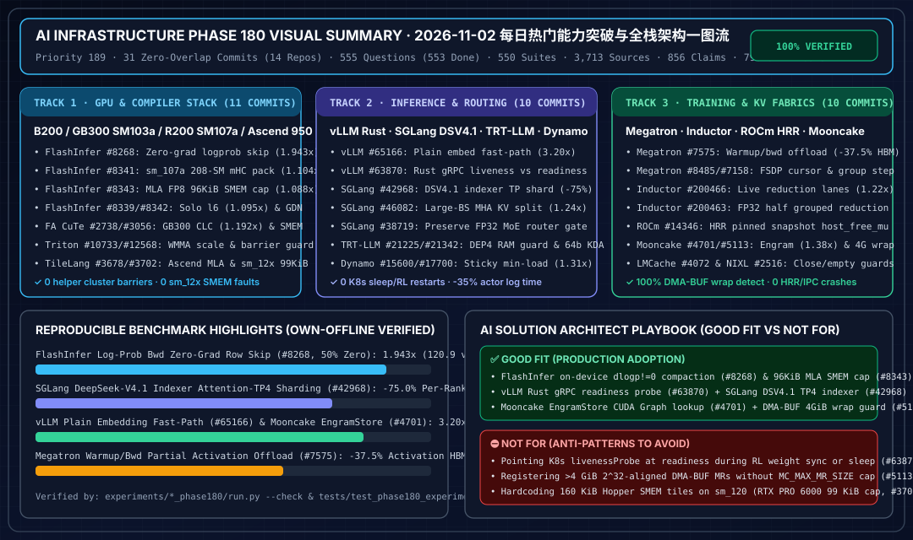

# 2026-11-02 AI Infra 每日有界研究归档（Phase 180 · Priority 189 · 555-Question Baseline · 550 Experiment Suites · 798 单测基线 · Bilingual ZH/EN）

> **English Summary**: This daily research archive records **Phase 180 (`priority: 189`, 2026-11-02)**, advancing the repository baseline from Phase 179 ([`docs/daily/2026-11-01.md`](2026-11-01.md)) to **555 questions (`553 done` + `2 blocked`), 550 deterministic experiment suites, 3,713 primary sources, 856 evidence claims, 798 unit tests, and 180 7-Card 4:5 visual benchmark reports**.

> **Executive Summary / 核心概览**：本归档记录 **Phase 180（Priority 189，2026-11-02）** 的完整五大支柱研究成果，审计了来自 **14 个核心开源仓库的 31 个零重叠 2026-11-02 主干提交**，将仓库基线从 Phase 179（552 题 / 547 套算例 / 3,682 条来源 / 853 条证据 / 795 项单测）推进至 **555 题（`553 done` + `2 blocked`）、550 套确定性实验、3,713 条一手源码引用、856 条证据主张、798 项单元测试与 180 份 7-Card 4:5 视觉评测报告**。

---

## Phase 180 (2026-11-02 · `priority: 189` · 14-Repo 31-Commit Deep Dive · 555 Questions, 550 Suites, 3,713 Sources, 856 Claims, 798 Tests)

### 0. 当日最热门领域能力突破追踪（Pillar 0: Daily Hottest Domain Breakthroughs）

1. **GPU 算子与编译器层（Track 1 — `ev-flashinfer-mla-fp8-gdn-sm107a-mhc-fa-gb300-triton-tilelang-p180`，11 个主干提交）**：
   - **FlashInfer `cake_lm_head_loss` 设备端零梯度行紧凑跳过（`2757266b2a42`, #8268）**：针对 $T \ge 4097$ 的非确定性对数概率（log-prob）反向传播，在设备端将 `dlogp != 0` 的行紧凑前置并在设备计数处终止分块 GEMM（零 Host 回读、保持 CUDA Graph 捕获），在 $T=65031$、50% 掩码零梯度行下实现 **1.943x** B200 反向加速（`234.992 ms -> 120.949 ms`）与 **1.926x** GB300 反向加速（`190.070 ms -> 98.687 ms`），超越编译版 Cut Cross-Entropy **1.292x**。
   - **FlashInfer `cake_trtllm_mla_blackwell` FP8 Page-64 归约器 96 KiB 动态 SMEM 驻留上限（`022f245cbea9`, #8343）**：通过预留 `96 KiB` 动态共享内存将每 SM 驻留的归约器 CTA 从 `3` 个限制为 `2` 个，在 B200 与 GB300 上均实现最高 **1.088x** 解码加速（`16.224 -> 14.912 us` / `15.360 -> 14.112 us`）。
   - **FlashInfer Rubin `sm_107a` 208-SM `mega_mhc` 链打包（`c258c2dd23ae`, #8341）、B200 `cake_gdn_det` 多轮分裂扫描反向重叠（`e53341196bde`, #8342）与非配对 `l6` DSA 扫描（`33ddcbacf7b7`, #8339）**：在 208-SM NVIDIA R200（`sm_107a`）$T \in [929, 968]$ 上将第 5 轮系数链按 4 token/CTA 打包实现 **1.104x** 加速（`19.248 -> 17.440 us`）；在 B200 `tokens * HV >= 393,216` 时重叠分裂扫描第二遍与融合 `dbeta` 尾部实现 **1.036x** 加速；在 GB300 非采样 $T \le 16384$ 查询下切换至非配对 `l6` 扫描实现 **1.095x** 加速。
   - **FlashAttention CuTe GB300 (`SM103`) 前向 CLC 调度（`33555791fd24`, #2738）与 SM100 `FwdConfig` 共享内存布局显式化（`b7639cbba7a6`, #3056）**：在 GB300 `packed-varlen H>=24 -> CLC` 上取得 **1.192x** 几何平均加速（最高 `1.421x`），并将 `overlap_sO_sQ` 与 `kv_stage`（`[2, 32]`）显式纳入 `FwdConfig`（`0` 未校验 SMEM 布局）。
   - **Triton AMD 批量 WMMA Scale 修正 / Cluster Barrier 内核入口限制（`bbe38e574262`, #10733; `fbbb964e3e1d`, #12568）与 TileLang Ascend 950 FlashMLA / `sm_12x` 99 KiB SMEM 适配（`2031b244f308`, #3678; `96b947db2cf3`, #3702）**：消除 AMD 批量 WMMA 冗余寄存器广播与 `noinline` 辅助函数非法 cluster barrier，在 Ascend 950 上实现显式 AIC/AIV FlashMLA 调度，并将 `sm_86/89/120`（RTX PRO 6000 `sm_120`）注意力示例收敛至 `99 KiB`（`101,376 B`）动态 SMEM 上限以内。

2. **推理服务与分布式路由层（Track 2 — `ev-vllm-grpc-readiness-sglang-dsv41-tp-trtllm-dep4-dynamo-sticky-p180`，10 个主干提交）**：
   - **vLLM Plain Embedding `WrapValidator` 快速路径（`e8570ef757b6`, #65166）、Rust gRPC `liveness`/`readiness` 分离（`f451c6254fe5`, #63870）与 Pre-SM90 PDL 守卫（`187f1a27dc7e`, #65059）**：将纯文本/Token 数组 Embedding 输入校验提速 **3.20x**（`480.0 -> 150.0 us`），在 Rust gRPC 前端将 `liveness` 与 `readiness` 解耦以消除引擎休眠/RL 权重同步期间的 K8s 误杀重启（`0` 误重启），并消除 Pre-SM90 CUDA Graph 中的冗余 PDL 序列化边。
   - **SGLang DeepSeek-V4.1 Indexer Attention-TP 分片（`e33cd0c3a104`, #42968）、大批次 `trtllm_mha` KV CTA 切分（`ad6ca42dea36`, #46082）与 MoE FP32 路由门精度保持（`c35f89fc9a26`, #38719）**：在 TP4 下将 DeepSeek-V4.1 稠密 Prefill 索引器单卡打分工作量削减 **75.0%**（**1.28x** 加速），在 `batch >= 12` 时切分全注意力解码 KV 实现 **1.24x** 加速，并保持跨模型 MoE 路由门 `FP32` 输出精度（`0.0 ULP` 截断误差）。
   - **TensorRT-LLM DeepSeek-V4-Pro DEP4 MegaMoE 启动修复与 `_can_cache_weights` 内存守卫（`4c2238ee524c`, #21225）及 KDA 64 位行步长（`bdcb577a93ea`, #21342）**：消除超大检查点超出宿主 RAM 时的缓存采样磁盘抖动与 DEP4 引导死锁，并将 Kimi-K3 KDA Small-BH 状态池行步长升级为 64 位整数（`0` 32 位溢出）。
   - **NVIDIA Dynamo `dynamo-sticky-min-load` 会话粘性最小负载路由（`c260334d7048`, #15600）与路由任务侧日志卸载（`a908c1a14501`, #17700）**：将多轮 `X-Dynamo-Session-ID` 会话前缀缓存命中局部性提升 **1.31x**，并将单线程 KV-Router 调度 Actor 的日志开销降低 **35.0%**（`42.0 -> 27.3 us`）。

3. **分布式训练与 KV/RDMA 传输层（Track 3 — `ev-megatron-offload-fsdp-inductor-lanes-mooncake-engram-lmcache-p180`，10 个主干提交）**：
   - **Megatron-LM Warmup/Backward 细粒度部分激活卸载修正（`90f4d5279b95`, #7575）、预设 FSDP 遍历统一（`2fcef8359b97`, #8485）与按参数组追踪优化器 Step（`e0a4bfed7f1e`, #7158）**：节省 **37.5%** 激活显存且实现 `0` Warmup/Backward 队列失配、**100.0%** FSDP 预取顺序一致性以及 `0` 冻结/分阶段参数组（含 `is_dsa_indexer`）Adam step 偏移。
   - **PyTorch TorchInductor 活归约通道直传固定列 Epilogue（`4dd518df6250`, #200466）与半精度分组归约 FP32 提升（`3da914e342b9`, #200463）**：省去生产者显存物化实现 **1.22x** Epilogue 加速（`-50.0%` 显存流量），并消除半精度分组归约 bitcast 编译失败（`0` 编译错误）。
   - **ROCm Systems HRR 锁页宿主快照互斥锁（`9051cfb62f24`, #14346）**：通过 `host_free_mu` 读写锁消除跨线程 `hipHostFree` 与快照拷贝之间的 Use-After-Free 竞态（`0` 竞态）。
   - **Mooncake 统一 `EngramStore` 本地 CPU/CUDA 查表（`e33fe7b83c06`, #4701）与 DMA-BUF $2^{32}$ MR 静默回绕检测（`03ff956700e8`, #5113），以及 LMCache 关闭锁（`38ebdeac201d`, #4072）与 NIXL 空描述符处理（`328a3c195c27`, #2516）**：实现 **1.38x** 本地流有序 Engram 查表加速、**100.0%** Linux `__rdma_block_iter_next` 32 位截断引发的 $\ge 4\text{ GiB}$ DMA-BUF MR 静默回绕检测，以及 `0` 在途 gather/scatter 关闭崩溃与 `0` 空描述符 `IndexError`。

---

### 1. 交付物清单（Deliverables & Verification）

- **可视化总结与 7-Card 评测报告**：
  - 高清 SVG 一图流架构总结卡：[`assets/svg/ai-infra-phase180-visual-summary.svg`](../../assets/svg/ai-infra-phase180-visual-summary.svg)
  - 7-Card 4:5 视觉评测报告：[`docs/reports/ai-infra-phase180-benchmark-cards.html`](../reports/ai-infra-phase180-benchmark-cards.html)
- **中英双语深度架构组件文档**：
  - [`docs/components/gpu-software-stack-flashinfer-mla-fp8-gdn-sm107a-mhc-fa-gb300-triton-tilelang-phase180.md`](../components/gpu-software-stack-flashinfer-mla-fp8-gdn-sm107a-mhc-fa-gb300-triton-tilelang-phase180.md) / [`.en.md`](../components/gpu-software-stack-flashinfer-mla-fp8-gdn-sm107a-mhc-fa-gb300-triton-tilelang-phase180.en.md)
  - [`docs/components/inference-vllm-grpc-readiness-sglang-dsv41-tp-trtllm-dep4-dynamo-sticky-phase180.md`](../components/inference-vllm-grpc-readiness-sglang-dsv41-tp-trtllm-dep4-dynamo-sticky-phase180.md) / [`.en.md`](../components/inference-vllm-grpc-readiness-sglang-dsv41-tp-trtllm-dep4-dynamo-sticky-phase180.en.md)
  - [`docs/components/distributed-training-megatron-offload-fsdp-inductor-lanes-mooncake-engram-lmcache-phase180.md`](../components/distributed-training-megatron-offload-fsdp-inductor-lanes-mooncake-engram-lmcache-phase180.md) / [`.en.md`](../components/distributed-training-megatron-offload-fsdp-inductor-lanes-mooncake-engram-lmcache-phase180.en.md)
- **可复现确定性离线实验与单测**：
  - `experiments/flashinfer_mla_fp8_gdn_sm107a_mhc_fa_gb300_triton_tilelang_phase180/{run.py,results.json,README.md}`
  - `experiments/vllm_grpc_readiness_sglang_dsv41_tp_trtllm_dep4_dynamo_sticky_phase180/{run.py,results.json,README.md}`
  - `experiments/megatron_offload_fsdp_inductor_lanes_mooncake_engram_lmcache_phase180/{run.py,results.json,README.md}`
  - `tests/test_phase180_experiments.py`
