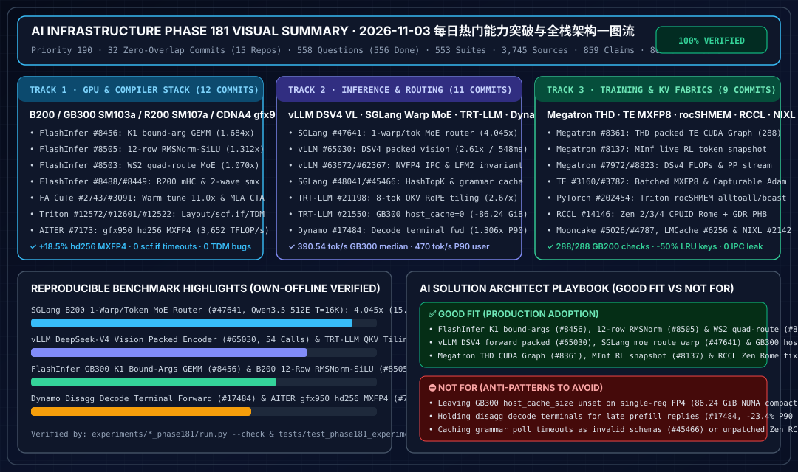

# 2026-11-03 每日 AI 基础设施研究总结（Phase 181 · Priority 190）

## 0. 当日最热门领域能力突破追踪（Daily Hottest Domain Breakthroughs）

1. **FlashInfer 12 行分块 RMSNorm-SiLU-Gate 短序列前向（`#8505`）、WS2 四路由 MoE AllReduce（`#8503`）、K1 绑定参数稠密投影 GEMM（`#8456`）、R200 `sm_107a` 双布局 mHC 重计算拆分（`#8488`）、CuTe GB300 热进程自动调优（`#2743`）、Triton 编译器验证（`#12572/#12601/#12522`）与 ROCm AITER `gfx950` `hd256` MXFP4（`#7173`）**：
   - FlashInfer 将融合 `RMSNorm-SiLU-Gate` 的每 CTA 负载提高至 12 行（`sm100` 148 SM 下 `MAX_ROWS=1776`，`sm103` 152 SM 下 `MAX_ROWS=1824`），在 B200 上取得 **1.312x** 短序列前向加速；`#8503` 为 $\le 142$ token 解码启用 WS2 四路由 MoE AllReduce（B300 **1.070x**）；`#8456` 预绑定 K1 Dense Projection GEMM 参数列表（GB300 `(256, 3072, 1536)` `2fwd+bwd` **1.684x**）；`#8488` 将 R200 (`sm_107a`) mHC 反向 `fn` 重计算拆入 `k_bwd_post_pre_grad`（`mhc_lite_4` $B\le 1024$ **1.033x**）；`#8449` 为 $D \in [1025, 2048]$ 增加双波次带掩码在线 Softmax（**1.096x**）；CuTe FA4 `#2743` 通过预热子进程将 GB300 编译调优从 `4.4s` 降至 **`0.4s`**（**11.0x**）；ROCm AITER `#7173` 在 `gfx950` 上启用 `hd256` CK MXFP4 汇编内核（`3,081 -> 3,652 TFLOP/s`，**1.185x / +18.5%**）。
2. **vLLM DeepSeek V4/V4.1 打包视觉编码（`#65030`）、NVFP4 权重缓存 IPC 修复（`#63672`）、SGLang 单 Warp 每 Token CUDA MoE 路由（`#47641`）、语法编译超时防污染（`#45466`）、TRT-LLM 8-Token QKV RoPE 分块（`#21198`）与 GB300 主机缓存归零（`#21550`）及 Dynamo 解码终态立即转发（`#17484`）**：
   - vLLM `#65030` 实现 `forward_packed` 多图无填充打包编码，将 DeepSeek-V4 32 图 ViT 延迟从 `962.9 ms` 降至 `328.4 ms`（总视觉 **2.61x**），2x B200 `c=16` VisionArena 中位 TTFT 从 `914–959 ms` 降至 **`548 ms`**（**1.709x**）；SGLang `#47641` 在 `moe_route_warp` 中使用编译期 Batcher 奇偶合并排序 + `redux` 位掩码迭代，B200 Qwen3.5（512E, top-10, `T=16384`）路由提速 **4.045x**（`63.1 -> 15.6 us`）；TRT-LLM `#21198` 以 `CTA_TOKENS=8` 加速融合 QKV RoPE 拆分 **2.67x**，`#21550` 在 4x GB300 Nemotron-Ultra-V3 配置 `host_cache_size: 0` 消除 `86.24 GiB/rank` 锁页内存与 13–49s Linux 512MiB 大页碎片整理（中位吞吐 **390.54 tok/s**，**0/24** 异常跌落）；Dynamo `#17484` 立即转发分离式解码终态块，P90 用户吞吐提升 **1.306x**（`360 -> 470 tok/s`）。
3. **Megatron-LM THD 变长序列打包 TE Attention CUDA Graph（`#8361`）、MInf 在线 RL 步内日志快照（`#8137`）、DeepSeek-V4 混合 MLA+DSA+GDN FLOPs 计量（`#7972`）、TE 批量 MXFP8 量化（`#3160`）、PyTorch Triton `rocSHMEM` 设备端集体通信（`#202454`）、RCCL Zen CPUID Rome 恢复（`#14146`）与 Mooncake / LMCache / NIXL 传输加固**：
   - Megatron `#8361` 解锁 `dp_balanced` 下 THD 变长打包 TE Attention CUDA Graph（GB200 **288/288** 回归检查通过）；`#8137` 为 MInf 在线 RL 在 `reset_PromptTokens()` 前快照真实生成 token 与 MoE 路由负载；PyTorch `#202454` 在 Triton 内核中提供 AMD GPU `rocSHMEM` 设备端 `all_to_all_team` 与 `broadcast_team`；RCCL `#14146` 修复 Zen 2/3/4 CPUID 架构识别与 `GDR PHB` 拓扑；Mooncake `#5026/#4787`、LMCache `#6256` 与 NIXL `#2142` 消除 XPU IPC 句柄泄漏、减少 50% LRU 键转换并拦截无符号回绕。

---

## 1. 交付物与可复现验证索引

| 支柱 | 交付物路径 | 核心验证指标 |
|---|---|---|
| **可视化总结卡（SVG）** | `assets/svg/ai-infra-phase181-visual-summary.svg` | 1080x640 自包含矢量架构与量化汇总 |
| **7-Card 4:5 评测报告** | `docs/reports/ai-infra-phase181-benchmark-cards.html` | CSP 自包含、零虚构坐标 7 卡基准报告 |
| **交互式架构师工作台** | `docs/reports/ai-infra-architect-workbench.html` | 含 Phase 181 实时参数仿真器 |
| **Track 1 组件与算例** | `docs/components/gpu-software-stack-flashinfer-12row-rmsnorm-quadroute-moe-allreduce-k1-bound-args-mhc-r200-fa4-autotune-triton-aiter-hd256-mxfp4-phase181.md` (`.en.md`) `experiments/flashinfer_12row_rmsnorm_quadroute_moe_k1_bound_mhc_r200_fa4_autotune_aiter_hd256_phase181/run.py` | 12 行 RMSNorm `1.312x`、K1 GEMM `1.684x`、CuTe 调优 `11.0x`、AITER `hd256` `3,652 TFLOP/s` (`+18.5%`) |
| **Track 2 组件与算例** | `docs/components/inference-vllm-dsv4-packed-vision-weight-cache-sglang-warp-moe-router-trtllm-qkv-tiling-gb300-host-cache-dynamo-handoff-phase181.md` (`.en.md`) `experiments/vllm_dsv4_packed_vision_sglang_warp_moe_trtllm_qkv_tiling_gb300_host_cache_dynamo_phase181/run.py` | SGLang Warp MoE `4.045x`、vLLM DSV4 视觉 `2.61x` (`548ms` TTFT)、TRT-LLM QKV `2.67x`、GB300 `-86.24 GiB`、Dynamo `1.306x` |
| **Track 3 组件与算例** | `docs/components/distributed-training-megatron-thd-cudagraph-minf-snapshot-dsv4-flops-te-batched-mxfp8-pytorch-rocshmem-rccl-mooncake-nixl-phase181.md` (`.en.md`) `experiments/megatron_thd_cudagraph_minf_snapshot_dsv4_flops_te_mxfp8_rocshmem_rccl_mooncake_nixl_phase181/run.py` | Megatron THD CUDA Graph `288/288`、MInf 快照 `0` 丢失、DSv4 `48/48` FLOPs、Mooncake `-50%` LRU 键 |
