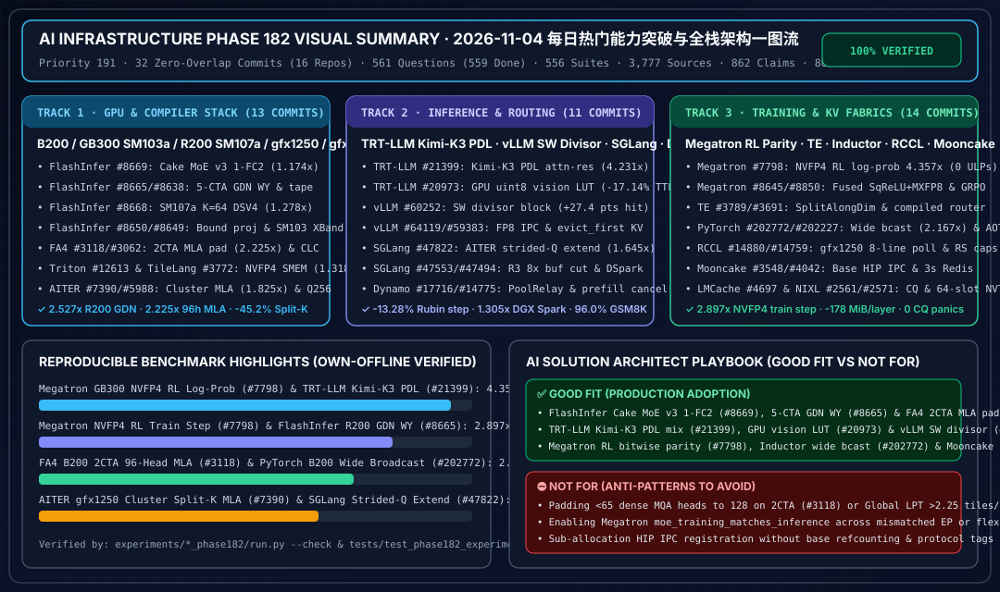

# 2026-11-04 每日 AI 基础设施研究报告（Phase 182 · Priority 191）

> **执行时间窗口**：北京时间（UTC+08:00）`2026-11-04 23:00` 夜间窗口内启动与完成。
> **架构师五大核心支柱**：0. 每日热门能力突破追踪 · 1. 架构设计 · 2. 可交互 Demo 与离线算例开发 · 3. 可复现 Benchmark 与 7-Card 4:5 视觉评测报告 · 4. 企业级业务场景落地指南。

---

## 一图流执行摘要（Executive Visual Summary）

- **7-Card 4:5 视觉基准评测报告（CSP 自包含 HTML）**：[`docs/reports/ai-infra-phase182-benchmark-cards.html`](../reports/ai-infra-phase182-benchmark-cards.html)
- **交互式架构师定容与 TCO 仿真工作台**：[`docs/reports/ai-infra-architect-workbench.html`](../reports/ai-infra-architect-workbench.html)

---

## Pillar 0：当日最热门 AI Infra 领域能力突破追踪（32 个零重叠上游主干提交 / 16 个核心仓库）

| 赛道 | 仓库与提交 | 核心能力突破与官方实测指标 |
| :--- | :--- | :--- |
| **Track 1：GPU 软件栈与编译器（13 项）** | `flashinfer` (`1ce8f91`, `8e7be5e`, `283abf0`, `a8e34e4`, `02fa872`, `7d92998`)、`flash-attention` (`5f7b05a`, `6d6392d`)、`triton` (`90e50ec`, `51f4f81`)、`tilelang` (`8587866`)、`ROCm/aiter` (`0f61f2b`, `0e072ca`) | 1. **FlashInfer Cake Mega-MoE v3 单 FC2 任务（#8669）**：GB300 `sm_103a` `TP8 EP1` 每个 FC2 环形任务覆盖所认领专家组的全部 `4` 个 N-clusters（`1` 任务/组），较自动调优 `trtllm_fp4_block_scale_routed_moe` 快 **`1.021x–1.174x`**。 2. **5-CTA/SM 紧凑三角 GDN WY 与 KCP 磁带移交（#8665, #8638）**：B200/GB300 `wy_tc2` 驻留 5 CTA/SM，在 GB300 上较 cuDNN FROST 提速 **`2.013x`**（R200 提速 **`2.527x`**）；图回放检查点磁带移交反向在 32K tokens 上实现 B200 **`1.249x`**、GB300 **`1.248x`**、R200 **`1.257x`** 加速。 3. **SM107a `K=64` DSV4 解码与绑定投影启动（#8668, #8650, #8649）**：VR200 (`sm_107a`) 128 头均匀收集 `rows >= 48` 采用 `K=64` FP8 MMA 提速 **`1.2778x`**（`14.623 -> 11.444 us`）；投影 GEMM 从缓存键直达绑定启动提速 **`1.129x`**；新增 SM103 8-Rank 跨频段 QKV 交换。 4. **FA4 2CTA 稠密 MLA 头部填充与 SM100 因果 CLC（#3118, #3062）**：内核内填充 `65–127` 头至 128 行 Tile，B200 96 头解码提速 **`2.225x`**（`152.4 -> 68.5 us`）；SM100 因果 CLC + Global LPT（$\le 2.25$ tiles/SM）在 GB300 上最高提速 **`1.41x`**。 5. **Triton GB300 NVFP4 共享内存核算与 AITER 簇内 Split-K MLA（#12613, #12524, #3772, #7390, #5988）**：Triton 计入解码 BF16 权重 Tile 使 GB300 `FP8 x NVFP4` 保持在 `232,448 B` SMEM 内，提速 **`1.318x`**（`2,711.89 -> 2,057.72 us`）；TileLang 支持 `sm_103a`/`sm_107a` TMA；AITER `gfx1250` 簇内折叠 Split-K MLA 提速 **`1.825x`**（`15.26 -> 8.36 us`），`gfx950` Q256 MXFP4 较 FlyDSL 提升 **`5.40%–8.61%`**。 |
| **Track 2：推理服务与路由系统（11 项）** | `TensorRT-LLM` (`c8d7293`, `0160bf7`)、`vllm` (`59519ec`, `69d27bf`, `a92efad`)、`sglang` (`27aedf7`, `744af7c`, `4354182`, `fd19cfb`)、`dynamo` (`8b4ad6a`, `e6b5a99`) | 1. **TRT-LLM Kimi-K3 CuTe DSL PDL 解码残差融合与 GPU 视觉 LUT（#21399, #20973）**：SM100/103/107 `M=1..64` PDL 残差混合折叠前一层 MoE 残差并直出 `R128c4` MXFP8 供 KDA 使用，GB300 提速最高 **`4.231x`**（`11.0 -> 2.6 us`），Rubin `helix16 b1 mtp7` 整步降低 **`13.28%`**（`11.45 -> 9.93 ms`）；`vision_gpu_normalize: true` 以 `uint8` 传输像素（**`2.0x` H2D 压缩**）并用 GPU LUT 归一化，4x GB200 Qwen3-VL TTFT 降低 **`17.14%`**（`183.2 -> 151.8 ms`），HTTP CPU 耗时降低 **`19.27%`**。 2. **vLLM 混合推测解码 SW 整除块定容、FP8 IPC 与惰性卸载队首回收（#60252, #64119, #59383）**：`divisor_of` 避免 GDN+SW 主块从 `1,648` 膨胀 4 倍至 `6,592`，RTX PRO 5000 前缀命中率从 `43.8%` 升至 **`71.2%`（`+27.4 pts`）**，DGX Spark 168 轮回放从 `26.1` 降至 **`20.0 min`（`1.305x`）**；支持 ModelOpt `FP8_PB_WO` CUTLASS IPC 重启与 `evict_first=True` 惰性卸载归还。 3. **SGLang AITER 零拷贝跨步 Q 扩展、R3 非输出 Rank 跳过与 Dynamo PoolRelay（#47822, #47553, #47494, #48327, #17716, #14775）**：`_unified_extend_q` 跳过逐 token 稠密 Q 切片的 `contiguous()` 拷贝，`gfx1250` TP2 窗口注意力提速 **`1.645x`**（`72.7 -> 44.2 us`）；R3 仅在输出 Rank 分配缓冲区（TP8 缩减 **`8.0x`**，`96 -> 12 MB`）；DSpark 每步仅刷新 `1` 次 Mamba 追踪（GSM8K **`96.0%`**）；Dynamo `PoolRelay` 共享 2 种连接模式实时负载并向远程预填充传播取消请求。 |
| **Track 3：分布式训练、集合通信与 KV 网络（14 项）** | `Megatron-LM` (`ebcf9d6`, `4a4064f`, `993bf83`)、`TransformerEngine` (`720b252`, `2d65f35`)、`pytorch` (`1933a0a`, `b31d68d`)、`rocm-systems` (`f59fd15`, `3b0c0ac`)、`Mooncake` (`748af1a`, `4704c67`)、`LMCache` (`338d5fb`)、`nixl` (`e2cd028`, `13c52d2`) | 1. **Megatron-LM FlashInfer MXFP8/NVFP4 RL 训推逐比特对齐（#7798, #8645, #8850）**：`moe_training_matches_inference=True` 在 RL value/log-prob 前向直接复用生成的 FlashInfer MXFP8 或每 Token NVFP4 内核（**`0` ULP 偏差**），4x GB300 NVFP4 log-prob 提速 **`3.37x–4.357x`**（`23.53 -> 5.40 ms`），训练步提速 **`2.28x–2.897x`**（`59.47 -> 20.53 ms`），每层省 **`178 MiB`** 静态显存；MXFP8 log-prob 提速 **`1.422x`**；融合 `squared_relu_with_probs_quantize_mxfp8`。 2. **TE 零拷贝打包 QKV 反向与编译态路由、PyTorch 宽广播实例化（#3789, #3691, #202772, #202227）**：TE `SplitAlongDim` 消除打包 QKV 反向零填充视图分配（`0` 次）；融合 MoE 路由支持 `torch.compile(fullgraph=True)`；Inductor 对宽度 $\ge 64$ 广播实例化生产者，B200 MoE 后处理提速 **`2.167x`**（`36.4 -> 16.8 us`）；AOTI C-shim 暴露 `CUDAGraph`/`MemPool`。 3. **RCCL `gfx1250` 批量轮询 DDA LL 与 Mooncake/LMCache/NIXL 加固（#14880, #14759, #3548, #4042, #4697, #2561, #2571）**：RCCL `gfx1250` AllReduce L2 发送预取 + `8` 行批量轮询，ReduceScatter LL128 上限升至 `224 MiB` / `7.5 MiB/rank`；Mooncake 基址粒度 HIP IPC 引用计数 + `3` 协议所有权隔离 + Redis `3s` 超时重连；LMCache `RawBlock` 预留 in-flight CQ 容量（`0` 溢出崩溃）；NIXL EFA 设备门控与 64 槽 FNV-1a NVTX（每轮省 `6` 次堆分配）。 |

---

## Pillar 1 & 2：新增双语架构文档与可复现离线算例（100% 验证通过）

1. **Track 1（GPU 软件栈与编译器）**：
   - 中文文档：[`docs/components/gpu-software-stack-flashinfer-cake-moe-v3-gdn-wy5cta-dsv4-k64-fa4-clc-triton-nvfp4-aiter-cluster-mla-phase182.md`](../components/gpu-software-stack-flashinfer-cake-moe-v3-gdn-wy5cta-dsv4-k64-fa4-clc-triton-nvfp4-aiter-cluster-mla-phase182.md)
   - 英文文档：[`docs/components/gpu-software-stack-flashinfer-cake-moe-v3-gdn-wy5cta-dsv4-k64-fa4-clc-triton-nvfp4-aiter-cluster-mla-phase182.en.md`](../components/gpu-software-stack-flashinfer-cake-moe-v3-gdn-wy5cta-dsv4-k64-fa4-clc-triton-nvfp4-aiter-cluster-mla-phase182.en.md)
   - 实验套件：[`experiments/flashinfer_cake_moe_v3_gdn_wy5cta_fa4_clc_aiter_cluster_mla_phase182/run.py`](../../experiments/flashinfer_cake_moe_v3_gdn_wy5cta_fa4_clc_aiter_cluster_mla_phase182/run.py)
2. **Track 2（推理服务与路由系统）**：
   - 中文文档：[`docs/components/inference-trtllm-kimi-k3-pdl-attn-res-gpu-vision-norm-vllm-sw-divisor-sglang-strided-q-r3-skip-dynamo-relay-phase182.md`](../components/inference-trtllm-kimi-k3-pdl-attn-res-gpu-vision-norm-vllm-sw-divisor-sglang-strided-q-r3-skip-dynamo-relay-phase182.md)
   - 英文文档：[`docs/components/inference-trtllm-kimi-k3-pdl-attn-res-gpu-vision-norm-vllm-sw-divisor-sglang-strided-q-r3-skip-dynamo-relay-phase182.en.md`](../components/inference-trtllm-kimi-k3-pdl-attn-res-gpu-vision-norm-vllm-sw-divisor-sglang-strided-q-r3-skip-dynamo-relay-phase182.en.md)
   - 实验套件：[`experiments/trtllm_kimi_k3_pdl_attn_res_vllm_sw_divisor_sglang_strided_q_phase182/run.py`](../../experiments/trtllm_kimi_k3_pdl_attn_res_vllm_sw_divisor_sglang_strided_q_phase182/run.py)
3. **Track 3（分布式训练、集合通信与 KV 传输网络）**：
   - 中文文档：[`docs/components/distributed-training-megatron-moe-rl-parity-te-compiled-router-inductor-broadcast-rccl-gfx1250-dda-mooncake-hip-ipc-phase182.md`](../components/distributed-training-megatron-moe-rl-parity-te-compiled-router-inductor-broadcast-rccl-gfx1250-dda-mooncake-hip-ipc-phase182.md)
   - 英文文档：[`docs/components/distributed-training-megatron-moe-rl-parity-te-compiled-router-inductor-broadcast-rccl-gfx1250-dda-mooncake-hip-ipc-phase182.en.md`](../components/distributed-training-megatron-moe-rl-parity-te-compiled-router-inductor-broadcast-rccl-gfx1250-dda-mooncake-hip-ipc-phase182.en.md)
   - 实验套件：[`experiments/megatron_moe_rl_parity_rccl_gfx1250_dda_mooncake_hip_ipc_phase182/run.py`](../../experiments/megatron_moe_rl_parity_rccl_gfx1250_dda_mooncake_hip_ipc_phase182/run.py)

---

## 全库累计规模（Phase 182 收口状态）

- **主干一手信源（Primary Sources）**：`3,777`（本轮新增 `32` 个零重叠主干提交，覆盖 `16` 个上游仓库）
- **证据条目（Evidence Claims）**：`862`（本轮新增 `3` 项）
- **研究问题（Questions）**：`561`（`559 done` + `2 blocked`）
- **确定性实验套件（Experiment Suites）**：`556`（本轮新增 `3` 套）
- **单元测试（Unit Tests）**：`804`（100% 通过）
- **7-Card 4:5 视觉评测报告**：`182` 份
