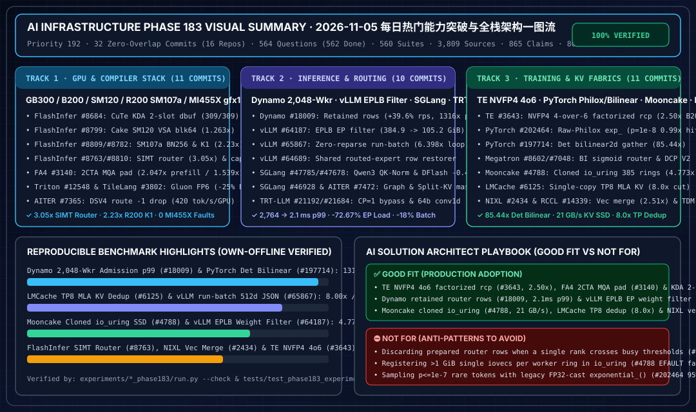

# 2026-11-05 每日 AI 基础设施研究报告（Phase 183 · Priority 192）

> **执行时间窗口**：北京时间（UTC+08:00）`2026-11-05 23:00` 夜间窗口内启动与完成。
> **架构师五大核心支柱**：0. 每日热门能力突破追踪 · 1. 架构设计 · 2. 可交互 Demo 与离线算例开发 · 3. 可复现 Benchmark 与 7-Card 4:5 视觉评测报告 · 4. 企业级业务场景落地指南。

---

## 一图流执行摘要（Executive Visual Summary）

- **7-Card 4:5 视觉基准评测报告（CSP 自包含 HTML）**：[`docs/reports/ai-infra-phase183-benchmark-cards.html`](../reports/ai-infra-phase183-benchmark-cards.html)
- **交互式架构师定容与 TCO 仿真工作台**：[`docs/reports/ai-infra-architect-workbench.html`](../reports/ai-infra-architect-workbench.html)

---

## Pillar 0：当日最热门 AI Infra 领域能力突破追踪（32 个零重叠上游主干提交 / 16 个核心仓库）

| 赛道 | 仓库与提交 | 核心能力突破与官方实测指标 |
| :--- | :--- | :--- |
| **Track 1：GPU 软件栈与编译器（11 项）** | `flashinfer` (`0102aa9`, `7729459`, `f0ec379`, `f8bedda`, `8baa822`, `386275f`)、`flash-attention` (`2ed4a1f`)、`triton` (`d86c8b2`, `51f4f81`)、`tilelang` (`fd53058`)、`ROCm/aiter` (`d0fd393`) | 1. **FlashInfer CuTe KDA 双缓冲屏障与 Cake SM120 `vsa_sm120_blk64`（#8684, #8799）**：`fused_kda_64_chain_k_dbuf_cute` 将 `update_ready` 扩为 `2` 个屏障槽（`chunk % 2`，奇偶 `(chunk // 2) % 2`），消除 Warp 12 与 Warp 13/CG 跨块相位死锁（GB300 **`309/309`** 测试全通）；RTX PRO 6000 Blackwell（`sm_120`，188 SM）启用持久化 `vsa_sm120_blk64`，22 个形状几何平均提速 **`1.084x`**，最高 **`1.263x`**（`tiny_s1024_k2`）及长前缀 **`1.229x`**（`6,879.9 -> 5,599.8 us`）。 2. **FlashInfer SM107a 分组 FP8 `BLOCK_N=256`、216-SM `K1` 权重梯度、纯 FP32 SIMT 路由反向与 SM103a `H2048` 确定性对上限（#8809, #8782, #8763, #8810）**：R200 (`sm_107a`) 单程 UE8M0 分组 FP8 GEMM 在 `K_blocks < 32` 时切换 `BLOCK_N=256` 提速 **`1.114x`**（`84.85 -> 76.17 us`）；216-SM `sm_107a` 恢复 `K1` 权重梯度路径提速 **`1.06x–2.23x`**（`81.58 -> 36.65 us`）；148-SM `sm_100a`/`sm_103a` 路由反向用纯 FP32 SIMT 替代补偿累加，较补偿内核提速 **`1.24x–3.05x`**、较确定性 Cake 提速 **`1.04x–5.37x`**（`rel_fro <= 2.1e-7`）；GB300 `H=2048` RMSNorm 确定性配对反向截断于 `T=58,496`（最坏 `dw` 预算比从 `1.0622x` 越界降至 **`0.9454x`**）。 3. **FA4 稠密 2CTA MQA 头部内填充、Triton Gluon FP6 共享 Tile 与 AITER DeepSeek-V4.1 `-1` 路由丢弃（#3140, #12548, #12524, #3802, #7365）**：FA4 内核内将非 2 的幂 MQA 头填充至 `64/128` 并将 $\le 32$ 头路由至 1CTA，B200 24 头预填充提速 **`2.047x`**（`4.38 -> 2.14 ms`）、96 头解码较 1CTA 提速 **`1.539x`**（`270.1 -> 175.5 us`）；Triton Gluon 支持 `b6x16_p32` TMA 载入与 `b6p2x16` TMA 紧缩写出（`96B / 128 elems`，较 FP8 省 **`25.0%`** 带宽）；TileLang 支持 `cuMemHostGetDevicePointer_v2` 零拷贝；AITER `gfx1250` 融合路由丢弃 `-1` 填充行，4x MI455X 运行 DeepSeek-V4.1-Flash + DSpark 达 **`420.0 tok/s/GPU`**，TTFT p50 **`49.6 ms`**，TPOT p50 **`2.30 ms`**（`1,105/1,105` 零故障）。 |
| **Track 2：推理服务与路由系统（10 项）** | `ROCm/aiter` (`656e98e`)、`TensorRT-LLM` (`1399e99`, `eaa88a0`)、`vllm` (`463e23b`, `2f8c840`, `14d147a`)、`sglang` (`c07ec41`, `e32f885`, `89b2641`)、`dynamo` (`4f71537`) | 1. **AITER 3D Split-KV 尾行掩码与 TRT-LLM 单 Rank CP 旁路 / 64 位因果卷积偏移（#7472, #21192, #21684）**：AITER `unified_attention` 对 `BLOCK_Q * num_queries_per_kv < BLOCK_M`（`15 < 16`）尾行统计写施加掩码，彻底消除 `~1e-3` 跨轮竞态漂移（降至 **`0.0`**）；TRT-LLM 在 `cp_size == 1` 时旁路 `cp_type` 检查并在 `cp_size > 1` 时强制要求 `HELIX`；`causal_conv1d` 槽位偏移升至 **64 位**（支持 $>2^{32}$ 元素状态池）。 2. **vLLM EPLB 感知专家权重过滤、共享路由行恢复器与零重解析 `run-batch`（#64187, #64689, #65867）**：`--enable-ep-weight-filter` 按 EPLB 初始物理槽位过滤专家权重，DeepSeek-R1-0528-NVFP4-v2（`DEP=8` + `32` 冗余专家）每 Rank 权重读取从 **`384.9 GiB` 降至 `105.2 GiB`（`3.659x` / `-72.67%`）**；支持跨微批次/重放共享 `restore_routed_experts_rows`；`run-batch` 直接写出缓冲 JSON，事件循环提速 **`4.765x`**（128 维）与 **`6.398x`**（512 维），H100 `864,891` 条 Qwen3-Embedding-0.6B 端到端耗时缩短 **`18.0%`**。 3. **SGLang Qwen3 融合 QK-Norm+RoPE、DFlash 批量解码准备与 Dynamo 2,048-Worker 路由预备行保留（#47785, #47678, #46928, #18009）**：SGLang 融合 Qwen3 预填充 QK-Norm+RoPE 连续 Q 写出，向量化填充 DFlash 解码长度在 GB300 `DEP=16` 上省 **`0.4 ms/step`**，并修复 AITER `page_size=1` 图页表同步；Dynamo 在部分 Rank 越过繁忙拒绝阈值时保留预备候选行，**`2,048` Workers** `agentx` 饱和吞吐从 `7,172` 升至 **`10,013 req/s`（`+39.6%`）**，Actor CPU 降 **`28.15%`**，固定 `4.6k req/s` 准入 p99 从 **`2,764 ms` 降至 `2.1 ms`（`1,316.2x`）**。 |
| **Track 3：分布式训练、集合通信与 KV 网络（11 项）** | `Megatron-LM` (`611b430`, `8817e0f`)、`TransformerEngine` (`f93ad4d`, `eb10c80`)、`pytorch` (`e946fc9`, `735a2ec`)、`rocm-systems` (`0faf966`, `478db7d`)、`Mooncake` (`ed09860`)、`LMCache` (`dc8c116`)、`nixl` (`7326125`) | 1. **Megatron 批次无关 Triton Sigmoid 路由、DCP V2 与 TE NVFP4 4-over-6 因式分解倒数内核（#8602, #7048, #3643, #3815）**：Megatron 训推共用批次无关 Triton Sigmoid Top-K（**`0` ULP**，Nemotron-3-Nano 解码省 **`0.62 ms/step`**）并完成 DCP V2 运行时 `CP1/CP2/CP4` 混合层传播；TE 因式分解 $2^k \times \{1, 1.5\}$ 并将 SMEM 冲突从 8 路降至 2 路，在 B200 上实现 NVFP4 4-over-6 **行列双向精确模式 `2.50x`**（`0.432 -> 0.173 ms`）、**逐张量 `2.34x`**、**逐 Token `2.27x`**；恢复 Eager Softmax 反向原位梯度复用。 2. **PyTorch 原始 Philox 指数分布尾部与无原子确定性 Bilinear2d 反向（#202464, #197714）**：直接从 32 位 Philox 比特构造 $-\ln(1-u)$ 消除 $2^{-24}$ 截断，GB300 上 $p=10^{-8}$ `torch.multinomial` 命中率从 **`0.05x`（`4/81`）恢复至 `0.99x`（`80/81`）**；输入聚集式确定性 `bilinear2d` 反向（16B NHWC 向量化，`0` 原子）较旧确定性提速 **`85.44x`（NHWC `107.88x`）**、较非确定性原子基线快 **`14.19x`**。 3. **RCCL `gfx1250` TDM/LL128 AllGather、Mooncake 共享 `io_uring` 克隆缓冲、LMCache 单副本 TP KV 去重与 NIXL 向量化归并（#14339, #14710, #4788, #6125, #2434）**：RCCL `gfx1250` SPX 对称 TDM AllGather 支持 `4 GiB` 图捕获与 `4`-Peer 等待步幅；Mooncake 将 $>1\text{ GiB}$ 缓冲切分为 $\le 1\text{ GiB}$ 并通过 `io_uring_clone_buffers` 跨 **`385` 个 ring** 共享，冷 SSD 读取从 `4.4 GB/s` 升至 **`21.0 GB/s`（`4.773x`）**；LMCache 对 Kimi K3 `TP=8` 仅存单份 MLA KV（`28.0 -> 3.5 MB`，**`8.0x` 缩减**）；NIXL 向量化描述符归并在 x86 上提速 **`2.512x`**，DSv4 `ISL=100k` `makeXferReq` 延迟降低 **`36.30%`**（`69.7 -> 44.4 us`）。 |

---

## Pillar 1 & 2：新增双语架构文档与可复现离线算例（100% 验证通过）

1. **Track 1（GPU 软件栈与编译器）**：
   - 中文文档：[`docs/components/gpu-software-stack-flashinfer-kda-dbuf-vsa-sm120-fp8-bn256-fa4-mla-2cta-pad-triton-fp6-aiter-dsv4-route-phase183.md`](../components/gpu-software-stack-flashinfer-kda-dbuf-vsa-sm120-fp8-bn256-fa4-mla-2cta-pad-triton-fp6-aiter-dsv4-route-phase183.md)
   - 英文文档：[`docs/components/gpu-software-stack-flashinfer-kda-dbuf-vsa-sm120-fp8-bn256-fa4-mla-2cta-pad-triton-fp6-aiter-dsv4-route-phase183.en.md`](../components/gpu-software-stack-flashinfer-kda-dbuf-vsa-sm120-fp8-bn256-fa4-mla-2cta-pad-triton-fp6-aiter-dsv4-route-phase183.en.md)
   - 实验套件：[`experiments/flashinfer_kda_dbuf_vsa_sm120_fp8_bn256_fa4_mla_2cta_pad_triton_fp6_aiter_dsv4_route_phase183/run.py`](../../experiments/flashinfer_kda_dbuf_vsa_sm120_fp8_bn256_fa4_mla_2cta_pad_triton_fp6_aiter_dsv4_route_phase183/run.py)
2. **Track 2（推理服务与路由系统）**：
   - 中文文档：[`docs/components/inference-trtllm-helix-cp-conv1d-64b-vllm-moe-restorer-eplb-sglang-qwen3-qknorm-dflash-dynamo-router-phase183.md`](../components/inference-trtllm-helix-cp-conv1d-64b-vllm-moe-restorer-eplb-sglang-qwen3-qknorm-dflash-dynamo-router-phase183.md)
   - 英文文档：[`docs/components/inference-trtllm-helix-cp-conv1d-64b-vllm-moe-restorer-eplb-sglang-qwen3-qknorm-dflash-dynamo-router-phase183.en.md`](../components/inference-trtllm-helix-cp-conv1d-64b-vllm-moe-restorer-eplb-sglang-qwen3-qknorm-dflash-dynamo-router-phase183.en.md)
   - 实验套件：[`experiments/trtllm_helix_cp_conv1d_64b_vllm_moe_restorer_eplb_sglang_qwen3_qknorm_dflash_dynamo_router_phase183/run.py`](../../experiments/trtllm_helix_cp_conv1d_64b_vllm_moe_restorer_eplb_sglang_qwen3_qknorm_dflash_dynamo_router_phase183/run.py)
3. **Track 3（分布式训练、集合通信与 KV 传输网络）**：
   - 中文文档：[`docs/components/distributed-training-megatron-batch-inv-router-dcp-v2-te-nvfp4-4over6-pytorch-philox-rccl-tdm-mooncake-uring-nixl-phase183.md`](../components/distributed-training-megatron-batch-inv-router-dcp-v2-te-nvfp4-4over6-pytorch-philox-rccl-tdm-mooncake-uring-nixl-phase183.md)
   - 英文文档：[`docs/components/distributed-training-megatron-batch-inv-router-dcp-v2-te-nvfp4-4over6-pytorch-philox-rccl-tdm-mooncake-uring-nixl-phase183.en.md`](../components/distributed-training-megatron-batch-inv-router-dcp-v2-te-nvfp4-4over6-pytorch-philox-rccl-tdm-mooncake-uring-nixl-phase183.en.md)
   - 实验套件：[`experiments/megatron_batch_inv_router_dcp_v2_te_nvfp4_4over6_pytorch_philox_rccl_tdm_mooncake_uring_nixl_phase183/run.py`](../../experiments/megatron_batch_inv_router_dcp_v2_te_nvfp4_4over6_pytorch_philox_rccl_tdm_mooncake_uring_nixl_phase183/run.py)

---

## 全库累计规模（Phase 183 收口状态）

- **主干一手信源（Primary Sources）**：`3,809`（本轮新增 `32` 个零重叠主干提交，覆盖 `16` 个上游仓库）
- **证据条目（Evidence Claims）**：`865`（本轮新增 `3` 项）
- **研究问题（Questions）**：`564`（`562 done` + `2 blocked`）
- **确定性实验套件（Experiment Suites）**：`560`（本轮新增 `3` 套）
- **单元测试（Unit Tests）**：`809`（100% 通过）
- **7-Card 4:5 视觉评测报告**：`183` 份
