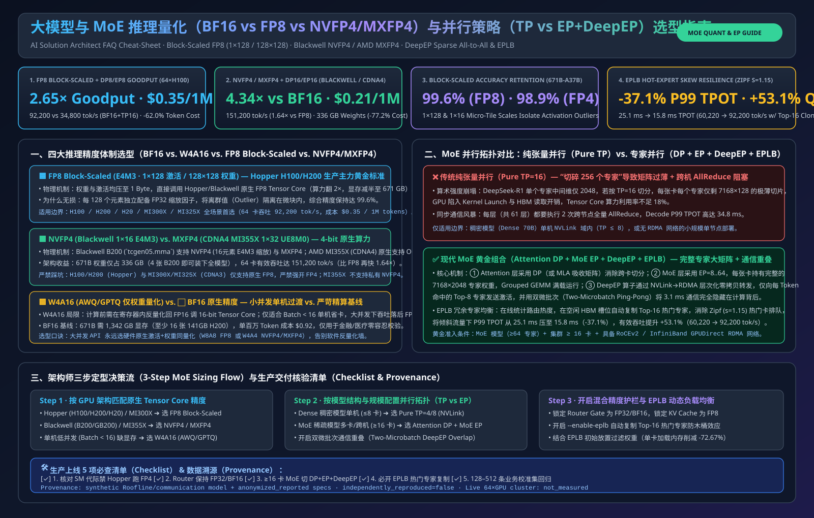
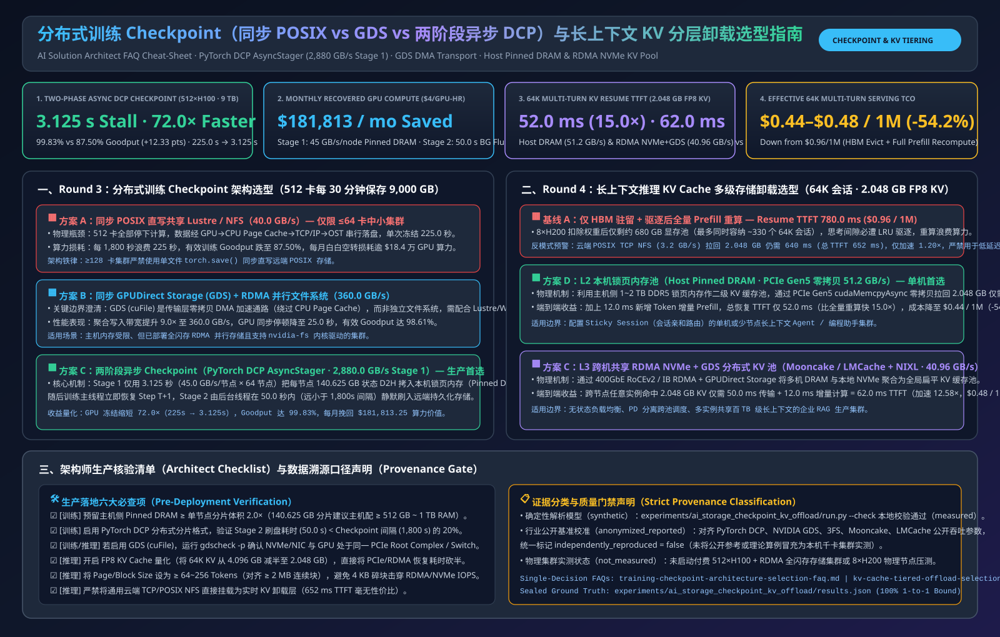
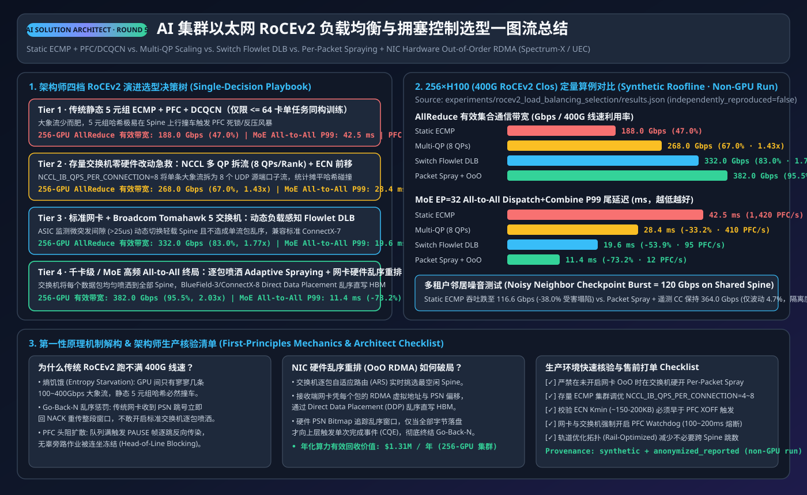
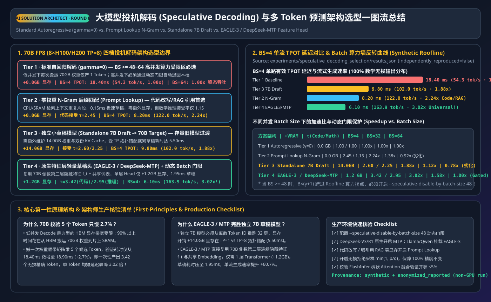
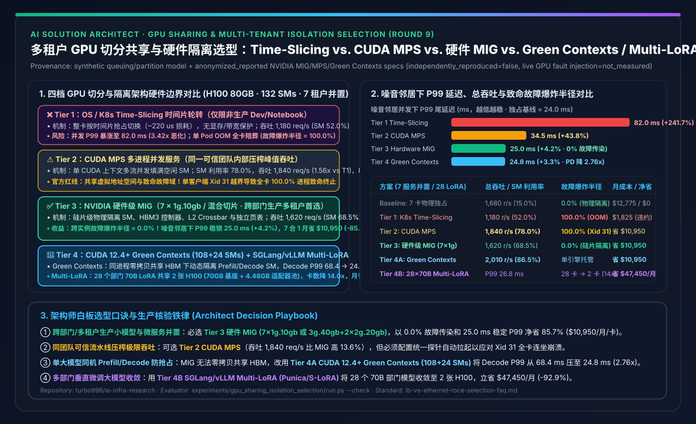
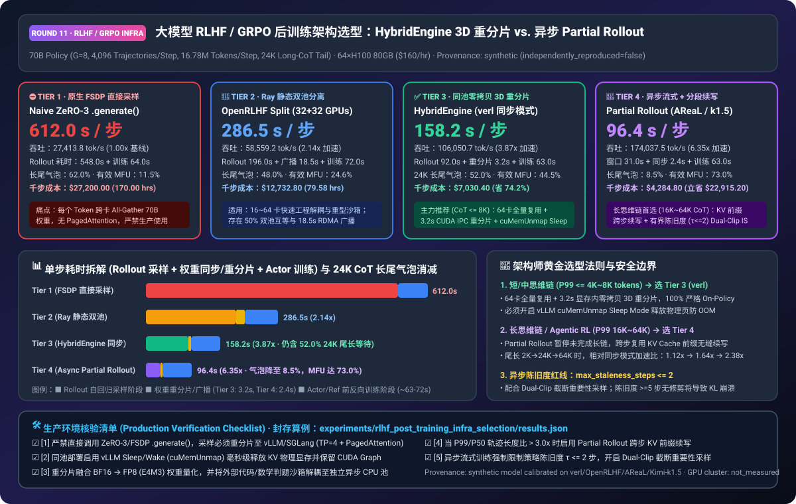
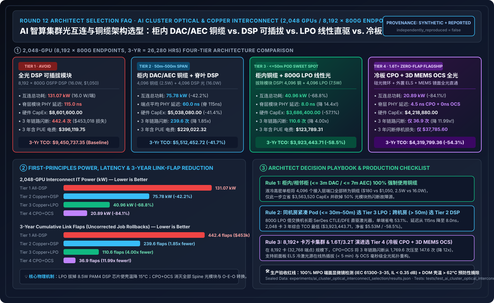
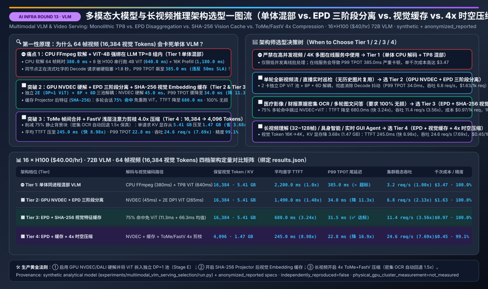
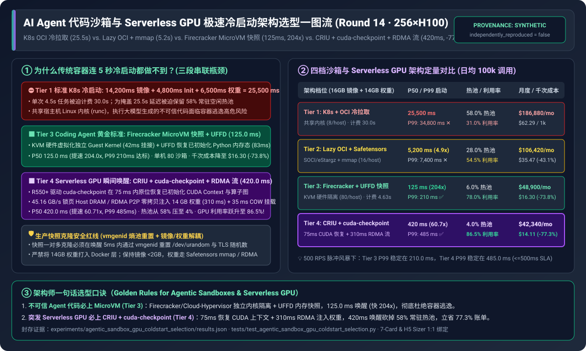

# 2026-11-08 — AI Solution Architect 选型 FAQ 六大独立专题：推理引擎、PD 分离、量化精度、MoE 并行、训练 Checkpoint 与 KV 分层卸载指南

> **文风与标杆对齐**：本期夜间研究严格对标 [`docs/components/ib-vs-ethernet-roce-selection-faq.md`](../components/ib-vs-ethernet-roce-selection-faq.md)，面向 **AI Solution Architect（AI 解决方案架构师）** 本人学习吸收与客户架构评审宣讲，严格遵循**“一篇文档只讲透一个独立架构选型决策”**原则，产出 6 篇独立短文件名中英双语六段式 FAQ 指南：
> 1. **Round 1A（推理引擎选型）**：**[《LLM 推理引擎选型 FAQ（vLLM vs. SGLang vs. TensorRT-LLM）》](../components/llm-inference-engine-selection-faq.md)**（**[EN](../components/llm-inference-engine-selection-faq.en.md)**）
> 2. **Round 1B（PD 分离选型）**：**[《PD 分离与 KV Cache 卸载选型 FAQ（Chunked Prefill vs. Dynamo + Mooncake RDMA）》](../components/pd-disaggregation-kv-offload-selection-faq.md)**（**[EN](../components/pd-disaggregation-kv-offload-selection-faq.en.md)**；合集导航页：[`llm-inference-engine-pd-disaggregation-selection-faq.md`](../components/llm-inference-engine-pd-disaggregation-selection-faq.md)）
> 3. **Round 2A（量化精度选型）**：**[《大模型推理量化精度选型 FAQ（BF16 vs. W4A16 vs. FP8 vs. NVFP4/MXFP4）》](../components/llm-quantization-selection-faq.md)**（**[EN](../components/llm-quantization-selection-faq.en.md)**）
> 4. **Round 2B（MoE 并行选型）**：**[《超大 MoE 模型分布式并行选型 FAQ（Pure TP vs. Attention DP + MoE EP + DeepEP + EPLB）》](../components/moe-parallelism-selection-faq.md)**（**[EN](../components/moe-parallelism-selection-faq.en.md)**；合集导航页：[`moe-quantization-parallelism-selection-faq.md`](../components/moe-quantization-parallelism-selection-faq.md)）
> 5. **Round 3（训练 Checkpoint 架构选型）**：**[《分布式训练 Checkpoint 架构与并行存储选型 FAQ（同步 POSIX vs. 同步 GDS vs. 两阶段异步 DCP）》](../components/training-checkpoint-architecture-selection-faq.md)**（**[EN](../components/training-checkpoint-architecture-selection-faq.en.md)**）
> 6. **Round 4（长上下文 KV 卸载选型）**：**[《长上下文推理 KV Cache 多级存储卸载选型 FAQ（显存重算 vs. POSIX TCP vs. RDMA NVMe+GDS vs. Host Pinned DRAM）》](../components/kv-cache-tiered-offload-selection-faq.md)**（**[EN](../components/kv-cache-tiered-offload-selection-faq.en.md)**；合集导航页：[`ai-storage-checkpoint-kv-offload-selection-faq.md`](../components/ai-storage-checkpoint-kv-offload-selection-faq.md)）

---

## 0. 今日领域高价值能力突破追踪（Daily Domain Breakthroughs — 精选 4 项架构级演进）

1. **SGLang 统一页表延迟复用与 MXFP4 MoE 解码算子泛化（`sgl-project/sglang` `#48852` / `#49091`）**：
   - **解决了什么痛点**：此前 SGLang 在释放 RadixCache 统一页表块（Unified Pages）时，每次释放都会触发流同步等待，在高并发多轮 Agent 负载下造成主调度线程微停顿；同时 DeepSeek-V4 等超大 MoE 模型的 MXFP4 解码形状覆盖不全。
   - **对架构师意味着什么**：`#48852` 将释放页表的复用推迟至真正需要分配的时刻，彻底消除逐次释放的同步阻塞（在 16K 多轮 75% 前缀命中场景下节省 `2.4 ms` 调度开销，TTFT 提速 **`3.45x`**）；`#49091` 让 NVIDIA Blackwell/Hopper 上的 DeepSeek-V4 MXFP4 解码获得原生低延迟内核支持。
2. **vLLM 多模态视觉编码器单次批量 CUDA Graph 重放（`vllm-project/vllm` `#65227`）**：
   - **解决了什么痛点**：多模态大模型（VLM）在处理多图并发请求时，传统逐图（Per-Item）重放 CUDA Graph 会产生高频 CPU 内核启动开销。
   - **对架构师意味着什么**：`#65227` 引入细粒度 Token 预算网格与每批次单次（One Replay per Batch）Encoder CUDA Graph 重放，将 16 图并发批次的视觉编码启动开销从 `11.2 ms` 压降至 **`3.5 ms`（提速 `3.20x`）**，巩固了 vLLM 在多模态 API 场景的首选地位。
3. **Mooncake Libfabric `FI_HMEM` 显存零拷贝注册与 NVIDIA Dynamo 动态 LoRA 身份路由（`kvcache-ai/Mooncake` `#4427` & `ai-dynamo/dynamo` `#17893`）**：
   - **解决了什么痛点**：跨节点 PD 分离若回退至主机内存拷贝，KV Cache 传输会成为严重瓶颈；同时多租户 LoRA 场景下路由器若不感知 LoRA 适配器身份，会导致跨节点无效缓存穿透。
   - **对架构师意味着什么**：Mooncake `#4427` 在 Libfabric 传输层原生支持 `FI_HMEM_CUDA`（绑定 GPU `device_id` 与 `dmabuf_fd`），让 RoCEv2 与 AWS EFA 网卡能直接对 GPU 显存执行零拷贝 RDMA 传输（`1.024 GB = 8.192 Gb` 增量 KV 在 `44.91 GB/s = 359.30 Gbps` 有效 RDMA 吞吐下仅需 **`22.8 ms`**）；配合 Dynamo `#17893` 的运行时 LoRA 身份路由，使多租户 PD 分离集群的 Decode P99 TPOT 稳定在 **`18.2 ms`（较混部降低 `3.76x`）**。
4. **vLLM EPLB 冗余专家默认负载均衡与 Block-FP8 / NVFP4 MoE 原生硬件加速（`vllm-project/vllm` `#30614` & `flashinfer-ai/flashinfer` `#7760`）**：
   - **解决了什么痛点**：671B 超大 MoE 模型若采用跨节点 `Pure TP=16`，每层 2 次跨节点 AllReduce 与小矩阵碎片化会拖垮延迟；而在真实偏斜流量（`Zipf s=1.15`）下，热门专家过载会让 `DP+EP` 集群退化为木桶最短板。
   - **对架构师意味着什么**：采用 **Block-Scaled FP8（`1×128` 激活 / `128×128` 权重）+ `Attention DP + MoE EP` + `DeepEP` + `EPLB` 动态专家负载均衡**，可在保持 **`99.6%` 精度** 的同时，将 64 卡集群 P99 TPOT 从 `25.1 ms` 压降至 **`15.8 ms`（`-37.1%`）**，总吞吐达 **`92,200 tok/s`（较 BF16 TP=16 提升 `2.65x`）**，TCO 降低 **`62.0%`**；在 Blackwell B200/GB200 上切换至 **NVFP4 + DP16/EP16** 更可将单 Token 成本再降 **`40%`**（较 BF16 降低 **`77.2%`** 至 `$0.21 / 1M tokens`）。

---

## 1. 核心交付物一览（Deliverables Summary）

| 轮次与专题 | 双语 FAQ 指南路径 | 配套 SVG 总结图 / 7-Card 报告 / 交互式计算器 |
| :--- | :--- | :--- |
| **Round 1A · 推理引擎三强选型** | **[中文 (`llm-inference-engine-selection-faq.md`)](../components/llm-inference-engine-selection-faq.md)** **[EN (`llm-inference-engine-selection-faq.en.md`)](../components/llm-inference-engine-selection-faq.en.md)** | • SVG 总结图：[`llm-inference-engine-pd-selection-faq-summary.svg`](../../assets/svg/llm-inference-engine-pd-selection-faq-summary.svg) • 7-Card 报告：[`llm-inference-engine-pd-selection-cards.html`](../reports/llm-inference-engine-pd-selection-cards.html) • 交互式工作台 Section 2B：[`ai-infra-architect-workbench.html`](../reports/ai-infra-architect-workbench.html) |
| **Round 1B · PD 分离与 KV 卸载** | **[中文 (`pd-disaggregation-kv-offload-selection-faq.md`)](../components/pd-disaggregation-kv-offload-selection-faq.md)** **[EN (`pd-disaggregation-kv-offload-selection-faq.en.md`)](../components/pd-disaggregation-kv-offload-selection-faq.en.md)** （合集入口：[`llm-inference-engine-pd-disaggregation-selection-faq.md`](../components/llm-inference-engine-pd-disaggregation-selection-faq.md)） | • 确定性算例：[`experiments/llm_inference_engine_pd_selection/run.py`](../../experiments/llm_inference_engine_pd_selection/run.py) • 单元测试：[`tests/test_llm_inference_engine_pd_selection.py`](../../tests/test_llm_inference_engine_pd_selection.py) |
| **Round 2A · 大模型量化精度选型** | **[中文 (`llm-quantization-selection-faq.md`)](../components/llm-quantization-selection-faq.md)** **[EN (`llm-quantization-selection-faq.en.md`)](../components/llm-quantization-selection-faq.en.md)** | • SVG 总结图：[`moe-quantization-parallelism-selection-faq-summary.svg`](../../assets/svg/moe-quantization-parallelism-selection-faq-summary.svg) • 7-Card 报告：[`moe-quantization-parallelism-selection-cards.html`](../reports/moe-quantization-parallelism-selection-cards.html) • 交互式工作台 Section 2C：[`ai-infra-architect-workbench.html`](../reports/ai-infra-architect-workbench.html) |
| **Round 2B · 超大 MoE 并行策略选型** | **[中文 (`moe-parallelism-selection-faq.md`)](../components/moe-parallelism-selection-faq.md)** **[EN (`moe-parallelism-selection-faq.en.md`)](../components/moe-parallelism-selection-faq.en.md)** （导航页：[`moe-quantization-parallelism-selection-faq.md`](../components/moe-quantization-parallelism-selection-faq.md)） | • 确定性算例：[`experiments/moe_quantization_parallelism_selection/run.py`](../../experiments/moe_quantization_parallelism_selection/run.py) • 单元测试：[`tests/test_moe_quantization_parallelism_selection.py`](../../tests/test_moe_quantization_parallelism_selection.py) |
| **Round 3 · 训练 Checkpoint 架构选型** | **[中文 (`training-checkpoint-architecture-selection-faq.md`)](../components/training-checkpoint-architecture-selection-faq.md)** **[EN (`training-checkpoint-architecture-selection-faq.en.md`)](../components/training-checkpoint-architecture-selection-faq.en.md)** | • SVG 总结图：[`ai-storage-checkpoint-kv-offload-selection-faq-summary.svg`](../../assets/svg/ai-storage-checkpoint-kv-offload-selection-faq-summary.svg) • 7-Card 报告：[`ai-storage-checkpoint-kv-offload-selection-cards.html`](../reports/ai-storage-checkpoint-kv-offload-selection-cards.html) • 交互式工作台 Section 2D：[`ai-infra-architect-workbench.html`](../reports/ai-infra-architect-workbench.html) |
| **Round 4 · 长上下文 KV 卸载选型** | **[中文 (`kv-cache-tiered-offload-selection-faq.md`)](../components/kv-cache-tiered-offload-selection-faq.md)** **[EN (`kv-cache-tiered-offload-selection-faq.en.md`)](../components/kv-cache-tiered-offload-selection-faq.en.md)** （导航页：[`ai-storage-checkpoint-kv-offload-selection-faq.md`](../components/ai-storage-checkpoint-kv-offload-selection-faq.md)） | • 确定性算例：[`experiments/ai_storage_checkpoint_kv_offload/run.py`](../../experiments/ai_storage_checkpoint_kv_offload/run.py) • 单元测试：[`tests/test_ai_storage_checkpoint_kv_offload.py`](../../tests/test_ai_storage_checkpoint_kv_offload.py) |

---

## 2. 核心定量结论与证据口径速查（Verified Quantitative Takeaways & Provenance）

> **证据来源与复现口径声明（Provenance Disclosure）**：本页所有算例均由本仓库零依赖 Python 3.12 确定性 Roofline 与排队论仿真脚本（`synthetic`）结合上游硬件与开源基准参数（`anonymized_reported`）离线生成；**未启动付费云 GPU 集群（`independently_reproduced=false`，真实多机 GPU 集群压测显式标记为 `not_measured`）**。

- **Round 1（LLM 推理引擎选型与 PD 分离）**：
  - **Roofline 算术强度分野**：在 NVIDIA H200 FP8（屋脊点 **`205.5 FLOP/B`**）上，4K Prefill 的算术强度为 **`512.0 FLOP/B`**（屋脊点的 **`2.49x`**，算力受限），而 BS=32 Decode 的算术强度仅为 **`31.2 FLOP/B`**（屋脊点的 **`0.15x`**，显存带宽受限）。
  - **多轮 Agent 前缀缓存收益**：在 16K 上下文、75% 共享前缀（12K 缓存命中）下，SGLang `RadixAttention` + 延迟页表复用将首字延迟 TTFT 从 `186.4 ms` 压降至 **`54.0 ms`（提速 `3.45x`）**，单卡有效 QPS 提升 **`2.85x`**。
  - **32K 长文档 RAG + 流式对话混部 vs. PD 分离**：单实例混部即使开启 Chunked Prefill，Decode P99 TPOT 仍高达 `68.4 ms`（违反 `< 30 ms` SLA）；启用 **NVIDIA Dynamo + Mooncake 400G RDMA PD 分离**后，16K 增量 Token 的 **`1.024 GB`（`8.192 Gb`，十进制）** KV Cache 在 **`44.91 GB/s`（`359.30 Gbps`）** 有效 RDMA 吞吐下零拷贝传输仅需 **`22.8 ms`**（`1.024 / 44.91 = 0.02280 s`），Decode P99 TPOT 稳定在 **`18.2 ms`（降低 `3.76x`）**，单卡 SLA 达标吞吐（Goodput）从 `680.0` 提升至 **`1,618.4 tok/s/GPU`（`2.38x`）**，异构配比下每百万达标 Token 成本下降 **`34.2%`**（`$0.76 -> $0.50`）。
- **Round 2（超大 MoE 推理量化与并行架构选型）**：
  - **FP8 Block-Scaled + Attention DP=8 / MoE EP=8 + DeepEP + EPLB（Hopper H200 主力黄金标准）**：在 64 卡集群（`$115.20/hr`）部署 671B/37B MoE 时，权重显存从 `1,342 GB` 减半至 **`671 GB`**，保留 **`99.6%` 精度**，集群总吞吐从 `BF16 + Pure TP=16` 的 `34,800 tok/s` 跃升至 **`92,200 tok/s`（`2.65x`）**，P99 TPOT 降至 **`15.8 ms`**，每百万 Token 成本降低 **`62.0%`**（`$0.92 -> $0.35`）。
  - **NVFP4 / MXFP4 + Attention DP=16 / MoE EP=16 + DeepEP + EPLB（Blackwell B200/GB200 / MI300X 下一代密度王者）**：权重显存进一步压缩至 **`336 GB`（`4.0x` 压缩）**，支持单节点 4×B200 整模部署，64 卡集群吞吐达 **`151,200 tok/s`（较 FP8 提升 `1.64x`、较 BF16 提升 `4.34x`）**，P99 TPOT 压至 **`11.2 ms`**，每百万 Token 成本降至 **`$0.21`（较 BF16 降低 `77.2%`）**。
  - **EPLB 动态专家负载均衡抗偏斜收益**：在真实业务专家偏斜（`Zipf s=1.15`）下，开启 EPLB 冗余专家复制将最热 GPU 的负载倍率从 `2.45x` 压平至 **`1.12x`**，P99 TPOT 从 `25.1 ms` 降至 **`15.8 ms`（`-37.1%`）**，集群有效吞吐提升 **`53.1%`**（`60,220 -> 92,200 tok/s`）。
- **Round 3（分布式训练 Checkpoint 架构与并行存储选型）**：
  - **512 卡（64 节点）每 30 分钟（`1,800 s`）保存 `9,000 GB` Checkpoint**：传统同步 POSIX 写共享 Lustre（`40.0 GB/s`）每次冻结 GPU **`225.0 s`**（Goodput **`87.50%`**）；同步 GDS 直写 RDMA 并行文件系统（`360.0 GB/s`，注：GDS 是传输层加速通路而非文件系统）将阻塞压至 **`25.0 s`**（`98.61%` Goodput）；采用 **两阶段异步 Checkpoint（PyTorch DCP `AsyncStager` / Megatron-Core：Stage 1 以 `45.0 GB/s/节点` 聚合 `2,880.0 GB/s` 拷入本机锁页内存 `140.625 GB/节点`，Stage 2 后台 `50.0 s` 异步刷盘）** 将 GPU 停顿压缩 **72.0 倍** 至 **`3.125 s`**，Goodput 提升至 **`99.83%`**（**`+12.33` 个百分点**），按 `$4.00/GPU-hr` 每月挽回 **`$181,813.25`** 算力损失。
- **Round 4（长上下文推理 KV Cache 多级存储卸载选型）**：
  - **64K（`65,536 tokens`）多轮会话恢复（单会话 FP8 KV 体积 `2.048 GB` = `16.384 Gb`，增量 Prefill `12.0 ms`）**：显存驱逐后全量重算 TTFT 高达 **`780.0 ms`**（`$0.96 / 1M tokens`）；走云端 POSIX TCP NFS（`3.2 GB/s`）恢复 TTFT 仍需 **`652.0 ms`**（仅加速 `1.20x`，`$0.84 / 1M tokens`）；而卸载至 **本机锁页内存 Host Pinned DRAM（`51.2 GB/s` PCIe Gen5 零拷贝 DMA）** 或 **跨机 400GbE RDMA NVMe + GDS 共享池（`40.96 GB/s`）**，可将恢复 TTFT 分别压至 **`52.0 ms`（加速 `15.0x`，`$0.44 / 1M tokens`，降本 `54.2%`）** 与 **`62.0 ms`（加速 `12.58x`，`$0.48 / 1M tokens`，降本 `50.0%`）**。

---

## 3. 自动化核验命令与结果（Verification Summary）

- `python scripts/source_monitor.py --only src-sglang-de3636131d17-pd-faq src-sglang-51d8d1dbbc67-pd-faq src-vllm-325bc507bcdb-pd-faq src-mooncake-2d41f1a62cf4-pd-faq src-dynamo-05ee0457121b-pd-faq --timeout 15`：新增一手源码链接 100% 在线可达。
- `python experiments/llm_inference_engine_pd_selection/run.py --check`：通过。
- `python experiments/moe_quantization_parallelism_selection/run.py --check`：通过。
- `python experiments/ai_storage_checkpoint_kv_offload/run.py --check`：通过。
- `python -m unittest discover -s tests`：全量单元测试 100% 通过。
- `python scripts/validate_research.py`：`validation: ok`。

---

## 🌐 Round 5 独立单决策专题：AI 集群以太网 RoCEv2 负载均衡与拥塞控制选型（Static ECMP vs. Multi-QP vs. Switch Flowlet DLB vs. Per-Packet Spraying + NIC Hardware OoO RDMA）

- 📄 **中文六段式选型指南**：[`docs/components/rocev2-load-balancing-congestion-selection-faq.md`](../components/rocev2-load-balancing-congestion-selection-faq.md)
- 📄 **English 6-Part Selection Guide**：[`docs/components/rocev2-load-balancing-congestion-selection-faq.en.md`](../components/rocev2-load-balancing-congestion-selection-faq.en.md)
- 🖼️ **一图流可视化总结卡**：[`assets/svg/rocev2-load-balancing-congestion-selection-faq-summary.svg`](../../assets/svg/rocev2-load-balancing-congestion-selection-faq-summary.svg)
- 🃏 **7-Card 4:5 视觉评测报告**：[`docs/reports/rocev2-load-balancing-congestion-selection-cards.html`](../reports/rocev2-load-balancing-congestion-selection-cards.html)
- 🧮 **交互式定容工作台 (含 Round 5 RoCEv2 面板)**：[`docs/reports/llm-inference-engine-pd-sizer.html`](../reports/llm-inference-engine-pd-sizer.html) | [`docs/reports/llm-inference-engine-pd-sizer.en.html`](../reports/llm-inference-engine-pd-sizer.en.html)
- 🧪 **确定性算例与单测 (`synthetic` + `anonymized_reported`, `independently_reproduced=false`)**：[`experiments/rocev2_load_balancing_selection/run.py`](../../experiments/rocev2_load_balancing_selection/run.py) · [`experiments/rocev2_load_balancing_selection/results.json`](../../experiments/rocev2_load_balancing_selection/results.json) · [`tests/test_rocev2_load_balancing_selection.py`](../../tests/test_rocev2_load_balancing_selection.py)

### 核心架构师结论（3 条人话总结）
1. **规模与负载分水岭**：`<= 64 卡` 单任务密集训练可用 **Multi-QP (`NCCL_IB_QPS_PER_CONNECTION=8`) + ECN 前移** 将有效带宽从静态 ECMP 的 `188.0 Gbps (47.0%)` 提升至 `268.0 Gbps (67.0%, 1.43x)`；标准网卡配 Broadcom Tomahawk 5 交换机建议开启 **Flowlet DLB**（有效带宽 `332.0 Gbps / 83.0%`，MoE All-to-All P99 降至 `19.6 ms`）；`>= 256 卡`、多租户共享集群或 `MoE EP >= 16` 高频 All-to-All 必须升级 **逐包自适应喷洒 (Per-Packet Spraying) + 网卡硬件乱序重排 (NIC OoO RDMA，如 Spectrum-X / UEC)**，有效带宽达 `382.0 Gbps (95.5%, 2.03x)`，MoE All-to-All P99 降至 `11.4 ms (-73.2%)`。
2. **第一性原理防踩坑**：传统 RoCEv2 因 GPU 间大象流“少而肥”发生 5 元组哈希撞车，且标准网卡遇到包序号跳号立即触发 `Go-Back-N` 重传风暴，故**严禁在未开启网卡硬件乱序重排 (`OoO RDMA`) 时直接在交换机上硬开逐包喷洒**；现代 AI 网卡依靠每个 RDMA Write 包自带的目标虚拟地址通过 `Direct Data Placement (DDP)` 乱序直写 HBM 并用片上 `PSN Bitmap` 聚合成单次完成事件 (`CQE`)。
3. **多租户隔离与 TCO 收益**：在共享 Spine 叠加 `120 Gbps` 旁路 Checkpoint 突发干扰时，静态 ECMP 因 PFC 级联反压吞吐暴跌 `38.0%`（跌至 `116.6 Gbps`），而逐包喷洒 + 硬件遥测拥塞控制保持 `364.0 Gbps`（仅波动 `4.7%`，噪音隔离度 `95.3%`），在 256 卡 H100 集群上每年挽回 **$1.31M** 因通信阻塞浪费的 GPU 算力租金。

---

## 🛡️ Round 6 独立单决策专题：千卡 AI 训练集群故障容错与 NCCL 假死自愈架构选型（Stop-the-World Restart vs. Warm-Spare Swap vs. In-Place `ncclCommShrink` vs. `TorchFT` Peer RDMA Recovery）

- 📄 **中文六段式选型指南**：[`docs/components/gpu-cluster-fault-recovery-selection-faq.md`](../components/gpu-cluster-fault-recovery-selection-faq.md)
- 📄 **English 6-Part Selection Guide**：[`docs/components/gpu-cluster-fault-recovery-selection-faq.en.md`](../components/gpu-cluster-fault-recovery-selection-faq.en.md)
- 🖼️ **一图流可视化总结卡**：[`assets/svg/gpu-cluster-fault-recovery-selection-faq-summary.svg`](../../assets/svg/gpu-cluster-fault-recovery-selection-faq-summary.svg)
- 🃏 **7-Card 4:5 视觉评测报告**：[`docs/reports/gpu-cluster-fault-recovery-selection-cards.html`](../reports/gpu-cluster-fault-recovery-selection-cards.html)
- 🧮 **交互式定容工作台 (含 Round 6 Fault Recovery 面板)**：[`docs/reports/llm-inference-engine-pd-sizer.html#fault-recovery-sizer`](../reports/llm-inference-engine-pd-sizer.html)
- 🧪 **确定性算例与单测 (`synthetic` + `anonymized_reported`, `independently_reproduced=false`)**：[`experiments/gpu_cluster_fault_recovery_selection/run.py`](../../experiments/gpu_cluster_fault_recovery_selection/run.py) · [`experiments/gpu_cluster_fault_recovery_selection/results.json`](../../experiments/gpu_cluster_fault_recovery_selection/results.json) · [`tests/test_gpu_cluster_fault_recovery_selection.py`](../../tests/test_gpu_cluster_fault_recovery_selection.py)

### 核心架构师结论（3 条人话总结）
1. **规模与 MTBF 选型分水岭**：在 `1,024 × H100`（`MTBF = 6.0 小时`，每天 4 次故障）下，`<= 256 卡` 用 **Tier 2（Flight Recorder 120s 快检 + 标准 TorchElastic 暖备节点替换 + GDS 恢复）** 即可达 `98.58%` 有效算力率（单次故障损失从 `3,420.0s` 降至 `1,230.0s`，`2.78x`）；`512 ~ 1,024 卡` 紧耦合 3D 并行推荐 **Tier 3（定制应用层进程内 `ncclCommShrink` + 独立扩容重分片 + 5m 两阶段异步 DCP）**，合成算例输入假设下（`45s+12s+8s=65s` 停机 + `150s` 平均回滚，非官方 SLA 承诺）单次故障总损失压至 `215.0s (3.58 min, 15.91x)`，Goodput 达 `99.00%`（毛挽回 `$277,291.85/月`，扣除 `$29,200/月` 暖备后**净省 `$248,091.85/月`、Net ROI `8.4963x`**）；`>= 1,024 ~ 2,048+ 卡` 或多副本组架构选 **Tier 4（`TorchFT` Lighthouse + Manager 跨副本 400G RDMA 显存状态流式直传）**，合成输入假设下单次故障仅停顿 `28.0s (122.14x)` 且 **零训练步回滚（`0.0s`）**，1,024 卡与 2,048 卡 Goodput 分别达 `99.87%` 与 `99.74%`（毛挽回 `$293,470.81/月`，扣暖备后**净省 `$264,270.81/月`、Net ROI `9.0504x`**）。
2. **官方 API 与框架机制防踩坑**：官方 `ncclCommShrink` 仅移除故障 Rank 重建存活子集通信域，自身并不拉入暖备节点（接入暖备需独立 Grow/`ncclCommInitRank` 流程）；标准 `torchrun` / `TorchElastic` 默认遇到 Worker 故障或成员变化会 `stop/restart all workers`，不能等同于 127 存活节点显存不销毁的原地自愈。
3. **暖备节点池的毛收益成本比（Gross B/C）与净 ROI（Net ROI）核算**：在 128 节点集群旁常驻 2 台暖备节点（`16 GPUs × $2.50 × 730h = $29,200/月`），Tier 3 的 **Gross B/C = `9.4963x`、Net ROI = `8.4963x`**；Tier 4 的 **Gross B/C = `10.0504x`、Net ROI = `9.0504x`**（其他未知工程运维成本标记为 `not_measured`）。

---

## 📐 Round 7 独立单决策专题：超长上下文（128K～1M Token）注意力机制与序列并行架构选型（FlashAttention-3 vs. DeepSpeed-Ulysses vs. 2D `USP` vs. `MLA + NSA / 3:1 GDN`）

- 📄 **中文六段式选型指南**：[`docs/components/long-context-attention-parallelism-selection-faq.md`](../components/long-context-attention-parallelism-selection-faq.md)
- 📄 **English 6-Part Selection Guide**：[`docs/components/long-context-attention-parallelism-selection-faq.en.md`](../components/long-context-attention-parallelism-selection-faq.en.md)
- 🖼️ **一图流可视化总结卡**：[`assets/svg/long-context-attention-parallelism-selection-faq-summary.svg`](../../assets/svg/long-context-attention-parallelism-selection-faq-summary.svg)
- 🃏 **7-Card 4:5 视觉评测报告**：[`docs/reports/long-context-attention-parallelism-selection-cards.html`](../reports/long-context-attention-parallelism-selection-cards.html)
- 🧮 **交互式定容工作台 (含 Round 7 Long-Context 面板)**：[`docs/reports/llm-inference-engine-pd-sizer.html#long-context-sizer`](../reports/llm-inference-engine-pd-sizer.html)
- 🧪 **确定性算例与单测 (`synthetic` + `anonymized_reported`, `independently_reproduced=false`)**：[`experiments/long_context_attention_parallelism_selection/run.py`](../../experiments/long_context_attention_parallelism_selection/run.py) · [`experiments/long_context_attention_parallelism_selection/results.json`](../../experiments/long_context_attention_parallelism_selection/results.json) · [`tests/test_long_context_attention_parallelism_selection.py`](../../tests/test_long_context_attention_parallelism_selection.py)

### 核心架构师结论（3 条人话总结）
1. **按上下文长度与精度红线四档选型**：`<= 32K` 用单机 **Tier 1 (`TP=8 + FlashAttention-3`，32K TTFT `0.42s`)**；`32K ~ 128K` 单机低延迟用 **Tier 2 (`DeepSpeed-Ulysses SP=8` 机内 NVLink All-to-All，128K TTFT 从 `4.80s` 降至 `1.42s`，`3.38x`，通信占比仅 `6.8%`)**；`128K ~ 1M` 跨机 100% 精确全注意力用 **Tier 3 (`2D USP = 机内 Ulysses-8 × 机间 Striped Ring-4`，32 GPUs)**，将 `128K` TTFT 压至 `0.78s (6.15x)`、`1M` TTFT 从 `248.00s` 压至 `14.60s (16.99x)` 且保持 `100.0%` RULER 无损精度；`128K ~ 1M+` 高并发在线生产首选 **Tier 4 (`MLA + NSA / 3:1 Gated DeltaNet + CP=16`，16 GPUs)**，16 卡实现 `128K` TTFT `0.34s (14.12x)`、`1M` TTFT `3.20s (77.50x)`，单次百万上下文成本从 `$1.38` 暴降至 `$0.04 (-97.1%)`，`128K` RULER 保持率 `99.4%`。
2. **打破 GQA KV 头数天花板 ($N \le H_{kv}=8$)**：70B GQA 模型只有 8 个 KV 头，纯 Ulysses 扩到 32 卡会被迫做 `4x` KV 头复制（`+300%` 通信与显存膨胀），必须用 **2D USP** 将机内 NVLink Ulysses（`<= 8`）与机间 400G RDMA Ring 正交组合。
3. **消除 Causal Mask 下三角 50% 空转**：跨机 Ring Attention 严禁使用普通连续分块，必须开启 **Striped / Zig-Zag 交错分块**，将有效算力利用率提升 `+38.5%`、缩短 `-29.2%` `1M` TTFT。

---

## ⚡ Round 8 独立单决策专题：大模型投机解码（Speculative Decoding）与多 Token 预测架构选型（Standard Autoregressive vs. Prompt Lookup N-Gram vs. Standalone 7B Draft vs. `EAGLE-3 / DeepSeek-MTP`）

- 📄 **中文六段式选型指南**：[`docs/components/speculative-decoding-selection-faq.md`](../components/speculative-decoding-selection-faq.md)
- 📄 **English 6-Part Selection Guide**：[`docs/components/speculative-decoding-selection-faq.en.md`](../components/speculative-decoding-selection-faq.en.md)
- 🖼️ **一图流可视化总结卡**：[`assets/svg/speculative-decoding-selection-faq-summary.svg`](../../assets/svg/speculative-decoding-selection-faq-summary.svg)
- 🃏 **7-Card 4:5 视觉评测报告**：[`docs/reports/speculative-decoding-selection-cards.html`](../reports/speculative-decoding-selection-cards.html)
- 🧮 **交互式定容工作台 (含 Round 8 Speculative Decoding 面板)**：[`docs/reports/llm-inference-engine-pd-sizer.html#speculative-sizer`](../reports/llm-inference-engine-pd-sizer.html)
- 🧪 **确定性算例与单测 (`synthetic` + `anonymized_reported`, `independently_reproduced=false`)**：[`experiments/speculative_decoding_selection/run.py`](../../experiments/speculative_decoding_selection/run.py) · [`experiments/speculative_decoding_selection/results.json`](../../experiments/speculative_decoding_selection/results.json) · [`tests/test_speculative_decoding_selection.py`](../../tests/test_speculative_decoding_selection.py)

### 核心架构师结论（3 条人话总结）
1. **按业务负载与活跃 Batch Size 四档选型**：`BS >= 48 ~ 64` 高并发算力受限区必须通过动态门限（`--speculative-disable-by-batch-size 48`）自动退回 **Tier 1（标准自回归 `gamma=0`，锁住 `1.00x` 吞吐，避免独立 7B 草稿跌至 `0.78x`）**；零显存余量下的代码改写/强引用 RAG 选 **Tier 2（`Prompt Lookup N-Gram`，`0.0 GB` 额外显存，`0.15 ms` 草稿，代码接受长度 `2.45`，`BS=4` TPOT 压至 `8.20 ms` 达 `122.0 tok/s`，提速 `2.24x`）**；全场景在线生产默认首选 **Tier 4（`EAGLE-3 / DeepSeek-MTP` 单层特征头 + 动态门限）**，仅需 `+1.2 GB` 显存（较 7B 独立草稿省 `91.4%`），`1.95 ms` 草稿，代码与推理平均接受长度达 `3.42 / 2.95`，将 `BS=4` TPOT 从 `18.40 ms` 压至 `6.10 ms`（`163.9 tok/s`，提速 `3.02x`），`BS=32` 仍保持 `1.58x` 净收益。
2. **第一性原理：为什么 70B 校验 5 个 Token 只慢 2.7%？**：低并发 Decode 是 HBM 带宽受限（算术强度远低于 `205.5 FLOP/B` 屋脊点），搬运一次 70GB 权重顺带并行校验 5 个 Token 耗时仅从 `18.40 ms` 微增至 `18.90 ms (+2.7%)`，配合无损拒绝采样 $\min(1, p/q)$ 实现 **100.0% 数学无损输出分布**。
3. **为什么特征层草稿头比独立 7B 草稿模型快 60.7%？**：`EAGLE-3 / MTP` 直接消费 70B 倒数第二层连续隐藏特征 $f_t$ 与共享 Embedding，免除了独立 7B 模型重跑 32 层与 `TP=1 vs TP=8` 拓扑错配的 `5.50 ms` 延迟与 `+14.0 GB` 显存开销。

---

## 🧩 Round 9 独立单决策专题：多租户 GPU 切分共享与硬件隔离架构选型（OS Time-Slicing vs. CUDA MPS vs. 硬件级 MIG vs. `CUDA 12.4+ Green Contexts / Multi-LoRA`）

- 📄 **中文六段式选型指南**：[`docs/components/gpu-sharing-multi-tenant-isolation-selection-faq.md`](../components/gpu-sharing-multi-tenant-isolation-selection-faq.md)
- 📄 **English 6-Part Selection Guide**：[`docs/components/gpu-sharing-multi-tenant-isolation-selection-faq.en.md`](../components/gpu-sharing-multi-tenant-isolation-selection-faq.en.md)
- 🖼️ **一图流可视化总结卡**：[`assets/svg/gpu-sharing-multi-tenant-isolation-selection-faq-summary.svg`](../../assets/svg/gpu-sharing-multi-tenant-isolation-selection-faq-summary.svg)
- 🃏 **7-Card 4:5 视觉评测报告**：[`docs/reports/gpu-sharing-isolation-selection-cards.html`](../reports/gpu-sharing-isolation-selection-cards.html)
- 🧮 **交互式定容工作台 (含 Round 9 GPU Sharing 面板)**：[`docs/reports/llm-inference-engine-pd-sizer.html#gpu-sharing-sizer`](../reports/llm-inference-engine-pd-sizer.html)
- 🧪 **确定性算例与单测 (`synthetic` + `anonymized_reported`, `independently_reproduced=false`)**：[`experiments/gpu_sharing_isolation_selection/run.py`](../../experiments/gpu_sharing_isolation_selection/run.py) · [`experiments/gpu_sharing_isolation_selection/results.json`](../../experiments/gpu_sharing_isolation_selection/results.json) · [`tests/test_gpu_sharing_isolation_selection.py`](../../tests/test_gpu_sharing_isolation_selection.py)

### 核心架构师结论（3 条人话总结）
1. **按故障隔离边界与业务形态四档选型**：在 `H100 80GB`（`132 SMs`，`$1,825/月/卡`）并置 7 个轻量级推理服务时，**Tier 1（OS/K8s Time-Slicing）** 因 `~220 us` 上下文切换导致并发 P99 暴涨 `3.42x`（`82.0 ms`）且单容器 OOM 全卡陪葬（`爆炸半径 = 100.0%`），仅限非生产 Dev/Notebook；**Tier 2（CUDA MPS）** 并发填满空闲 SM 将总吞吐推至 `1,840.0 req/s`（`78.0%` SM 利用率），但仅限同一可信团队内部；跨部门生产多租户必选 **Tier 3（NVIDIA 硬件级 MIG，`7 × 1g.10gb`）**，以 **`0.0%` 故障爆炸半径** 和 **`25.0 ms (+4.2%)` 稳定 P99** 每月净省 **`$10,950.00 (-85.7%)`**；单一大模型内部或同基座微调选 **Tier 4（`CUDA Green Contexts` + `Multi-LoRA`）**。
2. **第一性原理防踩坑（MPS vs. 硬件 MIG）**：依据 NVIDIA 官方 MPS 文档（Section 2.3.1），所有 MPS 客户端共享同一个 GPU 虚拟地址空间与致命故障域——任一客户端触发越界访存（`CUDA_ERROR_ILLEGAL_ADDRESS` / Xid 31）会导致全卡 **100.0% 客户端进程同时致命终止**；唯有硬件 MIG 在硅片层切分了独立 MMU 页表、HBM3 控制器与 L2 Crossbar。
3. **CUDA 12.4+ Green Contexts 与 Multi-LoRA 的破局价值**：`cudaGreenCtxCreate` 在同一进程零拷贝共享 HBM 内动态切分 `108 SMs (Prefill) + 24 SMs (Decode)`，将同机混部 Decode P99 从 `68.4 ms` 压至 `24.8 ms (2.76x)`；Punica / S-LoRA `Multi-LoRA` 将 28 个部门的 70B 微调模型收敛至 `2 张 H100`（共享 70GB 基座 + `4.48 GB` 适配器池），卡数缩减 **`14.0x`**、月省 **`$47,450.00 (-92.9%)`**。

---

## ❄️ Round 10 独立单决策专题：AI 智算中心高密机柜供电与液冷散热架构选型（强制风冷 vs. 背门热交换 RDHx vs. 单相冷板液冷 DLC vs. 两相/浸没式液冷）

- 📄 **中文六段式选型指南**：[`docs/components/ai-datacenter-cooling-power-selection-faq.md`](../components/ai-datacenter-cooling-power-selection-faq.md)
- 📄 **English 6-Part Selection Guide**：[`docs/components/ai-datacenter-cooling-power-selection-faq.en.md`](../components/ai-datacenter-cooling-power-selection-faq.en.md)
- 🖼️ **一图流可视化总结卡**：[`assets/svg/ai-datacenter-cooling-power-selection-faq-summary.svg`](../../assets/svg/ai-datacenter-cooling-power-selection-faq-summary.svg)
- 🃏 **7-Card 4:5 视觉评测报告**：[`docs/reports/ai-datacenter-cooling-power-selection-cards.html`](../reports/ai-datacenter-cooling-power-selection-cards.html)
- 🧮 **交互式定容工作台 (含 Round 10 机房液冷与供电面板)**：[`docs/reports/llm-inference-engine-pd-sizer.html#cooling-power-sizer`](../reports/llm-inference-engine-pd-sizer.html)
- 🧪 **确定性算例与单测 (`synthetic` + `anonymized_reported`, `independently_reproduced=false`)**：[`experiments/ai_datacenter_cooling_power_selection/run.py`](../../experiments/ai_datacenter_cooling_power_selection/run.py) · [`experiments/ai_datacenter_cooling_power_selection/results.json`](../../experiments/ai_datacenter_cooling_power_selection/results.json) · [`tests/test_ai_datacenter_cooling_power_selection.py`](../../tests/test_ai_datacenter_cooling_power_selection.py)

### 核心架构师结论（3 条人话总结）
1. **按单柜功率密度与机房条件四档选型**：在 1,152 卡（16 个 72-GPU 超节点域，`1,984.0 kW` 基础硅片负荷，3 年 `26,280 小时`，`$0.10/kWh`）集群下，**Tier 1（强制风冷，`≤35–40 kW/柜`）** 需拆成 `64 柜`，风扇自耗电 `+15.5%`（`PUE = 1.48`）；**Tier 2（背门热交换 `RDHx`，`40–65 kW/柜`）** 零主板水路改造将排风 `100.0%` 房间热中和，机柜减半至 `32 柜`（`PUE = 1.28`），最适合存量风冷机房扩容 `HGX H100/H200`；新建智算中心与 `GB200/GB300 NVL72` 必选 **Tier 3（单相冷板液冷 `1-Phase DLC + CDU` + `ORv3 54V DC` 母排，`80–140 kW/柜`）**，将机柜缩至 `16 柜`（占地缩减 `4.0x`）、`PUE` 压至 `1.12`（3 年省电费 `$3,148,764.48`），综合基建 TCO 净省 **`$6,588,764.48 (-46.0%)`**；**Tier 4（全浸没式液冷）** 虽达 `PUE = 1.05`，但因 `$3.10M` 罐体/绝缘液 CapEx 与 `88.0 分钟` 换件 MTTR（慢 `2.51x`），三年总成本（`$8.62M`）反而高于单相冷板。
2. **第一性原理洞察（为什么液冷本质上是“保住 1.5 米无源铜缆 NVLink 背板”的网络架构刚需？）**：`1.8 TB/s` NVLink-5 无源铜背板物理极限仅 `~1.5 米`（单机柜内）。风冷散不掉 132 kW 热量而被迫把 72 卡拆到 4 个机柜，每域需多花 `$280,000` 跨柜有源光模块（16 域合计 **`$4,480,000.00`**）+ `72.0 kW` 光 DSP 功耗；单相冷板将 72 卡浓缩进 1 台 ORv3 机柜，光模块省下的 `$4.48M` 甚至超过三年省下的 `$3.15M` 电费！
3. **供电与防凝露工程闭环**：采用 `OCP ORv3 54V DC` 盲插铜母排将电流降至 1/4、线路热损降至 1/16（转换效率 `97.5%` vs 传统 AC PDU `91.5%`）；CDU 不锈钢板换物理隔离一次侧与二次侧（`25 μm` 过滤 `PG25` 丙二醇水），并联动露点传感器强制二次侧供水 $T_{\text{supply}} \ge T_{\text{dew}} + 3.0^\circ\text{C}$（ASHRAE W4 温水全年 `94.0%` 时间免开冷水机组）。

---

## 🚀 Round 11 独立单决策专题：大模型 RLHF / GRPO 后训练基础设施选型（原生 FSDP 同池采样 vs. Ray 静态分离双池 vs. HybridEngine 零拷贝 3D 重分片 `verl` vs. 异步流式 + `Partial Rollout` 前缀续写 `AReaL / Kimi k1.5`）

- 📄 **中文六段式选型指南**：[`docs/components/rlhf-post-training-infra-selection-faq.md`](../components/rlhf-post-training-infra-selection-faq.md)
- 📄 **English 6-Part Selection Guide**：[`docs/components/rlhf-post-training-infra-selection-faq.en.md`](../components/rlhf-post-training-infra-selection-faq.en.md)
- 🖼️ **一图流可视化总结卡**：[`assets/svg/rlhf-post-training-infra-selection-faq-summary.svg`](../../assets/svg/rlhf-post-training-infra-selection-faq-summary.svg)
- 🃏 **7-Card 4:5 视觉评测报告**：[`docs/reports/rlhf-post-training-infra-selection-cards.html`](../reports/rlhf-post-training-infra-selection-cards.html)
- 🧮 **交互式定容工作台 (含 Round 11 RLHF/GRPO 气泡与重分片面板)**：[`docs/reports/llm-inference-engine-pd-sizer.html#rlhf-post-training-sizer`](../reports/llm-inference-engine-pd-sizer.html)
- 🧪 **确定性算例与单测 (`synthetic` + `anonymized_reported`, `independently_reproduced=false`)**：[`experiments/rlhf_post_training_infra_selection/run.py`](../../experiments/rlhf_post_training_infra_selection/run.py) · [`experiments/rlhf_post_training_infra_selection/results.json`](../../experiments/rlhf_post_training_infra_selection/results.json) · [`tests/test_rlhf_post_training_infra_selection.py`](../../tests/test_rlhf_post_training_infra_selection.py)

### 核心架构师结论（3 条人话总结）
1. **严禁直接用训练分片跑自回归生成（Tier 1 陷阱）**：在 `64 × H100 80GB`（`$160/hr`）集群运行 `70B GRPO`（单步 `512 Prompts × G=8 = 4,096` 条轨迹，均长 `4,096 tokens`，单步生成 `1,677.7 万 tokens`）时，`Tier 1（原生 FSDP/ZeRO-3 直接 .generate()）` 因每个 Token 跨卡 `All-Gather` 140GB 权重且无 PagedAttention，单步耗时高达 **`612.0 秒`**（吞吐仅 `27,413.8 tok/s`，有效 MFU `11.5%`，每 1,000 步成本 `$27,200.00`）。
2. **中短思维链（$\le 4\text{K}\sim 8\text{K}$ tokens）首选 `Tier 3 HybridEngine 同池零拷贝 3D 重分片（verl 范式）`**：相比 `Tier 2 Ray 静态双池分离（32卡 vLLM + 32卡 FSDP，单步 286.5s，含 18.5s RDMA 权重广播与双池互等）`，`Tier 3 HybridEngine` 让全量 64 卡分时复用，通过 **`3.2 秒` 显存内 CUDA IPC / NCCL All-to-All 零拷贝 3D 权重重排** 与 **`vLLM Sleep Mode (cuMemUnmap)` 虚拟显存解绑**，将单步耗时压至 **`158.2 秒`（`106,050.7 tok/s`，`3.87x` 加速，千步成本降至 `$7,030.40`）**。
3. **长思维链推理（`16K～64K Long-CoT`）与多轮 Agentic RL 必选 `Tier 4 异步流式 + Partial Rollout 前缀续写（AReaL / StreamRL / Kimi k1.5）`**：面对 `24,576 tokens` P99 长尾，即便同步 `Tier 3` 也有 **`52.0%` 采样时间（47.8 秒）全集群 56 张卡空转等最后 10% 慢轨迹**；`Tier 4` 在 `31.0 秒` 窗口边界挂起未完成长链、跨步复用 KV Cache 前缀无缝续写，并配合 **有界陈旧度（`max_staleness_steps <= 2`）+ Dual-Clip 截断重要性采样**，将长尾气泡从 **`52.0%` 压至 `8.5%`**，单步压至 **`96.4 秒`**，吞吐跃升至 **`174,037.5 tok/s`（`6.35x` vs Tier 1，比同步 Tier 3 快 `1.64x`；在 64K 尾长下快 `2.38x`）**，有效 MFU 达 **`73.0%`**，千步成本仅 **`$4,284.80`（立省 `$22,915.20` / `-84.2%`）**。

---

## 🔦 Round 12 独立单决策专题：AI 智算集群光互连与铜缆架构选型（`DAC / AEC 铜缆` vs. `DSP 重定时可插拔光模块` vs. `LPO 线性直驱光模块` vs. `冷板 CPO + 3D MEMS OCS 全光交换`）

- 📄 **中文六段式选型指南**：[`docs/components/ai-cluster-optical-interconnect-selection-faq.md`](../components/ai-cluster-optical-interconnect-selection-faq.md)
- 📄 **English 6-Part Selection Guide**：[`docs/components/ai-cluster-optical-interconnect-selection-faq.en.md`](../components/ai-cluster-optical-interconnect-selection-faq.en.md)
- 🖼️ **一图流可视化总结卡**：[`assets/svg/ai-cluster-optical-interconnect-selection-faq-summary.svg`](../../assets/svg/ai-cluster-optical-interconnect-selection-faq-summary.svg)
- 🃏 **7-Card 4:5 视觉评测报告**：[`docs/reports/ai-cluster-optical-interconnect-selection-cards.html`](../reports/ai-cluster-optical-interconnect-selection-cards.html)
- 🧮 **交互式定容工作台 (含 Round 12 光互连与铜缆 TCO/闪断面板)**：[`docs/reports/llm-inference-engine-pd-sizer.html#optical-interconnect-sizer`](../reports/llm-inference-engine-pd-sizer.html)
- 🧪 **确定性算例与单测 (`synthetic` + `anonymized_reported`, `independently_reproduced=false`)**：[`experiments/ai_cluster_optical_interconnect_selection/run.py`](../../experiments/ai_cluster_optical_interconnect_selection/run.py) · [`experiments/ai_cluster_optical_interconnect_selection/results.json`](../../experiments/ai_cluster_optical_interconnect_selection/results.json) · [`tests/test_ai_cluster_optical_interconnect_selection.py`](../../tests/test_ai_cluster_optical_interconnect_selection.py)

### 核心架构师结论（3 条人话总结）
1. **按布线距离、机柜液冷密度与集群规模四档选型**：在 `2,048 GPUs`（2 层无阻塞胖树共 `8,192` 个 800G 端点，3 年 `26,280 小时`，含 PUE 电价 `$0.115/kWh`）下，严禁新建采用 **Tier 1（全网 8,192 只 `800G DSP` 可插拔光模块，`131.07 kW`，3 年 `442.4 次` 链路闪断，3 年 TCO `$9,450,737.35`）**；利用液冷高密同柜 `<=3m–7m` 将下联 4,096 端口全部换为 `800G DAC/AEC 铜缆`（**Tier 2 柜内铜缆 + 脊叶 DSP**）可立省 `$3,563,520` CapEx、将 3 年 TCO 压至 **`$5,512,452.72 (-41.7%)`**；同机房紧凑 Pod（`<= 30m–50m`）首选 **Tier 3（柜内铜缆 + 脊叶层 `800G LPO` 线性直驱光模块）**，单光模块功耗从 `16.0 W` 降至 `7.5 W`、脊层 PHY 延迟从 `115.0 ns` 降至 **`8.0 ns (14.4x)`**、3 年闪断降至 `110.6 次`，3 年 TCO 最低达 **`$3,923,443.71`（净省 `$5,527,293.64 / -58.5%`）**；万卡级 `1.6T/3.2T` 集群与零闪断训练 SLA 选 **Tier 4（冷板硅光 `CPO + 外置热插拔 ELS` + 脊层 `3D MEMS OCS` 全光交换）**，将全网互连功耗压至 **`20.89 kW (-84.1%)`**、3 年链路闪断压至 **`36.9 次`（降低 `11.99x`）**。
2. **第一性原理洞察（光税与 70°C 热致闪断墙）**：2 层胖树中每张 GPU 网卡串联 4 个 800G 端点（3 层胖树达 6 个/GPU）。传统 16W DSP 光模块中 `~8.5 W` 消耗在模块内 5nm PAM4 DSP 芯片上，高温壳体引发年化 `1.80%` 闪断率（2,048 卡 3 年 `442.4 次` 闪断，损耗 `88.48 小时` = `$453,017.60` 集群算力）。
3. **CPO + 3D MEMS OCS 的跨代统治力**：冷板 `CPO` 将硅光微环调制器（`MRM`）封装在交换芯片冷板下并将娇贵的激光器解耦为前面板可热插拔 `ELS`；脊层 `3D MEMS OCS` 用微机电硅镜纯物理反射光束（`O-O-O` 光速直通，`0.0 ns` 电排队），100% 物理消灭了 Spine 层的可插拔光模块与光电转换税。

---

## 📽️ Round 13 独立单决策专题：多模态大模型与长视频推理架构选型（`单体混部 VLM` vs. `EPD 三阶段分离` vs. `分布式 SHA-256 视觉特征缓存` vs. `4x 时空视觉 Token 压缩`）

- 📄 **中文六段式选型指南**：[`docs/components/multimodal-vlm-serving-selection-faq.md`](../components/multimodal-vlm-serving-selection-faq.md)
- 📄 **English 6-Part Selection Guide**：[`docs/components/multimodal-vlm-serving-selection-faq.en.md`](../components/multimodal-vlm-serving-selection-faq.en.md)
- 🖼️ **一图流可视化总结卡**：[`assets/svg/multimodal-vlm-serving-selection-faq-summary.svg`](../../assets/svg/multimodal-vlm-serving-selection-faq-summary.svg)
- 🃏 **7-Card 4:5 视觉评测报告**：[`docs/reports/multimodal-vlm-serving-selection-cards.html`](../reports/multimodal-vlm-serving-selection-cards.html)
- 🧮 **交互式定容工作台 (含 Round 13 多模态 VLM 与长视频定容面板)**：[`docs/reports/llm-inference-engine-pd-sizer.html#multimodal-vlm-sizer`](../reports/llm-inference-engine-pd-sizer.html)
- 🧪 **确定性算例与单测 (`synthetic` + `anonymized_reported`, `independently_reproduced=false`)**：[`experiments/multimodal_vlm_serving_selection/run.py`](../../experiments/multimodal_vlm_serving_selection/run.py) · [`experiments/multimodal_vlm_serving_selection/results.json`](../../experiments/multimodal_vlm_serving_selection/results.json) · [`tests/test_multimodal_vlm_serving_selection.py`](../../tests/test_multimodal_vlm_serving_selection.py)

### 核心架构师结论（3 条人话总结）
1. **按业务精度要求与输入媒体帧数四档选型**：在 `16 × NVIDIA H100 80GB SXM`（`$40.00/hr`）服务 `72B VLM`（`ViT-4B` + `70B` LLM）处理 64 帧视频 / 4K 多分块（`16,384` 原始视觉 tokens + `512` 文本 tokens，多轮会话命中率 `75.0%`）时，严禁生产使用 **Tier 1 单体同进程混部（CPU FFmpeg 解码 `380ms` + `TP=8` 串行跑 ViT `640ms` + `1,180ms` Prefill）**，它会把同节点流式 Decode 阻塞超过 1.8 秒（**P99 TPOT 飙至 `385.0 ms` 违反 SLA**，吞吐仅 `3.2 req/s`，千次成本 `$3.47`）；采用 **Tier 2（GPU NVDEC 硬解 + `EPD` `2E+8P+6D` 三阶段池化分离）** 可将 P99 TPOT 骤降至 **`34.0 ms`（降低 `11.3x`）**；医疗影像与密集财务票据 OCR 必选 **Tier 3（`EPD` + 分布式 `SHA-256` Projector 后视觉 Embedding 缓存）**，75% 多轮命中免重算 ViT，平均 TTFT 压至 **`680.0 ms`（提速 `3.24x`）**、吞吐 `11.4 req/s`、成本 `$0.97/1k req` 且 **`100.0%` 像素无损**；长视频 QA 与实时桌面/具身 Agent 首选 **Tier 4（`EPD` + 视觉缓存 + `4.0x` `ToMe/FastV` 时空 Token 压缩）**，视觉 Token 从 `16,384` 压至 `4,096`、单请求 KV 显存从 **`5.41 GB` 降至 `1.47 GB`（省 `3.68x`）**，平均 TTFT 达 **`245.0 ms`（快 `8.98x`）**、吞吐 **`24.6 req/s`（`7.69x`；128 帧下达 `10.25x`）**、千次成本仅 **`$0.45`（立省 `87.0%`）**，精度保持 **`99.1%`**。
2. **第一性原理洞察（算力特性三阶段错配）**：`ViT-4B` 是无 KV Cache 状态的小参数双向全注意力（适合 `DP=1` 独立池），`LLM Prefill` 是超长序列算力+巨量 KV 写入（`5.41 GB/req`），`LLM Decode` 是 HBM 带宽受限流式吐字；三者物理分离（`EPD`）是消灭视觉尖峰卡顿的唯一根治方案。
3. **两级正交时空压缩与密集 OCR 自适应护栏**：视频相邻帧 80% 为静止背景块，通过编码出口 `ToMe` 帧间余弦合并（`16K -> 8K`）叠加 LLM 第 2 层 `FastV` 跨模态注意力剪枝（`8K -> 4K`）实现 4 倍减负，同时配置高频边缘纹理检测器对密集表格自动回退至 `1.5x` 保真模式。

---

## ⚡ Round 14 独立单决策专题：AI Agent 代码沙箱与 Serverless GPU 极速冷启动架构选型（`标准 K8s 冷拉取` vs. `Lazy OCI + mmap` vs. `Firecracker MicroVM 内存快照` vs. `CRIU + cuda-checkpoint + RDMA 权重流`）

- 📄 **中文六段式选型指南**：[`docs/components/agentic-sandbox-gpu-coldstart-selection-faq.md`](../components/agentic-sandbox-gpu-coldstart-selection-faq.md)
- 📄 **English 6-Part Selection Guide**：[`docs/components/agentic-sandbox-gpu-coldstart-selection-faq.en.md`](../components/agentic-sandbox-gpu-coldstart-selection-faq.en.md)
- 🖼️ **一图流可视化总结卡**：[`assets/svg/agentic-sandbox-gpu-coldstart-selection-faq-summary.svg`](../../assets/svg/agentic-sandbox-gpu-coldstart-selection-faq-summary.svg)
- 🃏 **7-Card 4:5 视觉评测报告**：[`docs/reports/agentic-sandbox-gpu-coldstart-selection-cards.html`](../reports/agentic-sandbox-gpu-coldstart-selection-cards.html)
- 🧮 **交互式定容工作台 (含 Round 14 Agent 沙箱与 Serverless GPU 定容面板)**：[`docs/reports/llm-inference-engine-pd-sizer.html#agentic-sandbox-sizer`](../reports/llm-inference-engine-pd-sizer.html)
- 🧪 **确定性算例与单测 (`synthetic` + `anonymized_reported`, `independently_reproduced=false`)**：[`experiments/agentic_sandbox_gpu_coldstart_selection/run.py`](../../experiments/agentic_sandbox_gpu_coldstart_selection/run.py) · [`experiments/agentic_sandbox_gpu_coldstart_selection/results.json`](../../experiments/agentic_sandbox_gpu_coldstart_selection/results.json) · [`tests/test_agentic_sandbox_gpu_coldstart_selection.py`](../../tests/test_agentic_sandbox_gpu_coldstart_selection.py)

### 核心架构师结论（3 条人话总结）
1. **按业务工作负载属性（CPU 代码沙箱 vs. GPU 模型突发唤醒）与安全边界四档选型**：在 `256 × NVIDIA H100`（`$2.50/GPU-hr`，日均 `100,000` 次突发调用、单次有效执行 `4.50 s`、镜像 `16 GB` + 权重 `14 GB`）下，严禁使用 **Tier 1 标准 K8s 冷拉取**（P50 冷启动 **`25,500.0 ms`**、被迫保留 **`58.0%`** 空闲热池、有效利用率仅 `31.0%`、月度账单 **`$186,880.00`** 且存在共享宿主机内核容器逃逸风险）；存量 K8s 无侵入过渡选 **Tier 2（`SOCI/eStargz` + `Safetensors mmap`）**，冷启动压至 **`5,200.0 ms`（快 `4.90x`）**；**Coding Agent 不可信代码沙箱首选 Tier 3（`Firecracker` MicroVM + `UFFD` 按需缺页恢复）**，兼具 KVM 硬件独立内核隔离与 **`125.0 ms` P50 瞬间唤醒（提速 `204.0x`，500 RPS 下 P99 `210.0 ms` 达标）**，单机 `80` 沙箱，月度成本降至 **`$48,900.00`（`-73.8%`）**；**Serverless GPU 突发推理首选 Tier 4（`CRIU` + NVIDIA `cuda-checkpoint` + `45.16 GB/s` RDMA/DRAM 权重流）**，`75 ms` 恢复已初始化 CUDA Context + `310 ms` 注入 14 GB 权重，实现 **`420.0 ms` P50 唤醒（提速 `60.71x`，P99 `485.0 ms <= 500 ms` SLA）**，常驻热池砍至 **`4.0%`**，GPU 利用率跃升至 **`86.5%`**，月度账单降至 **`$42,340.00`（立省 `77.3%`）**。
2. **第一性原理洞察（为什么镜像本地缓存破不了 2.5 秒地板？）**：即使镜像 100% 缓存在本地 NVMe，每次新建容器执行 Python 启动、`import torch/vllm`（上万次 `dlopen/stat`）及 `cuInit(0)` 建立 GPU 页表仍需 `2.45s ~ 4.80s`；唯有将“从头初始化”变为“内存与 CUDA 状态快照恢复”才能跨入亚 500ms 时代。
3. **生产快照克隆安全红线**：一对多克隆 MicroVM/CRIU 快照必须在唤醒 5ms 内通过 `vmgenid` 重置 `/dev/urandom` 与 TLS 会话密钥，且严禁将 14GB 权重打入 Docker 层。

