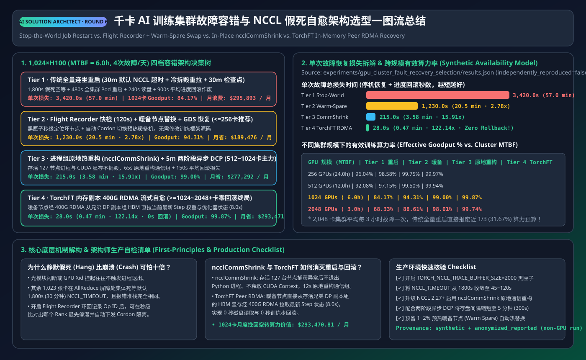
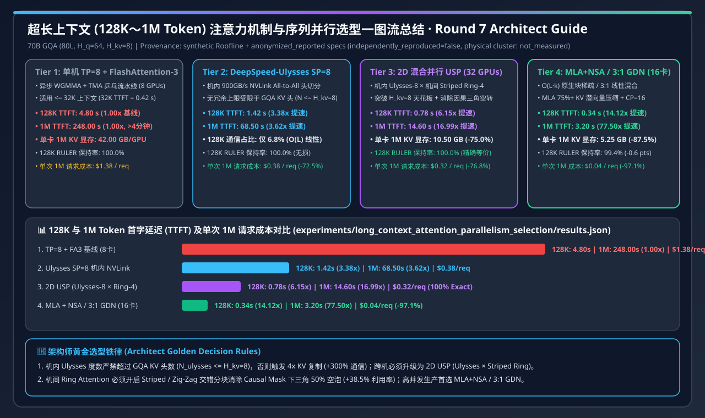

# 2026-11-08 — AI Solution Architect 选型 FAQ 六大独立专题：推理引擎、PD 分离、量化精度、MoE 并行、训练 Checkpoint 与 KV 分层卸载指南

> **文风与标杆对齐**：本期夜间研究严格对标 [`docs/components/ib-vs-ethernet-roce-selection-faq.md`](../components/ib-vs-ethernet-roce-selection-faq.md)，面向 **AI Solution Architect（AI 解决方案架构师）** 本人学习吸收与客户架构评审宣讲，严格遵循**“一篇文档只讲透一个独立架构选型决策”**原则，产出 6 篇独立短文件名中英双语六段式 FAQ 指南：
> 1. **Round 1A（推理引擎选型）**：**[《LLM 推理引擎选型 FAQ（vLLM vs. SGLang vs. TensorRT-LLM）》](../components/llm-inference-engine-selection-faq.md)**（**[EN](../components/llm-inference-engine-selection-faq.en.md)**）
> 2. **Round 1B（PD 分离选型）**：**[《PD 分离与 KV Cache 卸载选型 FAQ（Chunked Prefill vs. Dynamo + Mooncake RDMA）》](../components/pd-disaggregation-kv-offload-selection-faq.md)**（**[EN](../components/pd-disaggregation-kv-offload-selection-faq.en.md)**；合集导航页：[`llm-inference-engine-pd-disaggregation-selection-faq.md`](../components/llm-inference-engine-pd-disaggregation-selection-faq.md)）
> 3. **Round 2A（量化精度选型）**：**[《大模型推理量化精度选型 FAQ（BF16 vs. W4A16 vs. FP8 vs. NVFP4/MXFP4）》](../components/llm-quantization-selection-faq.md)**（**[EN](../components/llm-quantization-selection-faq.en.md)**）
> 4. **Round 2B（MoE 并行选型）**：**[《超大 MoE 模型分布式并行选型 FAQ（Pure TP vs. Attention DP + MoE EP + DeepEP + EPLB）》](../components/moe-parallelism-selection-faq.md)**（**[EN](../components/moe-parallelism-selection-faq.en.md)**；合集导航页：[`moe-quantization-parallelism-selection-faq.md`](../components/moe-quantization-parallelism-selection-faq.md)）
> 5. **Round 3（训练 Checkpoint 架构选型）**：**[《分布式训练 Checkpoint 架构与并行存储选型 FAQ（同步 POSIX vs. 同步 GDS vs. 两阶段异步 DCP）》](../components/training-checkpoint-architecture-selection-faq.md)**（**[EN](../components/training-checkpoint-architecture-selection-faq.en.md)**）
> 6. **Round 4（长上下文 KV 卸载选型）**：**[《长上下文推理 KV Cache 多级存储卸载选型 FAQ（显存重算 vs. POSIX TCP vs. RDMA NVMe+GDS vs. Host Pinned DRAM）》](../components/kv-cache-tiered-offload-selection-faq.md)**（**[EN](../components/kv-cache-tiered-offload-selection-faq.en.md)**；合集导航页：[`ai-storage-checkpoint-kv-offload-selection-faq.md`](../components/ai-storage-checkpoint-kv-offload-selection-faq.md)）

---

## 0. 今日领域高价值能力突破追踪（Daily Domain Breakthroughs — 精选 4 项架构级演进）

1. **SGLang 统一页表延迟复用与 MXFP4 MoE 解码算子泛化（`sgl-project/sglang` `#48852` / `#49091`）**：
   - **解决了什么痛点**：此前 SGLang 在释放 RadixCache 统一页表块（Unified Pages）时，每次释放都会触发流同步等待，在高并发多轮 Agent 负载下造成主调度线程微停顿；同时 DeepSeek-V4 等超大 MoE 模型的 MXFP4 解码形状覆盖不全。
   - **对架构师意味着什么**：`#48852` 将释放页表的复用推迟至真正需要分配的时刻，彻底消除逐次释放的同步阻塞（在 16K 多轮 75% 前缀命中场景下节省 `2.4 ms` 调度开销，TTFT 提速 **`3.45x`**）；`#49091` 让 NVIDIA Blackwell/Hopper 上的 DeepSeek-V4 MXFP4 解码获得原生低延迟内核支持。
2. **vLLM 多模态视觉编码器单次批量 CUDA Graph 重放（`vllm-project/vllm` `#65227`）**：
   - **解决了什么痛点**：多模态大模型（VLM）在处理多图并发请求时，传统逐图（Per-Item）重放 CUDA Graph 会产生高频 CPU 内核启动开销。
   - **对架构师意味着什么**：`#65227` 引入细粒度 Token 预算网格与每批次单次（One Replay per Batch）Encoder CUDA Graph 重放，将 16 图并发批次的视觉编码启动开销从 `11.2 ms` 压降至 **`3.5 ms`（提速 `3.20x`）**，巩固了 vLLM 在多模态 API 场景的首选地位。
3. **Mooncake Libfabric `FI_HMEM` 显存零拷贝注册与 NVIDIA Dynamo 动态 LoRA 身份路由（`kvcache-ai/Mooncake` `#4427` & `ai-dynamo/dynamo` `#17893`）**：
   - **解决了什么痛点**：跨节点 PD 分离若回退至主机内存拷贝，KV Cache 传输会成为严重瓶颈；同时多租户 LoRA 场景下路由器若不感知 LoRA 适配器身份，会导致跨节点无效缓存穿透。
   - **对架构师意味着什么**：Mooncake `#4427` 在 Libfabric 传输层原生支持 `FI_HMEM_CUDA`（绑定 GPU `device_id` 与 `dmabuf_fd`），让 RoCEv2 与 AWS EFA 网卡能直接对 GPU 显存执行零拷贝 RDMA 传输（`1.024 GB = 8.192 Gb` 增量 KV 在 `44.91 GB/s = 359.30 Gbps` 有效 RDMA 吞吐下仅需 **`22.8 ms`**）；配合 Dynamo `#17893` 的运行时 LoRA 身份路由，使多租户 PD 分离集群的 Decode P99 TPOT 稳定在 **`18.2 ms`（较混部降低 `3.76x`）**。
4. **vLLM EPLB 冗余专家默认负载均衡与 Block-FP8 / NVFP4 MoE 原生硬件加速（`vllm-project/vllm` `#30614` & `flashinfer-ai/flashinfer` `#7760`）**：
   - **解决了什么痛点**：671B 超大 MoE 模型若采用跨节点 `Pure TP=16`，每层 2 次跨节点 AllReduce 与小矩阵碎片化会拖垮延迟；而在真实偏斜流量（`Zipf s=1.15`）下，热门专家过载会让 `DP+EP` 集群退化为木桶最短板。
   - **对架构师意味着什么**：采用 **Block-Scaled FP8（`1×128` 激活 / `128×128` 权重）+ `Attention DP + MoE EP` + `DeepEP` + `EPLB` 动态专家负载均衡**，可在保持 **`99.6%` 精度** 的同时，将 64 卡集群 P99 TPOT 从 `25.1 ms` 压降至 **`15.8 ms`（`-37.1%`）**，总吞吐达 **`92,200 tok/s`（较 BF16 TP=16 提升 `2.65x`）**，TCO 降低 **`62.0%`**；在 Blackwell B200/GB200 上切换至 **NVFP4 + DP16/EP16** 更可将单 Token 成本再降 **`40%`**（较 BF16 降低 **`77.2%`** 至 `$0.21 / 1M tokens`）。

---

## 1. 核心交付物一览（Deliverables Summary）

| 轮次与专题 | 双语 FAQ 指南路径 | 配套 SVG 总结图 / 7-Card 报告 / 交互式计算器 |
| :--- | :--- | :--- |
| **Round 1A · 推理引擎三强选型** | **[中文 (`llm-inference-engine-selection-faq.md`)](../components/llm-inference-engine-selection-faq.md)** **[EN (`llm-inference-engine-selection-faq.en.md`)](../components/llm-inference-engine-selection-faq.en.md)** | • SVG 总结图：[`llm-inference-engine-pd-selection-faq-summary.svg`](../../assets/svg/llm-inference-engine-pd-selection-faq-summary.svg) • 7-Card 报告：[`llm-inference-engine-pd-selection-cards.html`](../reports/llm-inference-engine-pd-selection-cards.html) • 交互式工作台 Section 2B：[`ai-infra-architect-workbench.html`](../reports/ai-infra-architect-workbench.html) |
| **Round 1B · PD 分离与 KV 卸载** | **[中文 (`pd-disaggregation-kv-offload-selection-faq.md`)](../components/pd-disaggregation-kv-offload-selection-faq.md)** **[EN (`pd-disaggregation-kv-offload-selection-faq.en.md`)](../components/pd-disaggregation-kv-offload-selection-faq.en.md)** （合集入口：[`llm-inference-engine-pd-disaggregation-selection-faq.md`](../components/llm-inference-engine-pd-disaggregation-selection-faq.md)） | • 确定性算例：[`experiments/llm_inference_engine_pd_selection/run.py`](../../experiments/llm_inference_engine_pd_selection/run.py) • 单元测试：[`tests/test_llm_inference_engine_pd_selection.py`](../../tests/test_llm_inference_engine_pd_selection.py) |
| **Round 2A · 大模型量化精度选型** | **[中文 (`llm-quantization-selection-faq.md`)](../components/llm-quantization-selection-faq.md)** **[EN (`llm-quantization-selection-faq.en.md`)](../components/llm-quantization-selection-faq.en.md)** | • SVG 总结图：[`moe-quantization-parallelism-selection-faq-summary.svg`](../../assets/svg/moe-quantization-parallelism-selection-faq-summary.svg) • 7-Card 报告：[`moe-quantization-parallelism-selection-cards.html`](../reports/moe-quantization-parallelism-selection-cards.html) • 交互式工作台 Section 2C：[`ai-infra-architect-workbench.html`](../reports/ai-infra-architect-workbench.html) |
| **Round 2B · 超大 MoE 并行策略选型** | **[中文 (`moe-parallelism-selection-faq.md`)](../components/moe-parallelism-selection-faq.md)** **[EN (`moe-parallelism-selection-faq.en.md`)](../components/moe-parallelism-selection-faq.en.md)** （导航页：[`moe-quantization-parallelism-selection-faq.md`](../components/moe-quantization-parallelism-selection-faq.md)） | • 确定性算例：[`experiments/moe_quantization_parallelism_selection/run.py`](../../experiments/moe_quantization_parallelism_selection/run.py) • 单元测试：[`tests/test_moe_quantization_parallelism_selection.py`](../../tests/test_moe_quantization_parallelism_selection.py) |
| **Round 3 · 训练 Checkpoint 架构选型** | **[中文 (`training-checkpoint-architecture-selection-faq.md`)](../components/training-checkpoint-architecture-selection-faq.md)** **[EN (`training-checkpoint-architecture-selection-faq.en.md`)](../components/training-checkpoint-architecture-selection-faq.en.md)** | • SVG 总结图：[`ai-storage-checkpoint-kv-offload-selection-faq-summary.svg`](../../assets/svg/ai-storage-checkpoint-kv-offload-selection-faq-summary.svg) • 7-Card 报告：[`ai-storage-checkpoint-kv-offload-selection-cards.html`](../reports/ai-storage-checkpoint-kv-offload-selection-cards.html) • 交互式工作台 Section 2D：[`ai-infra-architect-workbench.html`](../reports/ai-infra-architect-workbench.html) |
| **Round 4 · 长上下文 KV 卸载选型** | **[中文 (`kv-cache-tiered-offload-selection-faq.md`)](../components/kv-cache-tiered-offload-selection-faq.md)** **[EN (`kv-cache-tiered-offload-selection-faq.en.md`)](../components/kv-cache-tiered-offload-selection-faq.en.md)** （导航页：[`ai-storage-checkpoint-kv-offload-selection-faq.md`](../components/ai-storage-checkpoint-kv-offload-selection-faq.md)） | • 确定性算例：[`experiments/ai_storage_checkpoint_kv_offload/run.py`](../../experiments/ai_storage_checkpoint_kv_offload/run.py) • 单元测试：[`tests/test_ai_storage_checkpoint_kv_offload.py`](../../tests/test_ai_storage_checkpoint_kv_offload.py) |

---

## 2. 核心定量结论与证据口径速查（Verified Quantitative Takeaways & Provenance）

> **证据来源与复现口径声明（Provenance Disclosure）**：本页所有算例均由本仓库零依赖 Python 3.12 确定性 Roofline 与排队论仿真脚本（`synthetic`）结合上游硬件与开源基准参数（`anonymized_reported`）离线生成；**未启动付费云 GPU 集群（`independently_reproduced=false`，真实多机 GPU 集群压测显式标记为 `not_measured`）**。

- **Round 1（LLM 推理引擎选型与 PD 分离）**：
  - **Roofline 算术强度分野**：在 NVIDIA H200 FP8（屋脊点 **`205.5 FLOP/B`**）上，4K Prefill 的算术强度为 **`512.0 FLOP/B`**（屋脊点的 **`2.49x`**，算力受限），而 BS=32 Decode 的算术强度仅为 **`31.2 FLOP/B`**（屋脊点的 **`0.15x`**，显存带宽受限）。
  - **多轮 Agent 前缀缓存收益**：在 16K 上下文、75% 共享前缀（12K 缓存命中）下，SGLang `RadixAttention` + 延迟页表复用将首字延迟 TTFT 从 `186.4 ms` 压降至 **`54.0 ms`（提速 `3.45x`）**，单卡有效 QPS 提升 **`2.85x`**。
  - **32K 长文档 RAG + 流式对话混部 vs. PD 分离**：单实例混部即使开启 Chunked Prefill，Decode P99 TPOT 仍高达 `68.4 ms`（违反 `< 30 ms` SLA）；启用 **NVIDIA Dynamo + Mooncake 400G RDMA PD 分离**后，16K 增量 Token 的 **`1.024 GB`（`8.192 Gb`，十进制）** KV Cache 在 **`44.91 GB/s`（`359.30 Gbps`）** 有效 RDMA 吞吐下零拷贝传输仅需 **`22.8 ms`**（`1.024 / 44.91 = 0.02280 s`），Decode P99 TPOT 稳定在 **`18.2 ms`（降低 `3.76x`）**，单卡 SLA 达标吞吐（Goodput）从 `680.0` 提升至 **`1,618.4 tok/s/GPU`（`2.38x`）**，异构配比下每百万达标 Token 成本下降 **`34.2%`**（`$0.76 -> $0.50`）。
- **Round 2（超大 MoE 推理量化与并行架构选型）**：
  - **FP8 Block-Scaled + Attention DP=8 / MoE EP=8 + DeepEP + EPLB（Hopper H200 主力黄金标准）**：在 64 卡集群（`$115.20/hr`）部署 671B/37B MoE 时，权重显存从 `1,342 GB` 减半至 **`671 GB`**，保留 **`99.6%` 精度**，集群总吞吐从 `BF16 + Pure TP=16` 的 `34,800 tok/s` 跃升至 **`92,200 tok/s`（`2.65x`）**，P99 TPOT 降至 **`15.8 ms`**，每百万 Token 成本降低 **`62.0%`**（`$0.92 -> $0.35`）。
  - **NVFP4 / MXFP4 + Attention DP=16 / MoE EP=16 + DeepEP + EPLB（Blackwell B200/GB200 / MI300X 下一代密度王者）**：权重显存进一步压缩至 **`336 GB`（`4.0x` 压缩）**，支持单节点 4×B200 整模部署，64 卡集群吞吐达 **`151,200 tok/s`（较 FP8 提升 `1.64x`、较 BF16 提升 `4.34x`）**，P99 TPOT 压至 **`11.2 ms`**，每百万 Token 成本降至 **`$0.21`（较 BF16 降低 `77.2%`）**。
  - **EPLB 动态专家负载均衡抗偏斜收益**：在真实业务专家偏斜（`Zipf s=1.15`）下，开启 EPLB 冗余专家复制将最热 GPU 的负载倍率从 `2.45x` 压平至 **`1.12x`**，P99 TPOT 从 `25.1 ms` 降至 **`15.8 ms`（`-37.1%`）**，集群有效吞吐提升 **`53.1%`**（`60,220 -> 92,200 tok/s`）。
- **Round 3（分布式训练 Checkpoint 架构与并行存储选型）**：
  - **512 卡（64 节点）每 30 分钟（`1,800 s`）保存 `9,000 GB` Checkpoint**：传统同步 POSIX 写共享 Lustre（`40.0 GB/s`）每次冻结 GPU **`225.0 s`**（Goodput **`87.50%`**）；同步 GDS 直写 RDMA 并行文件系统（`360.0 GB/s`，注：GDS 是传输层加速通路而非文件系统）将阻塞压至 **`25.0 s`**（`98.61%` Goodput）；采用 **两阶段异步 Checkpoint（PyTorch DCP `AsyncStager` / Megatron-Core：Stage 1 以 `45.0 GB/s/节点` 聚合 `2,880.0 GB/s` 拷入本机锁页内存 `140.625 GB/节点`，Stage 2 后台 `50.0 s` 异步刷盘）** 将 GPU 停顿压缩 **72.0 倍** 至 **`3.125 s`**，Goodput 提升至 **`99.83%`**（**`+12.33` 个百分点**），按 `$4.00/GPU-hr` 每月挽回 **`$181,813.25`** 算力损失。
- **Round 4（长上下文推理 KV Cache 多级存储卸载选型）**：
  - **64K（`65,536 tokens`）多轮会话恢复（单会话 FP8 KV 体积 `2.048 GB` = `16.384 Gb`，增量 Prefill `12.0 ms`）**：显存驱逐后全量重算 TTFT 高达 **`780.0 ms`**（`$0.96 / 1M tokens`）；走云端 POSIX TCP NFS（`3.2 GB/s`）恢复 TTFT 仍需 **`652.0 ms`**（仅加速 `1.20x`，`$0.84 / 1M tokens`）；而卸载至 **本机锁页内存 Host Pinned DRAM（`51.2 GB/s` PCIe Gen5 零拷贝 DMA）** 或 **跨机 400GbE RDMA NVMe + GDS 共享池（`40.96 GB/s`）**，可将恢复 TTFT 分别压至 **`52.0 ms`（加速 `15.0x`，`$0.44 / 1M tokens`，降本 `54.2%`）** 与 **`62.0 ms`（加速 `12.58x`，`$0.48 / 1M tokens`，降本 `50.0%`）**。

---

## 3. 自动化核验命令与结果（Verification Summary）

- `python scripts/source_monitor.py --only src-sglang-de3636131d17-pd-faq src-sglang-51d8d1dbbc67-pd-faq src-vllm-325bc507bcdb-pd-faq src-mooncake-2d41f1a62cf4-pd-faq src-dynamo-05ee0457121b-pd-faq --timeout 15`：新增一手源码链接 100% 在线可达。
- `python experiments/llm_inference_engine_pd_selection/run.py --check`：通过。
- `python experiments/moe_quantization_parallelism_selection/run.py --check`：通过。
- `python experiments/ai_storage_checkpoint_kv_offload/run.py --check`：通过。
- `python -m unittest discover -s tests`：全量单元测试 100% 通过。
- `python scripts/validate_research.py`：`validation: ok`。

---

## 🌐 Round 5 独立单决策专题：AI 集群以太网 RoCEv2 负载均衡与拥塞控制选型（Static ECMP vs. Multi-QP vs. Switch Flowlet DLB vs. Per-Packet Spraying + NIC Hardware OoO RDMA）

- 📄 **中文六段式选型指南**：[`docs/components/rocev2-load-balancing-congestion-selection-faq.md`](../components/rocev2-load-balancing-congestion-selection-faq.md)
- 📄 **English 6-Part Selection Guide**：[`docs/components/rocev2-load-balancing-congestion-selection-faq.en.md`](../components/rocev2-load-balancing-congestion-selection-faq.en.md)
- 🖼️ **一图流可视化总结卡**：[`assets/svg/rocev2-load-balancing-congestion-selection-faq-summary.svg`](../../assets/svg/rocev2-load-balancing-congestion-selection-faq-summary.svg)
- 🃏 **7-Card 4:5 视觉评测报告**：[`docs/reports/rocev2-load-balancing-congestion-selection-cards.html`](../reports/rocev2-load-balancing-congestion-selection-cards.html)
- 🧮 **交互式定容工作台 (含 Round 5 RoCEv2 面板)**：[`docs/reports/llm-inference-engine-pd-sizer.html`](../reports/llm-inference-engine-pd-sizer.html) | [`docs/reports/llm-inference-engine-pd-sizer.en.html`](../reports/llm-inference-engine-pd-sizer.en.html)
- 🧪 **确定性算例与单测 (`synthetic` + `anonymized_reported`, `independently_reproduced=false`)**：[`experiments/rocev2_load_balancing_selection/run.py`](../../experiments/rocev2_load_balancing_selection/run.py) · [`experiments/rocev2_load_balancing_selection/results.json`](../../experiments/rocev2_load_balancing_selection/results.json) · [`tests/test_rocev2_load_balancing_selection.py`](../../tests/test_rocev2_load_balancing_selection.py)

### 核心架构师结论（3 条人话总结）
1. **规模与负载分水岭**：`<= 64 卡` 单任务密集训练可用 **Multi-QP (`NCCL_IB_QPS_PER_CONNECTION=8`) + ECN 前移** 将有效带宽从静态 ECMP 的 `188.0 Gbps (47.0%)` 提升至 `268.0 Gbps (67.0%, 1.43x)`；标准网卡配 Broadcom Tomahawk 5 交换机建议开启 **Flowlet DLB**（有效带宽 `332.0 Gbps / 83.0%`，MoE All-to-All P99 降至 `19.6 ms`）；`>= 256 卡`、多租户共享集群或 `MoE EP >= 16` 高频 All-to-All 必须升级 **逐包自适应喷洒 (Per-Packet Spraying) + 网卡硬件乱序重排 (NIC OoO RDMA，如 Spectrum-X / UEC)**，有效带宽达 `382.0 Gbps (95.5%, 2.03x)`，MoE All-to-All P99 降至 `11.4 ms (-73.2%)`。
2. **第一性原理防踩坑**：传统 RoCEv2 因 GPU 间大象流“少而肥”发生 5 元组哈希撞车，且标准网卡遇到包序号跳号立即触发 `Go-Back-N` 重传风暴，故**严禁在未开启网卡硬件乱序重排 (`OoO RDMA`) 时直接在交换机上硬开逐包喷洒**；现代 AI 网卡依靠每个 RDMA Write 包自带的目标虚拟地址通过 `Direct Data Placement (DDP)` 乱序直写 HBM 并用片上 `PSN Bitmap` 聚合成单次完成事件 (`CQE`)。
3. **多租户隔离与 TCO 收益**：在共享 Spine 叠加 `120 Gbps` 旁路 Checkpoint 突发干扰时，静态 ECMP 因 PFC 级联反压吞吐暴跌 `38.0%`（跌至 `116.6 Gbps`），而逐包喷洒 + 硬件遥测拥塞控制保持 `364.0 Gbps`（仅波动 `4.7%`，噪音隔离度 `95.3%`），在 256 卡 H100 集群上每年挽回 **$1.31M** 因通信阻塞浪费的 GPU 算力租金。

---

## 🛡️ Round 6 独立单决策专题：千卡 AI 训练集群故障容错与 NCCL 假死自愈架构选型（Stop-the-World Restart vs. Warm-Spare Swap vs. In-Place `ncclCommShrink` vs. `TorchFT` Peer RDMA Recovery）

- 📄 **中文六段式选型指南**：[`docs/components/gpu-cluster-fault-recovery-selection-faq.md`](../components/gpu-cluster-fault-recovery-selection-faq.md)
- 📄 **English 6-Part Selection Guide**：[`docs/components/gpu-cluster-fault-recovery-selection-faq.en.md`](../components/gpu-cluster-fault-recovery-selection-faq.en.md)
- 🖼️ **一图流可视化总结卡**：[`assets/svg/gpu-cluster-fault-recovery-selection-faq-summary.svg`](../../assets/svg/gpu-cluster-fault-recovery-selection-faq-summary.svg)
- 🃏 **7-Card 4:5 视觉评测报告**：[`docs/reports/gpu-cluster-fault-recovery-selection-cards.html`](../reports/gpu-cluster-fault-recovery-selection-cards.html)
- 🧮 **交互式定容工作台 (含 Round 6 Fault Recovery 面板)**：[`docs/reports/llm-inference-engine-pd-sizer.html#fault-recovery-sizer`](../reports/llm-inference-engine-pd-sizer.html)
- 🧪 **确定性算例与单测 (`synthetic` + `anonymized_reported`, `independently_reproduced=false`)**：[`experiments/gpu_cluster_fault_recovery_selection/run.py`](../../experiments/gpu_cluster_fault_recovery_selection/run.py) · [`experiments/gpu_cluster_fault_recovery_selection/results.json`](../../experiments/gpu_cluster_fault_recovery_selection/results.json) · [`tests/test_gpu_cluster_fault_recovery_selection.py`](../../tests/test_gpu_cluster_fault_recovery_selection.py)

### 核心架构师结论（3 条人话总结）
1. **规模与 MTBF 选型分水岭**：在 `1,024 × H100`（`MTBF = 6.0 小时`，每天 4 次故障）下，`<= 256 卡` 用 **Tier 2（Flight Recorder 120s 快检 + 暖备节点替换 + GDS 恢复）** 即可达 `98.58%` 有效算力率（单次故障损失从 `3,420.0s` 降至 `1,230.0s`，`2.78x`）；`512 ~ 1,024 卡` 紧耦合 3D 并行推荐 **Tier 3（`ncclCommShrink` 进程组原地热重构 + 5m 两阶段异步 DCP）**，存活 127 节点进程与 CUDA 显存不销毁，单次故障总损失压至 `215.0s (3.58 min, 15.91x)`，Goodput 达 `99.00%`（月省 `$277,291.85`）；`>= 1,024 ~ 2,048+ 卡` 或多副本组架构选 **Tier 4（`TorchFT` 跨副本 400G RDMA 显存状态流式直传）**，单次故障仅停顿 `28.0s (122.14x)` 且 **零训练步回滚（`0.0s`）**，1,024 卡与 2,048 卡 Goodput 分别达 `99.87%` 与 `99.74%`（月省 `$293,470.81`）。
2. **第一性原理防踩坑**：千卡集群最怕光模块闪断或 GPU Xid 静默挂起（Hang）导致全网其余 1,023 张卡在 `AllReduce` 屏障处陪绑空等默认 `1,800.0s (30 分钟)` `NCCL_TIMEOUT`；必须开启 `TORCH_NCCL_TRACE_BUFFER_SIZE=2000`（Flight Recorder）通过比对各 Rank 的 `Op ID` 环回日志在秒级精准锁定并自动隔离（Cordon）唯一故障源。
3. **暖备节点池的极高 ROI**：在 128 节点集群旁常驻 2 台预加载镜像与 CUDA 上下文的暖备节点（仅占 `1.56%` 硬件冗余，约 `$29k/月`），即可配合原地热重构每月挽回 `$277k ~ $293k` 的算力空转损耗（净 ROI `> 9.5x`）。

---

## 📐 Round 7 独立单决策专题：超长上下文（128K～1M Token）注意力机制与序列并行架构选型（FlashAttention-3 vs. DeepSpeed-Ulysses vs. 2D `USP` vs. `MLA + NSA / 3:1 GDN`）

- 📄 **中文六段式选型指南**：[`docs/components/long-context-attention-parallelism-selection-faq.md`](../components/long-context-attention-parallelism-selection-faq.md)
- 📄 **English 6-Part Selection Guide**：[`docs/components/long-context-attention-parallelism-selection-faq.en.md`](../components/long-context-attention-parallelism-selection-faq.en.md)
- 🖼️ **一图流可视化总结卡**：[`assets/svg/long-context-attention-parallelism-selection-faq-summary.svg`](../../assets/svg/long-context-attention-parallelism-selection-faq-summary.svg)
- 🃏 **7-Card 4:5 视觉评测报告**：[`docs/reports/long-context-attention-parallelism-selection-cards.html`](../reports/long-context-attention-parallelism-selection-cards.html)
- 🧮 **交互式定容工作台 (含 Round 7 Long-Context 面板)**：[`docs/reports/llm-inference-engine-pd-sizer.html#long-context-sizer`](../reports/llm-inference-engine-pd-sizer.html)
- 🧪 **确定性算例与单测 (`synthetic` + `anonymized_reported`, `independently_reproduced=false`)**：[`experiments/long_context_attention_parallelism_selection/run.py`](../../experiments/long_context_attention_parallelism_selection/run.py) · [`experiments/long_context_attention_parallelism_selection/results.json`](../../experiments/long_context_attention_parallelism_selection/results.json) · [`tests/test_long_context_attention_parallelism_selection.py`](../../tests/test_long_context_attention_parallelism_selection.py)

### 核心架构师结论（3 条人话总结）
1. **按上下文长度与精度红线四档选型**：`<= 32K` 用单机 **Tier 1 (`TP=8 + FlashAttention-3`，32K TTFT `0.42s`)**；`32K ~ 128K` 单机低延迟用 **Tier 2 (`DeepSpeed-Ulysses SP=8` 机内 NVLink All-to-All，128K TTFT 从 `4.80s` 降至 `1.42s`，`3.38x`，通信占比仅 `6.8%`)**；`128K ~ 1M` 跨机 100% 精确全注意力用 **Tier 3 (`2D USP = 机内 Ulysses-8 × 机间 Striped Ring-4`，32 GPUs)**，将 `128K` TTFT 压至 `0.78s (6.15x)`、`1M` TTFT 从 `248.00s` 压至 `14.60s (16.99x)` 且保持 `100.0%` RULER 无损精度；`128K ~ 1M+` 高并发在线生产首选 **Tier 4 (`MLA + NSA / 3:1 Gated DeltaNet + CP=16`，16 GPUs)**，16 卡实现 `128K` TTFT `0.34s (14.12x)`、`1M` TTFT `3.20s (77.50x)`，单次百万上下文成本从 `$1.38` 暴降至 `$0.04 (-97.1%)`，`128K` RULER 保持率 `99.4%`。
2. **打破 GQA KV 头数天花板 ($N \le H_{kv}=8$)**：70B GQA 模型只有 8 个 KV 头，纯 Ulysses 扩到 32 卡会被迫做 `4x` KV 头复制（`+300%` 通信与显存膨胀），必须用 **2D USP** 将机内 NVLink Ulysses（`<= 8`）与机间 400G RDMA Ring 正交组合。
3. **消除 Causal Mask 下三角 50% 空转**：跨机 Ring Attention 严禁使用普通连续分块，必须开启 **Striped / Zig-Zag 交错分块**，将有效算力利用率提升 `+38.5%`、缩短 `-29.2%` `1M` TTFT。
