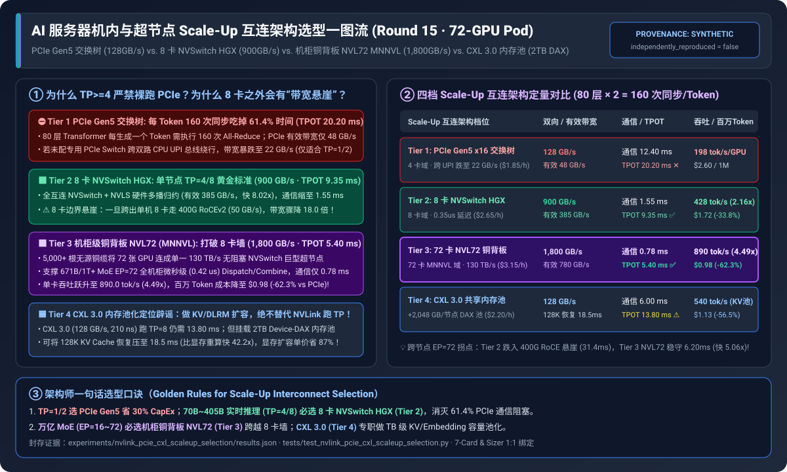

# 2026-11-09 — AI Solution Architect 选型 FAQ 夜间持续深潜专题：Scale-Up 机内/超节点互连、分布式训练并行显存优化与集群调度指南

> **文风与标杆对齐**：本期夜间研究严格对标 [`docs/components/ib-vs-ethernet-roce-selection-faq.md`](../components/ib-vs-ethernet-roce-selection-faq.md) 与 [`docs/daily/2026-11-08.md`](./2026-11-08.md)，面向 **AI Solution Architect（AI 解决方案架构师）** 本人学习吸收与客户架构评审宣讲，严格遵循**“单篇纯粹清晰 × 整晚多篇迭代”**原则，杜绝 Commit 杂烩汤与晦涩黑话堆砌。

---

## 0. 今日领域高价值能力突破追踪（Daily Domain Breakthroughs — 2026-11-09 精选 4 项架构级演进）

1. **SGLang + Mooncake 逐层 KV 直接加载主机开销削减与统一布局 TMA 硬件拷贝（`sgl-project/sglang` `#46168` `ab84df61dd` / `#48786` `60d8d1f8e4`）**：
   - **解决了什么痛点**：在分层 KV Cache 卸载（HiCache / Mooncake）中，当大模型按 Transformer 层（Layer-wise）从主机内存或远端存储异步拉取 KV 块时，CPU 端 Direct Linker 的指针拼装与逐页拷贝会阻塞主调度循环；同时非连续页布局难以跑满 Hopper/Blackwell 硬件张量内存加速器（TMA）。
   - **对架构师意味着什么**：`#46168` 大幅削减了 Mooncake 逐层直接链接器的 Host CPU 调度耗时，`#48786` 为 HiCache 统一内存布局引入原生 **TMA 异步硬件拷贝内核**，使多轮长上下文会话从 Host DRAM / CXL 内存池恢复 KV Cache 真正实现零 SM 占用、全线速重叠。
2. **SGLang DeepSeek-V4.1 长上下文投机解码验证元数据同址暂存（`sgl-project/sglang` `#47627` `704681229f`）**：
   - **解决了什么痛点**：在长上下文场景下开启 MTP / EAGLE-3 投机解码时，Target 模型验证阶段（Target Verify）原本需要在主机与设备之间额外构建并传递一套独立的分页注意力元数据，导致小 Batch 解码被元数据准备延迟拖累。
   - **对架构师意味着什么**：`#47627` 将 Target 验证元数据紧挨着 Draft 草稿元数据同址暂存（Stage Beside Draft），省去每次验证的冗余元数据重构建与 H2D 同步，进一步稳固了长文本下投机解码 `2.5x~3.0x` 的净加速比。
3. **vLLM PD 分离架构支持 Prefill 实例跨机流水线并行 + RDMA WRITE 直写（`vllm-project/vllm` `#64693` `56e5608d0f`）**：
   - **解决了什么痛点**：当部署 405B/671B 超大模型采用 Prefill-Decode (PD) 分离时，如果单个 Prefill 实例需要跨节点流水线并行（PP），传统 KV 传输连接器无法将分布在不同 PP Stage 上的 KV 层直接通过单边 RDMA `WRITE` 推送给 Decode 节点。
   - **对架构师意味着什么**：`#64693` 打通了 PD 分离下 Prefill 侧 `PP` 与 `WRITE` 模式的协同，允许没有机柜级 NVL72 的存量 8 卡服务器集群通过 `TP=8 + PP=2` 承载超大模型 Prefill，并由各 PP 阶段直接向 Decode 池并发执行零拷贝 RDMA 写入。
4. **FlashInfer Blackwell SM100a/SM103a 小分组 MoE FP8 DeepGEMM 掩码优化（`flashinfer-ai/flashinfer` `#9263` `5acec0d282`）**：
   - **解决了什么痛点**：在超大 MoE 模型开启大专家并行（如 `NVL72 EP=72`）后，分配到单张 GPU 上的本地活跃专家数（`<= 8 groups`）及每个专家分到的 Token 数较少，传统大分块（`BLOCK_N >= 64`）Grouped GEMM 会产生严重的矩阵填充算力浪费。
   - **对架构师意味着什么**：`#9263` 针对 Blackwell `sm_100a/sm_103a` 专门构建了 `BLOCK_N=32` 且单次计算 `masked_m` 的紧凑型 FP8 DeepGEMM 内核，直接提升机柜级大 EP 解码场景下的 Tensor Core 有效利用率。

---

## 🔌 Round 15 独立单决策专题：AI 服务器机内与超节点 Scale-Up 互连架构选型（`PCIe Gen5 交换树` vs. `单节点 8 卡 NVSwitch (HGX)` vs. `机柜级铜背板 NVL72 (MNNVL)` vs. `PCIe Gen6 + CXL 3.0 内存池化`）

- 📄 **中文六段式选型指南**：[`docs/components/nvlink-pcie-cxl-scaleup-interconnect-selection-faq.md`](../components/nvlink-pcie-cxl-scaleup-interconnect-selection-faq.md)
- 📄 **English 6-Part Selection Guide**：[`docs/components/nvlink-pcie-cxl-scaleup-interconnect-selection-faq.en.md`](../components/nvlink-pcie-cxl-scaleup-interconnect-selection-faq.en.md)
- 🖼️ **一图流可视化总结卡**：[`assets/svg/nvlink-pcie-cxl-scaleup-interconnect-selection-faq-summary.svg`](../../assets/svg/nvlink-pcie-cxl-scaleup-interconnect-selection-faq-summary.svg)
- 🃏 **7-Card 4:5 视觉评测报告**：[`docs/reports/nvlink-pcie-cxl-scaleup-interconnect-selection-cards.html`](../reports/nvlink-pcie-cxl-scaleup-interconnect-selection-cards.html)
- 🧮 **交互式定容工作台 (含 Round 15 Scale-Up 互连选型面板)**：[`docs/reports/llm-inference-engine-pd-sizer.html#scaleup-interconnect-sizer`](../reports/llm-inference-engine-pd-sizer.html)
- 🧪 **确定性算例与单测 (`synthetic` + `anonymized_reported`, `independently_reproduced=false`)**：[`experiments/nvlink_pcie_cxl_scaleup_selection/run.py`](../../experiments/nvlink_pcie_cxl_scaleup_selection/run.py) · [`experiments/nvlink_pcie_cxl_scaleup_selection/results.json`](../../experiments/nvlink_pcie_cxl_scaleup_selection/results.json) · [`tests/test_nvlink_pcie_cxl_scaleup_selection.py`](../../tests/test_nvlink_pcie_cxl_scaleup_selection.py)

### 核心架构师结论（3 条人话总结）
1. **按张量/专家并行紧耦合域规模（`TP / EP Domain GPUs`）四档精准对号入座**：在 `72-GPU` 算力集群运行 80 层大模型解码（每生成 1 个 Token 触发 `160` 次同步，SLA `TPOT <= 12.0 ms`）下，**`TP=1/2`（7B～32B 模型、LoRA 微调、视频独立渲染）首选 Tier 1（`PCIe Gen5` 交换树）**，TPOT `9.60 ms` 达标且节省 `30%+` 硬件 CapEx（但严禁跑 `TP>=4`，`TP=8` 下 `61.4%` 时间卡死在 PCIe 总线上，TPOT 恶化至 `20.20 ms`）；**`TP=4/8`（70B～405B 稠密模型）首选 Tier 2（单节点 8 卡 `NVSwitch HGX`）**，`900 GB/s` 双向全互连 + `NVLS` 硬件多播归约将 160 次同步从 `12.40 ms` 压至 **`1.55 ms`（快 `8.0x`）**，TPOT **`9.35 ms`**，单卡吞吐提升 **`2.16x`（`428.0 tok/s`）**，百万 Token 成本降至 **`$1.72`（`-33.8%`）**；**`EP=16~72`（671B～1T+ 超大 MoE 与万亿预训练）首选 Tier 3（机柜级 72 卡铜背板 `NVL72 MNNVL`）**，5,000+ 根无源铜缆构建 `130 TB/s` 整柜无阻塞域，彻底消灭 8 卡 HGX 跨机掉入 400G RoCE（`50 GB/s`）的 **18 倍带宽悬崖**（`EP=72` TPOT **`6.20 ms` vs. `31.40 ms`，快 `5.06x`**），单卡吞吐达 **`890.0 tok/s`（`4.49x`）**，百万 Token 成本降至 **`$0.98`（`-62.3%`）**。
2. **`CXL 3.0` 定位辟谣与容量池化红利**：`CXL 3.0 x16`（双向 `128 GB/s`）带宽仅为 `NVLink-4/5` 的 `1/7 ~ 1/14`，**绝不可替代 NVLink 跑高频 `TP>=8` All-Reduce**；但作为 **Tier 4（`CXL 3.0 Type-3` 共享内存池 + `2 MiB Device-DAX`）** 外挂 `+2,048 GB/节点` DDR5 内存池时，能以 **`$4.50/GB`（比 `$35+/GB` HBM3e 便宜 `87%`）** 在 **`18.5 ms`** 内零拷贝恢复 128K KV 缓存（比显存重算快 **`42.2x`**），将长上下文/搜推 DLRM 成本压至 **`$1.13 / 1M tokens`（`-56.5%`）**。
3. **生产防踩坑铁律**：采购 8 卡 PCIe 服务器必须通过 `nvidia-smi topo -m` 确认具备专用 PCIe Switch（`PIX`），严防跨双路 CPU `UPI/QPI` 总线（`SYS`）导致 P2P 带宽从 `48 GB/s` 腰斩至 `22 GB/s`。

---

## 🏋️ Round 16 独立单决策专题：百亿至万亿参数大模型分布式训练并行与显存优化架构选型（`DDP / ZeRO-1` vs. `全量 ZeRO-3 / FSDP` vs. `混合分片 HFSDP` vs. `Megatron 3D (TP + DualPipe PP + DP) + 选择性激活卸载`）

- 📄 **中文六段式选型指南**：[`docs/components/distributed-training-memory-parallelism-selection-faq.md`](../components/distributed-training-memory-parallelism-selection-faq.md)
- 📄 **English 6-Part Selection Guide**：[`docs/components/distributed-training-memory-parallelism-selection-faq.en.md`](../components/distributed-training-memory-parallelism-selection-faq.en.md)
- 🖼️ **一图流可视化总结卡**：[`assets/svg/distributed-training-memory-parallelism-selection-faq-summary.svg`](../../assets/svg/distributed-training-memory-parallelism-selection-faq-summary.svg)
- 🃏 **7-Card 4:5 视觉评测报告**：[`docs/reports/distributed-training-memory-parallelism-selection-cards.html`](../reports/distributed-training-memory-parallelism-selection-cards.html)
- 🧮 **交互式定容工作台 (含 Round 16 分布式训练并行选型面板)**：[`docs/reports/llm-inference-engine-pd-sizer.html#training-parallelism-sizer`](../reports/llm-inference-engine-pd-sizer.html)
- 🧪 **确定性算例与单测 (`synthetic` + `anonymized_reported`, `independently_reproduced=false`)**：[`experiments/distributed_training_parallelism_selection/run.py`](../../experiments/distributed_training_parallelism_selection/run.py) · [`experiments/distributed_training_parallelism_selection/results.json`](../../experiments/distributed_training_parallelism_selection/results.json) · [`tests/test_distributed_training_parallelism_selection.py`](../../tests/test_distributed_training_parallelism_selection.py)

### 核心架构师结论（3 条人话总结）
1. **破解 `$16\Psi$` 显存墙与跨机 `ZeRO-3` 通信风暴**：在 `256 × NVIDIA H100 80GB`（`$640/hr`）训练 `120B` 模型 `1.0T` Tokens（`4M tokens/step`）下，**Tier 1（`DDP / ZeRO-1`）** 因未切分权重与梯度单卡需 **`244.20 GB`** 直接触发 OOM（退回 PCIe CPU 卸载则阻塞 `58.6%`、MFU 仅 `28.5%`、1T 成本 `$499,885`）；**Tier 2（全量 `ZeRO-3 / FSDP` 256 卡全局分片）** 虽将显存压至 **`46.80 GB`**，但每层前向/反向跨 32 节点 RoCE 执行全局 `All-Gather/RS` 导致 **`44.2%` 时间卡在网卡上**（单步 `6.45 s`、MFU 仅 `36.4%`、1,024 卡更暴跌至 `24.5%`）。
2. **`32~128 卡` 选混合分片 `HFSDP`，`>=256 卡` 必选 `Megatron 3D + DualPipe`**：**Tier 3（`PyTorch FSDP2 HFSDP`）** 将权重分片锁死在机内 `900 GB/s` NVLink 域（`58.40 GB` HBM）并配合 Copy-Engine 异步预取，阻塞降至 **`16.8%`**，单步 **`4.35 s`（比 ZeRO-3 快 `1.48x`）**，MFU 跃升至 **`54.0%`**，1T 成本 **`$184,285`（`-63.1%`）**；**Tier 4（`Megatron 3D: TP=8 + DualPipe PP=4 + DP=8` + 选择性激活重算卸载）** 跨节点仅传层间微激活并将 PP 气泡从 `21.4%` 压至 **`3.8%`**，显存 **`51.01 GB`**，总阻塞仅 **`9.2%`**，单步 **`3.52 s`（快 `1.83x` vs ZeRO-3）**，MFU 达 **`66.8%`**，1T Token 成本降至 **`$149,121`（比 ZeRO-3 净省 `$124,134 / -45.4%`）**。
3. **生产防踩坑铁律**：严禁开启粗暴全层重算（`full recompute` 平白增加 `+33%` FLOPs），应改用选择性重算（仅重算 `Softmax/Dropout/SiLU`）结合 PCIe Copy-Engine 锁页内存卸载。

