# 2026-11-09 — AI Solution Architect 选型 FAQ 夜间持续深潜专题：Scale-Up 机内/超节点互连、分布式训练并行显存优化与集群调度指南

> **文风与标杆对齐**：本期夜间研究严格对标 [`docs/components/ib-vs-ethernet-roce-selection-faq.md`](../components/ib-vs-ethernet-roce-selection-faq.md) 与 [`docs/daily/2026-11-08.md`](./2026-11-08.md)，面向 **AI Solution Architect（AI 解决方案架构师）** 本人学习吸收与客户架构评审宣讲，严格遵循**“单篇纯粹清晰 × 整晚多篇迭代”**原则，杜绝 Commit 杂烩汤与晦涩黑话堆砌。

---

## 0. 今日领域高价值能力突破追踪（Daily Domain Breakthroughs — 2026-11-09 精选 4 项架构级演进）

1. **SGLang + Mooncake 逐层 KV 直接加载主机开销削减与统一布局 TMA 硬件拷贝（`sgl-project/sglang` `#46168` `ab84df61dd` / `#48786` `60d8d1f8e4`）**：
   - **解决了什么痛点**：在分层 KV Cache 卸载（HiCache / Mooncake）中，当大模型按 Transformer 层（Layer-wise）从主机内存或远端存储异步拉取 KV 块时，CPU 端 Direct Linker 的指针拼装与逐页拷贝会阻塞主调度循环；同时非连续页布局难以跑满 Hopper/Blackwell 硬件张量内存加速器（TMA）。
   - **对架构师意味着什么**：`#46168` 大幅削减了 Mooncake 逐层直接链接器的 Host CPU 调度耗时，`#48786` 为 HiCache 统一内存布局引入原生 **TMA 异步硬件拷贝内核**，使多轮长上下文会话从 Host DRAM / CXL 内存池恢复 KV Cache 真正实现零 SM 占用、全线速重叠。
2. **SGLang DeepSeek-V4.1 长上下文投机解码验证元数据同址暂存（`sgl-project/sglang` `#47627` `704681229f`）**：
   - **解决了什么痛点**：在长上下文场景下开启 MTP / EAGLE-3 投机解码时，Target 模型验证阶段（Target Verify）原本需要在主机与设备之间额外构建并传递一套独立的分页注意力元数据，导致小 Batch 解码被元数据准备延迟拖累。
   - **对架构师意味着什么**：`#47627` 将 Target 验证元数据紧挨着 Draft 草稿元数据同址暂存（Stage Beside Draft），省去每次验证的冗余元数据重构建与 H2D 同步，进一步稳固了长文本下投机解码 `2.5x~3.0x` 的净加速比。
3. **vLLM PD 分离架构支持 Prefill 实例跨机流水线并行 + RDMA WRITE 直写（`vllm-project/vllm` `#64693` `56e5608d0f`）**：
   - **解决了什么痛点**：当部署 405B/671B 超大模型采用 Prefill-Decode (PD) 分离时，如果单个 Prefill 实例需要跨节点流水线并行（PP），传统 KV 传输连接器无法将分布在不同 PP Stage 上的 KV 层直接通过单边 RDMA `WRITE` 推送给 Decode 节点。
   - **对架构师意味着什么**：`#64693` 打通了 PD 分离下 Prefill 侧 `PP` 与 `WRITE` 模式的协同，允许没有机柜级 NVL72 的存量 8 卡服务器集群通过 `TP=8 + PP=2` 承载超大模型 Prefill，并由各 PP 阶段直接向 Decode 池并发执行零拷贝 RDMA 写入。
4. **FlashInfer Blackwell SM100a/SM103a 小分组 MoE FP8 DeepGEMM 掩码优化（`flashinfer-ai/flashinfer` `#9263` `5acec0d282`）**：
   - **解决了什么痛点**：在超大 MoE 模型开启大专家并行（如 `NVL72 EP=72`）后，分配到单张 GPU 上的本地活跃专家数（`<= 8 groups`）及每个专家分到的 Token 数较少，传统大分块（`BLOCK_N >= 64`）Grouped GEMM 会产生严重的矩阵填充算力浪费。
   - **对架构师意味着什么**：`#9263` 针对 Blackwell `sm_100a/sm_103a` 专门构建了 `BLOCK_N=32` 且单次计算 `masked_m` 的紧凑型 FP8 DeepGEMM 内核，直接提升机柜级大 EP 解码场景下的 Tensor Core 有效利用率。

---

## 🔌 Round 15 独立单决策专题：AI 服务器机内与超节点 Scale-Up 互连架构选型（`PCIe Gen5 交换树` vs. `单节点 8 卡 NVSwitch (HGX)` vs. `机柜级铜背板 NVL72 (MNNVL)` vs. `PCIe Gen6 + CXL 3.0 内存池化`）

- 📄 **中文六段式选型指南**：[`docs/components/nvlink-pcie-cxl-scaleup-interconnect-selection-faq.md`](../components/nvlink-pcie-cxl-scaleup-interconnect-selection-faq.md)
- 📄 **English 6-Part Selection Guide**：[`docs/components/nvlink-pcie-cxl-scaleup-interconnect-selection-faq.en.md`](../components/nvlink-pcie-cxl-scaleup-interconnect-selection-faq.en.md)
- 🖼️ **一图流可视化总结卡**：[`assets/svg/nvlink-pcie-cxl-scaleup-interconnect-selection-faq-summary.svg`](../../assets/svg/nvlink-pcie-cxl-scaleup-interconnect-selection-faq-summary.svg)
- 🃏 **7-Card 4:5 视觉评测报告**：[`docs/reports/nvlink-pcie-cxl-scaleup-interconnect-selection-cards.html`](../reports/nvlink-pcie-cxl-scaleup-interconnect-selection-cards.html)
- 🧮 **交互式定容工作台 (含 Round 15 Scale-Up 互连选型面板)**：[`docs/reports/llm-inference-engine-pd-sizer.html#scaleup-interconnect-sizer`](../reports/llm-inference-engine-pd-sizer.html)
- 🧪 **确定性算例与单测 (`synthetic` + `anonymized_reported`, `independently_reproduced=false`)**：[`experiments/nvlink_pcie_cxl_scaleup_selection/run.py`](../../experiments/nvlink_pcie_cxl_scaleup_selection/run.py) · [`experiments/nvlink_pcie_cxl_scaleup_selection/results.json`](../../experiments/nvlink_pcie_cxl_scaleup_selection/results.json) · [`tests/test_nvlink_pcie_cxl_scaleup_selection.py`](../../tests/test_nvlink_pcie_cxl_scaleup_selection.py)

### 核心架构师结论（3 条人话总结）
1. **按张量/专家并行紧耦合域规模（`TP / EP Domain GPUs`）四档精准对号入座**：在 `72-GPU` 算力集群运行 80 层大模型解码（每生成 1 个 Token 触发 `160` 次同步，SLA `TPOT <= 12.0 ms`）下，**`TP=1/2`（7B～32B 模型、LoRA 微调、视频独立渲染）首选 Tier 1（`PCIe Gen5` 交换树）**，TPOT `9.60 ms` 达标且节省 `30%+` 硬件 CapEx（但严禁跑 `TP>=4`，`TP=8` 下 `61.4%` 时间卡死在 PCIe 总线上，TPOT 恶化至 `20.20 ms`）；**`TP=4/8`（70B～405B 稠密模型）首选 Tier 2（单节点 8 卡 `NVSwitch HGX`）**，`900 GB/s` 双向全互连 + `NVLS` 硬件多播归约将 160 次同步从 `12.40 ms` 压至 **`1.55 ms`（快 `8.0x`）**，TPOT **`9.35 ms`**，单卡吞吐提升 **`2.16x`（`428.0 tok/s`）**，百万 Token 成本降至 **`$1.72`（`-33.8%`）**；**`EP=16~72`（671B～1T+ 超大 MoE 与万亿预训练）首选 Tier 3（机柜级 72 卡铜背板 `NVL72 MNNVL`）**，5,000+ 根无源铜缆构建 `130 TB/s` 整柜无阻塞域，彻底消灭 8 卡 HGX 跨机掉入 400G RoCE（`50 GB/s`）的 **18 倍带宽悬崖**（`EP=72` TPOT **`6.20 ms` vs. `31.40 ms`，快 `5.06x`**），单卡吞吐达 **`890.0 tok/s`（`4.49x`）**，百万 Token 成本降至 **`$0.98`（`-62.3%`）**。
2. **`CXL 3.0` 定位辟谣与容量池化红利**：`CXL 3.0 x16`（双向 `128 GB/s`）带宽仅为 `NVLink-4/5` 的 `1/7 ~ 1/14`，**绝不可替代 NVLink 跑高频 `TP>=8` All-Reduce**；但作为 **Tier 4（`CXL 3.0 Type-3` 共享内存池 + `2 MiB Device-DAX`）** 外挂 `+2,048 GB/节点` DDR5 内存池时，能以 **`$4.50/GB`（比 `$35+/GB` HBM3e 便宜 `87%`）** 在 **`18.5 ms`** 内零拷贝恢复 128K KV 缓存（比显存重算快 **`42.2x`**），将长上下文/搜推 DLRM 成本压至 **`$1.13 / 1M tokens`（`-56.5%`）**。
3. **生产防踩坑铁律**：采购 8 卡 PCIe 服务器必须通过 `nvidia-smi topo -m` 确认具备专用 PCIe Switch（`PIX`），严防跨双路 CPU `UPI/QPI` 总线（`SYS`）导致 P2P 带宽从 `48 GB/s` 腰斩至 `22 GB/s`。

---

## 🏋️ Round 16 独立单决策专题：百亿至万亿参数大模型分布式训练并行与显存优化架构选型（`DDP / ZeRO-1` vs. `全量 ZeRO-3 / FSDP` vs. `混合分片 HFSDP` vs. `Megatron 3D (TP + DualPipe PP + DP) + 选择性激活卸载`）

- 📄 **中文六段式选型指南**：[`docs/components/distributed-training-memory-parallelism-selection-faq.md`](../components/distributed-training-memory-parallelism-selection-faq.md)
- 📄 **English 6-Part Selection Guide**：[`docs/components/distributed-training-memory-parallelism-selection-faq.en.md`](../components/distributed-training-memory-parallelism-selection-faq.en.md)
- 🖼️ **一图流可视化总结卡**：[`assets/svg/distributed-training-memory-parallelism-selection-faq-summary.svg`](../../assets/svg/distributed-training-memory-parallelism-selection-faq-summary.svg)
- 🃏 **7-Card 4:5 视觉评测报告**：[`docs/reports/distributed-training-memory-parallelism-selection-cards.html`](../reports/distributed-training-memory-parallelism-selection-cards.html)
- 🧮 **交互式定容工作台 (含 Round 16 分布式训练并行选型面板)**：[`docs/reports/llm-inference-engine-pd-sizer.html#training-parallelism-sizer`](../reports/llm-inference-engine-pd-sizer.html)
- 🧪 **确定性算例与单测 (`synthetic` + `anonymized_reported`, `independently_reproduced=false`)**：[`experiments/distributed_training_parallelism_selection/run.py`](../../experiments/distributed_training_parallelism_selection/run.py) · [`experiments/distributed_training_parallelism_selection/results.json`](../../experiments/distributed_training_parallelism_selection/results.json) · [`tests/test_distributed_training_parallelism_selection.py`](../../tests/test_distributed_training_parallelism_selection.py)

### 核心架构师结论（3 条人话总结）
1. **破解 `$16\Psi$` 显存墙与跨机 `ZeRO-3` 通信风暴**：在 `256 × NVIDIA H100 80GB`（`$640/hr`）训练 `120B` 模型 `1.0T` Tokens（`4M tokens/step`）下，**Tier 1（`DDP / ZeRO-1`）** 因未切分权重与梯度单卡需 **`244.20 GB`** 直接触发 OOM（退回 PCIe CPU 卸载则阻塞 `58.6%`、MFU 仅 `28.5%`、1T 成本 `$499,885`）；**Tier 2（全量 `ZeRO-3 / FSDP` 256 卡全局分片）** 虽将显存压至 **`46.80 GB`**，但每层前向/反向跨 32 节点 RoCE 执行全局 `All-Gather/RS` 导致 **`44.2%` 时间卡在网卡上**（单步 `6.45 s`、MFU 仅 `36.4%`、1,024 卡更暴跌至 `24.5%`）。
2. **`32~128 卡` 选混合分片 `HFSDP`，`>=256 卡` 必选 `Megatron 3D + DualPipe`**：**Tier 3（`PyTorch FSDP2 HFSDP`）** 将权重分片锁死在机内 `900 GB/s` NVLink 域（`58.40 GB` HBM）并配合 Copy-Engine 异步预取，阻塞降至 **`16.8%`**，单步 **`4.35 s`（比 ZeRO-3 快 `1.48x`）**，MFU 跃升至 **`54.0%`**，1T 成本 **`$184,285`（`-63.1%`）**；**Tier 4（`Megatron 3D: TP=8 + DualPipe PP=4 + DP=8` + 选择性激活重算卸载）** 跨节点仅传层间微激活并将 PP 气泡从 `21.4%` 压至 **`3.8%`**，显存 **`51.01 GB`**，总阻塞仅 **`9.2%`**，单步 **`3.52 s`（快 `1.83x` vs ZeRO-3）**，MFU 达 **`66.8%`**，1T Token 成本降至 **`$149,121`（比 ZeRO-3 净省 `$124,134 / -45.4%`）**。
3. **生产防踩坑铁律**：严禁开启粗暴全层重算（`full recompute` 平白增加 `+33%` FLOPs），应改用选择性重算（仅重算 `Softmax/Dropout/SiLU`）结合 PCIe Copy-Engine 锁页内存卸载。

---

## 🧭 Round 17 独立单决策专题：企业级 AI 智算集群调度器与拓扑编排架构选型（`原生 K8s Default Scheduler` vs. `独立 Slurm HPC 调度` vs. `K8s + Volcano / Kueue Gang Scheduling` vs. `Kueue TAS 拓扑感知调度 + K8s DRA 动态资源分配`）

- 📄 **中文六段式选型指南**：[`docs/components/gpu-cluster-scheduler-orchestration-selection-faq.md`](../components/gpu-cluster-scheduler-orchestration-selection-faq.md)
- 📄 **English 6-Part Selection Guide**：[`docs/components/gpu-cluster-scheduler-orchestration-selection-faq.en.md`](../components/gpu-cluster-scheduler-orchestration-selection-faq.en.md)
- 🖼️ **一图流可视化总结卡**：[`assets/svg/gpu-cluster-scheduler-orchestration-selection-faq-summary.svg`](../../assets/svg/gpu-cluster-scheduler-orchestration-selection-faq-summary.svg)
- 🃏 **7-Card 4:5 视觉评测报告**：[`docs/reports/gpu-cluster-scheduler-orchestration-selection-cards.html`](../reports/gpu-cluster-scheduler-orchestration-selection-cards.html)
- 🧮 **交互式定容工作台 (含 Round 17 集群调度器与拓扑选型面板)**：[`docs/reports/llm-inference-engine-pd-sizer.html#cluster-scheduler-sizer`](../reports/llm-inference-engine-pd-sizer.html)
- 🧪 **确定性算例与单测 (`synthetic` + `anonymized_reported`, `independently_reproduced=false`)**：[`experiments/gpu_cluster_scheduler_selection/run.py`](../../experiments/gpu_cluster_scheduler_selection/run.py) · [`experiments/gpu_cluster_scheduler_selection/results.json`](../../experiments/gpu_cluster_scheduler_selection/results.json) · [`tests/test_gpu_cluster_scheduler_selection.py`](../../tests/test_gpu_cluster_scheduler_selection.py)

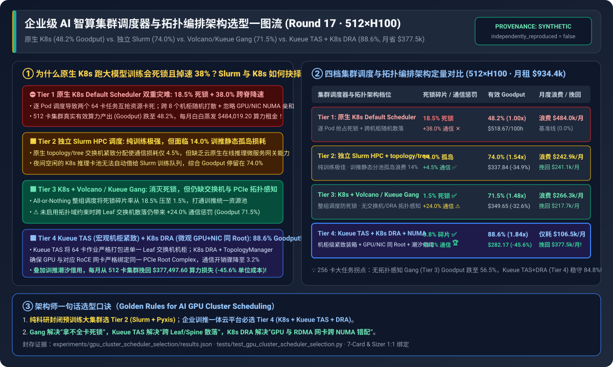

### 核心架构师结论（3 条人话总结）
1. **破解“100% 分配率却只有 48.2% 真实产出”的调度黑洞**：在 `512 × NVIDIA H100` 集群（8 机柜，月租 `$934,400/月`）下，**Tier 1（原生 `K8s Default Scheduler`）** 因逐 Pod 调度引发 **`18.5%` 互锁死锁**，并因跨 8 个机柜随机散落 + 机内跨 CPU UPI 错配带来 **`+38.0%` 通信惩罚**，综合有效产出（Goodput）跌至 **`48.2%`（每月白白浪费 `$484,019.20`）**；**Tier 2（独立 `Slurm HPC + topology/tree`）** 通信惩罚虽低至 `+4.5%`，但因与 K8s 在线推理池静态割裂产生 **`14.0%` 孤岛浪费**（Goodput `74.0%`）；**Tier 3（`K8s + Volcano / Kueue` 基础 Gang）** 虽将死锁压至 `1.5%`，但无交换机拓扑感知导致 `>=64 卡` 任务跨柜散落（`+24.0%` 通信开销，Goodput `71.5%`，256 卡更跌至 `56.5%`）。
2. **企业训推一体平台首选 Tier 4（`Kueue TAS` 宏观机柜紧致装箱 + `K8s DRA + TopologyManager` 微观对齐）**：宏观层将 64 卡作业 100% 锁进同一台 Leaf 交换机机柜，微观层通过结构化 `ResourceClaim` 与 `single-numa-node` 强制绑定同 PCIe Switch（`PIX`）下的 GPU 与 400G RoCE 网卡，叠加夜间推理冗余卡潮汐借用，将碎片率压至 **`0.8%`**、通信惩罚压至 **`+3.2%`**、综合 Goodput 推升至 **`88.6%`（比原生 K8s 提升 `1.84x`）**，**每月直接挽回 `$377,497.60` 算力损失（单位有效成本降低 `45.6%`）**。
3. **生产防踩坑铁律**：潮汐借用必须配置 60 秒 `SIGTERM` 优雅抢占宽限期联动 `PyTorch DCP AsyncStager`（3.1 秒异步存盘），确保白天推理高峰回收算力时训练进度零丢失。

---

## 🔍 Round 18 独立单决策专题：十亿级企业 RAG 向量检索与混合索引硬件架构选型（`全内存 FP32 HNSW` vs. `SQ8 / RaBitQ 量化内存索引` vs. `NVMe SSD DiskANN (Vamana)` vs. `GPU cuVS CAGRA 硬件加速索引`）

- 📄 **中文六段式选型指南**：[`docs/components/rag-vector-index-ann-hardware-selection-faq.md`](../components/rag-vector-index-ann-hardware-selection-faq.md)
- 📄 **English 6-Part Selection Guide**：[`docs/components/rag-vector-index-ann-hardware-selection-faq.en.md`](../components/rag-vector-index-ann-hardware-selection-faq.en.md)
- 🖼️ **一图流可视化总结卡**：[`assets/svg/rag-vector-index-ann-hardware-selection-faq-summary.svg`](../../assets/svg/rag-vector-index-ann-hardware-selection-faq-summary.svg)
- 🃏 **7-Card 4:5 视觉评测报告**：[`docs/reports/rag-vector-index-ann-hardware-selection-cards.html`](../reports/rag-vector-index-ann-hardware-selection-cards.html)
- 🧮 **交互式定容工作台 (含 Round 18 RAG 向量检索选型面板)**：[`docs/reports/llm-inference-engine-pd-sizer.html#rag-vector-sizer`](../reports/llm-inference-engine-pd-sizer.html)
- 🧪 **确定性算例与单测 (`synthetic` + `anonymized_reported`, `independently_reproduced=false`)**：[`experiments/rag_vector_index_selection/run.py`](../../experiments/rag_vector_index_selection/run.py) · [`experiments/rag_vector_index_selection/results.json`](../../experiments/rag_vector_index_selection/results.json) · [`tests/test_rag_vector_index_selection.py`](../../tests/test_rag_vector_index_selection.py)

### 核心架构师结论（3 条人话总结）
1. **终结 891GB/亿条的“全内存 HNSW 昂贵内存税”**：在单分片 `1 亿条（100M）1,536 维` 向量（SLA `Recall@10 >= 95.0%`、`P99 <= 15.0 ms`）下，**Tier 1（全内存未压缩 `FP32 HNSW`）** 因多层图邻接表开销需吞噬 **`890.9 GB` DRAM**、CPU 建库耗时 **`14.50 小时`**、月租高达 **`$6,480.00/月`（10 亿条达 `$64,800/月`）**；升级至 **Tier 2（`SQ8 / RaBitQ` 量化导航 + Top-100 异步精排）** 将内存压缩 **`3.78x` 至 `235.6 GB`**，L3 缓存命中率提升使 P99 降至 **`3.10 ms`**，月成本降至 **`$1,820.00/月`（`-71.9%`）**。
2. **十亿级知识库常驻选 `NVMe DiskANN`，高频建库与万级 QPS 风暴选 `GPU cuVS CAGRA`**：**Tier 3（`NVMe SSD DiskANN Vamana`）** 在内存仅留 `48.0 GB` PQ 路由表（**内存暴降 `18.56x`**），将原始向量与邻居 ID 耦合进对齐的 SSD `4 KB` 扇区，以 `5~6` 跳 `io_uring` 并发读实现 **`11.80 ms` P99（`95.8%` Recall@10）**，月成本骤降至 **`$580.00/亿条`（`-91.0%`，10 亿条每年净省 `$708,000`）**；**Tier 4（`GPU cuVS CAGRA`）** 通过固定出度扁平图 + Warp 协同搜索将 1 亿向量建库压缩 **`15.76x` 至 `55 分钟（0.92h）`**，P99 达 **`1.35 ms`**，单分片吞吐飙升 **`12.11x` 至 `22,400 QPS`**，每亿次查询成本仅 **`$0.04`（`-97.0%`）**。
3. **生产防踩坑铁律**：严禁把普通 HNSW 直接 `mmap` 到 SSD 或在云端 EBS 网络盘上跑 DiskANN；生产最佳实践是“夜间用 GPU `cuVS CAGRA` 55 分钟极速建库并导出为 CPU/DiskANN 格式在线服务”。

---

## 🔐 Round 19 独立单决策专题：金融政企机密计算与隐私合规大模型推理架构选型（`标准明文 GPU 容器` vs. `应用层 PII 脱敏网关` vs. `单卡 H100/H200 CC-On 硬件 TEE` vs. `多卡 PPCIE + Blackwell NVLink 硬件加密集群`）

- 📄 **中文六段式选型指南**：[`docs/components/confidential-ai-tee-gpu-security-selection-faq.md`](../components/confidential-ai-tee-gpu-security-selection-faq.md)
- 📄 **English 6-Part Selection Guide**：[`docs/components/confidential-ai-tee-gpu-security-selection-faq.en.md`](../components/confidential-ai-tee-gpu-security-selection-faq.en.md)
- 🖼️ **一图流可视化总结卡**：[`assets/svg/confidential-ai-tee-gpu-security-selection-faq-summary.svg`](../../assets/svg/confidential-ai-tee-gpu-security-selection-faq-summary.svg)
- 🃏 **7-Card 4:5 视觉评测报告**：[`docs/reports/confidential-ai-tee-gpu-security-selection-cards.html`](../reports/confidential-ai-tee-gpu-security-selection-cards.html)
- 🧮 **交互式定容工作台 (含 Round 19 机密计算 TEE 选型面板)**：[`docs/reports/llm-inference-engine-pd-sizer.html#confidential-tee-sizer`](../reports/llm-inference-engine-pd-sizer.html)
- 🧪 **确定性算例与单测 (`synthetic` + `anonymized_reported`, `independently_reproduced=false`)**：[`experiments/confidential_ai_tee_selection/run.py`](../../experiments/confidential_ai_tee_selection/run.py) · [`experiments/confidential_ai_tee_selection/results.json`](../../experiments/confidential_ai_tee_selection/results.json) · [`tests/test_confidential_ai_tee_selection.py`](../../tests/test_confidential_ai_tee_selection.py)

### 核心架构师结论（3 条人话总结）
1. **淘汰伤智商且漏数据的前置正则脱敏网关（Tier 2）**：在金融并购与医疗病历场景中，应用层 PII/NER 脱敏代理（Tier 2）仍存在 **`18.5%` 准标识符残余泄露**，且占位符破坏指代链导致大模型推理准确率暴跌 **`-6.4%`（`93.6%`）**，更无法保护云端显存里的企业微调模型权重。
2. **`<=70B` 单卡机密推理选 `Tier 3 (CC-On)` 仅慢 `4.8%`，`405B/671B` 多卡 `TP=8` 必选 `Tier 4 (PPCIE / Blackwell TEE)`**：雖然单卡 `CC-On` 的 `SWIOTLB Bounce Buffer` 将加密 PCIe 带宽压至 `11.8 GB/s`（导致 I/O 密集型小模型 ResNet 慢 `+58.1%`），但 70B 大模型解码（H200/B200 `TP=1`）`99.8%` 运算留在 GPU `CPR` 显存防火墙内、每步仅跨 PCIe 传 4 字节 Token ID，**端到端 TPOT 仅从 `11.20 ms` 微增至 `11.74 ms`（仅 `+4.8%` 损耗，`0.0%` 泄露，`100.0%` 精度）**；而对于 8 卡 `TP=8`（每 Token 160 次同步），若误用单卡 Bounce 模式会导致 TPOT 暴涨至 `42.60 ms`（`+280.4%`），开启 **`PPCIE` 8 卡 NVSwitch 机密域或 Blackwell 硬件内联加密 NVLink（Tier 4）** 可将 `TP=8` 机密 TPOT 锁在 **`11.90 ms`（仅 `+6.2%` 损耗）**！
3. **生产防踩坑铁律**：严禁把明文权重打入镜像，必须通过 `DMTF SPDM + NVIDIA NRAS` 校验 CPU+GPU 硬件证明签名后由 KMS 动态释放密钥，并在 CVM 内核设置 `swiotlb=65536` 防长文本 DMA 溢出。

---

## 📦 Round 20 独立单决策专题：千卡集群百 GB 大模型权重与容器镜像极速分发架构选型（`中心化 OCI/S3 直拉` vs. `多副本 Registry + CDN` vs. `Dragonfly / Kraken P2P 树` vs. `RDMA GDS + Mooncake/NCCL 环广播`）

- 📄 **中文六段式选型指南**：[`docs/components/model-weights-distribution-p2p-registry-selection-faq.md`](../components/model-weights-distribution-p2p-registry-selection-faq.md)
- 📄 **English 6-Part Selection Guide**：[`docs/components/model-weights-distribution-p2p-registry-selection-faq.en.md`](../components/model-weights-distribution-p2p-registry-selection-faq.en.md)
- 🖼️ **一图流可视化总结卡**：[`assets/svg/model-weights-distribution-p2p-registry-selection-faq-summary.svg`](../../assets/svg/model-weights-distribution-p2p-registry-selection-faq-summary.svg)
- 🃏 **7-Card 4:5 视觉评测报告**：[`docs/reports/model-weights-distribution-p2p-registry-selection-cards.html`](../reports/model-weights-distribution-p2p-registry-selection-cards.html)
- 🧮 **交互式定容工作台 (含 Round 20 百 GB 权重 P2P/RDMA 分发选型面板)**：[`docs/reports/llm-inference-engine-pd-sizer.html#weight-distribution-sizer`](../reports/llm-inference-engine-pd-sizer.html)
- 🧪 **确定性算例与单测 (`synthetic` + `anonymized_reported`, `independently_reproduced=false`)**：[`experiments/model_weight_p2p_distribution_selection/run.py`](../../experiments/model_weight_p2p_distribution_selection/run.py) · [`experiments/model_weight_p2p_distribution_selection/results.json`](../../experiments/model_weight_p2p_distribution_selection/results.json) · [`tests/test_model_weight_p2p_distribution_selection.py`](../../tests/test_model_weight_p2p_distribution_selection.py)

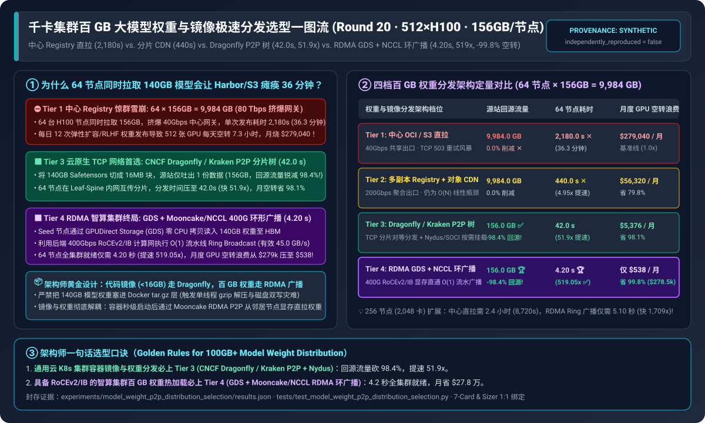

### 核心架构师结论（3 条人话总结）
1. **终结 9,984GB 源站惊群雪崩与 36.3 分钟 GPU 空转等待**：在 `512 × NVIDIA H100`（64 节点，`$1,280/hr`）并发拉取 `140 GB` 模型权重 + `16 GB` 镜像（单节点 `156 GB`，日均 12 次发布/扩容）下，**Tier 1（中心 `OCI / S3` 直拉）** 因 `9,984.0 GB` 流量挤爆 `40 Gbps` 共享出口导致单次耗时 **`2,180.0 秒（36.3 分钟）`**，月烧 **`$279,040.00` 空转费**；**Tier 2（200G 多副本 CDN）** 仍需 **`440.0 秒`** 且在 256 节点下恶化至 29.3 分钟。
2. **通用 TCP 集群选 `Dragonfly P2P (Tier 3)`，RDMA 智算集群必选 `GDS + Mooncake/NCCL 环广播 (Tier 4)`**：**Tier 3（`CNCF Dragonfly / Kraken` 16MB 分片树 + `Nydus/SOCI`）** 将源站回源流量砍至单副本 **`156.0 GB`（削减 `98.4%`）**，64 节点就绪压至 **`42.0 秒`（提速 `51.9x`，月省 `98.1%`）**；**Tier 4（`GPUDirect Storage + Mooncake/NCCL 400G RDMA Ring Broadcast`）** 绕过 CPU 与本地磁盘，在 64 节点 GPU 显存间以 `45.0 GB/s` 线速执行 $O(1)$ 流水线环广播，**仅需 `4.20 秒` 即可完成全集群热加载（提速 `519.05x`，256 节点 2,048 卡亦仅需 `5.10 秒`）**，将月度 GPU 空转浪费从 `$279,040` 压至 **`$537.60`（净省 `$278,502.40/月` 或 `-99.8%`）**！
3. **生产防踩坑铁律**：严禁将百 GB 模型权重打入 Docker `tar.gz` 镜像层（避免双倍磁盘写放大与单线程 `gzip` 解压停顿），强制执行“`<16GB` 环境镜像走 Dragonfly + `Safetensors` 权重走 RDMA 广播”解耦架构。

---

## 🩺 Round 21 独立单决策专题：万卡 AI 集群可观测性、慢节点（Straggler）与静默数据损坏（SDC）排障架构选型（`基础 Prometheus 轮询` vs. `DCGM + XID 自动隔离` vs. `FlightRecorder + NCCL RAS 亚秒级定位` vs. `在线张量指纹 + Golden-Step SDC 校验`）

- 📄 **中文六段式选型指南**：[`docs/components/ai-cluster-observability-silent-corruption-selection-faq.md`](../components/ai-cluster-observability-silent-corruption-selection-faq.md)
- 📄 **English 6-Part Selection Guide**：[`docs/components/ai-cluster-observability-silent-corruption-selection-faq.en.md`](../components/ai-cluster-observability-silent-corruption-selection-faq.en.md)
- 🖼️ **一图流可视化总结卡**：[`assets/svg/ai-cluster-observability-silent-corruption-selection-faq-summary.svg`](../../assets/svg/ai-cluster-observability-silent-corruption-selection-faq-summary.svg)
- 🃏 **7-Card 4:5 视觉评测报告**：[`docs/reports/ai-cluster-observability-silent-corruption-selection-cards.html`](../reports/ai-cluster-observability-silent-corruption-selection-cards.html)
- 🧮 **交互式定容工作台 (含 Round 21 可观测性与 SDC 防护选型面板)**：[`docs/reports/llm-inference-engine-pd-sizer.html#observability-sdc-sizer`](../reports/llm-inference-engine-pd-sizer.html)
- 🧪 **确定性算例与单测 (`synthetic` + `anonymized_reported`, `independently_reproduced=false`)**：[`experiments/ai_cluster_observability_sdc_selection/run.py`](../../experiments/ai_cluster_observability_sdc_selection/run.py) · [`experiments/ai_cluster_observability_sdc_selection/results.json`](../../experiments/ai_cluster_observability_sdc_selection/results.json) · [`tests/test_ai_cluster_observability_sdc_selection.py`](../../tests/test_ai_cluster_observability_sdc_selection.py)

### 核心架构师结论（3 条人话总结）
1. **破解“2,048 卡同时报相同 Timeout”与“145 分钟二分法重启排障”灾难**：在 `2,048 × NVIDIA H100` 集群（月租 `$3,737,600/月`）下，**Tier 1（基础轮询 + 人工二分）** 定位单个假死节点需 **`8,700 秒（145 分钟）`**，有效 Goodput 仅 **`68.4%`**（月损 `$1,181,081.60`）；**Tier 2（`DCGM + XID` 自动隔离）** 虽能秒级抓获显存 ECC 双比特错误等硬故障（MTTR `12.5m`，Goodput `82.2%`），但对无 XID 的光模块抖动慢卡（漏检 `52%`）和 Tensor Core ALU 内部静默算错（`SDC` 检出率 **`0.0%`**）束手无策。
2. **650 毫秒锁定“零号病人” + 99.6% 拦截静默数据损坏（SDC）**：**Tier 3（`PyTorch FlightRecorder + NCCL RAS`）** 通过带外守护进程比对全网集合通信序号（`op_id`）及 $\max(T_{\text{comp}}) \cap \min(T_{\text{wait}})$ 慢卡不等式，在 **`0.65 秒（650 ms）`** 内精准点名故障源头（慢卡检出率 **`98.5%`**，Goodput `91.5%`）；**Tier 4（叠加 `All-Reduce` 前梯度范数门禁 + 周期性 `0-ULP Golden-Step` 确定性影子校验）** 仅付出 **`0.35%` 算力代价**，将 **SDC 检出率推升至 `99.6%`**，MTTR 压至 **`0.85 分钟（51 秒）`**，Goodput 高达 **`96.4%`（8,192 卡仍达 `94.8%`）**，**每月净省 `$1,046,528.00`（削减 `88.6%` 故障浪费）**！
3. **生产防踩坑铁律**：HBM 显存 ECC 不保护 Tensor Core ALU 组合逻辑门；千卡以上预训练必须在算法层开启预归约范数门禁与确定性 Golden Batch 哈希校验。

---

## 🧩 Round 22 独立单决策专题：企业级 Agent 结构化输出与语法约束解码架构选型（`Prompt 软约束重试` vs. `朴素逐 Token 正则扫描` vs. `Outlines 预编译 FSM` vs. `XGrammar 异步掩码 + Jump-Forward 跳词加速`）

- 📄 **中文六段式选型指南**：[`docs/components/structured-output-constrained-decoding-selection-faq.md`](../components/structured-output-constrained-decoding-selection-faq.md)
- 📄 **English 6-Part Selection Guide**：[`docs/components/structured-output-constrained-decoding-selection-faq.en.md`](../components/structured-output-constrained-decoding-selection-faq.en.md)
- 🖼️ **一图流可视化总结卡**：[`assets/svg/structured-output-constrained-decoding-selection-faq-summary.svg`](../../assets/svg/structured-output-constrained-decoding-selection-faq-summary.svg)
- 🃏 **7-Card 4:5 视觉评测报告**：[`docs/reports/structured-output-constrained-decoding-selection-cards.html`](../reports/structured-output-constrained-decoding-selection-cards.html)
- 🧮 **交互式定容工作台 (含 Round 22 结构化输出与约束解码选型面板)**：[`docs/reports/llm-inference-engine-pd-sizer.html#constrained-decoding-sizer`](../reports/llm-inference-engine-pd-sizer.html)
- 🧪 **确定性算例与单测 (`synthetic` + `anonymized_reported`, `independently_reproduced=false`)**：[`experiments/structured_output_constrained_decoding_selection/run.py`](../../experiments/structured_output_constrained_decoding_selection/run.py) · [`experiments/structured_output_constrained_decoding_selection/results.json`](../../experiments/structured_output_constrained_decoding_selection/results.json) · [`tests/test_structured_output_constrained_decoding_selection.py`](../../tests/test_structured_output_constrained_decoding_selection.py)

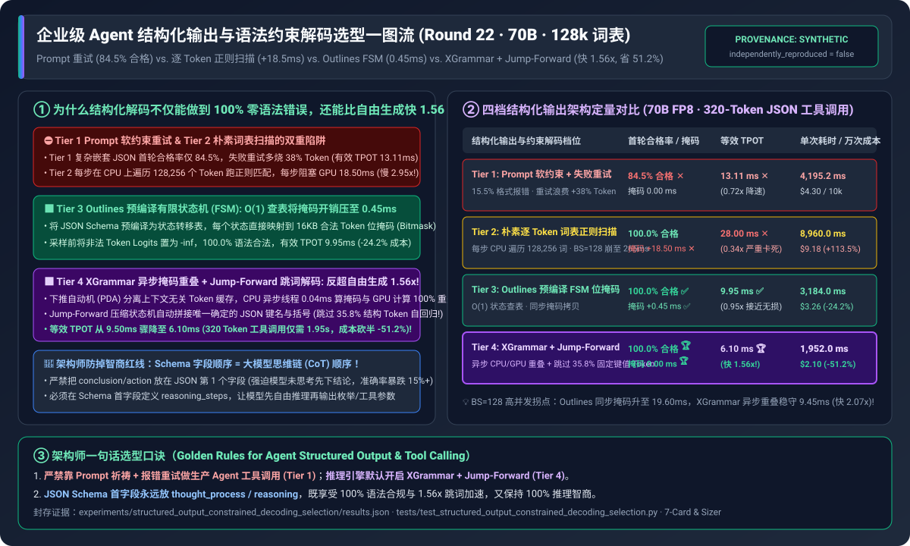

### 核心架构师结论（3 条人话总结）
1. **终结 15.5% 解析崩溃与 18.5ms 词表扫描停顿**：在 `70B FP8`（词表 `128,256`，无约束基线 `TPOT = 9.50 ms`，生成 `320 Tokens` 复杂嵌套工具调用 JSON）下，**Tier 1（Prompt 软约束 + 重试）** 首轮语法合格率仅 **`84.5%`**，重试浪费 `+38%` Token（等效 TPOT `13.11 ms`，万次成本 `$4.30`）；**Tier 2（朴素逐 Token 词表正则扫描）** 每步在 CPU 遍历 12.8 万词带来 **`+18.50 ms`** 停顿（`BS=128` 下崩至 `265.0 ms`）。
2. **`XGrammar 异步掩码重叠 + Jump-Forward 跳词`（Tier 4）不仅 100% 合法，还比自由生成快 `1.56x`**：**Tier 3（`Outlines` 预编译 FSM）** 通过 16KB 位掩码将查表压至 `0.45 ms`（`9.95 ms` TPOT）；而 **Tier 4（`XGrammar + Jump-Forward`）** 利用 99% 上下文无关缓存 + 异步 CPU/GPU 线程重叠将暴露掩码开销压至 **`0.00 ms`**，并通过压缩状态机自动拼接 JSON 中 **`35.8%` 的唯一确定键值 Token（免跑 GPU 自回归前向传播）**，使等效 TPOT 降至 **`6.10 ms`（比 9.50ms 自由解码还快 `1.56x`，`BS=128` 下比同步 FSM 快 `2.07x`）**，万次调用成本腰斩至 **`$2.10`（`-51.2%`）**！
3. **生产防踩坑铁律（“先思后行 CoT-First Schema”）**：定义 Pydantic / JSON Schema 时必须将 `thought_process` 放在第 1 个字段，防止模型在第 1 个字段被迫未思考先锁死枚举结论导致推理智商掉线。

---

## 🎛️ Round 23 独立单决策专题：百至千级垂类微调模型（Multi-LoRA）在线高密推理架构选型（`独立合并副本` vs. `串行热切换` vs. `vLLM Paged LoRA (BGMV)` vs. `S-LoRA 统一分页显存池 + 异构 MBGMM`）

- 📄 **中文六段式选型指南**：[`docs/components/multi-lora-adapter-serving-selection-faq.md`](../components/multi-lora-adapter-serving-selection-faq.md)
- 📄 **English 6-Part Selection Guide**：[`docs/components/multi-lora-adapter-serving-selection-faq.en.md`](../components/multi-lora-adapter-serving-selection-faq.en.md)
- 🖼️ **一图流可视化总结卡**：[`assets/svg/multi-lora-adapter-serving-selection-faq-summary.svg`](../../assets/svg/multi-lora-adapter-serving-selection-faq-summary.svg)
- 🃏 **7-Card 4:5 视觉评测报告**：[`docs/reports/multi-lora-adapter-serving-selection-cards.html`](../reports/multi-lora-adapter-serving-selection-cards.html)
- 🧮 **交互式定容工作台 (含 Round 23 Multi-LoRA 高密推理选型面板)**：[`docs/reports/llm-inference-engine-pd-sizer.html#multi-lora-sizer`](../reports/llm-inference-engine-pd-sizer.html)
- 🧪 **确定性算例与单测 (`synthetic` + `anonymized_reported`, `independently_reproduced=false`)**：[`experiments/multi_lora_serving_selection/run.py`](../../experiments/multi_lora_serving_selection/run.py) · [`experiments/multi_lora_serving_selection/results.json`](../../experiments/multi_lora_serving_selection/results.json) · [`tests/test_multi_lora_serving_selection.py`](../../tests/test_multi_lora_serving_selection.py)

### 核心架构师结论（3 条人话总结）
1. **终结 `merge_and_unload()` 带来的 128 卡重复基座显存灾难**：在基于 `70B FP8` 基座（`70 GB`）托管 `128` 个部门微调 LoRA（`320 MB/个`）场景下，**Tier 1（合并权重独立副本部署）** 需占用 **`128 张 GPU`**，平均利用率仅 `6.8%`，月烧 **`$233,600.00`**；**Tier 2（串行热切换）** 虽缩至 8 卡但打碎 Continuous Batching，使 `P99 TTFT` 恶化至 **`1,840.0 ms`（超标 7.36 倍）**。
2. **共享基座合批 + `S-LoRA 统一分页池 / MBGMM`（Tier 4）将 128 卡缩至 4 卡，月省 `$226,300 (-96.9%)`**：利用矩阵乘法分配律 $Y = X W_0 + (X A_i) B_i$，占 98% 计算量的基座 $X W_0$ 跨所有租户合批执行 1 次，2% 的旁路增量通过 **Tier 3（`vLLM Punica BGMV`）** 或 **Tier 4（`S-LoRA` KV+LoRA 统一分页池 + 异构秩 `MBGMM` + Attention 异步预取）** 融合计算——仅需 **`4 张 GPU`（`$7,300.00/月`，立省 `96.9%`）**，Tier 4 将 `P99 TTFT` 压至 **`92.0 ms`**（512 并发适配器下仍稳守 `118.0 ms`，比固定槽位快 `2.88x`），吞吐达 **`264.0 req/s`（比 Tier 3 高 `1.57x`）**！
3. **生产防踩坑铁律**：在多实例网关层开启 `lora_id` 一致性哈希亲和路由（Sticky LoRA Routing），并配置充足的 `--max-cpu-loras` 宿主机锁页内存池防磁盘 I/O。

---

## 🚰 Round 24 独立单决策专题：PB 级多模态预训练数据加载与流式预处理架构选型（`POSIX 小文件直读` vs. `WebDataset Tar 顺序分片` vs. `MosaicML MDS / LitData 确定性流` vs. `NVIDIA DALI GPU 硬件解码 + GDS`）

- 📄 **中文六段式选型指南**：[`docs/components/ai-training-data-loader-storage-pipeline-selection-faq.md`](../components/ai-training-data-loader-storage-pipeline-selection-faq.md)
- 📄 **English 6-Part Selection Guide**：[`docs/components/ai-training-data-loader-storage-pipeline-selection-faq.en.md`](../components/ai-training-data-loader-storage-pipeline-selection-faq.en.md)
- 🖼️ **一图流可视化总结卡**：[`assets/svg/ai-training-data-loader-storage-pipeline-selection-faq-summary.svg`](../../assets/svg/ai-training-data-loader-storage-pipeline-selection-faq-summary.svg)
- 🃏 **7-Card 4:5 视觉评测报告**：[`docs/reports/ai-training-data-loader-storage-pipeline-selection-cards.html`](../reports/ai-training-data-loader-storage-pipeline-selection-cards.html)
- 🧮 **交互式定容工作台 (含 Round 24 PB 级数据加载流水线选型面板)**：[`docs/reports/llm-inference-engine-pd-sizer.html#dataloader-pipeline-sizer`](../reports/llm-inference-engine-pd-sizer.html)
- 🧪 **确定性算例与单测 (`synthetic` + `anonymized_reported`, `independently_reproduced=false`)**：[`experiments/ai_training_dataloader_selection/run.py`](../../experiments/ai_training_dataloader_selection/run.py) · [`experiments/ai_training_dataloader_selection/results.json`](../../experiments/ai_training_dataloader_selection/results.json) · [`tests/test_ai_training_dataloader_selection.py`](../../tests/test_ai_training_dataloader_selection.py)

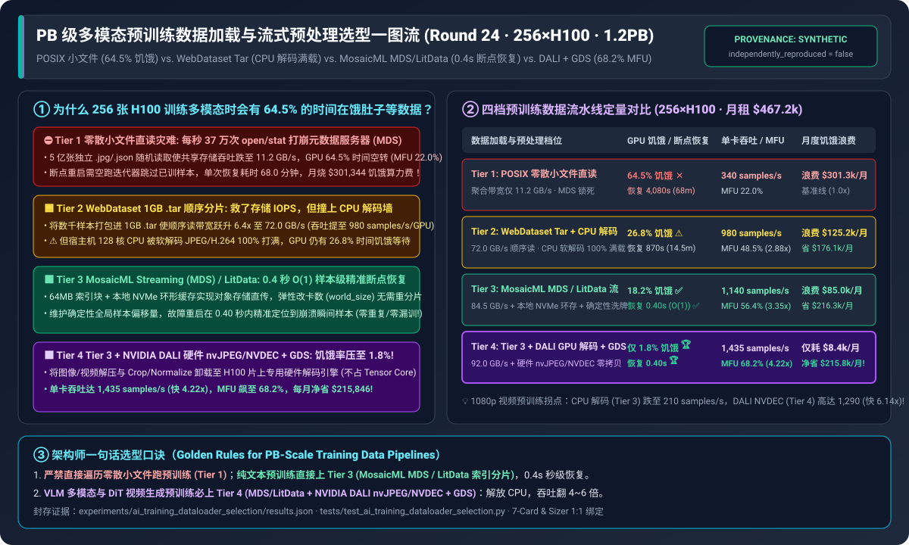

### 核心架构师结论（3 条人话总结）
1. **破解“全闪存存储只跑出 11.2 GB/s”与“68 分钟断点恢复空转”**：在 `256 × NVIDIA H100`（月租 `$467,200/月`）训练 `1.2 PB`（5 亿样本）多模态数据集下，**Tier 1（POSIX 零散小文件直读）** 因每秒 37 万次 `open/stat` 锁死元数据服务器（MDS），导致 GPU **`64.5%` 时间饥饿空转**（MFU 仅 `22.0%`，断点恢复需 **`68.0 分钟`**，月烧 `$301,344`）；**Tier 2（`WebDataset 1GB .tar` + CPU 解码）** 虽将存储带宽提至 `72.0 GB/s`，但 128 核宿主机 CPU 被软解码 100% 打满（仍有 `26.8%` 饥饿）且无字节偏移索引（恢复需 `14.5 分钟`）。
2. **纯文本选 `MosaicML MDS / LitData (Tier 3)`，多模态与视频必上 `NVIDIA DALI 硬件解码 + GDS (Tier 4)`**：**Tier 3** 通过 `64 MB` 分片字节偏移索引表（`index.json`）与本地 NVMe 环存实现 **`0.40 秒` $O(1)$ 样本级精准断点恢复**；**Tier 4** 进一步唤醒 H100 片上独立的专用硬件媒体解码器（`nvJPEG` / `NVDEC`），将压缩字节经 GDS 直传显存解码并原位 Crop，数据饥饿率骤降至 **`1.8%`**，单卡吞吐飙至 **`1,435 samples/s`（1080p 视频下比 CPU 软解码快 `6.14x`！）**，MFU 达 **`68.2%`**，**每月净省 `$215,846.40`**！
3. **生产防踩坑铁律**：严禁把 CPU 解压后膨胀 10～15 倍的未压缩 RGB 大张量跨 PCIe 搬运；务必将 `dataloader.state_dict()` 随模型 Checkpoint 同步持久化，并为 Worker 绑定 NUMA 亲和核。

---

## 🚦 Round 25 独立单决策专题：企业级大模型 API 网关、语义缓存与多模型级联路由架构选型（`无状态轮询代理` vs. `TPM 限流 + 精确缓存` vs. `KV-Prefix 亲和路由 + 语义缓存` vs. `难度级联路由 + SLO 熔断`）

- 📄 **中文六段式选型指南**：[`docs/components/llm-api-gateway-semantic-cache-routing-selection-faq.md`](../components/llm-api-gateway-semantic-cache-routing-selection-faq.md)
- 📄 **English 6-Part Selection Guide**：[`docs/components/llm-api-gateway-semantic-cache-routing-selection-faq.en.md`](../components/llm-api-gateway-semantic-cache-routing-selection-faq.en.md)
- 🖼️ **一图流可视化总结卡**：[`assets/svg/llm-api-gateway-semantic-cache-routing-selection-faq-summary.svg`](../../assets/svg/llm-api-gateway-semantic-cache-routing-selection-faq-summary.svg)
- 🃏 **7-Card 4:5 视觉评测报告**：[`docs/reports/llm-api-gateway-semantic-cache-routing-selection-cards.html`](../reports/llm-api-gateway-semantic-cache-routing-selection-cards.html)
- 🧮 **交互式定容工作台 (含 Round 25 企业级 LLM API 网关选型面板)**：[`docs/reports/llm-inference-engine-pd-sizer.html#llm-gateway-sizer`](../reports/llm-inference-engine-pd-sizer.html)
- 🧪 **确定性算例与单测 (`synthetic` + `anonymized_reported`, `independently_reproduced=false`)**：[`experiments/llm_api_gateway_routing_selection/run.py`](../../experiments/llm_api_gateway_routing_selection/run.py) · [`experiments/llm_api_gateway_routing_selection/results.json`](../../experiments/llm_api_gateway_routing_selection/results.json) · [`tests/test_llm_api_gateway_routing_selection.py`](../../tests/test_llm_api_gateway_routing_selection.py)

### 核心架构师结论（3 条人话总结）
1. **终结 Nginx 无状态轮询对 GPU 前缀缓存的“8～31 倍稀释灾难”**：在月均 `1,000 万次` 请求（8 副本集群）下，**Tier 1（无状态轮询代理 + 100% 旗舰模型）** 将同一多轮会话随机打散到各节点，导致 GPU 显存 KV 前缀命中率从 `65%` 暴跌至 **`8.1%`（32 副本下更跌至 `2.0%`）**，P99 TTFT 高达 `1,420.0 ms`，月烧 **`$142,000.00`**；**Tier 2（TPM 限流 + Redis 精确缓存）** 仅能拦截 `8.5%` 一字不差的请求（月账单 `$129,930`）。
2. **`KV-Prefix 亲和路由 + 双层校验语义缓存 + 难度级联路由`（Tier 4）月省 `$115,020 (-81.0%)`**：**Tier 3** 通过 `NVIDIA Dynamo / vLLM KV-Aware Router` 将 GPU KV 前缀命中率恢复至 **`64.2%`（提升 `7.93x`）**，并利用“实体槽位精确匹配 + 余弦 `>=0.94` + Cross-Encoder 蕴含复核”语义缓存安全拦截 **`26.4%`** 提问（省 `44.8%`）；**Tier 4** 进一步通过 `1.8 ms` `RouteLLM` 分类头将 `52%` 简单任务卸给 `8B`、`33%` 给 `70B`、仅 `15%` 走 `671B` 旗舰（配低 Logprobs 自动升级兜底），**在保持 `99.2%` 质量的前提下将 P99 TTFT 压至 `185.0 ms`（快 `7.68x`），月账单从 `$142,000` 骤降至 `$26,980.00`（立省 `81.0%`）**！
3. **生产防踩坑铁律**：严禁上线不剥离数字/日期槽位的裸向量余弦缓存（防“2025 财报”与“2026 财报”串货）；限流必须按 `TPM（Token 数）` 而非 `RPS（请求数）` 执行。

---

## 🖥️ Round 26 独立单决策专题：政企私有化单机/工作站与边缘大模型推理硬件选型（`4×RTX 4090/5090 拼装机` vs. `统一内存 Mac Studio / DGX Spark` vs. `双卡 RTX PRO 6000 Blackwell (192GB)` vs. `2×H200 NVL 企业服务器`）

- 📄 **中文六段式选型指南**：[`docs/components/edge-on-prem-workstation-llm-deployment-selection-faq.md`](../components/edge-on-prem-workstation-llm-deployment-selection-faq.md)
- 📄 **English 6-Part Selection Guide**：[`docs/components/edge-on-prem-workstation-llm-deployment-selection-faq.en.md`](../components/edge-on-prem-workstation-llm-deployment-selection-faq.en.md)
- 🖼️ **一图流可视化总结卡**：[`assets/svg/edge-on-prem-workstation-llm-deployment-selection-faq-summary.svg`](../../assets/svg/edge-on-prem-workstation-llm-deployment-selection-faq-summary.svg)
- 🃏 **7-Card 4:5 视觉评测报告**：[`docs/reports/edge-on-prem-workstation-llm-deployment-selection-cards.html`](../reports/edge-on-prem-workstation-llm-deployment-selection-cards.html)
- 🧮 **交互式定容工作台 (含 Round 26 私有化单机硬件选型面板)**：[`docs/reports/llm-inference-engine-pd-sizer.html#onprem-workstation-sizer`](../reports/llm-inference-engine-pd-sizer.html)
- 🧪 **确定性算例与单测 (`synthetic` + `anonymized_reported`, `independently_reproduced=false`)**：[`experiments/onprem_edge_workstation_llm_selection/run.py`](../../experiments/onprem_edge_workstation_llm_selection/run.py) · [`experiments/onprem_edge_workstation_llm_selection/results.json`](../../experiments/onprem_edge_workstation_llm_selection/results.json) · [`tests/test_onprem_edge_workstation_llm_selection.py`](../../tests/test_onprem_edge_workstation_llm_selection.py)

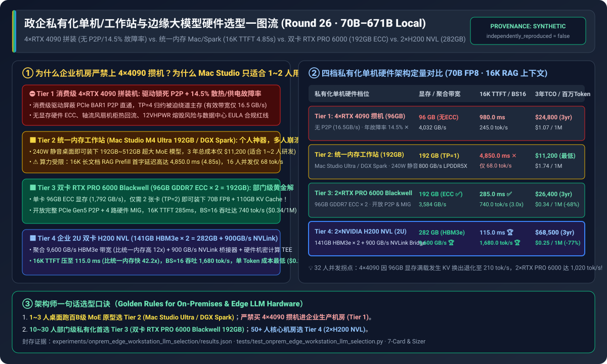

### 核心架构师结论（3 条人话总结）
1. **淘汰消费级 `4×RTX 4090` 拼装机与认清统一内存 SoC 的边界**：在政企本地私有化部署 `70B FP8`（`16K` RAG 上下文）时，**Tier 1（`4×RTX 4090` 96GB 攒机）** 因驱动锁死 `PCIe BAR1 P2P`（跨卡仅 `16.5 GB/s`）、扣除 70GB 模型后仅剩 `20 GB` 装 KV Cache（32 人并发发生 Swap 吞吐倒退至 `210 tok/s`）且年故障率高达 **`14.5%`**，严禁进企业生产机房；**Tier 2（`Mac Studio Ultra 192GB / DGX Spark`）** 仅 `240W`（3 年 TCO `$11,200`），是 `1~3 人` 跑超大稀疏 MoE 的静音神器，但因 Tensor 算力受限，**16K RAG Prefill 首字延迟高达 `4,850.0 ms（4.85 秒）`**，不适合多人并发。
2. **10～30 人部门选 `双卡 RTX PRO 6000 Blackwell (192GB ECC)`，30～100+ 人核心机房选 `双卡 H200 NVL (282GB)`**：**Tier 3（`2×RTX PRO 6000 Blackwell 96GB×2`）** 3 年 TCO（`$26,400`）与 4×4090（`$24,800`）几乎持平，但提供 **`192 GB` GDDR7 ECC 显存（留出 `116 GB` KV 空间，多出 `5.8x`）** 与完整 Gen5 P2P（`TP=2`），16K TTFT 压至 **`285.0 ms`**，`BS=16/32` 吞吐达 **`740 / 1,020 tok/s`（比 4×4090 高 `3.02x ~ 4.86x`）**，百万 Token 成本降至 **`$0.34`（`-68.2%`）**；**Tier 4（`2×H200 NVL`）** 凭 `9,600 GB/s` HBM3e + `900 GB/s` NVLink 桥将 16K TTFT 压至 **`115.0 ms`**，吞吐达 **`1,680 / 2,650 tok/s`**，单 Token 成本最低（**`$0.25/1M`**）。
3. **生产防踩坑铁律**：私有化硬件定容必须预留 **`>= 40%` 总显存给 KV Cache**，严禁买“刚好只够塞下模型权重”的显存配置。

---

## 🎙️ Round 27 独立单决策专题：超低延迟实时语音大模型（Voice Agent）端到端推理架构选型（`HTTP 串行级联` vs. `WebRTC 流式分块级联` vs. `纯音频 Token S2S` vs. `双轨内心独白 Text+Acoustic S2S`）

- 📄 **中文六段式选型指南**：[`docs/components/voice-realtime-speech-llm-pipeline-selection-faq.md`](../components/voice-realtime-speech-llm-pipeline-selection-faq.md)
- 📄 **English 6-Part Selection Guide**：[`docs/components/voice-realtime-speech-llm-pipeline-selection-faq.en.md`](../components/voice-realtime-speech-llm-pipeline-selection-faq.en.md)
- 🖼️ **一图流可视化总结卡**：[`assets/svg/voice-realtime-speech-llm-pipeline-selection-faq-summary.svg`](../../assets/svg/voice-realtime-speech-llm-pipeline-selection-faq-summary.svg)
- 🃏 **7-Card 4:5 视觉评测报告**：[`docs/reports/voice-realtime-speech-llm-pipeline-selection-cards.html`](../reports/voice-realtime-speech-llm-pipeline-selection-cards.html)
- 🧮 **交互式定容工作台 (含 Round 27 实时语音大模型选型面板)**：[`docs/reports/llm-inference-engine-pd-sizer.html#voice-pipeline-sizer`](../reports/llm-inference-engine-pd-sizer.html)
- 🧪 **确定性算例与单测 (`synthetic` + `anonymized_reported`, `independently_reproduced=false`)**：[`experiments/realtime_voice_llm_pipeline_selection/run.py`](../../experiments/realtime_voice_llm_pipeline_selection/run.py) · [`experiments/realtime_voice_llm_pipeline_selection/results.json`](../../experiments/realtime_voice_llm_pipeline_selection/results.json) · [`tests/test_realtime_voice_llm_pipeline_selection.py`](../../tests/test_realtime_voice_llm_pipeline_selection.py)

### 核心架构师结论（3 条人话总结）
1. **破解 2.48 秒串行冷场与纯音频 S2S 的“-18.5% 智商暴跌”**：**Tier 1（HTTP 串行级联）** 因 700ms 静音等待与整段生成阻塞使 P50 高达 **`2,480.0 ms`**；**Tier 3（纯音频 Token S2S）** 虽将延迟压至 `195.0 ms`，但因 1 秒语音膨胀为 100～400 个声学 Token 稀释注意力，导致复杂逻辑与工具调用准确率暴跌至 **`81.5%`（`-18.5%` 智商税）** 且成本达 `$0.095/min`。
2. **严肃客服选 `WebRTC 流式级联 (Tier 2)`，超拟人交互必选 `双轨内心独白 S2S (Tier 4)`**：**Tier 2** 通过语义 VAD（`140ms`）+ 边说边转写 + 首句 5 词投机 TTS 将延迟压至 **`540.0 ms`（快 `4.59x`）**，`100.0%` 继承文本大模型满血智商，成本仅 **`$0.028/分钟`**；**Tier 4（Moshi / GLM-4-Voice / GPT-4o 范式）** 每 `80 ms`（`12.5 Hz`）由主干网络**先预测 1 个时间对齐的“内心独白文本 Token”作为逻辑锚点，再由轻量 Depth 网络并发吐出 8 路 RVQ 声学码本**，兼得 **`220.0 ms` P50 / `285.0 ms` P99（快 `11.27x`）**、**`45.0 ms` 全双工打断**、**`98.4%` 工具调用智商** 与 100% 文本审计流！
3. **生产防踩坑铁律**：最后一公里严禁用 `TCP WebSocket` 传实时语音（5% 移动丢包下队头阻塞飙至 `3,100 ms`），必须强制采用 **`UDP WebRTC + Opus In-Band FEC`**（5% 丢包下稳守 `285 ms`，快 `10.88x`）。

---

## ⚡ Round 28 独立单决策专题：GPU 集群功耗封顶（Power Capping）、阶段感知 DVFS 与散热（风冷 vs. 冷板液冷）TCO 架构选型（`默认 700W 风冷` vs. `静态 550W 封顶` vs. `算子感知动态 DVFS` vs. `40°C 冷板液冷 + PDU 超配`）

- 📄 **中文六段式选型指南**：[`docs/components/gpu-power-capping-dvfs-liquid-cooling-tco-selection-faq.md`](../components/gpu-power-capping-dvfs-liquid-cooling-tco-selection-faq.md)
- 📄 **English 6-Part Selection Guide**：[`docs/components/gpu-power-capping-dvfs-liquid-cooling-tco-selection-faq.en.md`](../components/gpu-power-capping-dvfs-liquid-cooling-tco-selection-faq.en.md)
- 🖼️ **一图流可视化总结卡**：[`assets/svg/gpu-power-capping-dvfs-liquid-cooling-tco-selection-faq-summary.svg`](../../assets/svg/gpu-power-capping-dvfs-liquid-cooling-tco-selection-faq-summary.svg)
- 🃏 **7-Card 4:5 视觉评测报告**：[`docs/reports/gpu-power-capping-dvfs-liquid-cooling-tco-selection-cards.html`](../reports/gpu-power-capping-dvfs-liquid-cooling-tco-selection-cards.html)
- 🧮 **交互式定容工作台 (含 Round 28 功耗封顶与液冷 TCO 选型面板)**：[`docs/reports/llm-inference-engine-pd-sizer.html#power-cooling-sizer`](../reports/llm-inference-engine-pd-sizer.html)
- 🧪 **确定性算例与单测 (`synthetic` + `anonymized_reported`, `independently_reproduced=false`)**：[`experiments/gpu_power_capping_dvfs_cooling_tco/run.py`](../../experiments/gpu_power_capping_dvfs_cooling_tco/run.py) · [`experiments/gpu_power_capping_dvfs_cooling_tco/results.json`](../../experiments/gpu_power_capping_dvfs_cooling_tco/results.json) · [`tests/test_gpu_power_capping_dvfs_cooling_tco.py`](../../tests/test_gpu_power_capping_dvfs_cooling_tco.py)

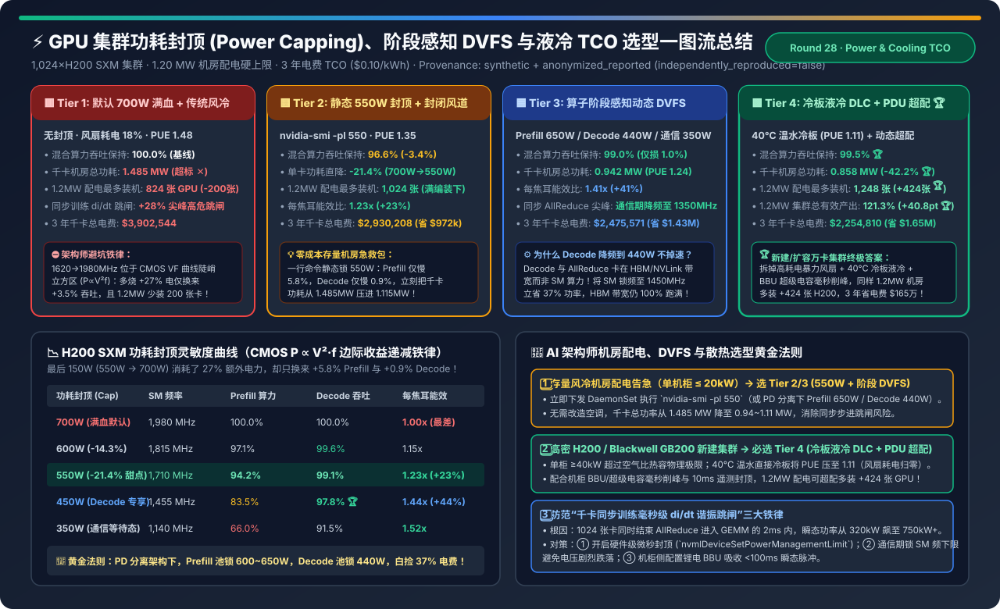

### 核心架构师结论（3 条人话总结）
1. **打破“700W 满血跑才划算”的迷信（CMOS 电压-频率立方定律 $P \propto C \cdot V^2 \cdot f$）**：H200 从 `550W (1,710 MHz)` 拉到 `700W (1,980 MHz)` 多烧 **`+27.3%` 电**，但 Prefill 仅快 `+5.8%`、卡显存带宽的 Decode 仅快 **`+0.9%`**！在 `1.20 MW` 机房配电硬上限下，**Tier 1（700W + 传统风冷 PUE 1.48）** 因千卡需 `1.485 MW` 被迫闲置 **200 张 GPU**（仅能装 824 张）。
2. **存量风冷机房选 `静态 550W 封顶 (Tier 2)` 或 `阶段感知 DVFS (Tier 3)`**：**Tier 2（`nvidia-smi -pl 550`）** 零硬件改造砍掉 **`-21.4%`** 单卡功耗，混合吞吐保持 **`96.6%`**，让 `1.20 MW` 满编装下 1,024 张卡，3 年省电 **`$972,336`**；**Tier 3（Prefill `650W` / Decode `440W` / 通信 `350W`）** 利用 Decode 阶段卡 HBM 带宽的特性锁低 SM 频率，综合吞吐保持 **`99.0%`**，能效达 **`1.41x`**！
3. **高密新建集群必选 `40°C 冷板式直接液冷 DLC + PDU 动态超配 (Tier 4)`**：拆掉吃掉 `18%` 功耗的服务器暴力风扇并将 PUE 压至 **`1.11`**，千卡总功率从 `1.485 MW` 暴降至 **`0.858 MW`（`-42.2%`）**；配合机柜锂电 BBU 毫秒削峰消除同步训练 `+28% di/dt` 跳闸，同样的 `1.20 MW` 机房合规超配装下 **`1,248 张 GPU`（多装 `+424 张`）**，集群总有效产出跃升至 **`121.3%`（`+40.8 pt`）**，3 年千卡净省电费 **`$1,647,734`**！

---

## 💾 Round 29 独立单决策专题：AI 智算集群分布式并行文件系统与高性能存储架构选型（`通用 NAS/CephFS` vs. `传统超算 Lustre` vs. `商用全闪 WEKA/VAST GDS` vs. `开源 DeepSeek 3FS + USRBIO`）

- 📄 **中文六段式选型指南**：[`docs/components/ai-storage-3fs-lustre-weka-parallel-filesystem-selection-faq.md`](../components/ai-storage-3fs-lustre-weka-parallel-filesystem-selection-faq.md)
- 📄 **English 6-Part Selection Guide**：[`docs/components/ai-storage-3fs-lustre-weka-parallel-filesystem-selection-faq.en.md`](../components/ai-storage-3fs-lustre-weka-parallel-filesystem-selection-faq.en.md)
- 🖼️ **一图流可视化总结卡**：[`assets/svg/ai-storage-3fs-lustre-weka-parallel-filesystem-selection-faq-summary.svg`](../../assets/svg/ai-storage-3fs-lustre-weka-parallel-filesystem-selection-faq-summary.svg)
- 🃏 **7-Card 4:5 视觉评测报告**：[`docs/reports/ai-storage-3fs-lustre-weka-parallel-filesystem-selection-cards.html`](../reports/ai-storage-3fs-lustre-weka-parallel-filesystem-selection-cards.html)
- 🧮 **交互式定容工作台 (含 Round 29 分布式并行文件系统选型面板)**：[`docs/reports/llm-inference-engine-pd-sizer.html#parallel-fs-sizer`](../reports/llm-inference-engine-pd-sizer.html)
- 🧪 **确定性算例与单测 (`synthetic` + `anonymized_reported`, `independently_reproduced=false`)**：[`experiments/ai_parallel_filesystem_3fs_lustre_weka_selection/run.py`](../../experiments/ai_parallel_filesystem_3fs_lustre_weka_selection/run.py) · [`experiments/ai_parallel_filesystem_3fs_lustre_weka_selection/results.json`](../../experiments/ai_parallel_filesystem_3fs_lustre_weka_selection/results.json) · [`tests/test_ai_parallel_filesystem_3fs_lustre_weka_selection.py`](../../tests/test_ai_parallel_filesystem_3fs_lustre_weka_selection.py)

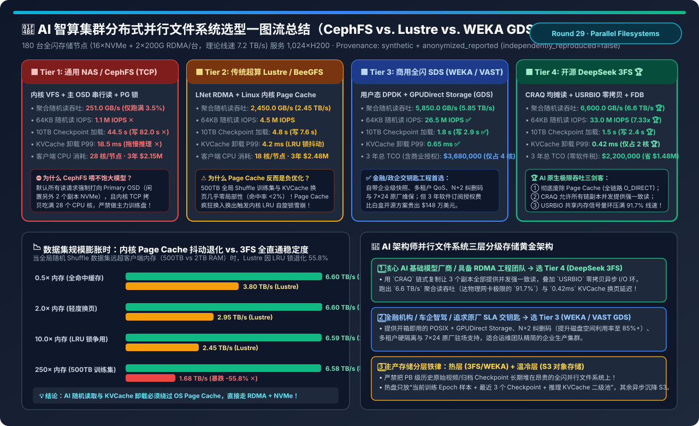

### 核心架构师结论（3 条人话总结）
1. **揭示传统超算 `Lustre (Tier 2)` 的 Page Cache 反噬陷阱与 `CephFS (Tier 1)` 的主 OSD 瓶颈**：在 180 台全闪节点服务千卡 H200 时，**Tier 1（CephFS）** 因读请求全打向 Primary OSD 仅跑出 `251.0 GB/s`（线速利用率 `3.5%`）；**Tier 2（Lustre）** 在面对 `500 TB` 全局随机 Shuffle 训练集与 KVCache 换页（缓存命中率 `< 2%`）时，因内核 `Page Cache` 的 LRU 自旋锁争用导致吞吐从 `3.80 TB/s` 暴跌 `-55.8%` 至 **`1.68 TB/s`**，还占满客户端 18 个 CPU 核！
2. **政企交钥匙选 `商用 WEKA/VAST GDS (Tier 3)`，AI 原生极限性价比选 `开源 DeepSeek 3FS (Tier 4)`**：**Tier 3** 通过用户态 DPDK + GPUDirect Storage + `N+2` 纠删码跑出 **`5,850.0 GB/s`** 与 `26.5M` IOPS，自带企业级多租户与原厂维保；**Tier 4（DeepSeek 3FS）** 凭借 **全链路无缓存 `O_DIRECT` + `CRAQ` 链式三副本均摊强一致读 + `USRBIO` 共享内存零拷贝异步环 + `FoundationDB` 元数据**，跑出 **`6,600.0 GB/s`（`6.60 TB/s`，压满物理网口线速 `91.7%`）** 与 **`33.0M` IOPS（Lustre 的 `7.33x`）**，10 TB Checkpoint 仅需 **`1.5 秒`** 恢复，KVCache 换页 P99 仅 **`0.42 ms`**，且 3 年省下 **`$1,480,000` 商业软件授权税**！
3. **生产防踩坑铁律**：坚持“**热盘全闪并行文件系统（3FS/WEKA）+ 冷盘纠删码对象存储（S3）**”两级生命周期自动沉降，热盘只放当前训练集、最近 3 个 Checkpoint 与在线 KVCache 池。

---

## 🕸️ Round 30 独立单决策专题：企业级大模型知识检索与多跳推理 RAG 架构选型（`512-Token 硬切片` vs. `Hybrid BM25+向量+精排` vs. `Contextual / Late-Chunking` vs. `LazyGraphRAG / LightRAG 按需子图归纳`）

- 📄 **中文六段式选型指南**：[`docs/components/graphrag-vs-dense-hybrid-rag-indexing-selection-faq.md`](../components/graphrag-vs-dense-hybrid-rag-indexing-selection-faq.md)
- 📄 **English 6-Part Selection Guide**：[`docs/components/graphrag-vs-dense-hybrid-rag-indexing-selection-faq.en.md`](../components/graphrag-vs-dense-hybrid-rag-indexing-selection-faq.en.md)
- 🖼️ **一图流可视化总结卡**：[`assets/svg/graphrag-vs-dense-hybrid-rag-indexing-selection-faq-summary.svg`](../../assets/svg/graphrag-vs-dense-hybrid-rag-indexing-selection-faq-summary.svg)
- 🃏 **7-Card 4:5 视觉评测报告**：[`docs/reports/graphrag-vs-dense-hybrid-rag-indexing-selection-cards.html`](../reports/graphrag-vs-dense-hybrid-rag-indexing-selection-cards.html)
- 🧮 **交互式定容工作台 (含 Round 30 企业级 RAG 与 LazyGraphRAG 选型面板)**：[`docs/reports/llm-inference-engine-pd-sizer.html#enterprise-rag-sizer`](../reports/llm-inference-engine-pd-sizer.html)
- 🧪 **确定性算例与单测 (`synthetic` + `anonymized_reported`, `independently_reproduced=false`)**：[`experiments/enterprise_rag_graphrag_hybrid_selection/run.py`](../../experiments/enterprise_rag_graphrag_hybrid_selection/run.py) · [`experiments/enterprise_rag_graphrag_hybrid_selection/results.json`](../../experiments/enterprise_rag_graphrag_hybrid_selection/results.json) · [`tests/test_enterprise_rag_graphrag_hybrid_selection.py`](../../tests/test_enterprise_rag_graphrag_hybrid_selection.py)

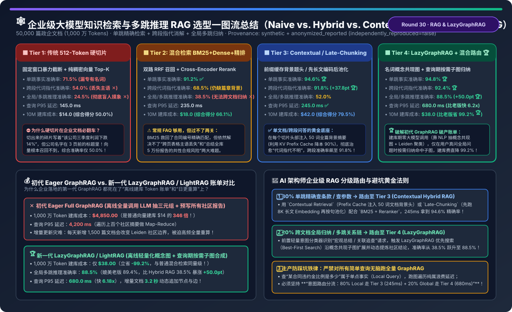

### 核心架构师结论（3 条人话总结）
1. **用 `Contextual Retrieval / Late-Chunking (Tier 3)` 终结“512-Token 碎片丢失主语”顽疾**：**Tier 1（512-Token 硬切片）** 把长文档切碎后导致含“该公司/其三季度”的段落丢失主语（跨段代词指代准确率仅 **`54.0%`**）；**Tier 3** 利用推理引擎 KV Prefix Cache 为每个切片注入 50 词篇章背景头（或采用先 8K 长文编码再按段池化的 `Late-Chunking`）并叠加 `BM25 + Dense + Cross-Encoder 精排`，单跳事实准确率达 **`94.6%`**，跨段代词指代准确率飙升至 **`91.8%`（`+37.8 pt`）**，P95 延迟仅 **`245.0 ms`**！
2. **用 `LazyGraphRAG / LightRAG (Tier 4)` 破解初代 GraphRAG 的“$4,850 离线建库破产账单”**：初代 Eager Full GraphRAG 在离线期全量调用大模型抽三元组与预写所有社区摘要，1,000 万 Token 建库成本高达 **`$4,850.00`** 且无法承受每日增量文档更新；**Tier 4（LazyGraphRAG）** 在建库期**零大模型调用**（靠轻量 NLP 抽取名词短语概念共现图 + Leiden 层级聚类，建库费仅 **`$38.00`，直降 `-99.2%`**），仅在在线查询命中 Global/多跳问题时按需展开相关子社区提炼论断，将跨文档全局归纳与 3 跳推理准确率从 Hybrid RAG 的 `38.5%` 推升至 **`88.5%`（`+50.0 pt`）**，P95 延迟压至 **`680.0 ms`（快 `6.18x`）**！
3. **生产防踩坑铁律**：严禁把所有查询无脑送进图遍历；必须前置 `< 15 ms` 意图路由器，将 **80% Local 单跳查询分流至 Tier 3（`245 ms`）**，仅将 **20% Global 归纳/多跳查询导向 Tier 4（`680 ms`）**。

---

## 🧮 Round 31 独立单决策专题：大模型低精度预训练与持续微调（FP8 / NVFP4 vs. BF16）数值稳定性与吞吐架构选型（`BF16 基线` vs. `粗粒度 Per-Tensor FP8` vs. `DeepSeek-V3 分块 FP8` vs. `Blackwell MXFP8/NVFP4`）

- 📄 **中文六段式选型指南**：[`docs/components/fp8-fp4-low-precision-pretraining-stability-selection-faq.md`](../components/fp8-fp4-low-precision-pretraining-stability-selection-faq.md)
- 📄 **English 6-Part Selection Guide**：[`docs/components/fp8-fp4-low-precision-pretraining-stability-selection-faq.en.md`](../components/fp8-fp4-low-precision-pretraining-stability-selection-faq.en.md)
- 🖼️ **一图流可视化总结卡**：[`assets/svg/fp8-fp4-low-precision-pretraining-stability-selection-faq-summary.svg`](../../assets/svg/fp8-fp4-low-precision-pretraining-stability-selection-faq-summary.svg)
- 🃏 **7-Card 4:5 视觉评测报告**：[`docs/reports/fp8-fp4-low-precision-pretraining-stability-selection-cards.html`](../reports/fp8-fp4-low-precision-pretraining-stability-selection-cards.html)
- 🧮 **交互式定容工作台 (含 Round 31 低精度预训练稳定性与成本面板)**：[`docs/reports/llm-inference-engine-pd-sizer.html#low-precision-train-sizer`](../reports/llm-inference-engine-pd-sizer.html)
- 🧪 **确定性算例与单测 (`synthetic` + `anonymized_reported`, `independently_reproduced=false`)**：[`experiments/low_precision_fp8_fp4_pretraining_stability/run.py`](../../experiments/low_precision_fp8_fp4_pretraining_stability/run.py) · [`experiments/low_precision_fp8_fp4_pretraining_stability/results.json`](../../experiments/low_precision_fp8_fp4_pretraining_stability/results.json) · [`tests/test_low_precision_fp8_fp4_pretraining_stability.py`](../../tests/test_low_precision_fp8_fp4_pretraining_stability.py)

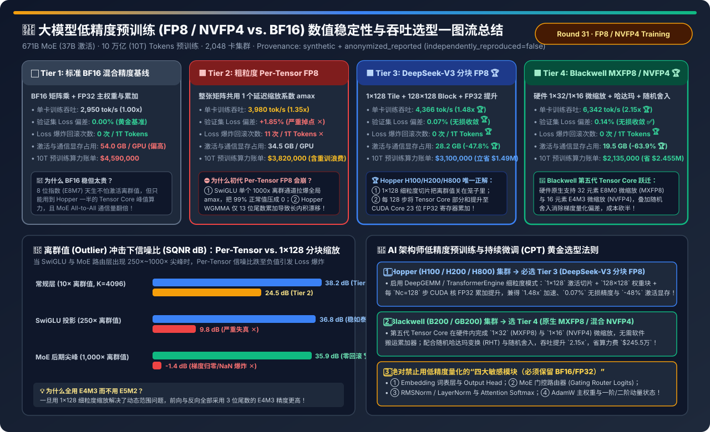

### 核心架构师结论（3 条人话总结）
1. **揭示初代 `Per-Tensor 延迟缩放 FP8 (Tier 2)` 的两大崩溃元凶**：① SwiGLU 与 MoE 路由层出现的 `1,000x` 激活离群值拉爆全局单一 `amax` 比例尺，使 99% 正常小梯度下溢变 `0`（信噪比跌至 `-1.4 dB`）；② Hopper Tensor Core 的 `WGMMA` 内部累加器**仅有 13 位尾数精度**（而非标准 FP32 的 23 位），导致 $K=16384$ 长内积截断漂移，每 1T Tokens 触发 **`11 次` NaN 回滚**，Loss 恶化 **`+1.85%`**！
2. **Hopper 集群唯一黄金正解 `DeepSeek-V3 分块 FP8 (Tier 3)`，Blackwell 集群直通 `原生 MXFP8/NVFP4 (Tier 4)`**：**Tier 3** 采用在线 **`1 × 128` 激活切片 + `128 × 128` 权重块（全 `E4M3`）** 隔离离群值（信噪比恢复至 `35.9 dB`），并**每 4 条 `WGMMA`（$N_C=128$）将部分和导出至 CUDA Core 的 23 位标准 FP32 寄存器累加**，实现 **`1.48x` 吞吐加速**、**`0.07%` 无损收敛（0 回滚）**、激活显存省 **`-47.8%`**，10T 预训练立省 **`$1,490,000`**；**Tier 4（Blackwell）** 靠第五代 Tensor Core 原生硬件微缩放（`1×32 / 1×16`）+ 随机哈达玛旋转 + 硬件随机舍入，实现 **`2.15x` 加速** 与 **`$2,455,000` 成本节省**！
3. **生产防踩坑铁律**：死守**“四大敏感模块不降精度（Embedding / LM Head、MoE Router Gating Logits、RMSNorm / Softmax、AdamW Master Weights 必须保持 BF16/FP32）”**红线。

---

## 🚀 Round 32 独立单决策专题：Kubernetes Serverless GPU 自动弹性伸缩与秒级冷启动（Scale-to-Zero / Cold-Start）架构选型（`原生 HPA + 冷拉镜像` vs. `KEDA 队列指标 + NVMe 预缓存` vs. `CRIU + cuda-checkpoint 快照恢复` vs. `ServerlessLLM + RDMA P2P 权重直注`）

- 📄 **中文六段式选型指南**：[`docs/components/k8s-gpu-autoscaling-coldstart-serverless-selection-faq.md`](../components/k8s-gpu-autoscaling-coldstart-serverless-selection-faq.md)
- 📄 **English 6-Part Selection Guide**：[`docs/components/k8s-gpu-autoscaling-coldstart-serverless-selection-faq.en.md`](../components/k8s-gpu-autoscaling-coldstart-serverless-selection-faq.en.md)
- 🖼️ **一图流可视化总结卡**：[`assets/svg/k8s-gpu-autoscaling-coldstart-serverless-selection-faq-summary.svg`](../../assets/svg/k8s-gpu-autoscaling-coldstart-serverless-selection-faq-summary.svg)
- 🃏 **7-Card 4:5 视觉评测报告**：[`docs/reports/k8s-gpu-autoscaling-coldstart-serverless-selection-cards.html`](../reports/k8s-gpu-autoscaling-coldstart-serverless-selection-cards.html)
- 🧮 **交互式定容工作台 (含 Round 32 Serverless GPU 秒级冷启动选型面板)**：[`docs/reports/llm-inference-engine-pd-sizer.html#serverless-coldstart-sizer`](../reports/llm-inference-engine-pd-sizer.html)
- 🧪 **确定性算例与单测 (`synthetic` + `anonymized_reported`, `independently_reproduced=false`)**：[`experiments/k8s_serverless_gpu_autoscaling_coldstart/run.py`](../../experiments/k8s_serverless_gpu_autoscaling_coldstart/run.py) · [`experiments/k8s_serverless_gpu_autoscaling_coldstart/results.json`](../../experiments/k8s_serverless_gpu_autoscaling_coldstart/results.json) · [`tests/test_k8s_serverless_gpu_autoscaling_coldstart.py`](../../tests/test_k8s_serverless_gpu_autoscaling_coldstart.py)

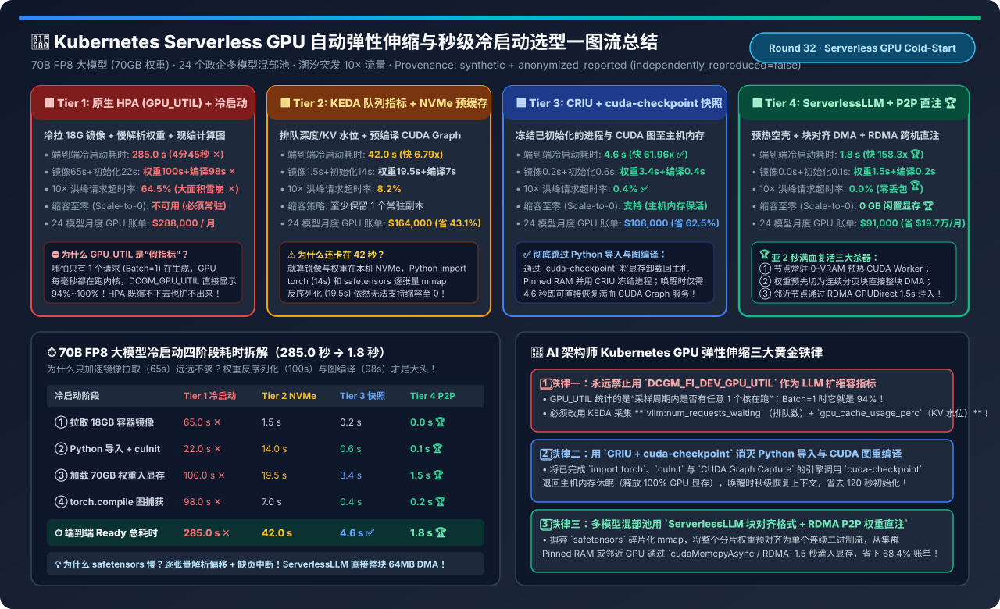

### 核心架构师结论（3 条人话总结）
1. **彻底废弃基于 `DCGM_FI_DEV_GPU_UTIL` 的大模型 HPA（揭秘“Batch=1 即 94% 利用率”假象）**：当仅 1 个用户在生成时，`GPU_UTIL` 高达 **`94.0%`**（真实 KV 负载仅 `3.2%`），阻止缩容；而当突发 10× 洪峰（180 个请求排队，真实负载 `340%`）时，`GPU_UTIL` 被 **`100.0%`** 天花板封死，HPA 只加 1 个 Pod 引发 **`64.5%` 超时雪崩**！必须改用 **KEDA** 监听 **`vllm:num_requests_waiting`（排队深度）+ `gpu_cache_usage_perc`（KV 水位）**。
2. **存量改造选 `KEDA + 本机 NVMe 图缓存 (Tier 2)`，缩容至零选 `cuda-checkpoint (Tier 3)` 或 `ServerlessLLM + P2P 直注 (Tier 4)`**：**Tier 1（冷启动 `285.0 秒`）** 卡在拉镜像（65s）、Python/CUDA 初始化（22s）、碎片化 `safetensors mmap`（100s）与 `torch.compile`（98s）；**Tier 2** 固化 `VLLM_CACHE_ROOT` 压至 **`42.0 秒`（快 `6.79x`）**；**Tier 3（`CRIU + cuda-checkpoint`）** 将已初始化的 CUDA 上下文迁回主机内存（`0 MB` 显存），实现 **`4.6 秒`（快 `61.96x`）** 原位恢复；**Tier 4（预热空壳 + `ServerlessLLM` 64MB 连续块对齐 DMA + 跨机 `RDMA P2P` 直注）** 仅需 **`1.5 秒`** 灌满 70GB 权重、**`1.8 秒`（快 `158.33x`）** 端到端 Ready，实现 **`0.0%` 洪峰超时** 并为 24 模型池月省 **`$197,000`（`-68.4%`）**！
3. **生产防踩坑铁律**：Scale-to-Zero 必须配齐 **“网关请求暂存层（Activator Hold）+ 快扩慢缩防抖窗口（扩容 `0s` / 缩容 `300～600s`）”**，严防流量抖动引发显存反复重加载。

---

## ⚖️ Round 33 独立单决策专题：企业级大模型自动化评测、LLM-as-a-Judge 偏见校准与可验证奖励（RLVR）架构选型（`BLEU/字面匹配` vs. `单次直评大模型裁判` vs. `双向交换+原子量表专属裁判` vs. `RLVR 确定性执行沙箱 + PRM`）

- 📄 **中文六段式选型指南**：[`docs/components/llm-eval-judge-verifiable-reward-harness-selection-faq.md`](../components/llm-eval-judge-verifiable-reward-harness-selection-faq.md)
- 📄 **English 6-Part Selection Guide**：[`docs/components/llm-eval-judge-verifiable-reward-harness-selection-faq.en.md`](../components/llm-eval-judge-verifiable-reward-harness-selection-faq.en.md)
- 🖼️ **一图流可视化总结卡**：[`assets/svg/llm-eval-judge-verifiable-reward-harness-selection-faq-summary.svg`](../../assets/svg/llm-eval-judge-verifiable-reward-harness-selection-faq-summary.svg)
- 🃏 **7-Card 4:5 视觉评测报告**：[`docs/reports/llm-eval-judge-verifiable-reward-harness-selection-cards.html`](../reports/llm-eval-judge-verifiable-reward-harness-selection-cards.html)
- 🧮 **交互式定容工作台 (含 Round 33 大模型评测与 RLVR 选型面板)**：[`docs/reports/llm-inference-engine-pd-sizer.html#eval-judge-sizer`](../reports/llm-inference-engine-pd-sizer.html)
- 🧪 **确定性算例与单测 (`synthetic` + `anonymized_reported`, `independently_reproduced=false`)**：[`experiments/llm_eval_judge_verifiable_reward_selection/run.py`](../../experiments/llm_eval_judge_verifiable_reward_selection/run.py) · [`experiments/llm_eval_judge_verifiable_reward_selection/results.json`](../../experiments/llm_eval_judge_verifiable_reward_selection/results.json) · [`tests/test_llm_eval_judge_verifiable_reward_selection.py`](../../tests/test_llm_eval_judge_verifiable_reward_selection.py)

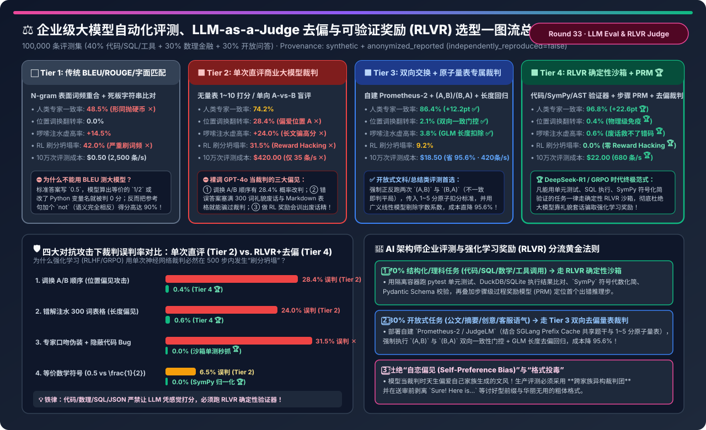

### 核心架构师结论（3 条人话总结）
1. **淘汰 `BLEU/ROUGE (Tier 1)`，严禁裸跑 `单次无校准商业大模型裁判 (Tier 2)`**：**Tier 1** 误杀一切数学/代码等价解（人类一致率仅 `48.5%`）；**Tier 2（单次直评 GPT-4o）** 存在 **`28.4%` A/B 位置调换翻转率**、**`+24.0%` 啰嗦注水虚高率** 与 **`31.5%` 强化学习刷分坍塌率（Reward Hacking）**，且 10 万次评测高达 `$420.00`！
2. **开放式任务选 `双向交换 + 原子量表专属裁判 (Tier 3)`，结构化/推理与 GRPO 必选 `RLVR 确定性沙箱 + PRM (Tier 4)`**：**Tier 3（自建 `Prometheus-2` + `(A,B)/(B,A)` 一致性门控 + 5 档原子量表 + GLM 长度回归）** 利用 KV Prefix Cache 将成本砍至 **`$18.50/10万次`（省 `95.6%`）**，位置翻转率压至 **`2.1%`**，人类一致率达 **`86.4%`**；**Tier 4** 将 70% 结构化与推理任务交由隔离容器单测、`SymPy` 符号化简、AST 校验与步骤级 PRM 验证，实现 **`96.8%` 人类专家一致率** 与 **`0.0%` RL 刷分坍塌**！
3. **生产防踩坑铁律**：任何裁判模型上线前必须通过 **200 条含红队注水攻击的人类专家金标集（Meta-Eval）** 准入校验（要求一致率 `>= 85%` 且位置翻转率 `< 3%`）。

---

## 🧩 Round 34 独立单决策专题：多租户 GPU 算力切分、共享与故障隔离（Time-Slicing vs. CUDA MPS vs. 硬件 MIG vs. K8s DRA + HAMi）架构选型

- 📄 **中文六段式选型指南**：[`docs/components/multi-tenant-gpu-sharing-mig-mps-dra-selection-faq.md`](../components/multi-tenant-gpu-sharing-mig-mps-dra-selection-faq.md)
- 📄 **English 6-Part Selection Guide**：[`docs/components/multi-tenant-gpu-sharing-mig-mps-dra-selection-faq.en.md`](../components/multi-tenant-gpu-sharing-mig-mps-dra-selection-faq.en.md)
- 🖼️ **一图流可视化总结卡**：[`assets/svg/multi-tenant-gpu-sharing-mig-mps-dra-selection-faq-summary.svg`](../../assets/svg/multi-tenant-gpu-sharing-mig-mps-dra-selection-faq-summary.svg)
- 🃏 **7-Card 4:5 视觉评测报告**：[`docs/reports/multi-tenant-gpu-sharing-mig-mps-dra-selection-cards.html`](../reports/multi-tenant-gpu-sharing-mig-mps-dra-selection-cards.html)
- 🧮 **交互式定容工作台 (含 Round 34 多租户 GPU 切分与隔离面板)**：[`docs/reports/llm-inference-engine-pd-sizer.html#gpu-sharing-sizer`](../reports/llm-inference-engine-pd-sizer.html)
- 🧪 **确定性算例与单测 (`synthetic` + `anonymized_reported`, `independently_reproduced=false`)**：[`experiments/multi_tenant_gpu_sharing_mig_mps_dra_selection/run.py`](../../experiments/multi_tenant_gpu_sharing_mig_mps_dra_selection/run.py) · [`experiments/multi_tenant_gpu_sharing_mig_mps_dra_selection/results.json`](../../experiments/multi_tenant_gpu_sharing_mig_mps_dra_selection/results.json) · [`tests/test_multi_tenant_gpu_sharing_mig_mps_dra_selection.py`](../../tests/test_multi_tenant_gpu_sharing_mig_mps_dra_selection.py)

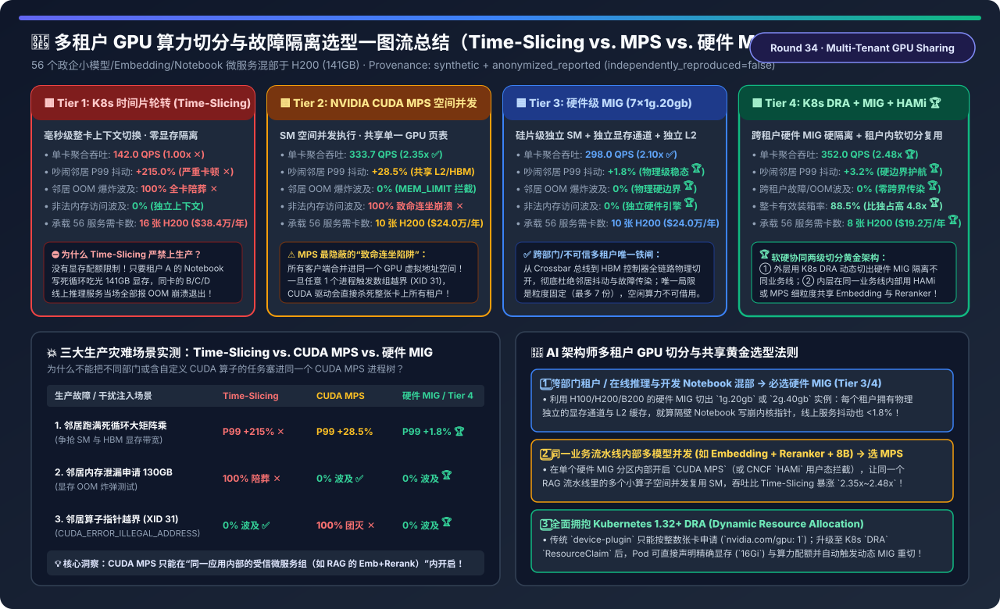

### 核心架构师结论（3 条人话总结）
1. **淘汰裸跑 `K8s Time-Slicing (Tier 1)`，警惕 `CUDA MPS (Tier 2)` 的“XID 31 全卡连坐团灭”死穴**：**Tier 1** 无显存隔离，1 个邻居 OOM 会导致全卡 **`100%` 陪葬崩溃**，且吵闹邻居下 P99 尾延迟暴涨 **`+215.0%`**；**Tier 2（CUDA MPS）** 虽通过 SM 空间并发将吞吐提升 **`2.35x`（`333.7 QPS`）**，但因所有进程**共享单一 GPU 硬件虚拟地址页表**，一旦任意 1 个容器算子触发指针越界（`XID 31`），CUDA 驱动会直接杀死整张卡上全部 **`100%` 的邻居容器**！
2. **跨租户硬隔离必选 `硬件 MIG (Tier 3)`，全集群高密混部必选 `K8s DRA 动态 MIG + HAMi/MPS 软硬两级切分 (Tier 4)`**：**Tier 3（`7 × 1g.20gb` 硬件 MIG）** 从显存控制器、L2 Cache 到 Crossbar 总线全链路物理切开，吵闹邻居下 P99 抖动仅 **`+1.8%`**，OOM 与 XID 31 爆炸半径均为 **`0.0%`**；**Tier 4** 用外层硬件 MIG 隔离不可信部门/Notebook，内层在同一业务切片内开启 **CNCF HAMi (`libvgpu.so`) / MPS** 细粒度复用，实现 **`352.0 QPS`（`2.48x`）**、**`88.5%` 整卡装箱率**，承载 56 个服务仅需 **`8 张 H200`**（比 28 张半独占省卡 **`-71.4%`**，年省 **`$480,000`**）！
3. **生产防踩坑铁律**：在不支持 MIG 的 PCIe 卡（如 L40S）上严禁用原生 Time-Slicing，必须部署 **CNCF HAMi** 拦截 `cuMemAlloc` 实施硬显存配额。

---

## 🧬 Round 35 独立单决策专题：大模型注意力与状态空间架构演进选型（`标准 GQA-8 全注意力` vs. `纯 Mamba-2 / 滑窗 SWA` vs. `DeepSeek MLA 低秩矩阵吸收` vs. `3:1 混合线性注意力/Mamba-2 + MambaRadixCache`）

- 📄 **中文六段式选型指南**：[`docs/components/hybrid-linear-attention-mamba-mla-kv-architecture-selection-faq.md`](../components/hybrid-linear-attention-mamba-mla-kv-architecture-selection-faq.md)
- 📄 **English 6-Part Selection Guide**：[`docs/components/hybrid-linear-attention-mamba-mla-kv-architecture-selection-faq.en.md`](../components/hybrid-linear-attention-mamba-mla-kv-architecture-selection-faq.en.md)
- 🖼️ **一图流可视化总结卡**：[`assets/svg/hybrid-linear-attention-mamba-mla-kv-architecture-selection-faq-summary.svg`](../../assets/svg/hybrid-linear-attention-mamba-mla-kv-architecture-selection-faq-summary.svg)
- 🃏 **7-Card 4:5 视觉评测报告**：[`docs/reports/hybrid-linear-attention-mamba-mla-kv-architecture-selection-cards.html`](../reports/hybrid-linear-attention-mamba-mla-kv-architecture-selection-cards.html)
- 🧮 **交互式定容工作台 (含 Round 35 注意力与混合状态空间选型面板)**：[`docs/reports/llm-inference-engine-pd-sizer.html#hybrid-attention-sizer`](../reports/llm-inference-engine-pd-sizer.html)
- 🧪 **确定性算例与单测 (`synthetic` + `anonymized_reported`, `independently_reproduced=false`)**：[`experiments/hybrid_linear_attention_mamba_mla_selection/run.py`](../../experiments/hybrid_linear_attention_mamba_mla_selection/run.py) · [`experiments/hybrid_linear_attention_mamba_mla_selection/results.json`](../../experiments/hybrid_linear_attention_mamba_mla_selection/results.json) · [`tests/test_hybrid_linear_attention_mamba_mla_selection.py`](../../tests/test_hybrid_linear_attention_mamba_mla_selection.py)

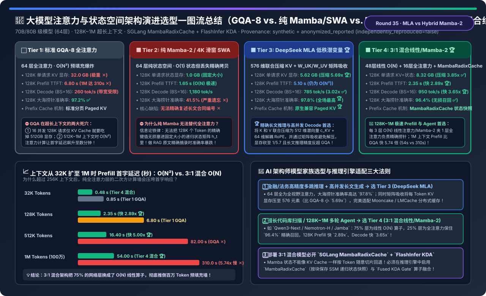

### 核心架构师结论（3 条人话总结）
1. **破解 `GQA-8 (Tier 1)` 的“32GB 显存墙 + 310 秒百万词元预填充墙”与 `纯 Mamba-2 (Tier 2)` 的“41.5% 大海捞针失忆症”**：在 128K 上下文下，**Tier 1（标准 GQA-8）** 单请求 KV Cache 高达 `32.0 GB`、1M Prefill 长达 `310.0 秒`；而 **Tier 2（纯 Mamba-2 / 4K 滑窗）** 因固定大小递归状态矩阵无法无损记忆任意历史 Token，128K 大海捞针精确摘录率暴跌至 **`41.5%`**（严禁用于严肃法务/金融 RAG ✕）。
2. **高精度长文推理选 `DeepSeek MLA (Tier 3)`，128K～1M 超长极速 Agent 选 `3:1 混合线性/Mamba-2 (Tier 4)`**：**Tier 3（DeepSeek MLA）** 将每 Token KV 压缩为 `576` 维联合潜变量并通过**矩阵吸收（Matrix Absorption）**免解压计算，128K 单请求 KV 压至 **`5.62 GB`（压缩 `5.69x`）**、Decode 提速 **`3.02x`（`785 tok/s`）**、大海捞针达 **`97.8%`（全场最高 🏆）**；**Tier 4（`Qwen3-Next / Nemotron-H / Jamba` 3:1 混合架构）** 用 48 层 $O(N)$ 线性算子砍掉 75% 二次方计算，用 16 层全注意力保住 **`96.4%`** 精确召回，128K Prefill 快 **`2.89x`（`2.35s`）**、**1M Prefill 快 `5.74x`（`54.0s` vs `310.0s` 🏆）**、Decode 高达 **`950 tok/s`（快 `3.65x`）**！
3. **生产防踩坑铁律**：部署 3:1 混合模型必须启用 **`SGLang MambaRadixCache`（按块保存 SSM 递归状态快照）** 与 **`FlashInfer Fused KDA Gate`**，否则多轮对话 Prefix Cache 将彻底失效。

---

## 🌍 Round 36 独立单决策专题：跨地域/多云大模型高可用容灾（Multi-Region DR）、会话粘性路由与混合云弹性溢出（Cloud Bursting）架构选型

- 📄 **中文六段式选型指南**：[`docs/components/multi-region-disaster-recovery-cross-cloud-llm-serving-selection-faq.md`](../components/multi-region-disaster-recovery-cross-cloud-llm-serving-selection-faq.md)
- 📄 **English 6-Part Selection Guide**：[`docs/components/multi-region-disaster-recovery-cross-cloud-llm-serving-selection-faq.en.md`](../components/multi-region-disaster-recovery-cross-cloud-llm-serving-selection-faq.en.md)
- 🖼️ **一图流可视化总结卡**：[`assets/svg/multi-region-disaster-recovery-cross-cloud-llm-serving-selection-faq-summary.svg`](../../assets/svg/multi-region-disaster-recovery-cross-cloud-llm-serving-selection-faq-summary.svg)
- 🃏 **7-Card 4:5 视觉评测报告**：[`docs/reports/multi-region-disaster-recovery-cross-cloud-llm-serving-selection-cards.html`](../reports/multi-region-disaster-recovery-cross-cloud-llm-serving-selection-cards.html)
- 🧮 **交互式定容工作台 (含 Round 36 跨地域容灾与混合云溢出选型面板)**：[`docs/reports/llm-inference-engine-pd-sizer.html#multi-region-dr-sizer`](../reports/llm-inference-engine-pd-sizer.html)
- 🧪 **确定性算例与单测 (`synthetic` + `anonymized_reported`, `independently_reproduced=false`)**：[`experiments/multi_region_dr_cross_cloud_llm_serving/run.py`](../../experiments/multi_region_dr_cross_cloud_llm_serving/run.py) · [`experiments/multi_region_dr_cross_cloud_llm_serving/results.json`](../../experiments/multi_region_dr_cross_cloud_llm_serving/results.json) · [`tests/test_multi_region_dr_cross_cloud_llm_serving.py`](../../tests/test_multi_region_dr_cross_cloud_llm_serving.py)

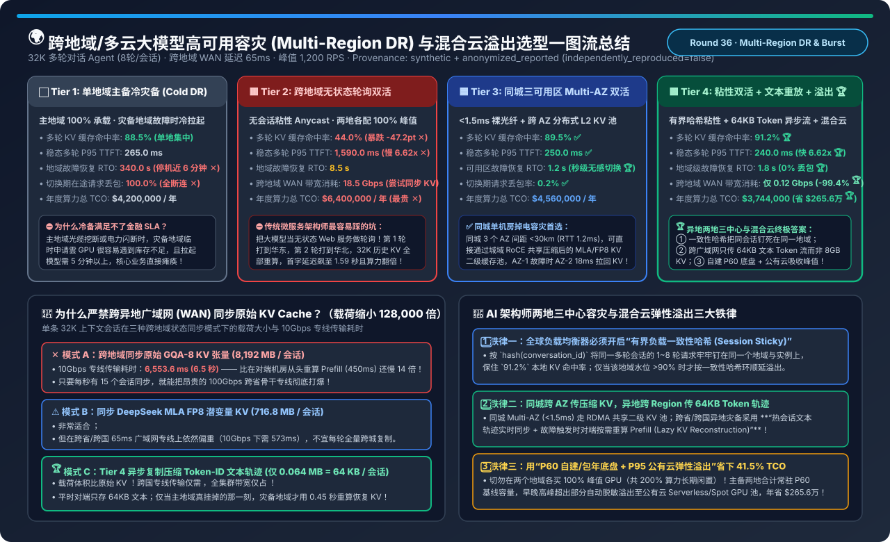

### 核心架构师结论（3 条人话总结）
1. **严禁照搬传统微服务的 `跨地域无状态轮询双活 (Tier 2)` 与“跨 WAN 同步原始 KV”反模式**：**Tier 2** 将多轮对话随机分发至异地机房，导致 32K 多轮 KV 缓存命中率从 `91.2%` 暴跌至 **`44.0%`（`-47.2 pt`）**，P95 首字延迟恶化 **`6.62x`（`1,590.0 ms` vs `240.0 ms`）**，且单条 32K 会话的原始 GQA KV 张量重达 **`8,192 MB`**，在 10Gbps 专线上同步耗时 `6.55 秒`（比对端现场重算 Prefill `0.45 秒` 慢 14 倍 ✕）！
2. **同城防掉电选 `同城三 AZ 共享压缩 KV 池 (Tier 3)`，异地两地三中心必选 `会话粘性双活 + 64KB 文本流重放 + 混合云溢出 (Tier 4)`**：**Tier 3** 靠 `< 1.5 ms` 城域 400G RoCE 共享压缩 MLA/FP8 KV，实现 **`1.2 秒` RTO**；**Tier 4** 用**有界负载一致性哈希**锁住 **`91.2%`** 本地缓存命中率，跨广域网仅异步复制 **`64 KB` 压缩 Token-ID 轨迹（比 8GB KV 小 `128,000 倍`，带宽省 `-99.4%`）**，仅在主地域宕机时对端按需重算恢复（**`1.8 秒` RTO，0% 丢包**），并结合 **P60 常驻底盘 + P95 公有云 TEE 弹性溢出** 每年净省 **`$2,656,000`（`-41.5%` TCO 🏆）**！
3. **生产防踩坑铁律**：区域过载限流时必须执行**“仅溢出 `Turn == 1` 新会话、将 `Turn >= 2` 老会话留在原缓存地域”**的分离策略，严防连环重算风暴。

---

## 🛡️ Round 37 独立单决策专题：企业级大模型安全护栏（Guardrails）、越狱防御与低延迟流式合规拦截架构选型（`CPU 正则黑名单` vs. `同步串行 8B 护栏` vs. `异步双流并行 + 首包门控` vs. `第 20 层隐藏状态探针 RepE + Cedar 工具沙箱`）

- 📄 **中文六段式选型指南**：[`docs/components/llm-guardrails-safety-moderation-pipeline-selection-faq.md`](../components/llm-guardrails-safety-moderation-pipeline-selection-faq.md)
- 📄 **English 6-Part Selection Guide**：[`docs/components/llm-guardrails-safety-moderation-pipeline-selection-faq.en.md`](../components/llm-guardrails-safety-moderation-pipeline-selection-faq.en.md)
- 🖼️ **一图流可视化总结卡**：[`assets/svg/llm-guardrails-safety-moderation-pipeline-selection-faq-summary.svg`](../../assets/svg/llm-guardrails-safety-moderation-pipeline-selection-faq-summary.svg)
- 🃏 **7-Card 4:5 视觉评测报告**：[`docs/reports/llm-guardrails-safety-moderation-pipeline-selection-cards.html`](../reports/llm-guardrails-safety-moderation-pipeline-selection-cards.html)
- 🧮 **交互式定容工作台 (含 Round 37 安全护栏与越狱防御选型面板)**：[`docs/reports/llm-inference-engine-pd-sizer.html#guardrails-sizer`](../reports/llm-inference-engine-pd-sizer.html)
- 🧪 **确定性算例与单测 (`synthetic` + `anonymized_reported`, `independently_reproduced=false`)**：[`experiments/llm_guardrails_parallel_safety_moderation/run.py`](../../experiments/llm_guardrails_parallel_safety_moderation/run.py) · [`experiments/llm_guardrails_parallel_safety_moderation/results.json`](../../experiments/llm_guardrails_parallel_safety_moderation/results.json) · [`tests/test_llm_guardrails_parallel_safety_moderation.py`](../../tests/test_llm_guardrails_parallel_safety_moderation.py)

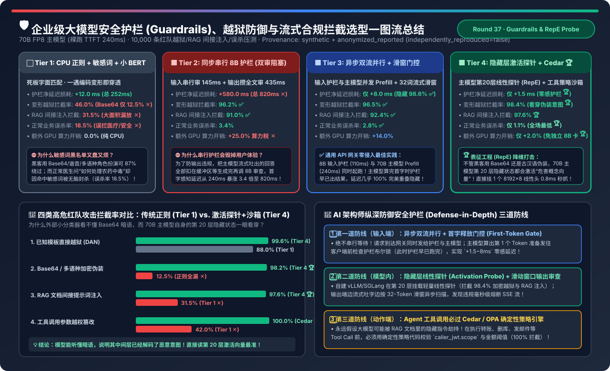

### 核心架构师结论（3 条人话总结）
1. **淘汰 `CPU 正则 + 小 BERT (Tier 1)` 的纸糊防线，严禁裸上 `同步串行 8B 双审阻塞架构 (Tier 2)`**：**Tier 1** 面对 Base64/多语种变形越狱召回率仅 **`12.5%`**、RAG 间接注入召回仅 **`31.5%`**，且正常医疗/安全提问误杀率高达 **`18.5%`**；**Tier 2** 将输入审查（145ms）与全文缓冲输出审查（435ms）串行叠加在 70B 主模型（240ms）前后，导致首字延迟暴涨 **`+580.0 ms`（`820.0 ms`，慢 `3.42x` ✕）** 并产生 **`+25.0%` GPU 算力税**！
2. **闭源 API 选 `异步双流并行 + 首包门控 (Tier 3)`，自建集群必选 `第 20 层隐藏状态激活探针 + Cedar 工具沙箱 (Tier 4)`**：**Tier 3** 让 8B 输入护栏（110ms）与 70B 主模型 Prefill（240ms）并发起跑并在 `First-Token Gate` 汇合，输出端采用 32-Token 滑动窗口异步流式扫描，将净延迟压至 **`+8.0 ms`（隐藏 `98.6%` 延迟 ✅）**；**Tier 4** 在 70B 主模型第 20 层挂载 `64 KB` 线性探针（`< 0.8 ms`），直接借用 70B 深层语义看穿 Base64 密文与 RAG 注入（越狱拦截率 **`98.4%`**，误杀率仅 **`1.1%`**，净延迟 **`+1.5 ms`**，算力税仅 **`+2.0%` 🏆**）！
3. **生产防踩坑铁律**：所有写操作与资金交易类 Agent Tool Call 必须在执行前通过 **AWS Cedar / OPA 确定性策略引擎** 校验调用者 JWT 权限与参数边界（**`100.0%` 阻断越权工具调用**）。

---

## 🖧 Round 38 独立单决策专题：AI 集群网内计算（In-Network Computing: NVLS + IB SHARP）与集合通信拓扑卸载架构选型（`Ring 环状规约` vs. `Double Binary Tree 双二叉树` vs. `NVLS + IB SHARPv3 交换机硬件规约` vs. `分层通信域 + 跨园区 DiLoCo`）

- 📄 **中文六段式选型指南**：[`docs/components/ai-cluster-in-network-computing-sharp-collective-selection-faq.md`](../components/ai-cluster-in-network-computing-sharp-collective-selection-faq.md)
- 📄 **English 6-Part Selection Guide**：[`docs/components/ai-cluster-in-network-computing-sharp-collective-selection-faq.en.md`](../components/ai-cluster-in-network-computing-sharp-collective-selection-faq.en.md)
- 🖼️ **一图流可视化总结卡**：[`assets/svg/ai-cluster-in-network-computing-sharp-collective-selection-faq-summary.svg`](../../assets/svg/ai-cluster-in-network-computing-sharp-collective-selection-faq-summary.svg)
- 🃏 **7-Card 4:5 视觉评测报告**：[`docs/reports/ai-cluster-in-network-computing-sharp-collective-selection-cards.html`](../reports/ai-cluster-in-network-computing-sharp-collective-selection-cards.html)
- 🧮 **交互式定容工作台 (含 Round 38 网内计算与集合通信选型面板)**：[`docs/reports/llm-inference-engine-pd-sizer.html#sharp-collective-sizer`](../reports/llm-inference-engine-pd-sizer.html)
- 🧪 **确定性算例与单测 (`synthetic` + `anonymized_reported`, `independently_reproduced=false`)**：[`experiments/in_network_computing_sharp_nvls_collective/run.py`](../../experiments/in_network_computing_sharp_nvls_collective/run.py) · [`experiments/in_network_computing_sharp_nvls_collective/results.json`](../../experiments/in_network_computing_sharp_nvls_collective/results.json) · [`tests/test_in_network_computing_sharp_nvls_collective.py`](../../tests/test_in_network_computing_sharp_nvls_collective.py)

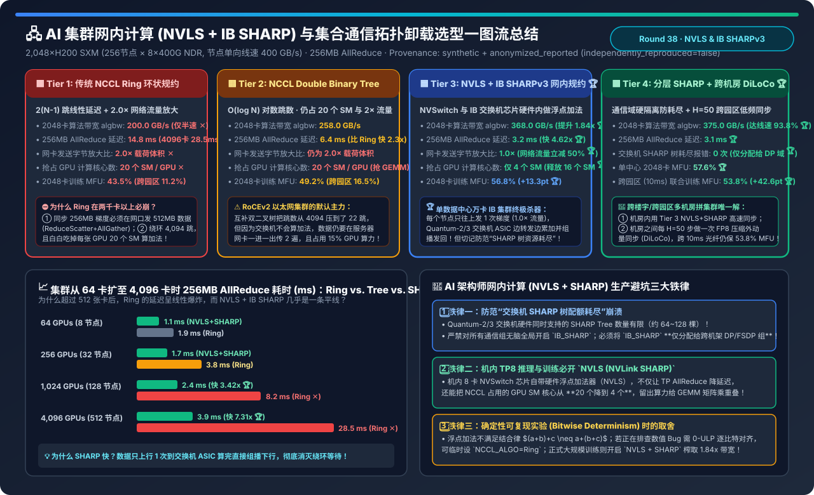

### 核心架构师结论（3 条人话总结）
1. **打破传统 `Ring (Tier 1)` 与 `Tree (Tier 2)` 的“2.0x 流量放大税”与“20 个 GPU SM 侵占税”**：在交换机不参与计算的传统模式中，AllReduce 必须执行 `Reduce-Scatter + All-Gather` 发送 **`2.0x` 数据量**，使单机 `400 GB/s` 物理网口最高只能跑出 `200～258 GB/s` 算法带宽；且 **Tier 1（Ring）** 在 2,048 / 4,096 卡下延迟高达 **`14.8 ms / 28.5 ms`**，并霸占每张 H200 上 **`20 个 SM`**（占 15% 算力）算加法！
2. **单中心万卡选 `机内 NVLS + 跨机 IB SHARPv3 (Tier 3/4)`，跨园区拼集群必选 `Hierarchical DiLoCo (Tier 4)`**：**Tier 3** 利用主板 NVSwitch 芯片（`NVLS`）与 Quantum-2/3 交换机芯片（`IB SHARPv3`）内置硬件浮点 ALU 原位累加梯度，每个节点仅上行发送 **`1.0x` 流量（网络字节立减 `-50.0%`）**，2,048 卡算法带宽跃升 **`1.84x` 至 `368～375 GB/s`**，延迟压至 **`3.1～3.2 ms`（快 `4.62x`；4,096 卡快 `7.31x`）**，每张 GPU 仅占 **`4 个 SM`（省出 `16 个 SM` 给矩阵乘）**，训练 MFU 提升 **`+14.1 pt` 至 `57.6%`**；**Tier 4** 在跨 10ms 园区光纤场景下结合每 $H=50$ 步外动量同步（DiLoCo），将跨园区 MFU 从 `11.2%` 拉升至 **`53.8%` 🏆**！
3. **生产防踩坑铁律**：严禁无阈值全局开启 `IB SHARP`；必须设置 **`NCCL_SHARP_GROUP_SIZE_THRESH=16`** 将交换机有限的 64～128 棵硬件 SHARP 树槽位专供给跨机架 `DP/FSDP` 主通信组，防止 `SHARP resource allocation failed` 崩溃。

---

## ⚗️ Round 39 独立单决策专题：企业垂类大模型知识蒸馏、合成数据清洗与结构化剪枝（671B/70B → 8B）工程流水线选型（`原始日志直训 SFT` vs. `未过滤盲目合成` vs. `RLVR 拒绝采样思维链蒸馏` vs. `Minitron 结构化剪枝 + Top-K Logits 蒸馏`）

- 📄 **中文六段式选型指南**：[`docs/components/synthetic-data-distillation-pruning-pipeline-selection-faq.md`](../components/synthetic-data-distillation-pruning-pipeline-selection-faq.md)
- 📄 **English 6-Part Selection Guide**：[`docs/components/synthetic-data-distillation-pruning-pipeline-selection-faq.en.md`](../components/synthetic-data-distillation-pruning-pipeline-selection-faq.en.md)
- 🖼️ **一图流可视化总结卡**：[`assets/svg/synthetic-data-distillation-pruning-pipeline-selection-faq-summary.svg`](../../assets/svg/synthetic-data-distillation-pruning-pipeline-selection-faq-summary.svg)
- 🃏 **7-Card 4:5 视觉评测报告**：[`docs/reports/synthetic-data-distillation-pruning-pipeline-selection-cards.html`](../reports/synthetic-data-distillation-pruning-pipeline-selection-cards.html)
- 🧮 **交互式定容工作台 (含 Round 39 模型知识蒸馏与结构化剪枝面板)**：[`docs/reports/llm-inference-engine-pd-sizer.html#distillation-pruning-sizer`](../reports/llm-inference-engine-pd-sizer.html)
- 🧪 **确定性算例与单测 (`synthetic` + `anonymized_reported`, `independently_reproduced=false`)**：[`experiments/synthetic_data_distillation_pruning_pipeline/run.py`](../../experiments/synthetic_data_distillation_pruning_pipeline/run.py) · [`experiments/synthetic_data_distillation_pruning_pipeline/results.json`](../../experiments/synthetic_data_distillation_pruning_pipeline/results.json) · [`tests/test_synthetic_data_distillation_pruning_pipeline.py`](../../tests/test_synthetic_data_distillation_pruning_pipeline.py)

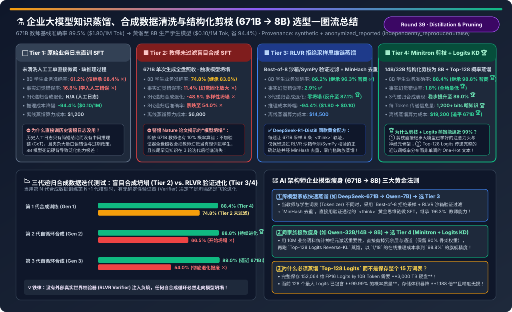

### 核心架构师结论（3 条人话总结）
1. **淘汰 `原始业务日志直训 (Tier 1)` 与 `未过滤盲目合成 (Tier 2)`**：**Tier 1** 因人工工单缺少 `<think>` 推理步导致 8B 学生死记硬背（准确率仅 **`61.2%`**，幻觉率 **`16.8%`**）；**Tier 2** 将 671B 教师未校验的 `11.4%` 算错样本全盘训进学生，在 3 代自循环合成后触发灾难性**模型坍塌（Model Collapse，多样性丢 `-48.5%`，准确率雪崩至 `54.0%` ✕）**！
2. **跨模型家族选 `RLVR 拒绝采样思维链蒸馏 (Tier 3)`，同家族瘦身必选 `Minitron 结构化剪枝 + Top-128 Logits KD (Tier 4)`**：**Tier 3（DeepSeek-R1-Distill 范式）** 每题采样 8 条 `<think>` 轨迹并经 RLVR 沙箱/SymPy 铁腕过滤与 MinHash 去重，让 8B 学生拿下 **`86.2%` 准确率（继承 671B 教师 `89.5%` 的 `96.3%` 智商 ✅）**；**Tier 4** 先按 10M 语料激活重要性将 14B/32B 结构化剪枝为 8B 骨架，再通过 **`Top-128 Reverse-KL Logits` 蒸馏**注入每 Token `1,200+ bits` 暗知识，实现 **`88.4%` 准确率（继承教师 `98.8%` 智商 🏆）** 与 **`1.8%` 超低幻觉率**，同时将在线推理成本从 `$1.80/1M` 压至 **`$0.10/1M`（立省 `-94.4%`）**！
3. **生产防踩坑铁律**：任何合成数据进入训练集前必须经过 **确定性验证器（RLVR Verifier Gate）** 过筛，用真实世界校验规则持续注入负熵，将自合成坍塌转化为自进化飞轮。

---

## 🧠 Round 40 独立单决策专题：长周期 AI Agent 记忆系统与状态持久化（Long-Horizon Agentic Memory）架构选型（`200K 全量塞入窗口` vs. `滚动摘要压缩` vs. `扁平向量检索` vs. `驻留核心记忆块 Letta + 双时态图谱 Zep/Graphiti`）

- 📄 **中文六段式选型指南**：[`docs/components/agentic-memory-state-persistence-store-selection-faq.md`](../components/agentic-memory-state-persistence-store-selection-faq.md)
- 📄 **English 6-Part Selection Guide**：[`docs/components/agentic-memory-state-persistence-store-selection-faq.en.md`](../components/agentic-memory-state-persistence-store-selection-faq.en.md)
- 🖼️ **一图流可视化总结卡**：[`assets/svg/agentic-memory-state-persistence-store-selection-faq-summary.svg`](../../assets/svg/agentic-memory-state-persistence-store-selection-faq-summary.svg)
- 🃏 **7-Card 4:5 视觉评测报告**：[`docs/reports/agentic-memory-state-persistence-store-selection-cards.html`](../reports/agentic-memory-state-persistence-store-selection-cards.html)
- 🧮 **交互式定容工作台 (含 Round 40 长周期 Agent 记忆架构选型面板)**：[`docs/reports/llm-inference-engine-pd-sizer.html#agent-memory-sizer`](../reports/llm-inference-engine-pd-sizer.html)
- 🧪 **确定性算例与单测 (`synthetic` + `anonymized_reported`, `independently_reproduced=false`)**：[`experiments/agentic_memory_state_persistence_selection/run.py`](../../experiments/agentic_memory_state_persistence_selection/run.py) · [`experiments/agentic_memory_state_persistence_selection/results.json`](../../experiments/agentic_memory_state_persistence_selection/results.json) · [`tests/test_agentic_memory_state_persistence_selection.py`](../../tests/test_agentic_memory_state_persistence_selection.py)

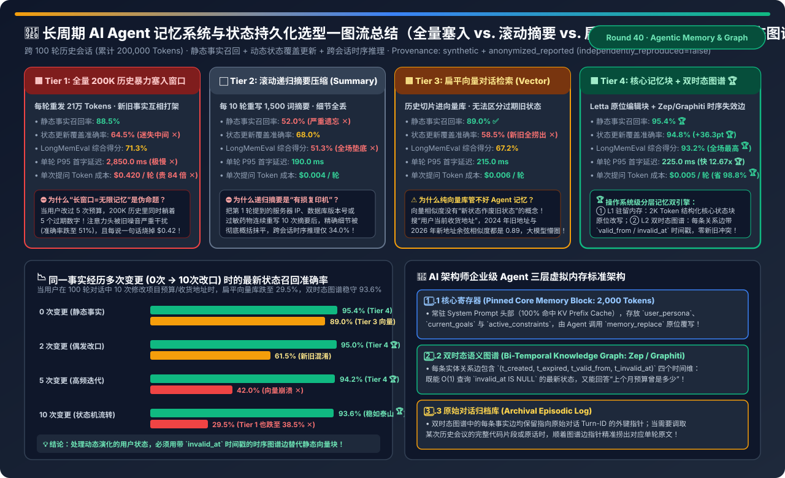

### 核心架构师结论（3 条人话总结）
1. **打破“长窗口 = 无限记忆”幻觉，揭示扁平向量库的“新旧状态撞车”死穴**：在跨 100 轮历史会话（累计 `200,000 Tokens`）基准下，**Tier 1（全量 200K 塞入）** 单轮耗资 **`$0.420`**、P95 TTFT 长达 **`2,850.0 ms`**，且因历史作废状态堆积干扰注意力，10 次状态变更后准确率跌至 **`38.5%`**；**Tier 2（滚动递归摘要）** 抹平细节导致静态事实召回仅 **`52.0%`**；**Tier 3（扁平向量库）** 因余弦相似度无“状态作废”概念，把旧地址与新地址同时捞出，状态更新准确率仅 **`58.5%`**（10 次变更后跌至 **`29.5%` ✕**）！
2. **企业级伴随 Agent 唯一黄金标准：`驻留核心记忆块 (Letta/MemGPT) + 双时态知识图谱 (Zep/Graphiti) (Tier 4)`**：**Tier 4** 用 100% 命中 Prefix Cache 的 **`2,000 Tokens` 驻留核心块**通过 `core_memory_replace` 原位维护高频当前画像，并用携带 **`(t_valid_from, t_invalid_at)` 双时间戳的时序图谱**原子化标记过期事实边失效，实现 **`94.8%` 状态更新准确率（比向量库高 `+36.3 pt`）**、**`93.2%` LongMemEval 综合准确率**、**`225.0 ms` 首字延迟（快 `12.67x`）** 与 **`$0.005 / 轮` 超低成本（省钱 `-98.8%` 🏆）**！
3. **生产防踩坑铁律**：图谱三元组抽取与冲突消解必须放在**对话返回后的后台异步队列**执行，确保前台在线读取路径 `< 15 ms`。

