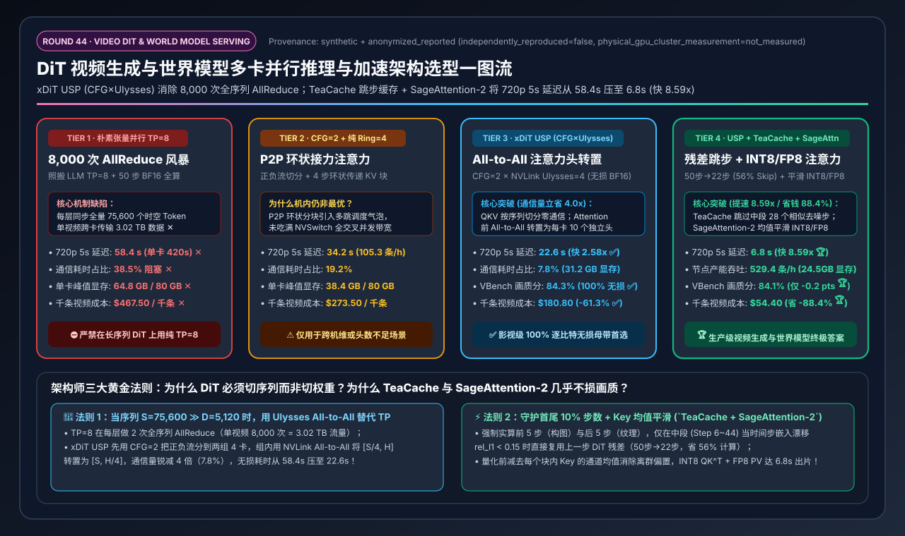
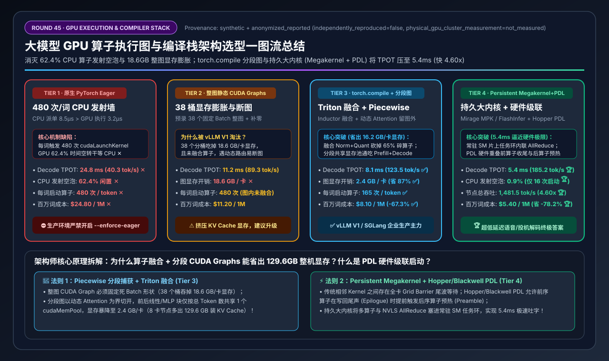
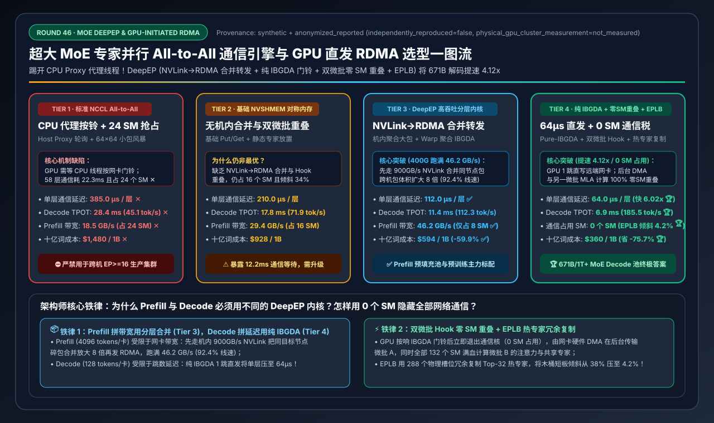
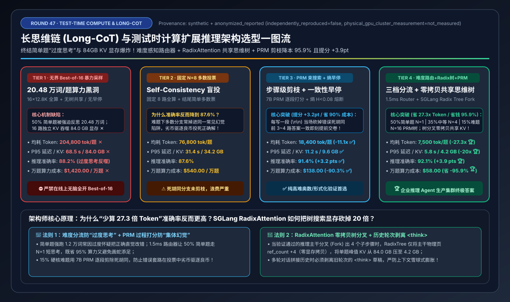
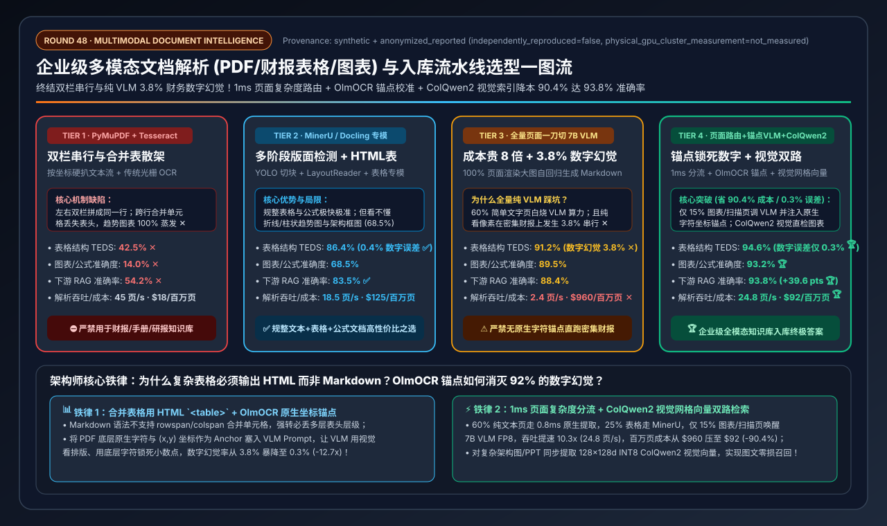

# 2026-11-11 — AI Solution Architect 选型 FAQ 深度专题：DiT 视频生成与世界模型多卡并行推理与加速架构选型指南（`USP` / `TeaCache` / `SageAttention-2`）

> **文风与标杆对齐**：本期专题严格对标 [`docs/components/ib-vs-ethernet-roce-selection-faq.md`](../components/ib-vs-ethernet-roce-selection-faq.md)，面向 **AI Solution Architect（AI 解决方案架构师）** 本人学习吸收与客户架构评审宣讲，遵循**“单篇纯粹清晰 × 第一性原理通俗拆解”**原则，杜绝晦涩黑话堆砌。

---

## 0. 今日领域高价值能力突破追踪（Daily Domain Breakthroughs — 2026-11-11 精选 3 项架构演进）

1. **xDiT 统一序列并行（`USP: CFG × DeepSpeed-Ulysses × Ring Attention`）在多模态视频 DiT 集群中的零冗余扩展**：
   - **解决了什么痛点**：传统大语言模型张量并行（`TP=8`）在面对 720p/1080p 视频生成动辄 `75,600 ~ 168,000` 个三维时空 Token 时，每层触发 2 次全序列 `AllReduce`（单条 50 步视频高达 8,000 次同步、`3.02 TB` 通信量），导致 38.5% 的算力卡死在集合通信上。
   - **对架构师意味着什么**：通过将正负条件引导分流（`CFG=2`）与机内 NVSwitch `All-to-All` 注意力头转置（`Ulysses=4`）结合，单层通信量天然缩减为 `TP AllReduce` 的 $1/P$（`4.0x` 下降），通信占比从 `38.5%` 压降至 `7.8%`，100% 逐比特无损实现 `2.58x` 加速（`58.4s → 22.6s`）。
2. **`TeaCache`（时间步嵌入感知残差跳步缓存）零训练砍半视频扩散步数（`50 步 → 22 步`）**：
   - **解决了什么痛点**：扩散模型 50 个去噪步中，中段（第 6～44 步）相邻时间步的 40 层 DiT 块残差输出余弦相似度超过 `98%`，全量重复计算造成巨大算力浪费。
   - **对架构师意味着什么**：通过监测微小的 Timestep Embedding 多项式校准 L1 距离（`rel_l1_thresh = 0.15`）并锁定首尾各 5 步关键步实算，可在零重训前提下跳过 `56%`（28 步）中段冗余步，直接带来 `2.27x` 端到端纯加速且 VBench 画质无感。
3. **`SageAttention-2`（块内 Key 均值平滑 `INT8 QK^T` + `FP8 PV`）攻克 DiT 注意力算子屋脊线**：
   - **解决了什么痛点**：视频 DiT 的 Key 张量存在严重的通道级离群值偏置（Channel-wise Outlier Bias），直接做 INT8 量化会导致注意力分数失真与画面色块崩坏。
   - **对架构师意味着什么**：在量化前减去每个块内 Key 的通道均值（$\tilde{K} = K - \bar{K}$），利用 Softmax 平移不变性彻底消除离群误差，将 3D Attention 核心算子送入 `INT8 + FP8` Tensor Core 执行，叠加 USP 与 TeaCache 后将 8×H100 生成 720p 5s 视频耗时压至 **`6.8 秒`（总提速 `8.59x`，成本直降 `-88.4%`）**。

---

## 🎬 Round 44 独立单决策专题：DiT 视频生成与世界模型多卡并行推理与加速架构选型（`朴素 TP=8 全序列 AllReduce` vs. `CFG + 纯 Ring Attention` vs. `xDiT USP [CFG × 机内 Ulysses All-to-All]` vs. `USP + TeaCache 时间步缓存 + SageAttention-2 FP8/INT8`）

- 📄 **中文六段式选型指南**：[`docs/components/video-dit-diffusion-serving-usp-teacache-selection-faq.md`](../components/video-dit-diffusion-serving-usp-teacache-selection-faq.md)
- 📄 **English 6-Part Selection Guide**：[`docs/components/video-dit-diffusion-serving-usp-teacache-selection-faq.en.md`](../components/video-dit-diffusion-serving-usp-teacache-selection-faq.en.md)
- 🖼️ **一图流可视化总结卡**：[`assets/svg/video-dit-diffusion-serving-usp-teacache-selection-faq-summary.svg`](../../assets/svg/video-dit-diffusion-serving-usp-teacache-selection-faq-summary.svg)
- 🃏 **7-Card 4:5 视觉评测报告**：[`docs/reports/video-dit-diffusion-serving-usp-teacache-selection-cards.html`](../reports/video-dit-diffusion-serving-usp-teacache-selection-cards.html)
- 🧮 **交互式定容工作台 (含 Round 44 视频 DiT 与世界模型多卡推理面板)**：[`docs/reports/llm-inference-engine-pd-sizer.html#video-dit-usp-sizer`](../reports/llm-inference-engine-pd-sizer.html)
- 🧪 **确定性算例与单测 (`synthetic` + `anonymized_reported`, `independently_reproduced=false`)**：[`experiments/video_dit_usp_teacache_serving_selection/run.py`](../../experiments/video_dit_usp_teacache_serving_selection/run.py) · [`experiments/video_dit_usp_teacache_serving_selection/results.json`](../../experiments/video_dit_usp_teacache_serving_selection/results.json) · [`tests/test_video_dit_usp_teacache_serving_selection.py`](../../tests/test_video_dit_usp_teacache_serving_selection.py)

---

## ⚡ Round 45 独立单决策专题：大模型 GPU 算子执行图与编译栈架构选型（`PyTorch Eager 逐算子发射` vs. `整图静态 CUDA Graphs` vs. `torch.compile + 分段 CUDA Graphs` vs. `持久大内核 Persistent Megakernel + PDL`）

- 📄 **中文六段式选型指南**：[`docs/components/cuda-graphs-torch-compile-megakernel-execution-selection-faq.md`](../components/cuda-graphs-torch-compile-megakernel-execution-selection-faq.md)
- 📄 **English 6-Part Selection Guide**：[`docs/components/cuda-graphs-torch-compile-megakernel-execution-selection-faq.en.md`](../components/cuda-graphs-torch-compile-megakernel-execution-selection-faq.en.md)
- 🖼️ **一图流可视化总结卡**：[`assets/svg/cuda-graphs-torch-compile-megakernel-execution-selection-faq-summary.svg`](../../assets/svg/cuda-graphs-torch-compile-megakernel-execution-selection-faq-summary.svg)
- 🃏 **7-Card 4:5 视觉评测报告**：[`docs/reports/cuda-graphs-torch-compile-megakernel-execution-selection-cards.html`](../reports/cuda-graphs-torch-compile-megakernel-execution-selection-cards.html)
- 🧮 **交互式定容工作台 (含 Round 45 GPU 执行图与编译栈面板)**：[`docs/reports/llm-inference-engine-pd-sizer.html#cuda-graph-compile-sizer`](../reports/llm-inference-engine-pd-sizer.html)
- 🧪 **确定性算例与单测 (`synthetic` + `anonymized_reported`, `independently_reproduced=false`)**：[`experiments/cuda_graphs_torch_compile_megakernel_selection/run.py`](../../experiments/cuda_graphs_torch_compile_megakernel_selection/run.py) · [`experiments/cuda_graphs_torch_compile_megakernel_selection/results.json`](../../experiments/cuda_graphs_torch_compile_megakernel_selection/results.json) · [`tests/test_cuda_graphs_torch_compile_megakernel_selection.py`](../../tests/test_cuda_graphs_torch_compile_megakernel_selection.py)

### 核心架构师结论（3 条人话总结）
1. **打破“GPU 越快，Eager 模式反而空转越严重 (Tier 1)”的 CPU 发射墙**：在 `8×H100 SXM5` 上跑 `70B FP8` 小批量解码（`BS=8`），GPU 算一个碎算子仅需 `3.2µs`，而 CPU 下发一次 `cudaLaunchKernel` 需 `8.5µs`；每词 `480 次` 启动导致 **`62.4%` 时间 GPU 在空转干等 CPU ✕**，TPOT 高达 **`24.8ms`（`40.3 tok/s` ✕）**！而旧版 **38 桶整图静态 CUDA Graphs（Tier 2）** 虽降至 `11.2ms`，却白白吃掉 **`18.6 GB/卡`（8 卡整机 `148.8 GB`）KV Cache 显存 ✕**！
2. **通用在线服务选 `torch.compile + 分段 CUDA Graphs (Tier 3)`，毫秒级语音/投机验证选 `Persistent Megakernel + PDL (Tier 4)`**：**Tier 3** 用 Triton 算子融合砍掉 65% 碎算子（`480→165`），并以动态 Attention 为界分段捕获共享内存池，将图显存从 `18.6 GB` 压至 **`2.4 GB/卡`（立省 `16.2 GB/卡` ✅）**，TPOT 达 **`8.1ms`（`123.5 tok/s`，快 `3.06x` ✅）**；**Tier 4** 用常驻 SM 持久大内核 + Hopper/Blackwell **PDL 硬件头尾重叠** 将启动压至 **`16 次`**、气泡压至 **`0.9%`**，TPOT 砸穿至 **`5.4ms`（`185.2 tok/s`，快 `4.60x`，成本直降 `-78.2%` 🏆）**！
3. **生产防踩坑铁律**：严禁线上遗留 `--enforce-eager`；必须挂载 `TORCHINDUCTOR_CACHE_DIR` 持久化卷消除 2 分钟冷编译等待，并在 H100/B200 上开启 `FLASHINFER_ENABLE_PDL=1`。

---

## 🚀 Round 46 独立单决策专题：超大 MoE 专家并行 All-to-All 通信引擎与 GPU 直发 RDMA（DeepEP / IBGDA）架构选型（`标准 NCCL CPU 代理` vs. `基础 NVSHMEM 对称内存` vs. `DeepEP 分层 NVLink→RDMA 转发` vs. `DeepEP 纯 IBGDA + 双微批零 SM 重叠 + EPLB`）

- 📄 **中文六段式选型指南**：[`docs/components/moe-deepep-ibgda-nvshmem-alltoall-engine-selection-faq.md`](../components/moe-deepep-ibgda-nvshmem-alltoall-engine-selection-faq.md)
- 📄 **English 6-Part Selection Guide**：[`docs/components/moe-deepep-ibgda-nvshmem-alltoall-engine-selection-faq.en.md`](../components/moe-deepep-ibgda-nvshmem-alltoall-engine-selection-faq.en.md)
- 🖼️ **一图流可视化总结卡**：[`assets/svg/moe-deepep-ibgda-nvshmem-alltoall-engine-selection-faq-summary.svg`](../../assets/svg/moe-deepep-ibgda-nvshmem-alltoall-engine-selection-faq-summary.svg)
- 🃏 **7-Card 4:5 视觉评测报告**：[`docs/reports/moe-deepep-ibgda-nvshmem-alltoall-engine-selection-cards.html`](../reports/moe-deepep-ibgda-nvshmem-alltoall-engine-selection-cards.html)
- 🧮 **交互式定容工作台 (含 Round 46 超大 MoE DeepEP 与 IBGDA 面板)**：[`docs/reports/llm-inference-engine-pd-sizer.html#moe-deepep-ibgda-sizer`](../reports/llm-inference-engine-pd-sizer.html)
- 🧪 **确定性算例与单测 (`synthetic` + `anonymized_reported`, `independently_reproduced=false`)**：[`experiments/moe_deepep_ibgda_alltoall_selection/run.py`](../../experiments/moe_deepep_ibgda_alltoall_selection/run.py) · [`experiments/moe_deepep_ibgda_alltoall_selection/results.json`](../../experiments/moe_deepep_ibgda_alltoall_selection/results.json) · [`tests/test_moe_deepep_ibgda_alltoall_selection.py`](../../tests/test_moe_deepep_ibgda_alltoall_selection.py)

### 核心架构师结论（3 条人话总结）
1. **终结“标准 NCCL All-to-All (Tier 1)”的 CPU 代理线程按铃与 24 SM 算力抢占**：在 64 卡（`EP=64`）运行 `DeepSeek-V3/R1 671B`（58 个 MoE 层）时，**Tier 1** 因依赖 Host CPU Proxy 线程轮询按网卡门铃，单层通信耗时高达 **`385.0 µs`（58 层累计 `22.3 ms` ✕）**，且常驻霸占 **`24 个 GPU SM`**，导致 Decode TPOT 恶化至 **`28.4 ms` ✕**！
2. **Prefill 池选 `DeepEP NVLink→RDMA 分层合并 (Tier 3)`，Decode 池必选 `DeepEP 纯 IBGDA + 双微批 0-SM Hook + EPLB (Tier 4)`**：**Tier 3** 先用机内 `900 GB/s` NVLink 合并同目标节点碎包再走 RDMA，将 400G 网卡有效带宽从 `18.5 GB/s` 拉满至 **`46.2 GB/s`（`92.4%` 线速 ✅）**；**Tier 4** 用 GPU SM 直接写网卡门铃（`Pure-IBGDA`）将单层通信压至 **`64.0 µs`（快 `6.02x` 🏆）**，并通过后台网卡 DMA Hook 双微批重叠实现 **`0 个 GPU SM` 通信占用**，配合 **EPLB 热专家冗余复制**（倾斜从 `38.0%` 压至 `4.2%`），将 Decode TPOT 压至 **`6.9 ms`（快 `4.12x` 🏆）**，成本直降 **`-75.7%` 🏆**！
3. **生产防踩坑铁律**：宿主机必须开启 `NVSHMEM_IB_ENABLE_IBGDA=1` 与 `PeerMappingOverride=1`；并为 256 个逻辑专家预留 `288` 个物理槽位动态复制 Top-32 热门专家。

---

## 🧠 Round 47 独立单决策专题：长思维链（Long-CoT）与测试时计算扩展（Test-Time Compute Scaling）推理架构选型（`无界 Best-of-16 暴力采样` vs. `固定 N=8 多数投票` vs. `PRM 步骤级束搜索 + 熵早停` vs. `难度感知路由器 + RadixAttention 共享思维树`）

- 📄 **中文六段式选型指南**：[`docs/components/test-time-compute-long-cot-prm-routing-selection-faq.md`](../components/test-time-compute-long-cot-prm-routing-selection-faq.md)
- 📄 **English 6-Part Selection Guide**：[`docs/components/test-time-compute-long-cot-prm-routing-selection-faq.en.md`](../components/test-time-compute-long-cot-prm-routing-selection-faq.en.md)
- 🖼️ **一图流可视化总结卡**：[`assets/svg/test-time-compute-long-cot-prm-routing-selection-faq-summary.svg`](../../assets/svg/test-time-compute-long-cot-prm-routing-selection-faq-summary.svg)
- 🃏 **7-Card 4:5 视觉评测报告**：[`docs/reports/test-time-compute-long-cot-prm-routing-selection-cards.html`](../reports/test-time-compute-long-cot-prm-routing-selection-cards.html)
- 🧮 **交互式定容工作台 (含 Round 47 长思维链与测试时计算面板)**：[`docs/reports/llm-inference-engine-pd-sizer.html#test-time-compute-sizer`](../reports/llm-inference-engine-pd-sizer.html)
- 🧪 **确定性算例与单测 (`synthetic` + `anonymized_reported`, `independently_reproduced=false`)**：[`experiments/test_time_compute_long_cot_routing_selection/run.py`](../../experiments/test_time_compute_long_cot_routing_selection/run.py) · [`experiments/test_time_compute_long_cot_routing_selection/results.json`](../../experiments/test_time_compute_long_cot_routing_selection/results.json) · [`tests/test_test_time_compute_long_cot_routing_selection.py`](../../tests/test_test_time_compute_long_cot_routing_selection.py)

### 核心架构师结论（3 条人话总结）
1. **终结“无界 Best-of-16 暴力采样 (Tier 1)”的 20.48 万词/题过度思考与 84GB KV 显存爆炸**：在企业真实混合流量（`50% 简单 / 35% 中等 / 15% 硬核难题`）下，**Tier 1** 对简单查询也硬跑 16 条 12.8K 长链（均耗 **`204,800 tokens/题` ✕**，峰值占 **`84.0 GB` KV 显存 ✕**），P95 高达 `68.5 秒`，万题成本高达 **`$1,420.00` ✕**！
2. **纯硬核难题选 `7B PRM 束搜索 + 熵早停 (Tier 3)`，企业混合流量必选 `难度感知路由器 + RadixAttention 共享思维树 + PRM (Tier 4)`**：**Tier 3** 在每个 `\n\n` 步骤边界用 7B PRM 淘汰死胡同并当熵 $H<0.08$ 早停，将准确率推升至 **`91.4%`（`+3.2 pts` ✅）**；**Tier 4** 用 `1.5ms` 难度路由器分流（50% 简单题走 `N=1` 短思考）并配合 **SGLang `RadixAttention` 零拷贝共享思维树主干 KV**，将每题均耗暴砍 **`27.3 倍`（`7,500 tokens` 🏆）**、峰值 KV 压至 **`4.2 GB`（缩小 `20x` 🏆）**、P95 压至 **`5.8 秒`（快 `11.8x` 🏆）**、准确率达 **`92.1%` 🏆**，万题成本暴降至 **`$58.00`（直省 `-95.9%` 🏆）**！
3. **生产防踩坑铁律**：多轮对话拼接上下文时必须**自动剥离历史轮次的 `<think>...</think>` 草稿**，严防历史推理草稿塞爆下一轮 KV Cache。

---

## 📄 Round 48 独立单决策专题：企业级多模态文档解析（PDF/财报表格/公式图表 OCR）与视觉语言入库流水线架构选型（`传统 PyMuPDF/Tesseract` vs. `多阶段版面检测 MinerU/Docling` vs. `全量 7B VLM 端到端转写` vs. `页面自适应路由 + 锚点校准 OlmOCR + ColQwen2 视觉索引`）

- 📄 **中文六段式选型指南**：[`docs/components/document-intelligence-ocr-vlm-parsing-pipeline-selection-faq.md`](../components/document-intelligence-ocr-vlm-parsing-pipeline-selection-faq.md)
- 📄 **English 6-Part Selection Guide**：[`docs/components/document-intelligence-ocr-vlm-parsing-pipeline-selection-faq.en.md`](../components/document-intelligence-ocr-vlm-parsing-pipeline-selection-faq.en.md)
- 🖼️ **一图流可视化总结卡**：[`assets/svg/document-intelligence-ocr-vlm-parsing-pipeline-selection-faq-summary.svg`](../../assets/svg/document-intelligence-ocr-vlm-parsing-pipeline-selection-faq-summary.svg)
- 🃏 **7-Card 4:5 视觉评测报告**：[`docs/reports/document-intelligence-ocr-vlm-parsing-pipeline-selection-cards.html`](../reports/document-intelligence-ocr-vlm-parsing-pipeline-selection-cards.html)
- 🧮 **交互式定容工作台 (含 Round 48 企业多模态文档解析面板)**：[`docs/reports/llm-inference-engine-pd-sizer.html#doc-intelligence-sizer`](../reports/llm-inference-engine-pd-sizer.html)
- 🧪 **确定性算例与单测 (`synthetic` + `anonymized_reported`, `independently_reproduced=false`)**：[`experiments/document_intelligence_ocr_vlm_pipeline_selection/run.py`](../../experiments/document_intelligence_ocr_vlm_pipeline_selection/run.py) · [`experiments/document_intelligence_ocr_vlm_pipeline_selection/results.json`](../../experiments/document_intelligence_ocr_vlm_pipeline_selection/results.json) · [`tests/test_document_intelligence_ocr_vlm_pipeline_selection.py`](../../tests/test_document_intelligence_ocr_vlm_pipeline_selection.py)

### 核心架构师结论（3 条人话总结）
1. **打破“PyMuPDF 双栏串行崩塌 (Tier 1)”与“全量 7B VLM 昂贵且抄串财务数字 (Tier 3)”的双重困境**：在 100 万页混合企业 PDF 入库中，**Tier 1** 因双栏串行与合并单元格散架（表格 TEDS 仅 `42.5%`、图表 `14.0%`）导致下游 RAG 问答仅 **`54.2%` ✕**；而将 100% 页面转图跑纯视觉 **7B VLM（Tier 3）** 不仅吞吐跌至 **`2.4 页/s`（`$960/百万页` ✕）**，更在密集财务表上出现 **`3.8%` 的数字串行幻觉 ✕**！
2. **规整文档选 `MinerU / Docling 专模 (Tier 2)`，金融财报/工程手册必选 `1ms 页面路由 + OlmOCR 坐标锚点校准 VLM + ColQwen2 视觉索引 (Tier 4)`**：**Tier 4** 让 60% 文本页走 `0.8ms` 原生提取、25% 表格走 `MinerU HTML`、仅 15% 图表/扫描页调用注入了 PDF 原生字符坐标锚点的 7B VLM，将财务数字幻觉率压低 **`12.7 倍` 至 `0.3%` 🏆**，表格 TEDS 达 **`94.6%` 🏆**，下游 RAG 准确率达 **`93.8%` 🏆**，吞吐提速 **`10.3x`（`24.8 页/s`）**，百万页成本仅 **`$92.00`（比全量 VLM 直省 `-90.4%` 🏆）**！
3. **生产防踩坑铁律**：跨行/跨列合并表格必须序列化为 **`HTML <table>`**（Markdown 不支持 `rowspan/colspan`），并在切片时在每个子块头部重复拼回 `<thead>` 表头。
