# 2026-11-11 — AI Solution Architect 选型 FAQ 深度专题：DiT 视频生成与世界模型多卡并行推理与加速架构选型指南（`USP` / `TeaCache` / `SageAttention-2`）

> **文风与标杆对齐**：本期专题严格对标 [`docs/components/ib-vs-ethernet-roce-selection-faq.md`](../components/ib-vs-ethernet-roce-selection-faq.md)，面向 **AI Solution Architect（AI 解决方案架构师）** 本人学习吸收与客户架构评审宣讲，遵循**“单篇纯粹清晰 × 第一性原理通俗拆解”**原则，杜绝晦涩黑话堆砌。

---

## 0. 今日领域高价值能力突破追踪（Daily Domain Breakthroughs — 2026-11-11 精选 3 项架构演进）

1. **xDiT 统一序列并行（`USP: CFG × DeepSpeed-Ulysses × Ring Attention`）在多模态视频 DiT 集群中的零冗余扩展**：
   - **解决了什么痛点**：传统大语言模型张量并行（`TP=8`）在面对 720p/1080p 视频生成动辄 `75,600 ~ 168,000` 个三维时空 Token 时，每层触发 2 次全序列 `AllReduce`（单条 50 步视频高达 8,000 次同步、`3.02 TB` 通信量），导致 38.5% 的算力卡死在集合通信上。
   - **对架构师意味着什么**：通过将正负条件引导分流（`CFG=2`）与机内 NVSwitch `All-to-All` 注意力头转置（`Ulysses=4`）结合，单层通信量天然缩减为 `TP AllReduce` 的 $1/P$（`4.0x` 下降），通信占比从 `38.5%` 压降至 `7.8%`，100% 逐比特无损实现 `2.58x` 加速（`58.4s → 22.6s`）。
2. **`TeaCache`（时间步嵌入感知残差跳步缓存）零训练砍半视频扩散步数（`50 步 → 22 步`）**：
   - **解决了什么痛点**：扩散模型 50 个去噪步中，中段（第 6～44 步）相邻时间步的 40 层 DiT 块残差输出余弦相似度超过 `98%`，全量重复计算造成巨大算力浪费。
   - **对架构师意味着什么**：通过监测微小的 Timestep Embedding 多项式校准 L1 距离（`rel_l1_thresh = 0.15`）并锁定首尾各 5 步关键步实算，可在零重训前提下跳过 `56%`（28 步）中段冗余步，直接带来 `2.27x` 端到端纯加速且 VBench 画质无感。
3. **`SageAttention-2`（块内 Key 均值平滑 `INT8 QK^T` + `FP8 PV`）攻克 DiT 注意力算子屋脊线**：
   - **解决了什么痛点**：视频 DiT 的 Key 张量存在严重的通道级离群值偏置（Channel-wise Outlier Bias），直接做 INT8 量化会导致注意力分数失真与画面色块崩坏。
   - **对架构师意味着什么**：在量化前减去每个块内 Key 的通道均值（$\tilde{K} = K - \bar{K}$），利用 Softmax 平移不变性彻底消除离群误差，将 3D Attention 核心算子送入 `INT8 + FP8` Tensor Core 执行，叠加 USP 与 TeaCache 后将 8×H100 生成 720p 5s 视频耗时压至 **`6.8 秒`（总提速 `8.59x`，成本直降 `-88.4%`）**。

---

## 🎬 Round 44 独立单决策专题：DiT 视频生成与世界模型多卡并行推理与加速架构选型（`朴素 TP=8 全序列 AllReduce` vs. `CFG + 纯 Ring Attention` vs. `xDiT USP [CFG × 机内 Ulysses All-to-All]` vs. `USP + TeaCache 时间步缓存 + SageAttention-2 FP8/INT8`）

- 📄 **中文六段式选型指南**：[`docs/components/video-dit-diffusion-serving-usp-teacache-selection-faq.md`](../components/video-dit-diffusion-serving-usp-teacache-selection-faq.md)
- 📄 **English 6-Part Selection Guide**：[`docs/components/video-dit-diffusion-serving-usp-teacache-selection-faq.en.md`](../components/video-dit-diffusion-serving-usp-teacache-selection-faq.en.md)
- 🖼️ **一图流可视化总结卡**：[`assets/svg/video-dit-diffusion-serving-usp-teacache-selection-faq-summary.svg`](../../assets/svg/video-dit-diffusion-serving-usp-teacache-selection-faq-summary.svg)
- 🃏 **7-Card 4:5 视觉评测报告**：[`docs/reports/video-dit-diffusion-serving-usp-teacache-selection-cards.html`](../reports/video-dit-diffusion-serving-usp-teacache-selection-cards.html)
- 🧮 **交互式定容工作台 (含 Round 44 视频 DiT 与世界模型多卡推理面板)**：[`docs/reports/llm-inference-engine-pd-sizer.html#video-dit-usp-sizer`](../reports/llm-inference-engine-pd-sizer.html)
- 🧪 **确定性算例与单测 (`synthetic` + `anonymized_reported`, `independently_reproduced=false`)**：[`experiments/video_dit_usp_teacache_serving_selection/run.py`](../../experiments/video_dit_usp_teacache_serving_selection/run.py) · [`experiments/video_dit_usp_teacache_serving_selection/results.json`](../../experiments/video_dit_usp_teacache_serving_selection/results.json) · [`tests/test_video_dit_usp_teacache_serving_selection.py`](../../tests/test_video_dit_usp_teacache_serving_selection.py)

---

## ⚡ Round 45 独立单决策专题：大模型 GPU 算子执行图与编译栈架构选型（`PyTorch Eager 逐算子发射` vs. `整图静态 CUDA Graphs` vs. `torch.compile + 分段 CUDA Graphs` vs. `持久大内核 Persistent Megakernel + PDL`）

- 📄 **中文六段式选型指南**：[`docs/components/cuda-graphs-torch-compile-megakernel-execution-selection-faq.md`](../components/cuda-graphs-torch-compile-megakernel-execution-selection-faq.md)
- 📄 **English 6-Part Selection Guide**：[`docs/components/cuda-graphs-torch-compile-megakernel-execution-selection-faq.en.md`](../components/cuda-graphs-torch-compile-megakernel-execution-selection-faq.en.md)
- 🖼️ **一图流可视化总结卡**：[`assets/svg/cuda-graphs-torch-compile-megakernel-execution-selection-faq-summary.svg`](../../assets/svg/cuda-graphs-torch-compile-megakernel-execution-selection-faq-summary.svg)
- 🃏 **7-Card 4:5 视觉评测报告**：[`docs/reports/cuda-graphs-torch-compile-megakernel-execution-selection-cards.html`](../reports/cuda-graphs-torch-compile-megakernel-execution-selection-cards.html)
- 🧮 **交互式定容工作台 (含 Round 45 GPU 执行图与编译栈面板)**：[`docs/reports/llm-inference-engine-pd-sizer.html#cuda-graph-compile-sizer`](../reports/llm-inference-engine-pd-sizer.html)
- 🧪 **确定性算例与单测 (`synthetic` + `anonymized_reported`, `independently_reproduced=false`)**：[`experiments/cuda_graphs_torch_compile_megakernel_selection/run.py`](../../experiments/cuda_graphs_torch_compile_megakernel_selection/run.py) · [`experiments/cuda_graphs_torch_compile_megakernel_selection/results.json`](../../experiments/cuda_graphs_torch_compile_megakernel_selection/results.json) · [`tests/test_cuda_graphs_torch_compile_megakernel_selection.py`](../../tests/test_cuda_graphs_torch_compile_megakernel_selection.py)

### 核心架构师结论（3 条人话总结）
1. **打破“GPU 越快，Eager 模式反而空转越严重 (Tier 1)”的 CPU 发射墙**：在 `8×H100 SXM5` 上跑 `70B FP8` 小批量解码（`BS=8`），GPU 算一个碎算子仅需 `3.2µs`，而 CPU 下发一次 `cudaLaunchKernel` 需 `8.5µs`；每词 `480 次` 启动导致 **`62.4%` 时间 GPU 在空转干等 CPU ✕**，TPOT 高达 **`24.8ms`（`40.3 tok/s` ✕）**！而旧版 **38 桶整图静态 CUDA Graphs（Tier 2）** 虽降至 `11.2ms`，却白白吃掉 **`18.6 GB/卡`（8 卡整机 `148.8 GB`）KV Cache 显存 ✕**！
2. **通用在线服务选 `torch.compile + 分段 CUDA Graphs (Tier 3)`，毫秒级语音/投机验证选 `Persistent Megakernel + PDL (Tier 4)`**：**Tier 3** 用 Triton 算子融合砍掉 65% 碎算子（`480→165`），并以动态 Attention 为界分段捕获共享内存池，将图显存从 `18.6 GB` 压至 **`2.4 GB/卡`（立省 `16.2 GB/卡` ✅）**，TPOT 达 **`8.1ms`（`123.5 tok/s`，快 `3.06x` ✅）**；**Tier 4** 用常驻 SM 持久大内核 + Hopper/Blackwell **PDL 硬件头尾重叠** 将启动压至 **`16 次`**、气泡压至 **`0.9%`**，TPOT 砸穿至 **`5.4ms`（`185.2 tok/s`，快 `4.60x`，成本直降 `-78.2%` 🏆）**！
3. **生产防踩坑铁律**：严禁线上遗留 `--enforce-eager`；必须挂载 `TORCHINDUCTOR_CACHE_DIR` 持久化卷消除 2 分钟冷编译等待，并在 H100/B200 上开启 `FLASHINFER_ENABLE_PDL=1`。

---

## 🚀 Round 46 独立单决策专题：超大 MoE 专家并行 All-to-All 通信引擎与 GPU 直发 RDMA（DeepEP / IBGDA）架构选型（`标准 NCCL CPU 代理` vs. `基础 NVSHMEM 对称内存` vs. `DeepEP 分层 NVLink→RDMA 转发` vs. `DeepEP 纯 IBGDA + 双微批零 SM 重叠 + EPLB`）

- 📄 **中文六段式选型指南**：[`docs/components/moe-deepep-ibgda-nvshmem-alltoall-engine-selection-faq.md`](../components/moe-deepep-ibgda-nvshmem-alltoall-engine-selection-faq.md)
- 📄 **English 6-Part Selection Guide**：[`docs/components/moe-deepep-ibgda-nvshmem-alltoall-engine-selection-faq.en.md`](../components/moe-deepep-ibgda-nvshmem-alltoall-engine-selection-faq.en.md)
- 🖼️ **一图流可视化总结卡**：[`assets/svg/moe-deepep-ibgda-nvshmem-alltoall-engine-selection-faq-summary.svg`](../../assets/svg/moe-deepep-ibgda-nvshmem-alltoall-engine-selection-faq-summary.svg)
- 🃏 **7-Card 4:5 视觉评测报告**：[`docs/reports/moe-deepep-ibgda-nvshmem-alltoall-engine-selection-cards.html`](../reports/moe-deepep-ibgda-nvshmem-alltoall-engine-selection-cards.html)
- 🧮 **交互式定容工作台 (含 Round 46 超大 MoE DeepEP 与 IBGDA 面板)**：[`docs/reports/llm-inference-engine-pd-sizer.html#moe-deepep-ibgda-sizer`](../reports/llm-inference-engine-pd-sizer.html)
- 🧪 **确定性算例与单测 (`synthetic` + `anonymized_reported`, `independently_reproduced=false`)**：[`experiments/moe_deepep_ibgda_alltoall_selection/run.py`](../../experiments/moe_deepep_ibgda_alltoall_selection/run.py) · [`experiments/moe_deepep_ibgda_alltoall_selection/results.json`](../../experiments/moe_deepep_ibgda_alltoall_selection/results.json) · [`tests/test_moe_deepep_ibgda_alltoall_selection.py`](../../tests/test_moe_deepep_ibgda_alltoall_selection.py)

### 核心架构师结论（3 条人话总结）
1. **终结“标准 NCCL All-to-All (Tier 1)”的 CPU 代理线程按铃与 24 SM 算力抢占**：在 64 卡（`EP=64`）运行 `DeepSeek-V3/R1 671B`（58 个 MoE 层）时，**Tier 1** 因依赖 Host CPU Proxy 线程轮询按网卡门铃，单层通信耗时高达 **`385.0 µs`（58 层累计 `22.3 ms` ✕）**，且常驻霸占 **`24 个 GPU SM`**，导致 Decode TPOT 恶化至 **`28.4 ms` ✕**！
2. **Prefill 池选 `DeepEP NVLink→RDMA 分层合并 (Tier 3)`，Decode 池必选 `DeepEP 纯 IBGDA + 双微批 0-SM Hook + EPLB (Tier 4)`**：**Tier 3** 先用机内 `900 GB/s` NVLink 合并同目标节点碎包再走 RDMA，将 400G 网卡有效带宽从 `18.5 GB/s` 拉满至 **`46.2 GB/s`（`92.4%` 线速 ✅）**；**Tier 4** 用 GPU SM 直接写网卡门铃（`Pure-IBGDA`）将单层通信压至 **`64.0 µs`（快 `6.02x` 🏆）**，并通过后台网卡 DMA Hook 双微批重叠实现 **`0 个 GPU SM` 通信占用**，配合 **EPLB 热专家冗余复制**（倾斜从 `38.0%` 压至 `4.2%`），将 Decode TPOT 压至 **`6.9 ms`（快 `4.12x` 🏆）**，成本直降 **`-75.7%` 🏆**！
3. **生产防踩坑铁律**：宿主机必须开启 `NVSHMEM_IB_ENABLE_IBGDA=1` 与 `PeerMappingOverride=1`；并为 256 个逻辑专家预留 `288` 个物理槽位动态复制 Top-32 热门专家。

---

## 🧠 Round 47 独立单决策专题：长思维链（Long-CoT）与测试时计算扩展（Test-Time Compute Scaling）推理架构选型（`无界 Best-of-16 暴力采样` vs. `固定 N=8 多数投票` vs. `PRM 步骤级束搜索 + 熵早停` vs. `难度感知路由器 + RadixAttention 共享思维树`）

- 📄 **中文六段式选型指南**：[`docs/components/test-time-compute-long-cot-prm-routing-selection-faq.md`](../components/test-time-compute-long-cot-prm-routing-selection-faq.md)
- 📄 **English 6-Part Selection Guide**：[`docs/components/test-time-compute-long-cot-prm-routing-selection-faq.en.md`](../components/test-time-compute-long-cot-prm-routing-selection-faq.en.md)
- 🖼️ **一图流可视化总结卡**：[`assets/svg/test-time-compute-long-cot-prm-routing-selection-faq-summary.svg`](../../assets/svg/test-time-compute-long-cot-prm-routing-selection-faq-summary.svg)
- 🃏 **7-Card 4:5 视觉评测报告**：[`docs/reports/test-time-compute-long-cot-prm-routing-selection-cards.html`](../reports/test-time-compute-long-cot-prm-routing-selection-cards.html)
- 🧮 **交互式定容工作台 (含 Round 47 长思维链与测试时计算面板)**：[`docs/reports/llm-inference-engine-pd-sizer.html#test-time-compute-sizer`](../reports/llm-inference-engine-pd-sizer.html)
- 🧪 **确定性算例与单测 (`synthetic` + `anonymized_reported`, `independently_reproduced=false`)**：[`experiments/test_time_compute_long_cot_routing_selection/run.py`](../../experiments/test_time_compute_long_cot_routing_selection/run.py) · [`experiments/test_time_compute_long_cot_routing_selection/results.json`](../../experiments/test_time_compute_long_cot_routing_selection/results.json) · [`tests/test_test_time_compute_long_cot_routing_selection.py`](../../tests/test_test_time_compute_long_cot_routing_selection.py)

### 核心架构师结论（3 条人话总结）
1. **终结“无界 Best-of-16 暴力采样 (Tier 1)”的 20.48 万词/题过度思考与 84GB KV 显存爆炸**：在企业真实混合流量（`50% 简单 / 35% 中等 / 15% 硬核难题`）下，**Tier 1** 对简单查询也硬跑 16 条 12.8K 长链（均耗 **`204,800 tokens/题` ✕**，峰值占 **`84.0 GB` KV 显存 ✕**），P95 高达 `68.5 秒`，万题成本高达 **`$1,420.00` ✕**！
2. **纯硬核难题选 `7B PRM 束搜索 + 熵早停 (Tier 3)`，企业混合流量必选 `难度感知路由器 + RadixAttention 共享思维树 + PRM (Tier 4)`**：**Tier 3** 在每个 `\n\n` 步骤边界用 7B PRM 淘汰死胡同并当熵 $H<0.08$ 早停，将准确率推升至 **`91.4%`（`+3.2 pts` ✅）**；**Tier 4** 用 `1.5ms` 难度路由器分流（50% 简单题走 `N=1` 短思考）并配合 **SGLang `RadixAttention` 零拷贝共享思维树主干 KV**，将每题均耗暴砍 **`27.3 倍`（`7,500 tokens` 🏆）**、峰值 KV 压至 **`4.2 GB`（缩小 `20x` 🏆）**、P95 压至 **`5.8 秒`（快 `11.8x` 🏆）**、准确率达 **`92.1%` 🏆**，万题成本暴降至 **`$58.00`（直省 `-95.9%` 🏆）**！
3. **生产防踩坑铁律**：多轮对话拼接上下文时必须**自动剥离历史轮次的 `<think>...</think>` 草稿**，严防历史推理草稿塞爆下一轮 KV Cache。

---

## 📄 Round 48 独立单决策专题：企业级多模态文档解析（PDF/财报表格/公式图表 OCR）与视觉语言入库流水线架构选型（`传统 PyMuPDF/Tesseract` vs. `多阶段版面检测 MinerU/Docling` vs. `全量 7B VLM 端到端转写` vs. `页面自适应路由 + 锚点校准 OlmOCR + ColQwen2 视觉索引`）

- 📄 **中文六段式选型指南**：[`docs/components/document-intelligence-ocr-vlm-parsing-pipeline-selection-faq.md`](../components/document-intelligence-ocr-vlm-parsing-pipeline-selection-faq.md)
- 📄 **English 6-Part Selection Guide**：[`docs/components/document-intelligence-ocr-vlm-parsing-pipeline-selection-faq.en.md`](../components/document-intelligence-ocr-vlm-parsing-pipeline-selection-faq.en.md)
- 🖼️ **一图流可视化总结卡**：[`assets/svg/document-intelligence-ocr-vlm-parsing-pipeline-selection-faq-summary.svg`](../../assets/svg/document-intelligence-ocr-vlm-parsing-pipeline-selection-faq-summary.svg)
- 🃏 **7-Card 4:5 视觉评测报告**：[`docs/reports/document-intelligence-ocr-vlm-parsing-pipeline-selection-cards.html`](../reports/document-intelligence-ocr-vlm-parsing-pipeline-selection-cards.html)
- 🧮 **交互式定容工作台 (含 Round 48 企业多模态文档解析面板)**：[`docs/reports/llm-inference-engine-pd-sizer.html#doc-intelligence-sizer`](../reports/llm-inference-engine-pd-sizer.html)
- 🧪 **确定性算例与单测 (`synthetic` + `anonymized_reported`, `independently_reproduced=false`)**：[`experiments/document_intelligence_ocr_vlm_pipeline_selection/run.py`](../../experiments/document_intelligence_ocr_vlm_pipeline_selection/run.py) · [`experiments/document_intelligence_ocr_vlm_pipeline_selection/results.json`](../../experiments/document_intelligence_ocr_vlm_pipeline_selection/results.json) · [`tests/test_document_intelligence_ocr_vlm_pipeline_selection.py`](../../tests/test_document_intelligence_ocr_vlm_pipeline_selection.py)

### 核心架构师结论（3 条人话总结）
1. **打破“PyMuPDF 双栏串行崩塌 (Tier 1)”与“全量 7B VLM 昂贵且抄串财务数字 (Tier 3)”的双重困境**：在 100 万页混合企业 PDF 入库中，**Tier 1** 因双栏串行与合并单元格散架（表格 TEDS 仅 `42.5%`、图表 `14.0%`）导致下游 RAG 问答仅 **`54.2%` ✕**；而将 100% 页面转图跑纯视觉 **7B VLM（Tier 3）** 不仅吞吐跌至 **`2.4 页/s`（`$960/百万页` ✕）**，更在密集财务表上出现 **`3.8%` 的数字串行幻觉 ✕**！
2. **规整文档选 `MinerU / Docling 专模 (Tier 2)`，金融财报/工程手册必选 `1ms 页面路由 + OlmOCR 坐标锚点校准 VLM + ColQwen2 视觉索引 (Tier 4)`**：**Tier 4** 让 60% 文本页走 `0.8ms` 原生提取、25% 表格走 `MinerU HTML`、仅 15% 图表/扫描页调用注入了 PDF 原生字符坐标锚点的 7B VLM，将财务数字幻觉率压低 **`12.7 倍` 至 `0.3%` 🏆**，表格 TEDS 达 **`94.6%` 🏆**，下游 RAG 准确率达 **`93.8%` 🏆**，吞吐提速 **`10.3x`（`24.8 页/s`）**，百万页成本仅 **`$92.00`（比全量 VLM 直省 `-90.4%` 🏆）**！
3. **生产防踩坑铁律**：跨行/跨列合并表格必须序列化为 **`HTML <table>`**（Markdown 不支持 `rowspan/colspan`），并在切片时在每个子块头部重复拼回 `<thead>` 表头。

---

## 🔧 Round 49 独立单决策专题：跨异构 GPU 集群（NVIDIA H100/B200 + AMD MI300X/MI325X）统一编译栈与跨架构 PD 分离选型（`源码硬转 HIPIFY` vs. `静态 ONNX/OpenXLA` vs. `Triton/TileLang + AMD AITER 调优` vs. `跨厂商异构 PD 分离 [H100 Prefill + MI300X 192GB Decode]`）

- 📄 **中文六段式选型指南**：[`docs/components/heterogeneous-gpu-rocm-cuda-triton-tilelang-stack-selection-faq.md`](../components/heterogeneous-gpu-rocm-cuda-triton-tilelang-stack-selection-faq.md)
- 📄 **English 6-Part Selection Guide**：[`docs/components/heterogeneous-gpu-rocm-cuda-triton-tilelang-stack-selection-faq.en.md`](../components/heterogeneous-gpu-rocm-cuda-triton-tilelang-stack-selection-faq.en.md)
- 🖼️ **一图流可视化总结卡**：[`assets/svg/heterogeneous-gpu-rocm-cuda-triton-tilelang-stack-selection-faq-summary.svg`](../../assets/svg/heterogeneous-gpu-rocm-cuda-triton-tilelang-stack-selection-faq-summary.svg)
- 🃏 **7-Card 4:5 视觉评测报告**：[`docs/reports/heterogeneous-gpu-rocm-cuda-triton-tilelang-stack-selection-cards.html`](../reports/heterogeneous-gpu-rocm-cuda-triton-tilelang-stack-selection-cards.html)
- 🧮 **交互式定容工作台 (含 Round 49 跨异构 GPU 编译栈与 PD 分离面板)**：[`docs/reports/llm-inference-engine-pd-sizer.html#hetero-gpu-rocm-cuda-sizer`](../reports/llm-inference-engine-pd-sizer.html)
- 🧪 **确定性算例与单测 (`synthetic` + `anonymized_reported`, `independently_reproduced=false`)**：[`experiments/heterogeneous_gpu_rocm_cuda_triton_stack_selection/run.py`](../../experiments/heterogeneous_gpu_rocm_cuda_triton_stack_selection/run.py) · [`experiments/heterogeneous_gpu_rocm_cuda_triton_stack_selection/results.json`](../../experiments/heterogeneous_gpu_rocm_cuda_triton_stack_selection/results.json) · [`tests/test_heterogeneous_gpu_rocm_cuda_triton_stack_selection.py`](../../tests/test_heterogeneous_gpu_rocm_cuda_triton_stack_selection.py)

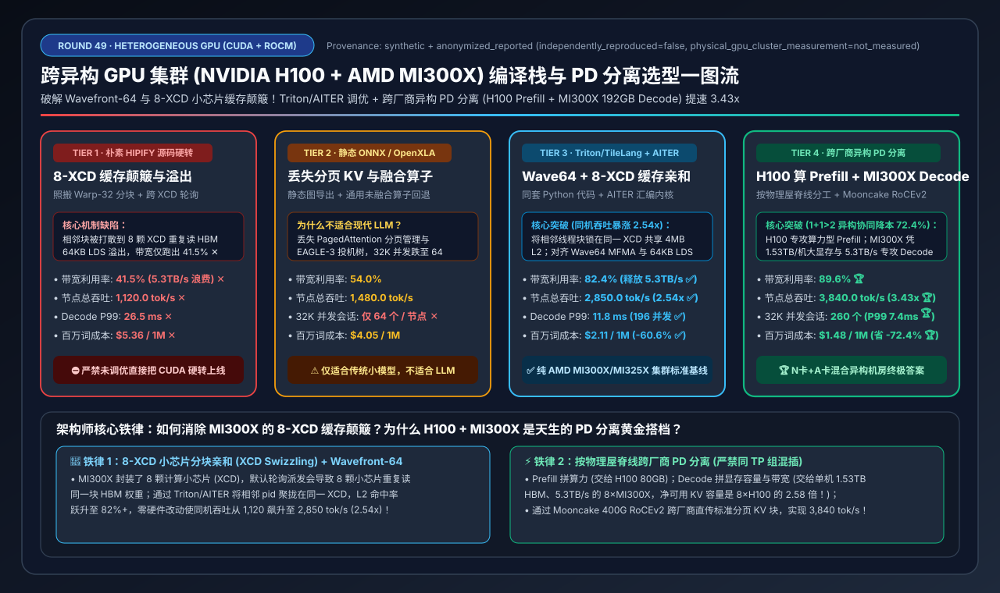

### 核心架构师结论（3 条人话总结）
1. **破解“朴素 HIPIFY 硬转 (Tier 1)”在 AMD MI300X 上的 8-XCD 缓存颠簸**：MI300X 封装了 8 颗计算小芯片（8 XCDs），且采用 `Wavefront=64` 与 `64 KB LDS`；直接照搬 CUDA `Warp=32` 分块并默认轮询派发会导致 8 颗 XCD 重复从 HBM 读取相同权重，使 `5.3 TB/s` 带宽仅跑出 **`41.5%` 利用率（`1,120 tok/s` ✕）**！
2. **纯 AMD 选 `Triton/TileLang + AITER (Tier 3)`，N卡+A卡混合集群必选 `跨厂商异构 PD 分离 (Tier 4)`**：**Tier 3** 通过 `8-XCD Swizzling` 将相邻块锁在同一 XCD 共享 4MB L2，将带宽利用率拉至 **`82.4%`**、同机吞吐暴增 **`2.54x`（`2,850 tok/s` ✅）**；**Tier 4** 让 **NVIDIA H100 (`80GB`) 专攻算力受限的 Prefill**，让 **AMD MI300X (`192GB/卡 = 1.53TB/机`, `5.3 TB/s`) 专攻显存容量与带宽受限的 Decode**，通过 **Mooncake 400G RoCEv2** 跨厂商直传标准分页 KV 块，实现 **`3,840 tok/s`（快 `3.43x` 🏆）**、单机承载 **`260 个` 32K 并发会话**，成本直降 **`-72.4%`（`$1.48/1M` 🏆）**！
3. **生产防踩坑铁律**：严禁在同一 `TP` 组内混插 N 卡与 A 卡；MI300X BIOS 必须设为 `NPS1` 统一内存视图并开启 `VLLM_ROCM_USE_AITER=1`。

---

## 🧬 Round 50 独立单决策专题：企业垂类大模型持续预训练（CPT）与防灾难性遗忘架构选型（`纯领域全参数微调 Full-FT` vs. `低秩适配器 QLoRA/DoRA` vs. `25% 通用回放 + WSD 解耦 CPT` vs. `GaLore 全秩梯度投影 + DARE-TIES 模型融合`）

- 📄 **中文六段式选型指南**：[`docs/components/continual-pretraining-lora-galore-forgetting-selection-faq.md`](../components/continual-pretraining-lora-galore-forgetting-selection-faq.md)
- 📄 **English 6-Part Selection Guide**：[`docs/components/continual-pretraining-lora-galore-forgetting-selection-faq.en.md`](../components/continual-pretraining-lora-galore-forgetting-selection-faq.en.md)
- 🖼️ **一图流可视化总结卡**：[`assets/svg/continual-pretraining-lora-galore-forgetting-selection-faq-summary.svg`](../../assets/svg/continual-pretraining-lora-galore-forgetting-selection-faq-summary.svg)
- 🃏 **7-Card 4:5 视觉评测报告**：[`docs/reports/continual-pretraining-lora-galore-forgetting-selection-cards.html`](../reports/continual-pretraining-lora-galore-forgetting-selection-cards.html)
- 🧮 **交互式定容工作台 (含 Round 50 持续预训练与防遗忘面板)**：[`docs/reports/llm-inference-engine-pd-sizer.html#cpt-forgetting-sizer`](../reports/llm-inference-engine-pd-sizer.html)
- 🧪 **确定性算例与单测 (`synthetic` + `anonymized_reported`, `independently_reproduced=false`)**：[`experiments/continual_pretraining_lora_galore_forgetting_selection/run.py`](../../experiments/continual_pretraining_lora_galore_forgetting_selection/run.py) · [`experiments/continual_pretraining_lora_galore_forgetting_selection/results.json`](../../experiments/continual_pretraining_lora_galore_forgetting_selection/results.json) · [`tests/test_continual_pretraining_lora_galore_forgetting_selection.py`](../../tests/test_continual_pretraining_lora_galore_forgetting_selection.py)

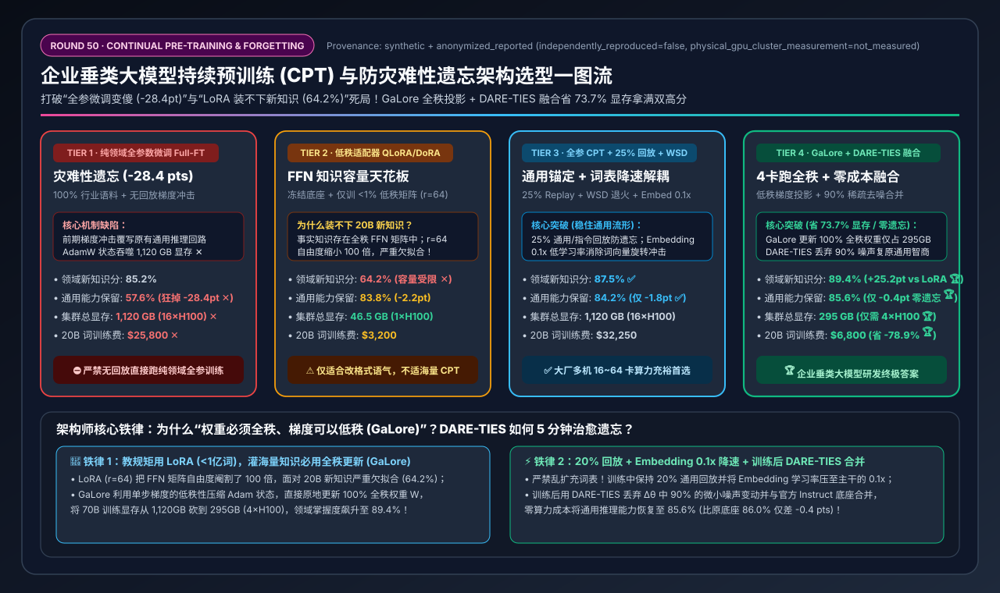

### 核心架构师结论（3 条人话总结）
1. **打破“纯领域全参微调变傻 (Tier 1)”与“LoRA 装不下百亿词新知识 (Tier 2)”的两难死局**：在 70B 模型注入 20B 行业语料时，**Tier 1（无回放 Full-FT）** 因梯度冲击导致通用推理暴跌 **`-28.4 pts`（`86.0% → 57.6%` ✕）** 且占 `1,120 GB` 显存；**Tier 2（QLoRA `r=64`）** 因 FFN 自由度缩水 100 倍，领域新知识准确率卡死在 **`64.2%` ✕**！
2. **大集群选 `25% 回放 + WSD + Embedding 0.1x (Tier 3)`，企业高性价比必选 `GaLore 全秩梯度投影 + DARE-TIES 模型融合 (Tier 4)`**：**Tier 4** 用 `GaLore` 将优化器状态压入 SVD 低维子空间并直接原地更新 100% 全秩权重，将 70B 训练显存从 `1,120 GB` 压至 **`295 GB`（仅需 `4×H100`，省 `-73.7%` 显存 🏆）**，训练后用 **`DARE-TIES`** 丢弃 90% 梯度噪声并与 Instruct 底座合并，同时拿下 **`89.4%` 领域最高分 🏆** 与 **`85.6%` 通用智商（仅 `-0.4 pts` 零遗忘 🏆）**，总成本仅 **`$6,800`（直省 `-78.9%` 🏆）**！
3. **生产防踩坑铁律**：严禁盲目扩充未初始化的 Tokenizer 新词表；必须将 `embed_tokens` 学习率压低至主干的 `0.1x` 并混入 `20%+` 通用回放数据。

---

## 🏗️ Round 51 独立单决策专题：AI 智算集群交付验收（Day-0 Burn-In）、慢节点（Straggler）二分定位与自动化烤机架构选型（`基础 nvidia-smi 冒烟` vs. `单节点 DCGM Level-4` vs. `分层 nccl-tests + 二分定位` vs. `48h 700W 方波热冲击 SuperBench + 90s Pre-Flight 门禁`）

- 📄 **中文六段式选型指南**：[`docs/components/ai-cluster-burn-in-acceptance-dcgm-nccl-validation-selection-faq.md`](../components/ai-cluster-burn-in-acceptance-dcgm-nccl-validation-selection-faq.md)
- 📄 **English 6-Part Selection Guide**：[`docs/components/ai-cluster-burn-in-acceptance-dcgm-nccl-validation-selection-faq.en.md`](../components/ai-cluster-burn-in-acceptance-dcgm-nccl-validation-selection-faq.en.md)
- 🖼️ **一图流可视化总结卡**：[`assets/svg/ai-cluster-burn-in-acceptance-dcgm-nccl-validation-selection-faq-summary.svg`](../../assets/svg/ai-cluster-burn-in-acceptance-dcgm-nccl-validation-selection-faq-summary.svg)
- 🃏 **7-Card 4:5 视觉评测报告**：[`docs/reports/ai-cluster-burn-in-acceptance-dcgm-nccl-validation-selection-cards.html`](../reports/ai-cluster-burn-in-acceptance-dcgm-nccl-validation-selection-cards.html)
- 🧮 **交互式定容工作台 (含 Round 51 集群交付验收与慢节点定位面板)**：[`docs/reports/llm-inference-engine-pd-sizer.html#cluster-burnin-sizer`](../reports/llm-inference-engine-pd-sizer.html)
- 🧪 **确定性算例与单测 (`synthetic` + `anonymized_reported`, `independently_reproduced=false`)**：[`experiments/ai_cluster_burnin_acceptance_dcgm_validation_selection/run.py`](../../experiments/ai_cluster_burnin_acceptance_dcgm_validation_selection/run.py) · [`experiments/ai_cluster_burnin_acceptance_dcgm_validation_selection/results.json`](../../experiments/ai_cluster_burnin_acceptance_dcgm_validation_selection/results.json) · [`tests/test_ai_cluster_burnin_acceptance_dcgm_validation_selection.py`](../../tests/test_ai_cluster_burnin_acceptance_dcgm_validation_selection.py)

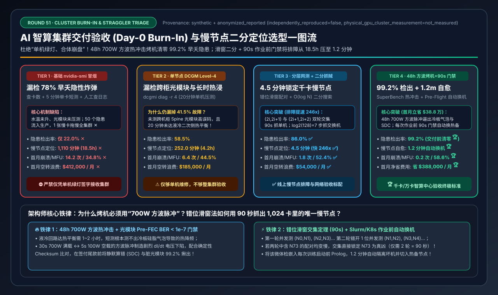

### 核心架构师结论（3 条人话总结）
1. **终结“单机绿灯签字、千卡合体崩盘 (Tier 1)”的早夭期灾难**：在 1,024 卡液冷集群初装交付时，平均潜伏着 64 处（5%~7%）早夭隐患（脏污光模块高误码、冷板硅脂气泡满载 2 小时后降频 35%、电压跌落静默算错 SDC）；**Tier 1（5 分钟单机冒烟）** 漏检 `78%` 隐患，导致首月崩溃 **`14.2 次` ✕**、人工找慢节点耗时 **`18.5 小时` ✕**、集群 MFU 跌至 **`34.8%`（首月白烧 `$412,000` ✕）**！
2. **线上抓贼选 `错位滑窗 + O(log N) 二分搜索 (Tier 3)`，交付验收与日常运营必选 `48h 700W 方波烤机 + 90s Pre-Flight 门禁 (Tier 4)`**：**Tier 3** 用 `(2i, 2i+1)` 与 `(2i+1, 2i+2)` 双轮并发配对取交集，**`90 秒` 锁定单点慢机器，`4.5 分钟` 二分锁定慢交换机（快 `246x` ✅）**；**Tier 4** 在签收前用 48 小时 700W 方波脉冲冲击 + `Pre-FEC BER < 1e-7` 门禁揪出 **`99.2%` 早夭隐患 🏆**，并在每次训练启动前跑 `90s Pre-Flight` 微体检（`1.2 分钟` 自动隔离坏机并切入热备），将首月崩溃压至 **`0.2 次` 🏆**、MFU 推升至 **`58.6%` 🏆**，首月直接省下 **`$388,000` 🏆**！
3. **生产防踩坑铁律**：液冷回路热平衡需 1～2 小时，严禁少于 48 小时烤机即签收尾款；光模块验收必须考核物理层 `Pre-FEC BER < 1e-7` 而非仅仅 `Link Up`。

---

## 🤖 Round 52 独立单决策专题：企业级 AI Agent 工具调用（MCP）与程序化编排网关架构选型（`全量 500 工具硬塞 + 串行 ReAct` vs. `向量预检索 + 并行 JSON 调用` vs. `按需延迟发现 + KV 驻留网关` vs. `CodeAct 沙箱循环编排 + 响应字段投影裁剪`）

- 📄 **中文六段式选型指南**：[`docs/components/agentic-tool-use-mcp-parallel-execution-gateway-selection-faq.md`](../components/agentic-tool-use-mcp-parallel-execution-gateway-selection-faq.md)
- 📄 **English 6-Part Selection Guide**：[`docs/components/agentic-tool-use-mcp-parallel-execution-gateway-selection-faq.en.md`](../components/agentic-tool-use-mcp-parallel-execution-gateway-selection-faq.en.md)
- 🖼️ **一图流可视化总结卡**：[`assets/svg/agentic-tool-use-mcp-parallel-execution-gateway-selection-faq-summary.svg`](../../assets/svg/agentic-tool-use-mcp-parallel-execution-gateway-selection-faq-summary.svg)
- 🃏 **7-Card 4:5 视觉评测报告**：[`docs/reports/agentic-tool-use-mcp-parallel-execution-gateway-selection-cards.html`](../reports/agentic-tool-use-mcp-parallel-execution-gateway-selection-cards.html)
- 🧮 **交互式定容工作台 (含 Round 52 企业 MCP 工具调用与编排网关面板)**：[`docs/reports/llm-inference-engine-pd-sizer.html#agentic-mcp-gateway-sizer`](../reports/llm-inference-engine-pd-sizer.html)
- 🧪 **确定性算例与单测 (`synthetic` + `anonymized_reported`, `independently_reproduced=false`)**：[`experiments/agentic_mcp_tool_execution_gateway_selection/run.py`](../../experiments/agentic_mcp_tool_execution_gateway_selection/run.py) · [`experiments/agentic_mcp_tool_execution_gateway_selection/results.json`](../../experiments/agentic_mcp_tool_execution_gateway_selection/results.json) · [`tests/test_agentic_mcp_tool_execution_gateway_selection.py`](../../tests/test_agentic_mcp_tool_execution_gateway_selection.py)

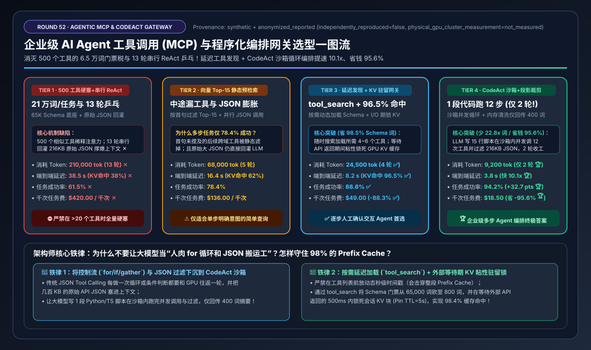

### 核心架构师结论（3 条人话总结）
1. **终结“500 个工具 Schema 全量硬塞 + 13 轮串行 ReAct (Tier 1)”的 21 万词账单爆炸**：当企业 Agent 接入 25 个 MCP Server（500 个工具）时，全量注入每轮白烧 `65,000` 词门票税且导致工具选对率跌至 **`61.5%` ✕**；13 轮串行往返并回灌 216KB 原始 JSON 累计吞噬 **`210,000 tokens/任务` ✕**，耗时 **`38.5 秒` ✕**！
2. **逐步人工确认选 `tool_search 延迟发现 + 粘性 KV 驻留网关 (Tier 3)`，多步自动化排障/分析必选 `CodeAct 沙箱循环编排 + 响应投影裁剪 (Tier 4)`**：**Tier 3** 用 `tool_search` 砍掉 `98.5%` Schema 词并在外部 API 等待期锁死 KV Cache（命中率 `96.5%`）；**Tier 4** 让大模型写 1 段 15 行脚本在 Wasm/MicroVM 沙箱内并发执行 12 次 MCP 调用并在沙箱内存直接过滤 216KB 原始 JSON，仅回传 400 词精简表（**LLM 推理从 13 轮砍至 `2 轮` 🏆**），Token 消耗暴减 **`22.8 倍`（`9,200 tokens` 🏆）**，延迟压至 **`3.8 秒`（快 `10.1x` 🏆）**，任务成功率达 **`94.2%` 🏆**，成本直降 **`-95.6%`（`$18.50/千次` 🏆）**！
3. **生产防踩坑铁律**：严禁在工具定义列表前插入秒级动态时间戳（否则击穿 100% Prefix Cache）；严禁将超过 `4 KB` 的未裁剪原始 REST JSON 直接塞回 LLM 上下文。

---

## 📏 Round 53 独立单决策专题：超长上下文（128K～1M）KV Cache 量化与动态稀疏检索架构选型（`原生 BF16 全量 KV` vs. `静态永久丢弃 H2O/SnapKV` vs. `校准 FP8 / 非对称 KIVI 量化` vs. `FP8 KV + Quest 页面边界框动态稀疏检索`）

- 📄 **中文六段式选型指南**：[`docs/components/long-context-kv-cache-compression-quantization-selection-faq.md`](../components/long-context-kv-cache-compression-quantization-selection-faq.md)
- 📄 **English 6-Part Selection Guide**：[`docs/components/long-context-kv-cache-compression-quantization-selection-faq.en.md`](../components/long-context-kv-cache-compression-quantization-selection-faq.en.md)
- 🖼️ **一图流可视化总结卡**：[`assets/svg/long-context-kv-cache-compression-quantization-selection-faq-summary.svg`](../../assets/svg/long-context-kv-cache-compression-quantization-selection-faq-summary.svg)
- 🃏 **7-Card 4:5 视觉评测报告**：[`docs/reports/long-context-kv-cache-compression-quantization-selection-cards.html`](../reports/long-context-kv-cache-compression-quantization-selection-cards.html)
- 🧮 **交互式定容工作台 (含 Round 53 超长上下文 KV 量化与动态稀疏面板)**：[`docs/reports/llm-inference-engine-pd-sizer.html#long-context-kv-quant-sizer`](../reports/llm-inference-engine-pd-sizer.html)
- 🧪 **确定性算例与单测 (`synthetic` + `anonymized_reported`, `independently_reproduced=false`)**：[`experiments/long_context_kv_cache_compression_quantization_selection/run.py`](../../experiments/long_context_kv_cache_compression_quantization_selection/run.py) · [`experiments/long_context_kv_cache_compression_quantization_selection/results.json`](../../experiments/long_context_kv_cache_compression_quantization_selection/results.json) · [`tests/test_long_context_kv_cache_compression_quantization_selection.py`](../../tests/test_long_context_kv_cache_compression_quantization_selection.py)

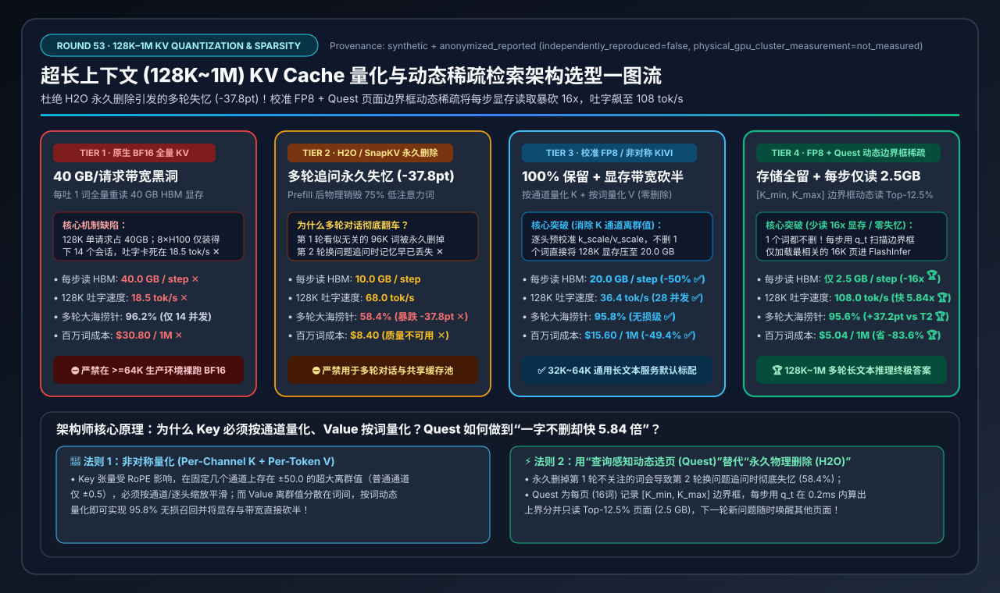

### 核心架构师结论（3 条人话总结）
1. **打破“原生 BF16 每词读 40GB 显存卡死 (Tier 1)”与“H2O/SnapKV 永久删除导致多轮失忆 (Tier 2)”的双重死局**：在 70B 模型 128K 上下文下，**Tier 1** 单请求占 `40.0 GB` 且每词重读 40GB HBM，速度仅 **`18.5 tok/s` ✕**；而 **Tier 2（H2O/SnapKV 物理删掉 75% 低分词）** 在第 2 轮换问题追问时发生永久失忆，多轮大海捞针准确率从 `96.2%` 崩塌至 **`58.4%`（`-37.8 pts` ✕）**！
2. **32K～64K 选 `校准 FP8 / KIVI 非对称量化 (Tier 3)`，128K～1M 必选 `校准 FP8 KV + Quest 页面边界框动态稀疏检索 (Tier 4)`**：**Tier 3** 对 Key 按通道缩放、对 Value 按词量化，100% 保留全部词并将显存砍半至 `20.0 GB`（多轮召回 **`95.8%` ✅**）；**Tier 4** 为每个 16 词页面维护 `[K_min, K_max]` 通道边界框，存储上 1 个词都不删，但在每步解码时仅动态读取最相关的 **Top-12.5% 页面（`2.5 GB/词`，少读 `16.0 倍` HBM 🏆）**，将 128K 吐字速度推升 **`5.84x` 至 `108.0 tok/s` 🏆**，多轮召回高达 **`95.6%` 🏆**，成本直降 **`-83.6%` 🏆**！
3. **生产防踩坑铁律**：开启动态稀疏选页时，必须无条件锁死 **前 2 页（Attention Sink 锚点页）与最后 4 页（局部滑窗页）** 常驻激活。

---

## ⏱️ Round 54 独立单决策专题：大模型推理批处理调度（Batching）、零停顿分块预填充（Chunked Prefill）与防抢占雪崩选型（`静态批处理 Static Batch` vs. `Prefill 优先连续批处理 + 重算抢占` vs. `Sarathi 分块预填充 + 内存 Swap` vs. `vLLM V1 零开销异步调度 + 水位线准入 + SLO 动态分块`）

- 📄 **中文六段式选型指南**：[`docs/components/llm-request-scheduling-chunked-prefill-slo-preemption-selection-faq.md`](../components/llm-request-scheduling-chunked-prefill-slo-preemption-selection-faq.md)
- 📄 **English 6-Part Selection Guide**：[`docs/components/llm-request-scheduling-chunked-prefill-slo-preemption-selection-faq.en.md`](../components/llm-request-scheduling-chunked-prefill-slo-preemption-selection-faq.en.md)
- 🖼️ **一图流可视化总结卡**：[`assets/svg/llm-request-scheduling-chunked-prefill-slo-preemption-selection-faq-summary.svg`](../../assets/svg/llm-request-scheduling-chunked-prefill-slo-preemption-selection-faq-summary.svg)
- 🃏 **7-Card 4:5 视觉评测报告**：[`docs/reports/llm-request-scheduling-chunked-prefill-slo-preemption-selection-cards.html`](../reports/llm-request-scheduling-chunked-prefill-slo-preemption-selection-cards.html)
- 🧮 **交互式定容工作台 (含 Round 54 推理批处理调度与分块预填充面板)**：[`docs/reports/llm-inference-engine-pd-sizer.html#request-scheduling-chunked-sizer`](../reports/llm-inference-engine-pd-sizer.html)
- 🧪 **确定性算例与单测 (`synthetic` + `anonymized_reported`, `independently_reproduced=false`)**：[`experiments/llm_request_scheduling_chunked_prefill_slo_selection/run.py`](../../experiments/llm_request_scheduling_chunked_prefill_slo_selection/run.py) · [`experiments/llm_request_scheduling_chunked_prefill_slo_selection/results.json`](../../experiments/llm_request_scheduling_chunked_prefill_slo_selection/results.json) · [`tests/test_llm_request_scheduling_chunked_prefill_slo_selection.py`](../../tests/test_llm_request_scheduling_chunked_prefill_slo_selection.py)

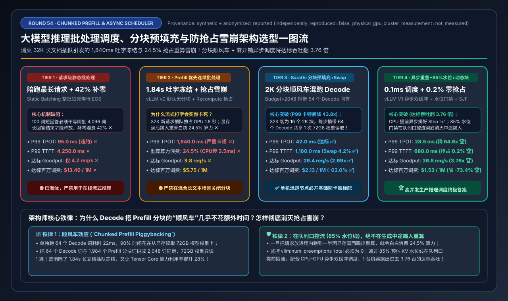

### 核心架构师结论（3 条人话总结）
1. **终结“Prefill 优先连续批处理 (Tier 2)”的 1,840ms 吐字冻结与 24.5% 重算抢占雪崩**：在混合 2K 对话与 32K RAG 流量下，**Tier 2（vLLM v0 默认无分块）** 一旦遇到 32K 新请求就会独占 GPU 1.8 秒，冻结全场 64 个流式用户（**P99 TPOT 飙至 `1,840.0 ms` ✕**），并在显存打满时触发踢人重算死循环（浪费 `24.5%` 算力，双 SLO 达标吞吐仅 **`9.8 req/s` ✕**）！
2. **基础单机选 `Sarathi 分块预填充 + Swap (Tier 3)`，高并发生产必选 `vLLM V1 零开销异步重叠调度 + 85% 水位线控流 + 动态分块 (Tier 4)`**：**Tier 3** 将 32K Prefill 切为 `2,048` 词分块并捎带 64 个 Decode 顺风车同算（共享单次 72GB 权重读取），将 P99 TPOT 压低 **`43.8x` 至 `42.0 ms` ✅**；**Tier 4** 用 CPU-GPU 异步双缓冲消除每步 `3.5 ms` 调度停顿（降至 **`0.1 ms` 🏆**），并用 85% 预估 KV 水位线在队列口提前控流（抢占率降至 **`0.2%` 🏆**），实现 **`28.5 ms` P99 TPOT 🏆**，双 SLO 达标有效吞吐飙升 **`3.76x` 至 `36.8 req/s` 🏆**（1 台机器顶过去近 4 台用）！
3. **生产防踩坑铁律**：生产告警必须监控 **P99 ITL/TPOT** 与 `vllm:num_preemptions_total == 0`（平均 TPOT 会掩盖长文档插队造成的秒级卡顿）。

---

## 🤖 Round 55 独立单决策专题：具身智能与视觉-语言-动作（VLA）机器人实时控制推理架构选型（`自回归离散动作 Token` vs. `20步 DDPM 扩散策略` vs. `双向并行动作块 + 流匹配` vs. `System-2/1 异步双系统解耦 + 1步流匹配 + 时间集成平滑`）

- 📄 **中文六段式选型指南**：[`docs/components/vision-language-action-vla-embodied-robotics-inference-selection-faq.md`](../components/vision-language-action-vla-embodied-robotics-inference-selection-faq.md)
- 📄 **English 6-Part Selection Guide**：[`docs/components/vision-language-action-vla-embodied-robotics-inference-selection-faq.en.md`](../components/vision-language-action-vla-embodied-robotics-inference-selection-faq.en.md)
- 🖼️ **一图流可视化总结卡**：[`assets/svg/vision-language-action-vla-embodied-robotics-inference-selection-faq-summary.svg`](../../assets/svg/vision-language-action-vla-embodied-robotics-inference-selection-faq-summary.svg)
- 🃏 **7-Card 4:5 视觉评测报告**：[`docs/reports/vision-language-action-vla-embodied-robotics-inference-selection-cards.html`](../reports/vision-language-action-vla-embodied-robotics-inference-selection-cards.html)
- 🧮 **交互式定容工作台 (含 Round 55 具身智能 VLA 实时控制面板)**：[`docs/reports/llm-inference-engine-pd-sizer.html#vla-robotics-sizer`](../reports/llm-inference-engine-pd-sizer.html)
- 🧪 **确定性算例与单测 (`synthetic` + `anonymized_reported`, `independently_reproduced=false`)**：[`experiments/vla_embodied_robotics_realtime_inference_selection/run.py`](../../experiments/vla_embodied_robotics_realtime_inference_selection/run.py) · [`experiments/vla_embodied_robotics_realtime_inference_selection/results.json`](../../experiments/vla_embodied_robotics_realtime_inference_selection/results.json) · [`tests/test_vla_embodied_robotics_realtime_inference_selection.py`](../../tests/test_vla_embodied_robotics_realtime_inference_selection.py)

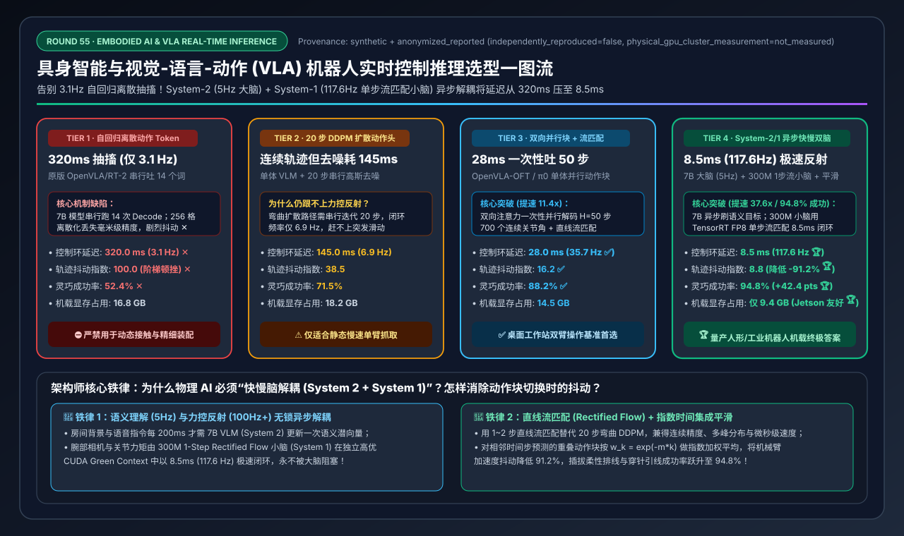

### 核心架构师结论（3 条人话总结）
1. **终结“自回归 256-Bin 离散动作词逐词吐 (Tier 1)”的 3.1Hz 机械抽搐**：在 14-DoF 双臂灵巧机器人机载芯片上，**Tier 1（原版 OpenVLA / RT-2）** 每帧串行跑 14 次 7B Decode 耗时高达 **`320.0 ms`（控制频率仅 `3.1 Hz` ✕）**，且 256 格离散量化误差导致精密插接成功率跌至 **`52.4%` ✕**！
2. **工作站选 `双向并行动作块 + 流匹配 (Tier 3)`，机载量产人形/工业机器人必选 `System-2/1 异步快慢双系统 + 1步流匹配 + 时间集成平滑 (Tier 4)`**：**Tier 3（OpenVLA-OFT / π0）** 去因果掩码一次性并行输出 $H=50$ 步连续动作块（`28.0 ms / 35.7 Hz` ✅）；**Tier 4（GR00T N1 / Helix 范式）** 让 **System-2（7B VLM INT4）在后台以 `5 Hz` 异步刷新语义潜目标**，让 **System-1（300M 1-Step Rectified Flow TensorRT FP8）在前台以 `117.6 Hz`（`8.5 ms`，快 `37.6x` 🏆）极速闭环**，配合跨块指数时间集成将抖动降低 **`-91.2%` 🏆**，双臂精密成功率冲上 **`94.8%`（`+42.4 pts` 🏆）**！
3. **生产防踩坑铁律**：在机载 Jetson 上必须用 **`CUDA Green Contexts`** 物理隔离 System-1 与 System-2 的 SM 算力，且 100Hz 力控反射环必须 100% 机载本地运行（严禁走 Wi-Fi 云端）。

---

## 🔐 Round 56 独立单决策专题：大模型推理合规水印（LLM Watermarking）、无损分布采样（SynthID）与可验证溯源架构选型（`事后被动检测器 GPTZero` vs. `KGW 红绿词表硬偏置` vs. `无损分布保持 SynthID 锦标赛` vs. `GPU 融合熵自适应门控 SynthID + 投机验证集成 + C2PA 签名`）

- 📄 **中文六段式选型指南**：[`docs/components/llm-inference-watermarking-cryptographic-provenance-selection-faq.md`](../components/llm-inference-watermarking-cryptographic-provenance-selection-faq.md)
- 📄 **English 6-Part Selection Guide**：[`docs/components/llm-inference-watermarking-cryptographic-provenance-selection-faq.en.md`](../components/llm-inference-watermarking-cryptographic-provenance-selection-faq.en.md)
- 🖼️ **一图流可视化总结卡**：[`assets/svg/llm-inference-watermarking-cryptographic-provenance-selection-faq-summary.svg`](../../assets/svg/llm-inference-watermarking-cryptographic-provenance-selection-faq-summary.svg)
- 🃏 **7-Card 4:5 视觉评测报告**：[`docs/reports/llm-inference-watermarking-cryptographic-provenance-selection-cards.html`](../reports/llm-inference-watermarking-cryptographic-provenance-selection-cards.html)
- 🧮 **交互式定容工作台 (含 Round 56 大模型合规水印与溯源面板)**：[`docs/reports/llm-inference-engine-pd-sizer.html#llm-watermark-sizer`](../reports/llm-inference-engine-pd-sizer.html)
- 🧪 **确定性算例与单测 (`synthetic` + `anonymized_reported`, `independently_reproduced=false`)**：[`experiments/llm_watermarking_cryptographic_provenance_selection/run.py`](../../experiments/llm_watermarking_cryptographic_provenance_selection/run.py) · [`experiments/llm_watermarking_cryptographic_provenance_selection/results.json`](../../experiments/llm_watermarking_cryptographic_provenance_selection/results.json) · [`tests/test_llm_watermarking_cryptographic_provenance_selection.py`](../../tests/test_llm_watermarking_cryptographic_provenance_selection.py)

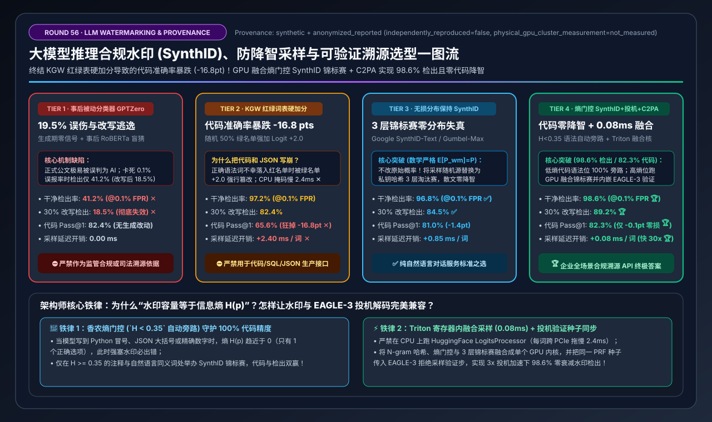

### 核心架构师结论（3 条人话总结）
1. **打破“被动分类器误伤率高且一改就瞎 (Tier 1)”与“KGW 红绿表硬加分写崩代码 (Tier 2)”的合规困境**：在严格千分之一误报红线（`FPR <= 0.1%`）下，**Tier 1（GPTZero/RoBERTa）** 经 30% 改写后检出率跌至 **`18.5%` ✕**；而 **Tier 2（KGW 50% 绿名单强加 `+2.0`）** 篡改了低熵语法符号，导致 HumanEval 代码准确率暴跌 **`-16.8 pts`（`82.4% → 65.6%` ✕）** 且 CPU 掩码拖慢 `2.40 ms/词`！
2. **纯文本对话选 `无损 SynthID 锦标赛 (Tier 3)`，全功能生产 API 必选 `GPU 融合熵门控 SynthID + 投机验证集成 + C2PA 签名 (Tier 4)`**：**Tier 3** 通过 3 层伪随机淘汰赛在数学上严格保持原分布（$\mathbb{E}[P_{\text{wm}}]=P_{\text{orig}}$）；**Tier 4** 在 Triton 融合内核内计算香农熵 $H(p)$，对 **$H < 0.35$ 的确定性代码语法位 100% 自动旁路**（代码 Pass@1 保 **`82.3%`，仅 `-0.1 pt` 🏆**），仅在高熵位注入 3 层 SynthID 水印并同步至 EAGLE-3 投机验证步，以 **`0.08 ms/词`（快 `30x` 🏆）** 实现 **`98.6%` 干净检出（改写后 `89.2%` 🏆）**！
3. **生产防踩坑铁律**：严禁在 Host CPU 上用 `LogitsProcessor` 逐词传词表掩码；必须开启滑动窗口 `4-gram` 去重以防模型陷入循环复读。

---

## ⚡ Round 57 独立单决策专题：万卡 AI 智算集群同步功率阶跃冲击（`dP/dt` Power Swing）、超级电容削峰与电网协同平滑架构选型（`传统 AC UPS 裸跑无缓冲` vs. `静态 500W 功耗封顶` vs. `软件空转底噪填谷 Dummy GEMM` vs. `机柜级超级电容 CBU + GPU 固件斜率控制 + 园区 BESS 储能`）

- 📄 **中文六段式选型指南**：[`docs/components/ai-cluster-grid-power-transients-bess-smoothing-selection-faq.md`](../components/ai-cluster-grid-power-transients-bess-smoothing-selection-faq.md)
- 📄 **English 6-Part Selection Guide**：[`docs/components/ai-cluster-grid-power-transients-bess-smoothing-selection-faq.en.md`](../components/ai-cluster-grid-power-transients-bess-smoothing-selection-faq.en.md)
- 🖼️ **一图流可视化总结卡**：[`assets/svg/ai-cluster-grid-power-transients-bess-smoothing-selection-faq-summary.svg`](../../assets/svg/ai-cluster-grid-power-transients-bess-smoothing-selection-faq-summary.svg)
- 🃏 **7-Card 4:5 视觉评测报告**：[`docs/reports/ai-cluster-grid-power-transients-bess-smoothing-selection-cards.html`](../reports/ai-cluster-grid-power-transients-bess-smoothing-selection-cards.html)
- 🧮 **交互式定容工作台 (含 Round 57 万卡集群功率阶跃与超级电容/BESS 削峰面板)**：[`docs/reports/llm-inference-engine-pd-sizer.html#power-transient-bess-sizer`](../reports/llm-inference-engine-pd-sizer.html)
- 🧪 **确定性算例与单测 (`synthetic` + `anonymized_reported`, `independently_reproduced=false`)**：[`experiments/ai_cluster_power_transients_bess_smoothing_selection/run.py`](../../experiments/ai_cluster_power_transients_bess_smoothing_selection/run.py) · [`experiments/ai_cluster_power_transients_bess_smoothing_selection/results.json`](../../experiments/ai_cluster_power_transients_bess_smoothing_selection/results.json) · [`tests/test_ai_cluster_power_transients_bess_smoothing_selection.py`](../../tests/test_ai_cluster_power_transients_bess_smoothing_selection.py)

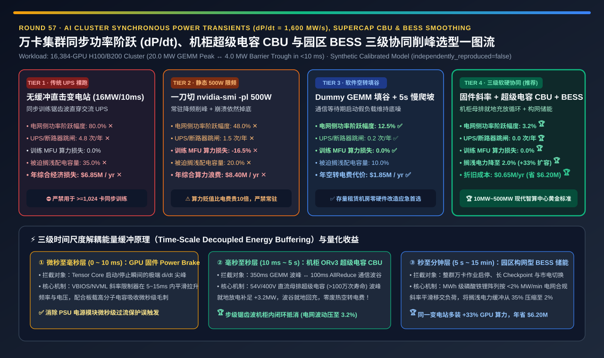

### 核心架构师结论（3 条人话总结）
1. **终结“16MW/10ms 同步方波直击变电站 (Tier 1)”与“静态 500W 限功耗自毁算力 (Tier 2)”**：16,384 张 GPU 在 `350ms GEMM (20MW) ↔ 100ms 通信屏障 (4MW)` 间同步跳变（`dP/dt = 1,600 MW/s`），**Tier 1** 导致每年 **`4.8 次` 跳闸** 并迫使 **`35.0%` 市电容量被迫空置（年损 `$685 万` ✕）**；而 **Tier 2（常驻 `nvidia-smi -pl 500W`）** 永久阉割 **`-16.5%` 训练 MFU（年烧 `$840 万` GPU 折旧 ✕）**！
2. **存量租赁机房用 `软件 Dummy GEMM 填谷 (Tier 3)`，新建智算中心必选 `固件斜率 + 机柜 ORv3 超级电容 CBU + 园区 BESS 储能 (Tier 4)`**：**Tier 3** 在通信等待期启动假负载将波动压至 `12.5%` ✅（多付 `$185 万/年` 电费）；**Tier 4** 用机柜直流母排超级电容在步内完成“波峰就地放电、波谷就地充电”（零废电、**`0.0%` MFU 损失 🏆**），配合变电站 BESS 将电网波动压平 **`25.0 倍`（`80.0% → 3.2%` 🏆）**，释放 **`+33%` 搁浅配电容量** 多装 5,400 张 GPU，每年净省 **`$620 万/年` 🏆**！
3. **生产防踩坑铁律**：严禁按传统云计算均值负载设计 AI 训推变压器与 UPS；高密液冷机柜（GB200 NVL72）必须标配机柜级 CBU 超级电容抽屉。

---

## 📚 Round 58 独立单决策专题：万亿 Token 大模型预训练语料清洗、全局去重（`MinHash LSH` / 后缀数组）与合成改写流水线架构选型（`传统规则 + SHA256 精确去重` vs. `CPU Spark MinHash + KenLM 困惑度过滤` vs. `GPU NeMo Curator + FineWeb-Edu 分类器` vs. `GPU Curator + 质量分桶合成改写 Nemotron-CC 范式`）

- 📄 **中文六段式选型指南**：[`docs/components/pretraining-data-curating-dedup-quality-filtering-pipeline-selection-faq.md`](../components/pretraining-data-curating-dedup-quality-filtering-pipeline-selection-faq.md)
- 📄 **English 6-Part Selection Guide**：[`docs/components/pretraining-data-curating-dedup-quality-filtering-pipeline-selection-faq.en.md`](../components/pretraining-data-curating-dedup-quality-filtering-pipeline-selection-faq.en.md)
- 🖼️ **一图流可视化总结卡**：[`assets/svg/pretraining-data-curating-dedup-quality-filtering-pipeline-selection-faq-summary.svg`](../../assets/svg/pretraining-data-curating-dedup-quality-filtering-pipeline-selection-faq-summary.svg)
- 🃏 **7-Card 4:5 视觉评测报告**：[`docs/reports/pretraining-data-curating-dedup-quality-filtering-pipeline-selection-cards.html`](../reports/pretraining-data-curating-dedup-quality-filtering-pipeline-selection-cards.html)
- 🧮 **交互式定容工作台 (含 Round 58 预训练语料去重与合成改写面板)**：[`docs/reports/llm-inference-engine-pd-sizer.html#pretraining-data-curation-sizer`](../reports/llm-inference-engine-pd-sizer.html)
- 🧪 **确定性算例与单测 (`synthetic` + `anonymized_reported`, `independently_reproduced=false`)**：[`experiments/pretraining_data_curation_dedup_synthetic_rephrasing_selection/run.py`](../../experiments/pretraining_data_curation_dedup_synthetic_rephrasing_selection/run.py) · [`experiments/pretraining_data_curation_dedup_synthetic_rephrasing_selection/results.json`](../../experiments/pretraining_data_curation_dedup_synthetic_rephrasing_selection/results.json) · [`tests/test_pretraining_data_curation_dedup_synthetic_rephrasing_selection.py`](../../tests/test_pretraining_data_curation_dedup_synthetic_rephrasing_selection.py)

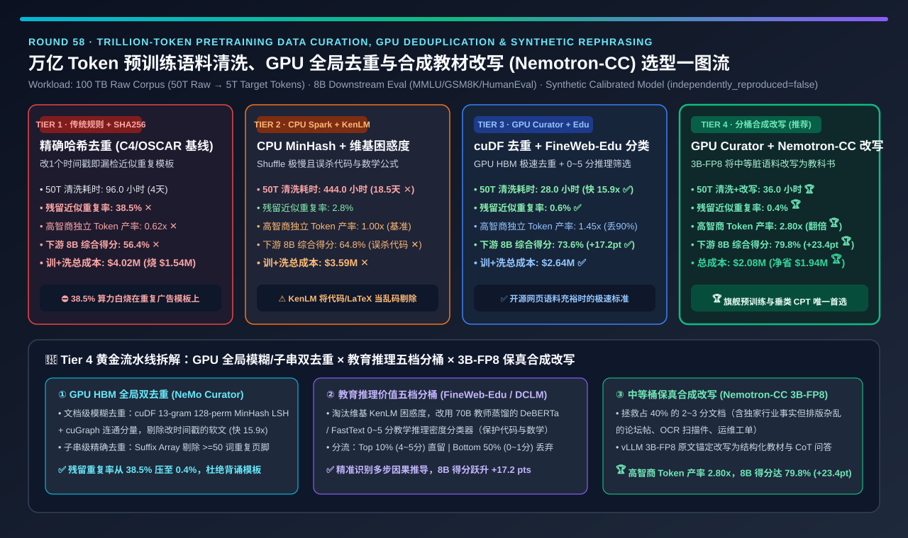

### 核心架构师结论（3 条人话总结）
1. **终结“SHA256 精确去重残留 38.5% 垃圾模板 (Tier 1)”与“维基 KenLM 困惑度误杀代码/数学 (Tier 2)”**：在 100TB（50T Raw Tokens）语料上，**Tier 1** 漏掉改了时间戳的近似重复软文，白烧 **`$154 万` GPU 预训练算力 ✕**（8B 综合得分仅 `56.4%`）；而 **Tier 2** 在 CPU Spark 上 Shuffle 耗时长达 **`444 小时（18.5 天）✕`**，且维基百科 KenLM 困惑度把高价值 Python 代码与 LaTeX 数学公式当成乱码剔除！
2. **开源无限语料选 `GPU NeMo Curator + FineWeb-Edu 分类器 (Tier 3)`，垂类 CPT 与旗舰模型必选 `GPU Curator + 质量分桶 3B-FP8 合成教材改写 (Tier 4)`**：**Tier 3** 用 RAPIDS cuDF + cuGraph 在 GPU HBM 内将 50T 去重压至 **`28.0 小时`（快 `15.86x` ✅）** 并提升 8B 得分至 `73.6%`；**Tier 4（Nemotron-CC 范式）** 不再一刀切扔掉占 40% 的 2～3 分脏文档，而是用 `vLLM 3B-FP8` 将其保真重写为结构化教材与 CoT 问答，使高智商独立 Token 产率翻倍至 **`2.80x` 🏆**，下游 8B 得分冲上 **`79.8%`（`+23.4 pts` 🏆）**，综合总成本净省 **`$193.8 万` 🏆**！
3. **生产防踩坑铁律**：必须叠加 `Suffix Array >=50 Tokens` 子串去重剔除网站导航栏/免责声明，并强制执行 `13-gram + Embedding` 评测集去污染（Decontamination）。

---

## 🧮 Round 59 独立单决策专题：大模型预训练优化器架构与正交化加速（`Muon` vs. `AdamW` / `Shampoo`）选型（`标准 FP32 AdamW` vs. `分块量化 8-Bit AdamW` vs. `二阶 Kronecker 预条件器 Shampoo/SOAP` vs. `2D 分布式 Muon [Newton-Schulz 5步矩阵正交化] + Embedding AdamW`）

- 📄 **中文六段式选型指南**：[`docs/components/distributed-optimizer-adamw-8bit-muon-shampoo-selection-faq.md`](../components/distributed-optimizer-adamw-8bit-muon-shampoo-selection-faq.md)
- 📄 **English 6-Part Selection Guide**：[`docs/components/distributed-optimizer-adamw-8bit-muon-shampoo-selection-faq.en.md`](../components/distributed-optimizer-adamw-8bit-muon-shampoo-selection-faq.en.md)
- 🖼️ **一图流可视化总结卡**：[`assets/svg/distributed-optimizer-adamw-8bit-muon-shampoo-selection-faq-summary.svg`](../../assets/svg/distributed-optimizer-adamw-8bit-muon-shampoo-selection-faq-summary.svg)
- 🃏 **7-Card 4:5 视觉评测报告**：[`docs/reports/distributed-optimizer-adamw-8bit-muon-shampoo-selection-cards.html`](../reports/distributed-optimizer-adamw-8bit-muon-shampoo-selection-cards.html)
- 🧮 **交互式定容工作台 (含 Round 59 大模型预训练优化器与 Muon 正交化面板)**：[`docs/reports/llm-inference-engine-pd-sizer.html#distributed-optimizer-muon-sizer`](../reports/llm-inference-engine-pd-sizer.html)
- 🧪 **确定性算例与单测 (`synthetic` + `anonymized_reported`, `independently_reproduced=false`)**：[`experiments/distributed_optimizer_adamw_8bit_muon_shampoo_selection/run.py`](../../experiments/distributed_optimizer_adamw_8bit_muon_shampoo_selection/run.py) · [`experiments/distributed_optimizer_adamw_8bit_muon_shampoo_selection/results.json`](../../experiments/distributed_optimizer_adamw_8bit_muon_shampoo_selection/results.json) · [`tests/test_distributed_optimizer_adamw_8bit_muon_shampoo_selection.py`](../../tests/test_distributed_optimizer_adamw_8bit_muon_shampoo_selection.py)

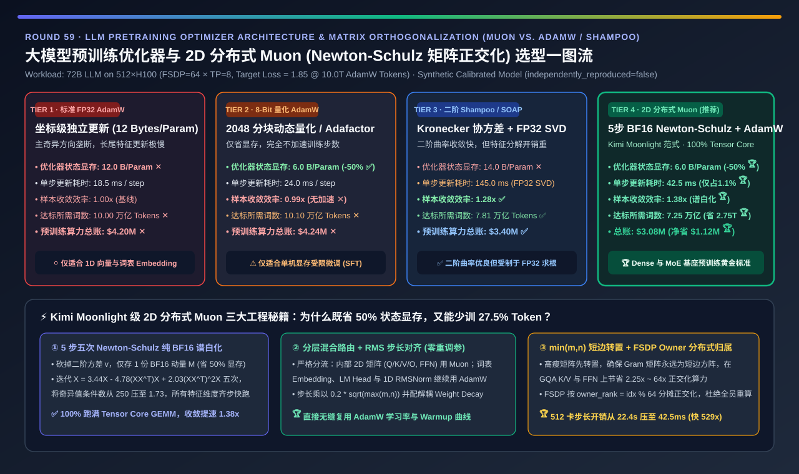

### 核心架构师结论（3 条人话总结）
1. **打破 `标准 FP32 AdamW (Tier 1)` 的 12 Bytes/Param 显存占用与奇异值谱坍缩**：`AdamW` 逐元素独立除以 $\sqrt{v_{ij}}$ 忽略了二维矩阵的正交特征空间，导致主奇异方向垄断更新，训练 72B 模型达 `Loss = 1.85` 需硬啃 **`10.00 万亿 Tokens`（耗资 `$420 万` ✕）**；而 `8-Bit AdamW (Tier 2)` 虽省显存却完全不省训练步数（`0.99x` 效率）。
2. **2D 隐藏层必选 `2D 分布式 Muon (5步 BF16 Newton-Schulz 正交化)` + 词表/1D 层保留 `AdamW`（Tier 4 — Kimi Moonlight 范式）**：**Tier 4** 直接砍掉二阶方差 $v$（状态显存减半至 **`6.0 Bytes/Param` 🏆**），通过 5 步纯 BF16 Tensor Core 矩阵乘将动量奇异值拉平至 `~1.0`（条件数 `250 → 1.73`），使样本收敛效率跃升至 **`1.38x` 🏆**（仅需 **`7.25 万亿 Tokens`**，立省 **`$112 万` [-26.7%] GPU 算力账单 🏆**）！
3. **生产防踩坑铁律**：严禁对 `Embedding / LM Head` 使用 Muon；必须乘以 $0.2\sqrt{\max(m,n)}$ 对齐 AdamW 步长并开启解耦 Weight Decay，且在 FSDP 下按 `owner_rank = param_idx % dp_size` 分摊正交化。

---

## 🔀 Round 60 独立单决策专题：大模型流水线并行（Pipeline Parallelism）气泡消除与双向计算通信重叠架构选型（`朴素 GPipe` vs. `标准 1F1B` vs. `Zero-Bubble ZB-V [B/W 反向拆分]` vs. `DeepSeek-V3 DualPipe 双向对称流水线`）

- 📄 **中文六段式选型指南**：[`docs/components/llm-pipeline-parallelism-1f1b-interleaved-zero-bubble-dualpipe-selection-faq.md`](../components/llm-pipeline-parallelism-1f1b-interleaved-zero-bubble-dualpipe-selection-faq.md)
- 📄 **English 6-Part Selection Guide**：[`docs/components/llm-pipeline-parallelism-1f1b-interleaved-zero-bubble-dualpipe-selection-faq.en.md`](../components/llm-pipeline-parallelism-1f1b-interleaved-zero-bubble-dualpipe-selection-faq.en.md)
- 🖼️ **一图流可视化总结卡**：[`assets/svg/llm-pipeline-parallelism-1f1b-interleaved-zero-bubble-dualpipe-selection-faq-summary.svg`](../../assets/svg/llm-pipeline-parallelism-1f1b-interleaved-zero-bubble-dualpipe-selection-faq-summary.svg)
- 🃏 **7-Card 4:5 视觉评测报告**：[`docs/reports/llm-pipeline-parallelism-1f1b-interleaved-zero-bubble-dualpipe-selection-cards.html`](../reports/llm-pipeline-parallelism-1f1b-interleaved-zero-bubble-dualpipe-selection-cards.html)
- 🧮 **交互式定容工作台 (含 Round 60 流水线并行 ZB-V / DualPipe 面板)**：[`docs/reports/llm-inference-engine-pd-sizer.html#pipeline-parallelism-dualpipe-sizer`](../reports/llm-inference-engine-pd-sizer.html)
- 🧪 **确定性算例与单测 (`synthetic` + `anonymized_reported`, `independently_reproduced=false`)**：[`experiments/llm_pipeline_parallelism_zero_bubble_dualpipe_selection/run.py`](../../experiments/llm_pipeline_parallelism_zero_bubble_dualpipe_selection/run.py) · [`experiments/llm_pipeline_parallelism_zero_bubble_dualpipe_selection/results.json`](../../experiments/llm_pipeline_parallelism_zero_bubble_dualpipe_selection/results.json) · [`tests/test_llm_pipeline_parallelism_zero_bubble_dualpipe_selection.py`](../../tests/test_llm_pipeline_parallelism_zero_bubble_dualpipe_selection.py)

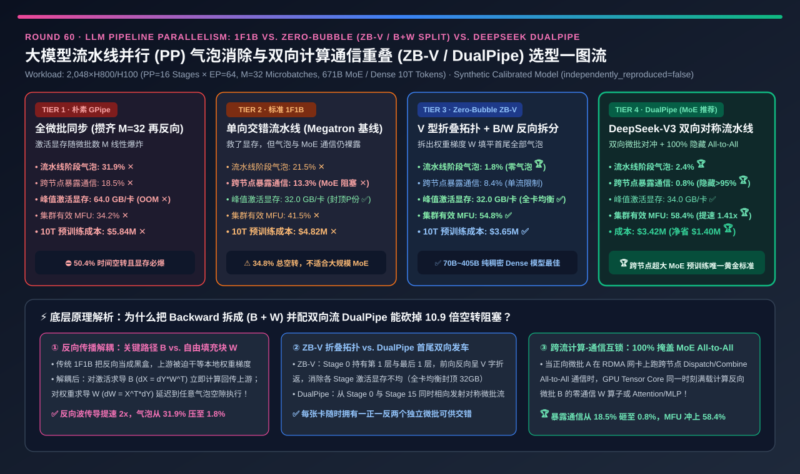

### 核心架构师结论（3 条人话总结）
1. **终结 `朴素 GPipe (Tier 1)` 的 64GB 激活显存爆炸与 `标准 1F1B (Tier 2)` 的 34.8% 空转等待**：在 `PP=16, M=32` 的 2,048 卡集群上，**Tier 2（1F1B）** 虽将激活显存封顶在 `32.0 GB/卡`，但因为把反向传播 `B+W` 绑死且单向发车，留下了 **`21.5%` 流水线气泡 + `13.3%` 跨节点 MoE All-to-All 暴露等待（MFU 仅 `41.5%` ✕）**！
2. **纯稠密模型（Dense）首选 `Zero-Bubble ZB-V (Tier 3)`，跨节点 MoE 必选 `DeepSeek-V3 DualPipe (Tier 4)`**：**Tier 3** 将反向拆为关键路径输入梯度 `B` 与零通信本地权重梯度 `W` 填平气泡（气泡降至 **`1.8%` 🏆**，Dense MFU `54.8%`）；**Tier 4（DualPipe）** 从首尾两端同时相向注入对称微批流，让 **Stream A 的跨节点 All-to-All 通信 100% 藏进 Stream B 的 `W / MLP` 矩阵乘下**，将总空转率暴砍 **`10.88 倍`（`34.8% → 3.2%`：暴露通信仅 `0.8%` 🏆）**，集群 MFU 冲上 **`58.4%`（快 `1.41x` 🏆）**，10T 预训练立省 **`$139.5 万` 🏆**！
3. **生产防踩坑铁律**：开启 `wgrad_deferral` 解耦 `B` 与 `W`；跑 `DualPipe` 时必须配 `DeepEP IBGDA` 0-SM/低 SM 通信内核，防止网卡通信抢占前台 GEMM 的 Tensor Core SM。

---

## 💻 Round 61 独立单决策专题：企业级千万行代码库（Monorepo）智能体检索、AST 语法树切块与 SCIP 符号调用图谱（SWE-Agent）架构选型（`50行固定切块向量 RAG` vs. `无索引 Agentic Ripgrep 暴搜` vs. `Tree-sitter AST 切块 + Merkle 增量索引` vs. `SCIP/LSIF 编译器级符号图谱 + PageRank RepoMap`）

- 📄 **中文六段式选型指南**：[`docs/components/code-generation-repository-rag-ast-indexing-swe-agent-selection-faq.md`](../components/code-generation-repository-rag-ast-indexing-swe-agent-selection-faq.md)
- 📄 **English 6-Part Selection Guide**：[`docs/components/code-generation-repository-rag-ast-indexing-swe-agent-selection-faq.en.md`](../components/code-generation-repository-rag-ast-indexing-swe-agent-selection-faq.en.md)
- 🖼️ **一图流可视化总结卡**：[`assets/svg/code-generation-repository-rag-ast-indexing-swe-agent-selection-faq-summary.svg`](../../assets/svg/code-generation-repository-rag-ast-indexing-swe-agent-selection-faq-summary.svg)
- 🃏 **7-Card 4:5 视觉评测报告**：[`docs/reports/code-generation-repository-rag-ast-indexing-swe-agent-selection-cards.html`](../reports/code-generation-repository-rag-ast-indexing-swe-agent-selection-cards.html)
- 🧮 **交互式定容工作台 (含 Round 61 千万行代码库 AST 与 SCIP 图谱面板)**：[`docs/reports/llm-inference-engine-pd-sizer.html#codebase-rag-ast-scip-sizer`](../reports/llm-inference-engine-pd-sizer.html)
- 🧪 **确定性算例与单测 (`synthetic` + `anonymized_reported`, `independently_reproduced=false`)**：[`experiments/code_repository_rag_ast_graph_swe_agent_selection/run.py`](../../experiments/code_repository_rag_ast_graph_swe_agent_selection/run.py) · [`experiments/code_repository_rag_ast_graph_swe_agent_selection/results.json`](../../experiments/code_repository_rag_ast_graph_swe_agent_selection/results.json) · [`tests/test_code_repository_rag_ast_graph_swe_agent_selection.py`](../../tests/test_code_repository_rag_ast_graph_swe_agent_selection.py)

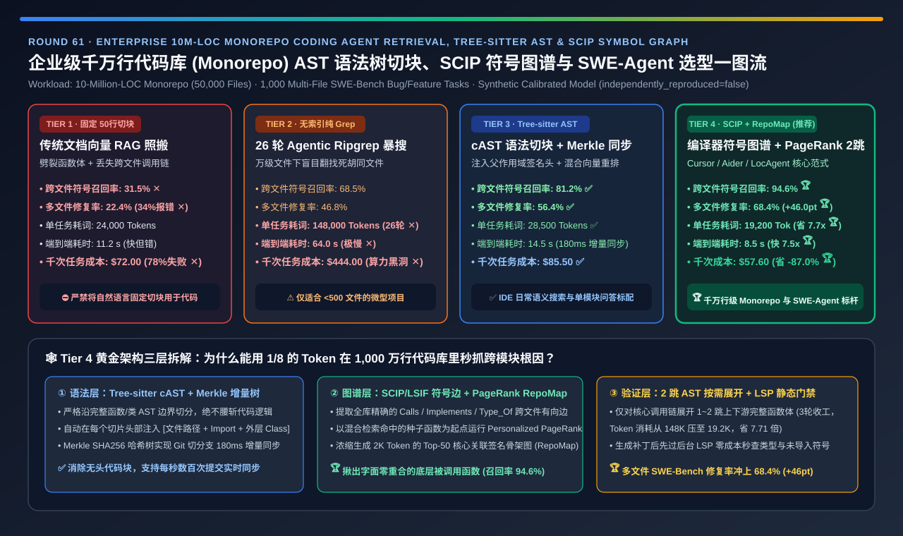

### 核心架构师结论（3 条人话总结）
1. **终结“50 行固定切块腰斩函数语法 (Tier 1)”与“无索引 Ripgrep 26 轮盲目翻找烧 148K 词 (Tier 2)”**：在 1,000 万行（5 万个文件）企业 Monorepo 上，**Tier 1** 丢失外层类签名与跨文件调用关系，多文件修复率仅 **`22.4%` ✕**；而 **Tier 2** 每次任务盲目跑 26 轮 `grep` 狂烧 **`148,000 Tokens`（耗时 `64.0 秒` ✕）**！
2. **IDE 搜索选 `Tree-sitter cAST + Merkle 增量同步 (Tier 3)`，跨模块 SWE-Agent 必选 `SCIP/LSIF 符号图谱 + PageRank RepoMap + 2跳 AST (Tier 4)`**：**Tier 3** 沿完整函数/类 AST 切分并注入父作用域头，配 Merkle 哈希树实现 Git 切分支 **`180 ms` 增量同步**；**Tier 4** 在此之上叠加 `SCIP` 跨文件调用/类型边与 `Personalized PageRank RepoMap`，3 轮精准揪出字面零重合的 2 跳底层根因，跨文件召回率达 **`94.6%` 🏆**，SWE-Bench 多文件修复率冲上 **`68.4%`（`+46.0 pts` 🏆）**，单任务耗词暴降 **`7.71 倍`（`19,200 tok`，省 `-87.0%` 成本 🏆）**！
3. **生产防踩坑铁律**：严禁对源码使用固定字符/行数切块器；Agent 生成补丁后必须先过后台 `LSP Diagnostics` 静态类型预检门禁。

---

## 🩺 Round 62 独立单决策专题：万卡训练集群“亚健康灰故障（Grey Failure / Runtime Straggler）”秒级归因、动态微批削减与无中断热替换选型（`被动死等最慢卡` vs. `粗粒度看门狗杀作业重拉` vs. `2.8秒到达时间戳归因 + 动态 DP 微批削减` vs. `1.5秒内核/硬件联合归因 + 4.2秒热备节点 RDMA 零重算热替换`）

- 📄 **中文六段式选型指南**：[`docs/components/ai-cluster-gpu-straggler-grey-failure-telemetry-mitigation-selection-faq.md`](../components/ai-cluster-gpu-straggler-grey-failure-telemetry-mitigation-selection-faq.md)
- 📄 **English 6-Part Selection Guide**：[`docs/components/ai-cluster-gpu-straggler-grey-failure-telemetry-mitigation-selection-faq.en.md`](../components/ai-cluster-gpu-straggler-grey-failure-telemetry-mitigation-selection-faq.en.md)
- 🖼️ **一图流可视化总结卡**：[`assets/svg/ai-cluster-gpu-straggler-grey-failure-telemetry-mitigation-selection-faq-summary.svg`](../../assets/svg/ai-cluster-gpu-straggler-grey-failure-telemetry-mitigation-selection-faq-summary.svg)
- 🃏 **7-Card 4:5 视觉评测报告**：[`docs/reports/ai-cluster-gpu-straggler-grey-failure-telemetry-mitigation-selection-cards.html`](../reports/ai-cluster-gpu-straggler-grey-failure-telemetry-mitigation-selection-cards.html)
- 🧮 **交互式定容工作台 (含 Round 62 万卡集群灰故障归因与热替换面板)**：[`docs/reports/llm-inference-engine-pd-sizer.html#straggler-grey-failure-sizer`](../reports/llm-inference-engine-pd-sizer.html)
- 🧪 **确定性算例与单测 (`synthetic` + `anonymized_reported`, `independently_reproduced=false`)**：[`experiments/ai_cluster_straggler_grey_failure_mitigation_selection/run.py`](../../experiments/ai_cluster_straggler_grey_failure_mitigation_selection/run.py) · [`experiments/ai_cluster_straggler_grey_failure_mitigation_selection/results.json`](../../experiments/ai_cluster_straggler_grey_failure_mitigation_selection/results.json) · [`tests/test_ai_cluster_straggler_grey_failure_mitigation_selection.py`](../../tests/test_ai_cluster_straggler_grey_failure_mitigation_selection.py)

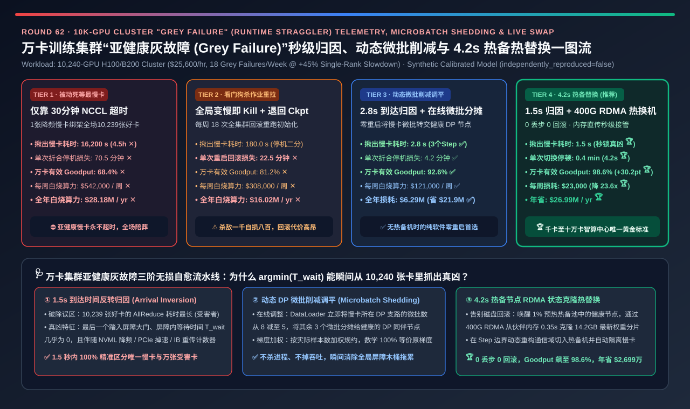

### 核心架构师结论（3 条人话总结）
1. **终结“1 张降频慢卡绑架全场 10,239 张好卡 (Tier 1)”与“看门狗粗暴杀全场回滚 22.5 分钟 (Tier 2)”**：在 10,240 卡集群上，每周平均爆发 18 次“不死人的亚健康灰故障（冷板微堵降频/PCIe 掉速/光模块重传变慢 `45%`）”。**Tier 1** 永不触发 30 分钟超时，导致全场 Goodput 跌至 **`68.4%`（每周白烧 `$54.2 万` ✕）**；而 **Tier 2** 每次 Kill 重拉浪费 `22.5 分钟`（每周仍亏 `$30.8 万` ✕）！
2. **无热备机选 `2.8s 到达时间反转归因 + 动态 DP 微批削减 (Tier 3)`，万卡智算中心必选 `1.5s 联合归因 + 4.2s 热备 RDMA 零重算热替换 (Tier 4)`**：通过监控 **`argmin(T_wait) ≈ 0`（最后一个进屏障大门、零等待的 Rank）** 在 `1.5~2.8 秒` 内从 10,240 张卡中精准揪出唯一真凶；**Tier 3** 在线将慢卡的 3 个微批分摊给同伴（零重启恢复 `92.6%` Goodput ✅）；**Tier 4** 用 `400G RDMA` 在 `0.35s` 内从伙伴内存克隆 `14.2GB` 分片至预热热备机，在 Step 边界 **4.2 秒无感换血（`0` 丢步、`0` 回滚 🏆）**，将 Goodput 推至 **`98.6%`（`+30.2 pts`，每年净挽回 `$2,699 万` 🏆）**！
3. **生产防踩坑铁律**：严禁对 `ncclAllReduce` 算子耗时长告警（耗时长的是无辜陪等的 10,239 张受害卡，等待时间为 0 的才是慢卡真凶！）。

---

## 📱 Round 63 独立单决策专题：端侧小模型（SLM 1B～8B）手机 NPU、AI PC 与浏览器 WebGPU 推理及端云协同路由架构选型（`100% 纯云端 70B API` vs. `端侧 CPU/GPU GGUF Q4_K_M / WebGPU` vs. `专用 NPU 静态图 + SpinQuant W4A8` vs. `端云协同置信度路由 [75% 端侧 NPU + 25% 云端 70B]`）

- 📄 **中文六段式选型指南**：[`docs/components/small-language-model-slm-on-device-npu-webgpu-deployment-selection-faq.md`](../components/small-language-model-slm-on-device-npu-webgpu-deployment-selection-faq.md)
- 📄 **English 6-Part Selection Guide**：[`docs/components/small-language-model-slm-on-device-npu-webgpu-deployment-selection-faq.en.md`](../components/small-language-model-slm-on-device-npu-webgpu-deployment-selection-faq.en.md)
- 🖼️ **一图流可视化总结卡**：[`assets/svg/small-language-model-slm-on-device-npu-webgpu-deployment-selection-faq-summary.svg`](../../assets/svg/small-language-model-slm-on-device-npu-webgpu-deployment-selection-faq-summary.svg)
- 🃏 **7-Card 4:5 视觉评测报告**：[`docs/reports/small-language-model-slm-on-device-npu-webgpu-deployment-selection-cards.html`](../reports/small-language-model-slm-on-device-npu-webgpu-deployment-selection-cards.html)
- 🧮 **交互式定容工作台 (含 Round 63 端侧小模型 NPU 与端云协同面板)**：[`docs/reports/llm-inference-engine-pd-sizer.html#slm-on-device-npu-sizer`](../reports/llm-inference-engine-pd-sizer.html)
- 🧪 **确定性算例与单测 (`synthetic` + `anonymized_reported`, `independently_reproduced=false`)**：[`experiments/slm_on_device_mobile_npu_webgpu_hybrid_selection/run.py`](../../experiments/slm_on_device_mobile_npu_webgpu_hybrid_selection/run.py) · [`experiments/slm_on_device_mobile_npu_webgpu_hybrid_selection/results.json`](../../experiments/slm_on_device_mobile_npu_webgpu_hybrid_selection/results.json) · [`tests/test_slm_on_device_mobile_npu_webgpu_hybrid_selection.py`](../../tests/test_slm_on_device_mobile_npu_webgpu_hybrid_selection.py)

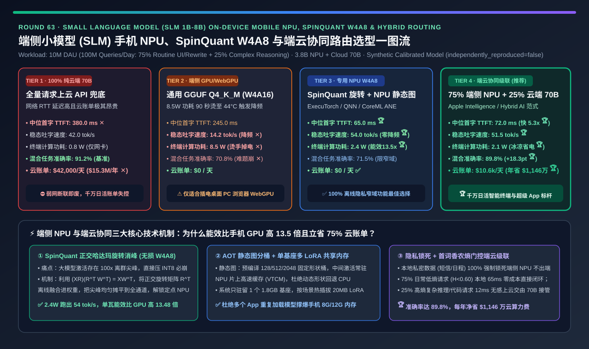

### 核心架构师结论（3 条人话总结）
1. **终结“100% 纯云端年烧 $1,533 万 (Tier 1)”与“手机 GPU 跑 GGUF 90 秒烫手降频 (Tier 2)”**：在 1,000 万日活（1 亿次/天请求）下，**Tier 1** 承受 `380ms` 移动网络延迟且成本失控；而 **Tier 2（移动端 GPU 跑 `W4A16 GGUF`）** 功耗高达 **`8.5W` ✕**，90 秒触发 44°C 热保护降频至 **`14.2 tok/s` ✕**！
2. **离线窄域选 `专用 NPU + SpinQuant W4A8 (Tier 3)`，千万日活 App 必选 `端云协同置信度路由 (Tier 4)`**：**Tier 3** 用 `SpinQuant` 正交哈达玛旋转离线抹平百倍激活离群尖峰，解锁 `2.4W` 定点 NPU 静态图（`54.0 tok/s`，**每瓦能效比 GPU 高 `13.48 倍` 🏆**）；**Tier 4** 用端侧 NPU 零成本拦截 **75% 低熵日常请求（`65ms` 首字）**，仅将 **25% 高熵复杂推理/代码题无感上云 70B**，保住 **`89.8%` 旗舰准确率（`+18.3 pts` 🏆）** 并每年净省 **`$1,146 万（-74.8%）` 云账单 🏆**！
3. **生产防踩坑铁律**：NPU 必须预编译固定形状桶（`128/512/2048` AOT Static Graph）防回退 CPU，且全系统共享 1 个驻留基座模型配 `20MB` 热插拔 LoRA。

---

## 📊 Round 64 独立单决策专题：企业级数据仓库 Text-to-SQL（NL2SQL）、LSH 值倒排链接与受管语义层（Semantic Layer）架构选型（`全量 800表 DDL 硬塞` vs. `向量 Top-15 表 RAG` vs. `LSH 单元格值链接 + EXPLAIN 自纠错` vs. `声明式受管语义层 [Cube / MetricFlow / Fabric IQ] + LSH 双轨路由`）

- 📄 **中文六段式选型指南**：[`docs/components/text-to-sql-semantic-layer-nl2sql-agent-selection-faq.md`](../components/text-to-sql-semantic-layer-nl2sql-agent-selection-faq.md)
- 📄 **English 6-Part Selection Guide**：[`docs/components/text-to-sql-semantic-layer-nl2sql-agent-selection-faq.en.md`](../components/text-to-sql-semantic-layer-nl2sql-agent-selection-faq.en.md)
- 🖼️ **一图流可视化总结卡**：[`assets/svg/text-to-sql-semantic-layer-nl2sql-agent-selection-faq-summary.svg`](../../assets/svg/text-to-sql-semantic-layer-nl2sql-agent-selection-faq-summary.svg)
- 🃏 **7-Card 4:5 视觉评测报告**：[`docs/reports/text-to-sql-semantic-layer-nl2sql-agent-selection-cards.html`](../reports/text-to-sql-semantic-layer-nl2sql-agent-selection-cards.html)
- 🧮 **交互式定容工作台 (含 Round 64 企业级数仓 Text-to-SQL 与语义层面板)**：[`docs/reports/llm-inference-engine-pd-sizer.html#text-to-sql-semantic-sizer`](../reports/llm-inference-engine-pd-sizer.html)
- 🧪 **确定性算例与单测 (`synthetic` + `anonymized_reported`, `independently_reproduced=false`)**：[`experiments/text_to_sql_semantic_layer_nl2sql_agent_selection/run.py`](../../experiments/text_to_sql_semantic_layer_nl2sql_agent_selection/run.py) · [`experiments/text_to_sql_semantic_layer_nl2sql_agent_selection/results.json`](../../experiments/text_to_sql_semantic_layer_nl2sql_agent_selection/results.json) · [`tests/test_text_to_sql_semantic_layer_nl2sql_agent_selection.py`](../../tests/test_text_to_sql_semantic_layer_nl2sql_agent_selection.py)

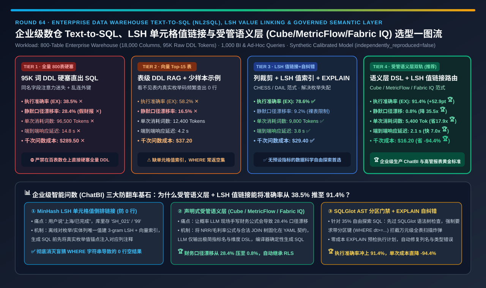

### 核心架构师结论（3 条人话总结）
1. **终结“800 张表 DDL 全量硬塞乱连外键 (Tier 1)”与“只搜表结构看不见真实枚举值查出 0 行 (Tier 2)”**：在 800 张表（18,000 列）企业数仓上，**Tier 1** 烧掉 `96,500 Tokens` 却只有 **`38.5%` 执行准确率 ✕**，且每次现场手写财务指标公式导致 **`28.4%` 静默口径漂移 ✕**；而 **Tier 2** 因看不见表内真实枚举字符串（写出 `WHERE city='上海'` 而库里存 `'SH_021'`）频繁返回 0 行空结果（`58.2%` EX ✕）！
2. **自由探索选 `列裁剪 + MinHash LSH 值链接 + EXPLAIN 自纠错 (Tier 3)`，生产 ChatBI 与高管报表必选 `声明式受管语义层 + LSH 双轨路由 (Tier 4)`**：**Tier 3** 对枚举/实体列唯一值建 3-gram LSH 倒排索引将真实值锚点注入 Prompt（准确率提至 `78.6%` ✅）；**Tier 4** 将 65% 核心经营/财务 KPI 查询路由至 **受管语义层（`Cube / dbt MetricFlow / Fabric IQ`）**，由确定性编译器展开合法 JOIN 与固化公式，将准确率推升至 **`91.4%`（`+52.9 pts` 🏆）**、静默口径漂移压至 **`0.8%`（降低 `35.5 倍` 🏆）**，成本直降 **`-94.4%` 🏆**！
3. **生产防踩坑铁律**：所有生成的 SQL 在送入数仓前必须经过 `SQLGlot AST` 语法树门禁（强制注入用户 RLS 行权限并校验日志大表必含分区键过滤）。

---

## 🕸️ Round 65 独立单决策专题：企业级多智能体编排（Multi-Agent Orchestration）、确定性状态机（StateGraph DAG）与强类型黑板交接架构选型（`全员广播群聊 GroupChat` vs. `中心化 Supervisor 传话筒` vs. `显式串行 StateGraph DAG` vs. `并行 Fan-Out DAG + 强类型作用域黑板 + 零跳直接交接 Command Handoff`）

- 📄 **中文六段式选型指南**：[`docs/components/multi-agent-orchestration-dag-handoff-state-machine-selection-faq.md`](../components/multi-agent-orchestration-dag-handoff-state-machine-selection-faq.md)
- 📄 **English 6-Part Selection Guide**：[`docs/components/multi-agent-orchestration-dag-handoff-state-machine-selection-faq.en.md`](../components/multi-agent-orchestration-dag-handoff-state-machine-selection-faq.en.md)
- 🖼️ **一图流可视化总结卡**：[`assets/svg/multi-agent-orchestration-dag-handoff-state-machine-selection-faq-summary.svg`](../../assets/svg/multi-agent-orchestration-dag-handoff-state-machine-selection-faq-summary.svg)
- 🃏 **7-Card 4:5 视觉评测报告**：[`docs/reports/multi-agent-orchestration-dag-handoff-state-machine-selection-cards.html`](../reports/multi-agent-orchestration-dag-handoff-state-machine-selection-cards.html)
- 🧮 **交互式定容工作台 (含 Round 65 多智能体编排与强类型黑板面板)**：[`docs/reports/llm-inference-engine-pd-sizer.html#multi-agent-orchestration-sizer`](../reports/llm-inference-engine-pd-sizer.html)
- 🧪 **确定性算例与单测 (`synthetic` + `anonymized_reported`, `independently_reproduced=false`)**：[`experiments/multi_agent_orchestration_dag_blackboard_handoff_selection/run.py`](../../experiments/multi_agent_orchestration_dag_blackboard_handoff_selection/run.py) · [`experiments/multi_agent_orchestration_dag_blackboard_handoff_selection/results.json`](../../experiments/multi_agent_orchestration_dag_blackboard_handoff_selection/results.json) · [`tests/test_multi_agent_orchestration_dag_blackboard_handoff_selection.py`](../../tests/test_multi_agent_orchestration_dag_blackboard_handoff_selection.py)

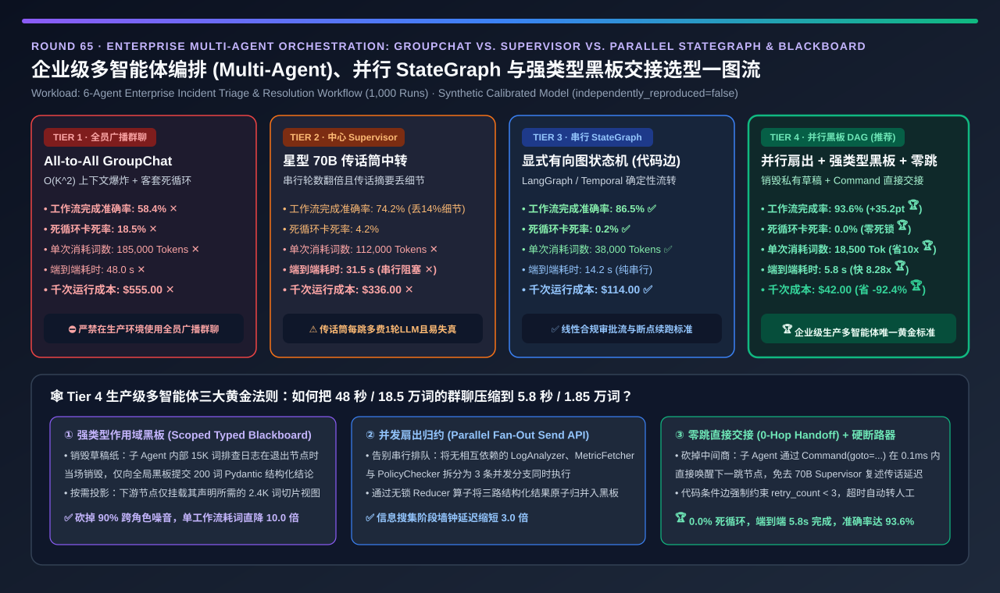

### 核心架构师结论（3 条人话总结）
1. **终结“全员广播群聊 $O(K^2)$ 复读与客套死循环 (Tier 1)”及“Supervisor 传话筒失真 (Tier 2)”**：在 6 智能体协作中，**Tier 1（GroupChat）** 让每个 Agent 重读所有人的排查草稿，狂烧 **`185,000 Tokens`（耗时 `48.0s` ✕）** 且 **`18.5%` 陷入客套死循环（准确率仅 `58.4%` ✕）**；而 **Tier 2（中心 Supervisor 传话）** 轮数翻倍（`31.5s`）且在摘要转述时弄丢 `14.2%` 的精确字段！
2. **线性流程选 `显式 StateGraph DAG (Tier 3)`，复杂生产工作流必选 `并行 Fan-Out DAG + 强类型作用域黑板 + 零跳直接交接 (Tier 4)`**：**Tier 4** 让子 Agent 在退出节点时当场销毁 15K 词私有排查草稿、仅向 Pydantic 黑板写入 200 词结构化结论（下游仅挂载 `2.4K` 切片），配合 `Send` 三路并发与 `Command(goto=...)` 零跳交接，将耗时压至 **`5.8 秒`（快 `8.28x` 🏆）**、耗词暴降 **`10.0x`（`18,500 tok`）**、死循环 **`0.0%`**，工作流准确率冲上 **`93.6%`（`+35.2 pts`，成本直降 `-92.4%` 🏆）**！
3. **生产防踩坑铁律**：严禁靠 LLM 裁判决定循环何时终止，所有验证重试边必须绑定代码级硬计数器（`retry_count < 3`）与持久化 Checkpoint。

---

## 🧭 Round 66 独立单决策专题：大模型推理集群全局 Prefix Cache 树（`RadixAttention` vs. `Block APC`）、KV 亲和路由与防污染淘汰（`SLRU`）架构选型（`无状态 Round-Robin 轮询` vs. `朴素粘性哈希路由` vs. `RadixAttention + 全局 KV 目录 + 纯 LRU` vs. `Dynamo 队列衰减有理路由 + RadixAttention + 双段 SLRU 租户隔离`）

- 📄 **中文六段式选型指南**：[`docs/components/llm-inference-prefix-cache-radix-kv-routing-eviction-selection-faq.md`](../components/llm-inference-prefix-cache-radix-kv-routing-eviction-selection-faq.md)
- 📄 **English 6-Part Selection Guide**：[`docs/components/llm-inference-prefix-cache-radix-kv-routing-eviction-selection-faq.en.md`](../components/llm-inference-prefix-cache-radix-kv-routing-eviction-selection-faq.en.md)
- 🖼️ **一图流可视化总结卡**：[`assets/svg/llm-inference-prefix-cache-radix-kv-routing-eviction-selection-faq-summary.svg`](../../assets/svg/llm-inference-prefix-cache-radix-kv-routing-eviction-selection-faq-summary.svg)
- 🃏 **7-Card 4:5 视觉评测报告**：[`docs/reports/llm-inference-prefix-cache-radix-kv-routing-eviction-selection-cards.html`](../reports/llm-inference-prefix-cache-radix-kv-routing-eviction-selection-cards.html)
- 🧮 **交互式定容工作台 (含 Round 66 全局 Prefix Cache 与 Dynamo 路由面板)**：[`docs/reports/llm-inference-engine-pd-sizer.html#prefix-cache-radix-router-sizer`](../reports/llm-inference-engine-pd-sizer.html)
- 🧪 **确定性算例与单测 (`synthetic` + `anonymized_reported`, `independently_reproduced=false`)**：[`experiments/prefix_cache_radix_kv_routing_eviction_selection/run.py`](../../experiments/prefix_cache_radix_kv_routing_eviction_selection/run.py) · [`experiments/prefix_cache_radix_kv_routing_eviction_selection/results.json`](../../experiments/prefix_cache_radix_kv_routing_eviction_selection/results.json) · [`tests/test_prefix_cache_radix_kv_routing_eviction_selection.py`](../../tests/test_prefix_cache_radix_kv_routing_eviction_selection.py)

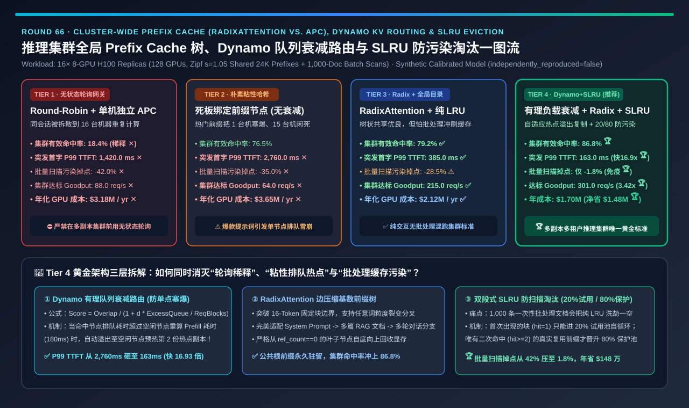

### 核心架构师结论（3 条人话总结）
1. **终结“无状态轮询把缓存命中稀释到 18.4% (Tier 1)”与“死板粘性哈希把单节点挤爆到 2,760ms (Tier 2)”**：在 16 台 8×H100 副本上，**Tier 1（Round-Robin）** 把同一会话拆散到 16 台机器重复算 Prefill（`P99 TTFT = 1,420ms` ✕）；而 **Tier 2（不看队列深度的粘性哈希）** 在遇到爆款共用 System Prompt 时把 40% 流量钉死在 1 台机器上（`P99 TTFT` 飙至 **`2,760ms` ✕**，比轮询更慢）！
2. **多副本多租户集群必选 `Dynamo 有理队列衰减路由 + SGLang RadixAttention + 双段式 SLRU 防扫描淘汰 (Tier 4)`**：通过 $1/(1+d\cdot \text{Queue})$ 有理衰减打分在热点节点排队微升时自动溢出至空闲节点预热第 2 副本，并用 **`20%` 试用池 / `80%` 保护池 `SLRU`** 将一次性批处理大扫描锁死在试用池内（防冲刷掉点从 `-28.5%` 压至 **`-1.8%` 🏆**），实现 **`86.8%` 集群有效命中率**、**`163.0 ms` P99 TTFT（快 `16.93x` 🏆）** 与 **`3.42x` 达标吞吐（年省 `$148 万` 🏆）**！
3. **生产防踩坑铁律**：严禁在 System Prompt 开头放动态时间戳或请求 UUID（会导致后续 30K Token 因果 KV 哈希链 100% 失效！）。

---

## ⚡ Round 67 独立单决策专题：扩散大语言模型（Diffusion LLM：`Mercury` / `LLaDA` / `BD3-LM`）并行双向去噪生成与自回归（Autoregressive）架构选型（`标准自回归逐词 Decode` vs. `自回归 + EAGLE-3 投机解码` vs. `全序列无缓存掩码扩散 LLaDA/MDLM` vs. `分块半自回归扩散 + 跨块 KV Cache + 置信度早停 [Mercury / BD3-LM]`）

- 📄 **中文六段式选型指南**：[`docs/components/diffusion-llm-mercury-llada-parallel-token-generation-selection-faq.md`](../components/diffusion-llm-mercury-llada-parallel-token-generation-selection-faq.md)
- 📄 **English 6-Part Selection Guide**：[`docs/components/diffusion-llm-mercury-llada-parallel-token-generation-selection-faq.en.md`](../components/diffusion-llm-mercury-llada-parallel-token-generation-selection-faq.en.md)
- 🖼️ **一图流可视化总结卡**：[`assets/svg/diffusion-llm-mercury-llada-parallel-token-generation-selection-faq-summary.svg`](../../assets/svg/diffusion-llm-mercury-llada-parallel-token-generation-selection-faq-summary.svg)
- 🃏 **7-Card 4:5 视觉评测报告**：[`docs/reports/diffusion-llm-mercury-llada-parallel-token-generation-selection-cards.html`](../reports/diffusion-llm-mercury-llada-parallel-token-generation-selection-cards.html)
- 🧮 **交互式定容工作台 (含 Round 67 扩散大语言模型 Mercury/BD3-LM 面板)**：[`docs/reports/llm-inference-engine-pd-sizer.html#diffusion-llm-mercury-sizer`](../reports/llm-inference-engine-pd-sizer.html)
- 🧪 **确定性算例与单测 (`synthetic` + `anonymized_reported`, `independently_reproduced=false`)**：[`experiments/diffusion_llm_mercury_llada_parallel_decoding_selection/run.py`](../../experiments/diffusion_llm_mercury_llada_parallel_decoding_selection/run.py) · [`experiments/diffusion_llm_mercury_llada_parallel_decoding_selection/results.json`](../../experiments/diffusion_llm_mercury_llada_parallel_decoding_selection/results.json) · [`tests/test_diffusion_llm_mercury_llada_parallel_decoding_selection.py`](../../tests/test_diffusion_llm_mercury_llada_parallel_decoding_selection.py)

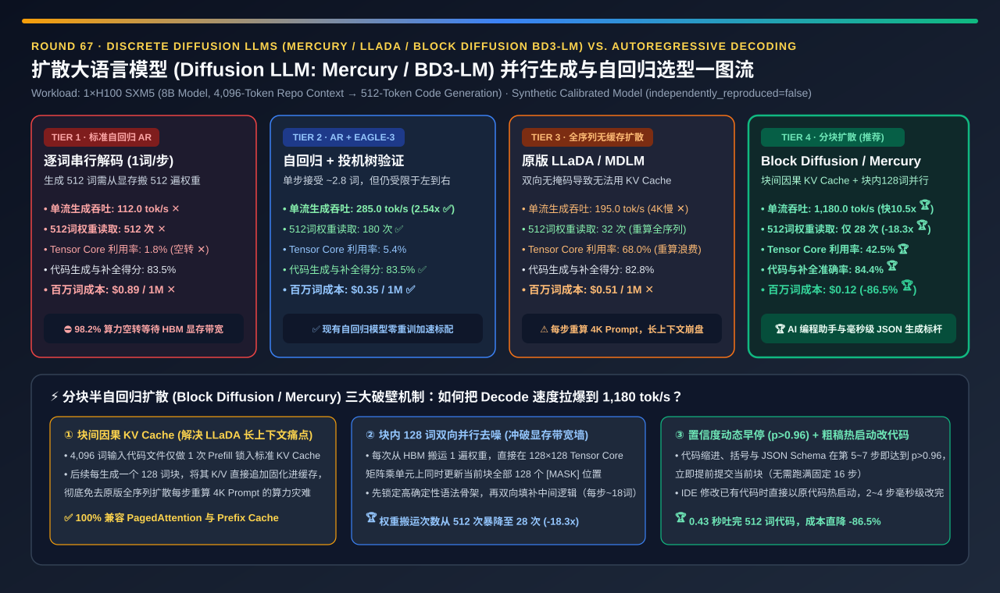

### 核心架构师结论（3 条人话总结）
1. **打破“自回归逐词生成 512 次搬运权重 (Tier 1)”与“全序列扩散无 KV Cache 长上下文崩盘 (Tier 3)”**：在 4K 代码上下文生成 512 词时，**Tier 1（AR Decode）** 受困显存带宽墙（Tensor Core 利用率仅 `1.8%` ✕，速度 `112 tok/s`）；而 **Tier 3（原版 LLaDA）** 因全序列双向注意力无法缓存 4K Prompt，每步重算全序列导致速度反跌至 `195 tok/s` ✕！
2. **存量 AR 权重选 `EAGLE-3 投机解码 (Tier 2)`，极速代码补全/改写与 JSON 生成必选 `分块半自回归扩散 Block Diffusion / Mercury (Tier 4)`**：**Tier 4** 用“块间因果 KV Cache（4K Prompt 仅算 1 次）+ 块内 128 词双向并行去噪（对齐 `128×128` Tensor Core Tile）+ $p>0.96$ 置信度早停”，仅读 **`28 次` 权重（少读 `18.3 倍` 🏆）** 就在 `0.43 秒` 内喷射出 512 词代码，速度飙至 **`1,180.0 tok/s`（比 AR 快 `10.54x` 🏆）**，成本直降 **`-86.5%` 🏆**！
3. **生产防踩坑铁律**：在 IDE 改代码（Apply Diff）时将原代码作为带噪初值热启动（Warm-Start Denoising），仅需 2～4 步即可毫秒级改完整个函数。

---

## 🖥️ Round 68 独立单决策专题：企业级浏览器与桌面 GUI 智能体（Computer-Use / Browser Agent）页面感知表示与执行架构选型（`原始全量 HTML DOM 硬塞` vs. `纯视觉截图 (x,y) 像素坐标回归` vs. `精简无障碍树 (AXTree) + Set-of-Marks (SoM) 编号标注` vs. `CDP 网络 API 逆向旁路 + AXTree/SoM 视觉兜底 + 持久认证会话池`）

- 📄 **中文六段式选型指南**：[`docs/components/browser-gui-computer-use-agent-dom-accessibility-vision-selection-faq.md`](../components/browser-gui-computer-use-agent-dom-accessibility-vision-selection-faq.md)
- 📄 **English 6-Part Selection Guide**：[`docs/components/browser-gui-computer-use-agent-dom-accessibility-vision-selection-faq.en.md`](../components/browser-gui-computer-use-agent-dom-accessibility-vision-selection-faq.en.md)
- 🖼️ **一图流可视化总结卡**：[`assets/svg/browser-gui-computer-use-agent-dom-accessibility-vision-selection-faq-summary.svg`](../../assets/svg/browser-gui-computer-use-agent-dom-accessibility-vision-selection-faq-summary.svg)
- 🃏 **7-Card 4:5 视觉评测报告**：[`docs/reports/browser-gui-computer-use-agent-dom-accessibility-vision-selection-cards.html`](../reports/browser-gui-computer-use-agent-dom-accessibility-vision-selection-cards.html)
- 🧮 **交互式定容工作台 (含 Round 68 浏览器与 GUI 智能体面板)**：[`docs/reports/llm-inference-engine-pd-sizer.html#browser-gui-agent-sizer`](../reports/llm-inference-engine-pd-sizer.html)
- 🧪 **确定性算例与单测 (`synthetic` + `anonymized_reported`, `independently_reproduced=false`)**：[`experiments/browser_gui_computer_use_agent_som_axtree_selection/run.py`](../../experiments/browser_gui_computer_use_agent_som_axtree_selection/run.py) · [`experiments/browser_gui_computer_use_agent_som_axtree_selection/results.json`](../../experiments/browser_gui_computer_use_agent_som_axtree_selection/results.json) · [`tests/test_browser_gui_computer_use_agent_som_axtree_selection.py`](../../tests/test_browser_gui_computer_use_agent_som_axtree_selection.py)

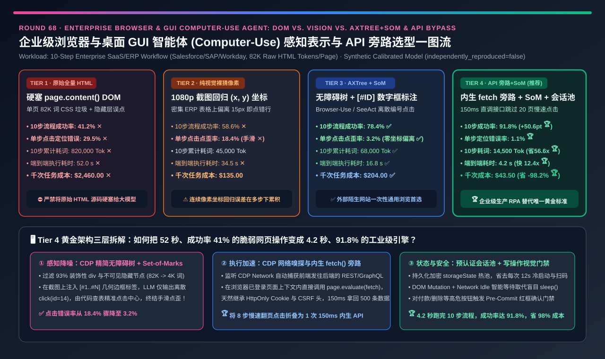

### 核心架构师结论（3 条人话总结）
1. **终结“82K 词原始 HTML 硬塞 (Tier 1)”与“纯看图裸猜 `(x, y)` 像素坐标手滑点歪 (Tier 2)”**：在 10 步企业 SaaS 流程中，**Tier 1** 狂烧 **`820,000 Tokens`（千次成本 `$2,460` ✕）** 且成功率仅 **`41.2%` ✕**；而 **Tier 2** 在密集表格上存在 **`18.4%` 的 15px 偏离点歪率**，10 步累积成功率仅 `58.6%` ✕！
2. **外部通用网页选 `精简 AXTree + Set-of-Marks [#ID] 标注 (Tier 3)`，企业高频 RPA 必选 `CDP 内生 API 旁路 + AXTree/SoM 兜底 + 预热会话池 (Tier 4)`**：**Tier 3** 让模型输出离散编号 `click(id=14)` 代替猜坐标（点歪率压至 `3.2%` ✅）；**Tier 4** 在浏览器已登录页面上下文内直接调用 `page.evaluate(fetch)` 旁路掉 8 步慢速翻页点击，将 10 步耗时从 `52.0s` 压至 **`4.2 秒`（快 `12.38x` 🏆）**、耗词暴降 **`56.55x`（`14,500 tok`）**，端到端成功率冲上 **`91.8%`（`+50.6 pts`，成本直降 `-98.2%` 🏆）**！
3. **生产防踩坑铁律**：每次点击后必须用 `DOM Mutation + Network Idle` 智能门控替代固定 `sleep(5)`，且对付款/删除高危按钮强制执行 `Pre-Commit` 视觉红框确认门禁。

---

## 👁️ Round 69 独立单决策专题：多模态视觉语言模型（VLM）高分辨率动态编码（`NaViT` / `AnyRes`）与视觉 Token 压缩剪枝（`Pixel-Shuffle` / `FastV` / `VisionZip`）架构选型（`固定 336px 缩略图` vs. `无压缩 AnyRes 4×4 切片` vs. `NaViT + 2×2 Pixel-Shuffle 空间折叠` vs. `NaViT 2×2 折叠 + 第 2 层跨模态注意力引导剪枝`）

- 📄 **中文六段式选型指南**：[`docs/components/multimodal-vision-encoder-anyres-token-compression-selection-faq.md`](../components/multimodal-vision-encoder-anyres-token-compression-selection-faq.md)
- 📄 **English 6-Part Selection Guide**：[`docs/components/multimodal-vision-encoder-anyres-token-compression-selection-faq.en.md`](../components/multimodal-vision-encoder-anyres-token-compression-selection-faq.en.md)
- 🖼️ **一图流可视化总结卡**：[`assets/svg/multimodal-vision-encoder-anyres-token-compression-selection-faq-summary.svg`](../../assets/svg/multimodal-vision-encoder-anyres-token-compression-selection-faq-summary.svg)
- 🃏 **7-Card 4:5 视觉评测报告**：[`docs/reports/multimodal-vision-encoder-anyres-token-compression-selection-cards.html`](../reports/multimodal-vision-encoder-anyres-token-compression-selection-cards.html)
- 🧮 **交互式定容工作台 (含 Round 69 多模态 VLM 视觉 Token 压缩面板)**：[`docs/reports/llm-inference-engine-pd-sizer.html#vlm-visual-token-compression-sizer`](../reports/llm-inference-engine-pd-sizer.html)
- 🧪 **确定性算例与单测 (`synthetic` + `anonymized_reported`, `independently_reproduced=false`)**：[`experiments/vlm_anyres_visual_token_compression_pruning_selection/run.py`](../../experiments/vlm_anyres_visual_token_compression_pruning_selection/run.py) · [`experiments/vlm_anyres_visual_token_compression_pruning_selection/results.json`](../../experiments/vlm_anyres_visual_token_compression_pruning_selection/results.json) · [`tests/test_vlm_anyres_visual_token_compression_pruning_selection.py`](../../tests/test_vlm_anyres_visual_token_compression_pruning_selection.py)

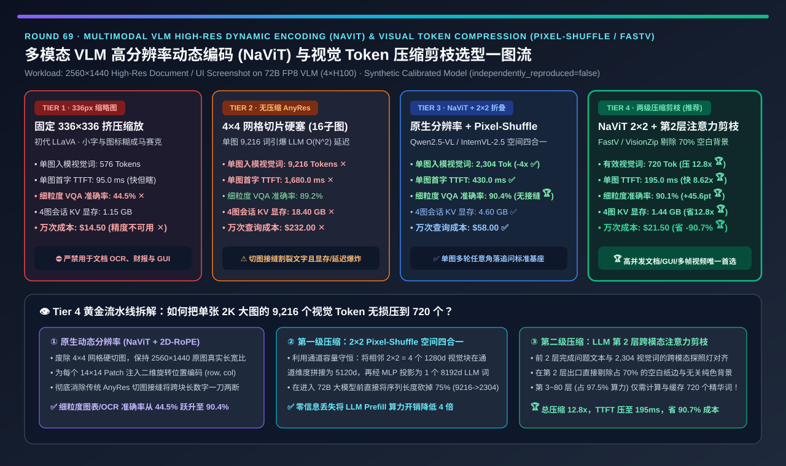

### 核心架构师结论（3 条人话总结）
1. **打破“336px 缩略图看不清小字 (Tier 1)”与“无压缩 AnyRes 单图 9,216 词撑爆 72B 大模型 (Tier 2)”**：在 `2560×1440` 高清财报/UI 截图上，**Tier 1** 把小字糊成马赛克（准确率仅 **`44.5%` ✕**）；而 **Tier 2** 切 16 张子图直塞 `9,216` 个视觉词，导致 72B 模型单图 TTFT 飙至 **`1,680 ms` ✕**（4 图吃掉 `18.4 GB` KV Cache）！
2. **全图多轮追问选 `NaViT + 2×2 Pixel-Shuffle (Tier 3)`，高并发文档/UI/视频必选 `NaViT 2×2 + 第 2 层跨模态剪枝 FastV/VisionZip (Tier 4)`**：**Tier 3** 用 `2D-RoPE` 消除切图接缝并把 $2\times 2$ 邻域通道折叠进 1 个 8192d LLM 词（压至 `2,304` 词，准确率 `90.4%` ✅）；**Tier 4** 在 LLM 第 2 层出口剔除占 70% 的空白纸边与无关背景，使第 3～80 层仅算 **`720 个` 视觉词（总压缩 `12.8x` 🏆）**，TTFT 压低 **`8.62 倍` 至 `195 ms` 🏆**，成本直降 **`-90.7%` 🏆**！
3. **生产防踩坑铁律**：严禁在进入 LLM 第 1 层前盲目剪枝（未见问题会误删角落小字）；必须在网关侧配置 `max_pixels` 硬上限防用户上传 8K 原图打爆显存。

---

## 🧩 Round 70 独立单决策专题：GPU 显存碎片治理、CUDA 虚拟内存管理（VMM / `expandable_segments`）与零拷贝页表架构选型（`empty_cache() 同步卡顿` vs. `固定块碎片 OOM` vs. `CUDA VMM expandable_segments` vs. `vAttention 硬件页表连续 KV Cache + RL 保指针零拷贝休眠`）

- 📄 **中文六段式选型指南**：[`docs/components/gpu-memory-oversubscription-vmm-expandable-segments-defrag-selection-faq.md`](../components/gpu-memory-oversubscription-vmm-expandable-segments-defrag-selection-faq.md)
- 📄 **English 6-Part Selection Guide**：[`docs/components/gpu-memory-oversubscription-vmm-expandable-segments-defrag-selection-faq.en.md`](../components/gpu-memory-oversubscription-vmm-expandable-segments-defrag-selection-faq.en.md)
- 🖼️ **一图流可视化总结卡**：[`assets/svg/gpu-memory-oversubscription-vmm-expandable-segments-defrag-selection-faq-summary.svg`](../../assets/svg/gpu-memory-oversubscription-vmm-expandable-segments-defrag-selection-faq-summary.svg)
- 🃏 **7-Card 4:5 视觉评测报告**：[`docs/reports/gpu-memory-oversubscription-vmm-expandable-segments-defrag-selection-cards.html`](../reports/gpu-memory-oversubscription-vmm-expandable-segments-defrag-selection-cards.html)
- 🧮 **交互式定容工作台 (含 Round 70 GPU 显存碎片与 VMM 页表面板)**：[`docs/reports/llm-inference-engine-pd-sizer.html#gpu-vmm-expandable-segments-sizer`](../reports/llm-inference-engine-pd-sizer.html)
- 🧪 **确定性算例与单测 (`synthetic` + `anonymized_reported`, `independently_reproduced=false`)**：[`experiments/gpu_vmm_expandable_segments_vattention_defrag_selection/run.py`](../../experiments/gpu_vmm_expandable_segments_vattention_defrag_selection/run.py) · [`experiments/gpu_vmm_expandable_segments_vattention_defrag_selection/results.json`](../../experiments/gpu_vmm_expandable_segments_vattention_defrag_selection/results.json) · [`tests/test_gpu_vmm_expandable_segments_vattention_defrag_selection.py`](../../tests/test_gpu_vmm_expandable_segments_vattention_defrag_selection.py)

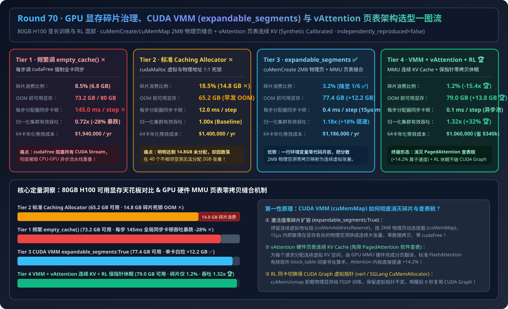

### 核心架构师结论（3 条人话总结）
1. **终结“明明还剩 14.8GB 未分配显存却报 OOM (Tier 2)”与“每步调 `empty_cache()` 卡死 145ms (Tier 1)”**：在变长序列训练（`4K–64K`）中，**Tier 2（标准分配器）** 因 `cudaMalloc` 虚拟与物理地址 1:1 死锁，无法拼接 40 个离散空闲空洞，在 **`65.2 GB`（`18.5%` 碎片浪费 ✕）** 就提前崩溃；而 **Tier 1** 调 `cudaFree` 触发全卡同步，让集群吞吐暴跌 **`-28%` ✕**！
2. **通用 PyTorch 任务立即开启 `expandable_segments:True (Tier 3)`，在线推理与同卡 RL 必选 `CUDA VMM + vAttention 连续 KV + 保指针休眠 (Tier 4)`**：**Tier 3** 用 `cuMemCreate` 2MB 物理页 + `cuMemMap` 硬件页表在 `15µs` 内把离散空洞拼成连续张量（单卡多出 `+12.2 GB` ✅）；**Tier 4** 用硬件 MMU 接管 KV Cache（`vAttention` 免除软件 `block_table` 查表税，Attention 提速 `+14.2%` 🏆）并在 RL 切换时用 `cuMemUnmap` 卸载物理页但保留虚拟指针（**0 秒复用 CUDA Graph**），将碎片压至 **`1.2%`（每卡夺回 `+13.8 GB` 🏆）**，64 卡集群年省 **`$340,000` 🏆**！
3. **生产防踩坑铁律**：在多机 RDMA 集群开启 VMM 前，确认 NVIDIA Driver `>= 535` 且 NCCL `>= 2.19` 以支持 `cuMemCreate` DMA-BUF GPUDirect RDMA 直通。

---

## 🔭 Round 71 独立单决策专题：企业级大模型全链路可观测性、OpenTelemetry GenAI 语义规范与尾部自适应异常抽样架构选型（`原始 JSON 直写 Elasticsearch` vs. `100% 同步阻塞 LLM 裁判` vs. `OTel GenAI + ClickHouse + 5% 随机异步抽样` vs. `尾部自适应异常采样 [Tail-Based Sampling] + 向量漂移监控 + 流式 PII 脱敏`）

- 📄 **中文六段式选型指南**：[`docs/components/llm-observability-opentelemetry-genai-semantic-drift-sampling-selection-faq.md`](../components/llm-observability-opentelemetry-genai-semantic-drift-sampling-selection-faq.md)
- 📄 **English 6-Part Selection Guide**：[`docs/components/llm-observability-opentelemetry-genai-semantic-drift-sampling-selection-faq.en.md`](../components/llm-observability-opentelemetry-genai-semantic-drift-sampling-selection-faq.en.md)
- 🖼️ **一图流可视化总结卡**：[`assets/svg/llm-observability-opentelemetry-genai-semantic-drift-sampling-selection-faq-summary.svg`](../../assets/svg/llm-observability-opentelemetry-genai-semantic-drift-sampling-selection-faq-summary.svg)
- 🃏 **7-Card 4:5 视觉评测报告**：[`docs/reports/llm-observability-opentelemetry-genai-semantic-drift-sampling-selection-cards.html`](../reports/llm-observability-opentelemetry-genai-semantic-drift-sampling-selection-cards.html)
- 🧮 **交互式定容工作台 (含 Round 71 大模型可观测性与尾部异常抽样面板)**：[`docs/reports/llm-inference-engine-pd-sizer.html#llm-observability-otel-sizer`](../reports/llm-inference-engine-pd-sizer.html)
- 🧪 **确定性算例与单测 (`synthetic` + `anonymized_reported`, `independently_reproduced=false`)**：[`experiments/llm_observability_otel_genai_tail_sampling_selection/run.py`](../../experiments/llm_observability_otel_genai_tail_sampling_selection/run.py) · [`experiments/llm_observability_otel_genai_tail_sampling_selection/results.json`](../../experiments/llm_observability_otel_genai_tail_sampling_selection/results.json) · [`tests/test_llm_observability_otel_genai_tail_sampling_selection.py`](../../tests/test_llm_observability_otel_genai_tail_sampling_selection.py)

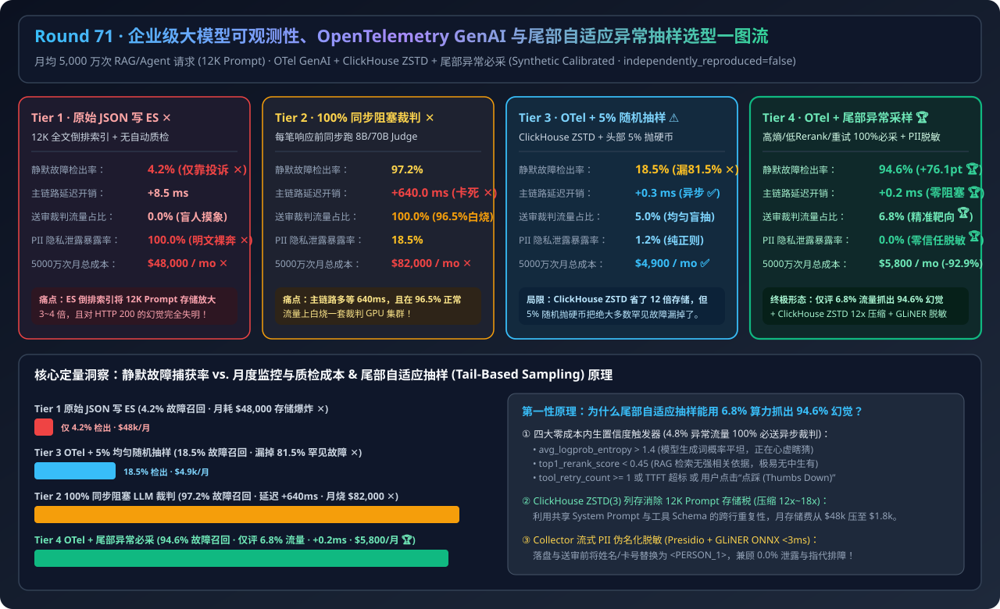

### 核心架构师结论（3 条人话总结）
1. **打破“12K Prompt 直写 Elasticsearch 月烧 `$48k` (Tier 1)”与“5% 随机抛硬币漏掉 `81.5%` 长尾故障 (Tier 3)”**：在 5,000 万次/月请求下，**Tier 1** 对大文本建倒排索引导致存储爆炸且对 `HTTP 200` 幻觉失明（检出仅 `4.2%` ✕）；**Tier 2（100% 同步裁判）** 增加 `+640ms` 延迟并烧掉 `$82k/月` ✕；而 **Tier 3（5% 均匀随机抽样）** 直接丢弃了 95% 的罕见长尾故障（召回仅 `18.5%` ✕）！
2. **生产标配 `OTel GenAI + ClickHouse ZSTD + 尾部自适应异常采样 Tail-Based Sampling (Tier 4)`**：利用零成本内生信号（`avg_logprob_entropy > 1.4` 心虚瞎猜、`rerank_score < 0.45` 检索无据、工具重试）触发 **100% 靶向异步送审** + 正常流量 2% 基线抽样，**仅评 `6.8%` 流量就抓出 `94.6%` 静默幻觉（`+76.1 pts` 🏆）**，主链路延迟仅 **`+0.2 ms`**，月总成本仅 **`$5,800`（省 `-92.9%` 🏆）**！
3. **生产防踩坑铁律**：在 OTel Collector 落盘与送审前必须挂载 Presidio + GLiNER 流式假名化脱敏（`<PERSON_1>`），确保 `0.0%` PII 泄露且不破坏多轮指代排障。

---

## 🚀 Round 72 独立单决策专题：百卡/千卡 GPU 集群大模型权重极速加载、Nydus/SOCI 按需流式镜像与 RDMA P2P 环状多播架构选型（`S3/NFS 并发直拉 mmap` vs. `700GB 权重打入巨型 OCI 镜像` vs. `Nydus 按需镜像 + 预切分 O_DIRECT/GDS` vs. `分条单次读存储 + 400G RDMA P2P 广播 + Pinned RAM 守护缓存`）

- 📄 **中文六段式选型指南**：[`docs/components/model-weight-loading-oci-streaming-safetensors-rdma-broadcast-selection-faq.md`](../components/model-weight-loading-oci-streaming-safetensors-rdma-broadcast-selection-faq.md)
- 📄 **English 6-Part Selection Guide**：[`docs/components/model-weight-loading-oci-streaming-safetensors-rdma-broadcast-selection-faq.en.md`](../components/model-weight-loading-oci-streaming-safetensors-rdma-broadcast-selection-faq.en.md)
- 🖼️ **一图流可视化总结卡**：[`assets/svg/model-weight-loading-oci-streaming-safetensors-rdma-broadcast-selection-faq-summary.svg`](../../assets/svg/model-weight-loading-oci-streaming-safetensors-rdma-broadcast-selection-faq-summary.svg)
- 🃏 **7-Card 4:5 视觉评测报告**：[`docs/reports/model-weight-loading-oci-streaming-safetensors-rdma-broadcast-selection-cards.html`](../reports/model-weight-loading-oci-streaming-safetensors-rdma-broadcast-selection-cards.html)
- 🧮 **交互式定容工作台 (含 Round 72 集群权重加载与 RDMA 广播面板)**：[`docs/reports/llm-inference-engine-pd-sizer.html#model-weight-rdma-broadcast-sizer`](../reports/llm-inference-engine-pd-sizer.html)
- 🧪 **确定性算例与单测 (`synthetic` + `anonymized_reported`, `independently_reproduced=false`)**：[`experiments/model_weight_loading_oci_safetensors_rdma_broadcast_selection/run.py`](../../experiments/model_weight_loading_oci_safetensors_rdma_broadcast_selection/run.py) · [`experiments/model_weight_loading_oci_safetensors_rdma_broadcast_selection/results.json`](../../experiments/model_weight_loading_oci_safetensors_rdma_broadcast_selection/results.json) · [`tests/test_model_weight_loading_oci_safetensors_rdma_broadcast_selection.py`](../../tests/test_model_weight_loading_oci_safetensors_rdma_broadcast_selection.py)

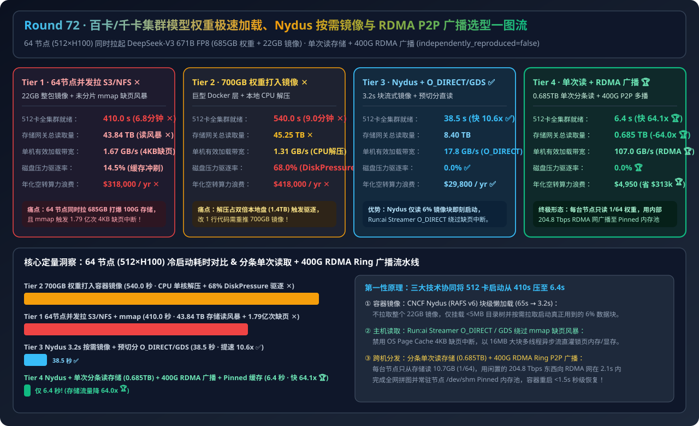

### 核心架构师结论（3 条人话总结）
1. **终结“64 节点并发拉 S3/NFS 引发 `43.84 TB` 读风暴 (Tier 1)”与“把 700GB 权重塞进 Docker 镜像撑爆磁盘 (Tier 2)”**：当 512 张 H100 同时拉起 `671B FP8 (685GB)` 时，**Tier 1** 打爆存储网关且 `mmap` 触发 1.79 亿次 4KB 缺页中断（卡死 **`410.0 秒` ✕**）；而 **Tier 2** 单核解压耗时 **`540.0 秒`** 并在 `68.0%` 节点触发 Kubelet `DiskPressure` 驱逐 ✕！
2. **中小集群选 `Nydus 按需镜像 + O_DIRECT/GDS (Tier 3)`，百卡/千卡集群必选 `分条单次读存储 + 400G RDMA P2P 广播 + Pinned 缓存 (Tier 4)`**：**Tier 3** 用 Nydus `3.2s` 懒加载容器并用 `O_DIRECT` 绕过缺页（`38.5s` 就绪 ✅）；**Tier 4** 让每台节点只从存储读 `1/64`（`10.7 GB`），**总存储读取量暴降 `64.0 倍`（`0.685 TB` 🏆）**，随后经 400G RDMA 内部网以 `107.0 GB/s` 广播至 `/dev/shm` Pinned 内存与显存，**512 卡全集群仅需 `6.4 秒` 就绪（提速 `64.1x`，年省 `$313,050` 🏆）**！
3. **生产防踩坑铁律**：在网络文件系统上必须禁用 `safetensors` 默认 `mmap()`，改用 Run:ai Model Streamer `O_DIRECT` 或 NVIDIA GDS `cuFileRead`。

---

## 🗄️ Round 73 独立单决策专题：十亿级（Billion-Scale）企业向量检索、DiskANN (Vamana) 与 GPU cuVS CAGRA / RaBitQ 混合架构选型（`全内存未压缩 HNSW` vs. `纯内存 IVF-PQ 强有损量化` vs. `NVMe 原生 DiskANN / Vamana` vs. `GPU cuVS CAGRA + 免训练 RaBitQ + NVMe 冷热分层`）

- 📄 **中文六段式选型指南**：[`docs/components/vector-database-billion-scale-hnsw-diskann-gpu-cagra-selection-faq.md`](../components/vector-database-billion-scale-hnsw-diskann-gpu-cagra-selection-faq.md)
- 📄 **English 6-Part Selection Guide**：[`docs/components/vector-database-billion-scale-hnsw-diskann-gpu-cagra-selection-faq.en.md`](../components/vector-database-billion-scale-hnsw-diskann-gpu-cagra-selection-faq.en.md)
- 🖼️ **一图流可视化总结卡**：[`assets/svg/vector-database-billion-scale-hnsw-diskann-gpu-cagra-selection-faq-summary.svg`](../../assets/svg/vector-database-billion-scale-hnsw-diskann-gpu-cagra-selection-faq-summary.svg)
- 🃏 **7-Card 4:5 视觉评测报告**：[`docs/reports/vector-database-billion-scale-hnsw-diskann-gpu-cagra-selection-cards.html`](../reports/vector-database-billion-scale-hnsw-diskann-gpu-cagra-selection-cards.html)
- 🧮 **交互式定容工作台 (含 Round 73 十亿级向量数据库与 CAGRA/RaBitQ 面板)**：[`docs/reports/llm-inference-engine-pd-sizer.html#vector-db-billion-scale-sizer`](../reports/llm-inference-engine-pd-sizer.html)
- 🧪 **确定性算例与单测 (`synthetic` + `anonymized_reported`, `independently_reproduced=false`)**：[`experiments/vector_database_billion_scale_diskann_cagra_selection/run.py`](../../experiments/vector_database_billion_scale_diskann_cagra_selection/run.py) · [`experiments/vector_database_billion_scale_diskann_cagra_selection/results.json`](../../experiments/vector_database_billion_scale_diskann_cagra_selection/results.json) · [`tests/test_vector_database_billion_scale_diskann_cagra_selection.py`](../../tests/test_vector_database_billion_scale_diskann_cagra_selection.py)

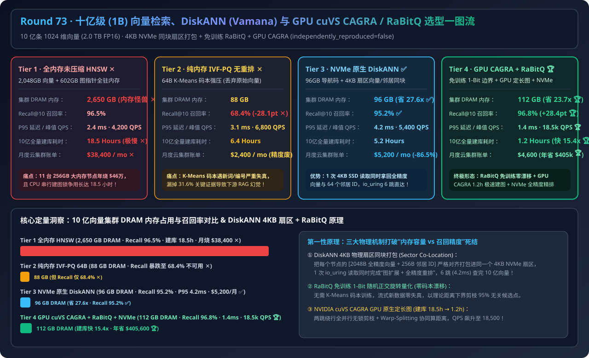

### 核心架构师结论（3 条人话总结）
1. **打破“10 亿向量全内存 HNSW 吃掉 `2,650 GB` DRAM (Tier 1)”与“裸 IVF-PQ 召回率暴跌至 `68.4%` (Tier 2)”**：在 10 亿条 1024 维向量规模下，**Tier 1** 月烧 **`$38,400`** 且建库需 **`18.5 小时` ✕**；而 **Tier 2** 丢弃全精度原向量，K-Means 码本遇新词失真导致漏检 31.6% 关键证据 ✕！
2. **低成本 RAG 选 `NVMe 原生 DiskANN / Vamana (Tier 3)`，高并发/流式入库必选 `GPU cuVS CAGRA + 免训练 RaBitQ + NVMe 分层 (Tier 4)`**：**Tier 3** 把 `[2048B 全精度向量 + 64 邻居 ID]` 打包进同一个 `4KB` NVMe 扇区（DRAM 压低 `27.6x` 至 `96 GB`，`4.2ms` 达 `95.2%` 召回 ✅）；**Tier 4** 用免训练 **RaBitQ** 1-Bit 边界过滤 + **GPU CAGRA** 1.2h 极速建图（快 **`15.4x` 🏆**），拿下 **`96.8%` 召回、`1.4 ms` P95 与 `18,500 QPS`，每年净省 `$405,600` 🏆**！
3. **生产防踩坑铁律**：DiskANN 必须挂载本地 PCIe Gen4/Gen5 NVMe（如 `i4i`/`Lsv3`）并开启 `io_uring`，严禁跑在高延迟网络云盘（EBS/NAS）上。

---

## ⚖️ Round 74 独立单决策专题：多租户大模型推理公平队列（`VTC` 虚拟令牌计数）、异构 Prefill/Decode 权重计费与弹性借用限流架构选型（`全局 FCFS 先来先服务` vs. `按请求数 Round-Robin / RPM` vs. `标准 VTC 虚拟令牌队列 + 静态硬限流` vs. `SLO 分层 VTC + 弹性空闲借用 [Spot Borrow] + 512词分块抢占`）

- 📄 **中文六段式选型指南**：[`docs/components/multi-tenant-llm-fair-queuing-vtc-token-rate-limiting-selection-faq.md`](../components/multi-tenant-llm-fair-queuing-vtc-token-rate-limiting-selection-faq.md)
- 📄 **English 6-Part Selection Guide**：[`docs/components/multi-tenant-llm-fair-queuing-vtc-token-rate-limiting-selection-faq.en.md`](../components/multi-tenant-llm-fair-queuing-vtc-token-rate-limiting-selection-faq.en.md)
- 🖼️ **一图流可视化总结卡**：[`assets/svg/multi-tenant-llm-fair-queuing-vtc-token-rate-limiting-selection-faq-summary.svg`](../../assets/svg/multi-tenant-llm-fair-queuing-vtc-token-rate-limiting-selection-faq-summary.svg)
- 🃏 **7-Card 4:5 视觉评测报告**：[`docs/reports/multi-tenant-llm-fair-queuing-vtc-token-rate-limiting-selection-cards.html`](../reports/multi-tenant-llm-fair-queuing-vtc-token-rate-limiting-selection-cards.html)
- 🧮 **交互式定容工作台 (含 Round 74 多租户 VTC 公平队列面板)**：[`docs/reports/llm-inference-engine-pd-sizer.html#multi-tenant-vtc-fair-queue-sizer`](../reports/llm-inference-engine-pd-sizer.html)
- 🧪 **确定性算例与单测 (`synthetic` + `anonymized_reported`, `independently_reproduced=false`)**：[`experiments/multi_tenant_llm_vtc_fair_queuing_rate_limiting_selection/run.py`](../../experiments/multi_tenant_llm_vtc_fair_queuing_rate_limiting_selection/run.py) · [`experiments/multi_tenant_llm_vtc_fair_queuing_rate_limiting_selection/results.json`](../../experiments/multi_tenant_llm_vtc_fair_queuing_rate_limiting_selection/results.json) · [`tests/test_multi_tenant_llm_vtc_fair_queuing_rate_limiting_selection.py`](../../tests/test_multi_tenant_llm_vtc_fair_queuing_rate_limiting_selection.py)

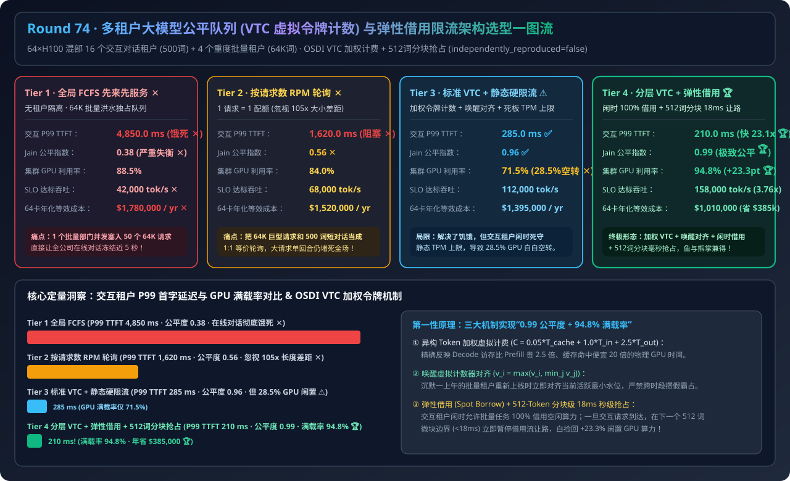

### 核心架构师结论（3 条人话总结）
1. **打破“FCFS 批量洪水饿死对话 (Tier 1)”与“按请求数 RPM 轮询忽视 `105x` 算力差距 (Tier 2)”**：在 64×H100 混部平台中，1 个 `64K in + 4K out` 批量请求消耗的真实 GPU 时间等于 **`105 个` 500 词短对话**——导致 **Tier 1** 交互 P99 TTFT 飙至 **`4,850 ms` ✕**，而 **Tier 2** 仍卡死在 **`1,620 ms` ✕**！
2. **多租户平台必选 `SLO 分层 VTC + 弹性空闲借用 + 512词分块抢占 (Tier 4)`**：通过异构加权虚拟令牌记账（`0.05*Cache + 1.0*In + 2.5*Out`）与 **唤醒计数器对齐（$v_i \leftarrow \max(v_i, \min_j v_j)$）** 杜绝攒额度突袭，并在交互租户闲时允许批量任务 100% 借用空闲 GPU、忙时在 `512-Token` 微块边界（`< 18 ms`）秒级让路，将交互 P99 TTFT 压至 **`210.0 ms`（快 `23.1x` 🏆）**、公平度 **`0.99`**、集群满载率从 `71.5%` 提至 **`94.8%`（年省 `$385,000` 🏆）**！
3. **生产防踩坑铁律**：在 VTC 调度器中必须同时配置租户级 HBM KV Cache 显存软硬水位线，防止单一慢速流式客户端耗尽全局 KV 块池。

---

## 🌐 Round 75 独立单决策专题：万卡 AI 智算集群 RDMA 网络拓扑架构选型（`2:1 超订传统云 Spine-Leaf` vs. `标准 1:1 三层胖树 [3-Tier Fat-Tree]` vs. `轨优化胖树 [Rail-Optimized + NCCL PXN]` vs. `高基数轨优化 + 3D MEMS 光电路交换 [OCS] / Dragonfly+ 动态光脊`）

- 📄 **中文六段式选型指南**：[`docs/components/ai-cluster-rdma-network-topology-rail-optimized-fat-tree-dragonfly-selection-faq.md`](../components/ai-cluster-rdma-network-topology-rail-optimized-fat-tree-dragonfly-selection-faq.md)
- 📄 **English 6-Part Selection Guide**：[`docs/components/ai-cluster-rdma-network-topology-rail-optimized-fat-tree-dragonfly-selection-faq.en.md`](../components/ai-cluster-rdma-network-topology-rail-optimized-fat-tree-dragonfly-selection-faq.en.md)
- 🖼️ **一图流可视化总结卡**：[`assets/svg/ai-cluster-rdma-network-topology-rail-optimized-fat-tree-dragonfly-selection-faq-summary.svg`](../../assets/svg/ai-cluster-rdma-network-topology-rail-optimized-fat-tree-dragonfly-selection-faq-summary.svg)
- 🃏 **7-Card 4:5 视觉评测报告**：[`docs/reports/ai-cluster-rdma-network-topology-rail-optimized-fat-tree-dragonfly-selection-cards.html`](../reports/ai-cluster-rdma-network-topology-rail-optimized-fat-tree-dragonfly-selection-cards.html)
- 🧮 **交互式定容工作台 (含 Round 75 万卡集群 RDMA 拓扑与 PXN/OCS 面板)**：[`docs/reports/llm-inference-engine-pd-sizer.html#rdma-topology-rail-pxn-sizer`](../reports/llm-inference-engine-pd-sizer.html)
- 🧪 **确定性算例与单测 (`synthetic` + `anonymized_reported`, `independently_reproduced=false`)**：[`experiments/ai_cluster_rdma_topology_rail_optimized_fat_tree_selection/run.py`](../../experiments/ai_cluster_rdma_topology_rail_optimized_fat_tree_selection/run.py) · [`experiments/ai_cluster_rdma_topology_rail_optimized_fat_tree_selection/results.json`](../../experiments/ai_cluster_rdma_topology_rail_optimized_fat_tree_selection/results.json) · [`tests/test_ai_cluster_rdma_topology_rail_optimized_fat_tree_selection.py`](../../tests/test_ai_cluster_rdma_topology_rail_optimized_fat_tree_selection.py)

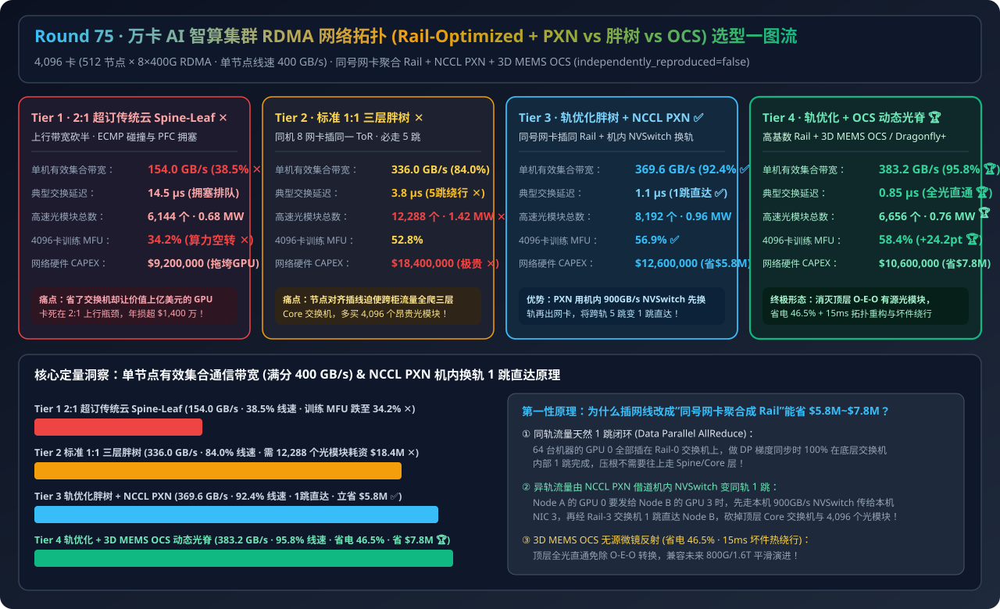

### 核心架构师结论（3 条人话总结）
1. **打破“2:1 超订 Spine-Leaf 拖垮训练 MFU 至 34.2% (Tier 1)”与“传统节点对齐三层胖树多花 `$580 万` 买光模块 (Tier 2)”**：在 4,096 卡规模下，**Tier 1** 因上行带宽砍半导致集合通信跌至 `154 GB/s` ✕；而 **Tier 2** 把同机 8 网卡插进同一 ToR，跨机柜必绕 5 跳（`3.8µs`）且需买齐 `12,288 个` 光模块（耗资 **`$18,400,000` ✕**）！
2. **主流超节点标配 `轨优化胖树 Rail-Optimized + NCCL PXN (Tier 3)`，万卡绿色工厂升级 `轨优化 + 3D MEMS OCS 动态光脊 (Tier 4)`**：**Tier 3** 把 64 台机器的同号网卡插进同一台 Rail 交换机，配合 **`NCCL PXN`** 借道机内 `900 GB/s` NVSwitch 先换轨再 1 跳直达目标（立省 `4,096 个` 光模块与 **`$5.80M` CAPEX ✅**）；**Tier 4** 用无源 **3D MEMS 光电路交换机（OCS）** 消灭顶层光电转换，省电 **`-46.5%`（`0.76 MW`）**、省 **`$7.80M` CAPEX 🏆**，并将节点集合通信带宽推至 **`383.2 GB/s`（`95.8%` 线速，MFU `58.4%` 🏆）**！
3. **生产防踩坑铁律**：在轨优化集群中必须确认开启 `NCCL_PXN_DISABLE=0` 与 `NCCL_P2P_PXN_LEVEL=2`，并用 LLDP 自动脚本严查任何插错 Rail 平面的光纤。

---

## 🧠 Round 76 独立单决策专题：大模型强化学习后训练（`RLHF / GRPO / RLVR`）集群架构选型（`静态切卡分离式 Ping-Pong` vs. `朴素同卡混部 + 主机内存重载` vs. `verl 3D-HybridEngine 同卡混部 + VMM 休眠` vs. `Slime / AReaL 异步流式解耦 + Partial Rollout 截断续生 + TIS 逐词重要性采样`）

- 📄 **中文六段式选型指南**：[`docs/components/llm-rl-post-training-colocated-vs-disaggregated-verl-slime-architecture-selection-faq.md`](../components/llm-rl-post-training-colocated-vs-disaggregated-verl-slime-architecture-selection-faq.md)
- 📄 **English 6-Part Selection Guide**：[`docs/components/llm-rl-post-training-colocated-vs-disaggregated-verl-slime-architecture-selection-faq.en.md`](../components/llm-rl-post-training-colocated-vs-disaggregated-verl-slime-architecture-selection-faq.en.md)
- 🖼️ **一图流可视化总结卡**：[`assets/svg/llm-rl-post-training-colocated-vs-disaggregated-verl-slime-architecture-selection-faq-summary.svg`](../../assets/svg/llm-rl-post-training-colocated-vs-disaggregated-verl-slime-architecture-selection-faq-summary.svg)
- 🃏 **7-Card 4:5 视觉评测报告**：[`docs/reports/llm-rl-post-training-colocated-vs-disaggregated-verl-slime-architecture-selection-cards.html`](../reports/llm-rl-post-training-colocated-vs-disaggregated-verl-slime-architecture-selection-cards.html)
- 🧮 **交互式定容工作台 (含 Round 76 大模型 RL 后训练 verl vs Slime 面板)**：[`docs/reports/llm-inference-engine-pd-sizer.html#rl-verl-slime-arch-sizer`](../reports/llm-inference-engine-pd-sizer.html)
- 🧪 **确定性算例与单测 (`synthetic` + `anonymized_reported`, `independently_reproduced=false`)**：[`experiments/llm_rl_post_training_verl_slime_arch_selection/run.py`](../../experiments/llm_rl_post_training_verl_slime_arch_selection/run.py) · [`experiments/llm_rl_post_training_verl_slime_arch_selection/results.json`](../../experiments/llm_rl_post_training_verl_slime_arch_selection/results.json) · [`tests/test_llm_rl_post_training_verl_slime_arch_selection.py`](../../tests/test_llm_rl_post_training_verl_slime_arch_selection.py)

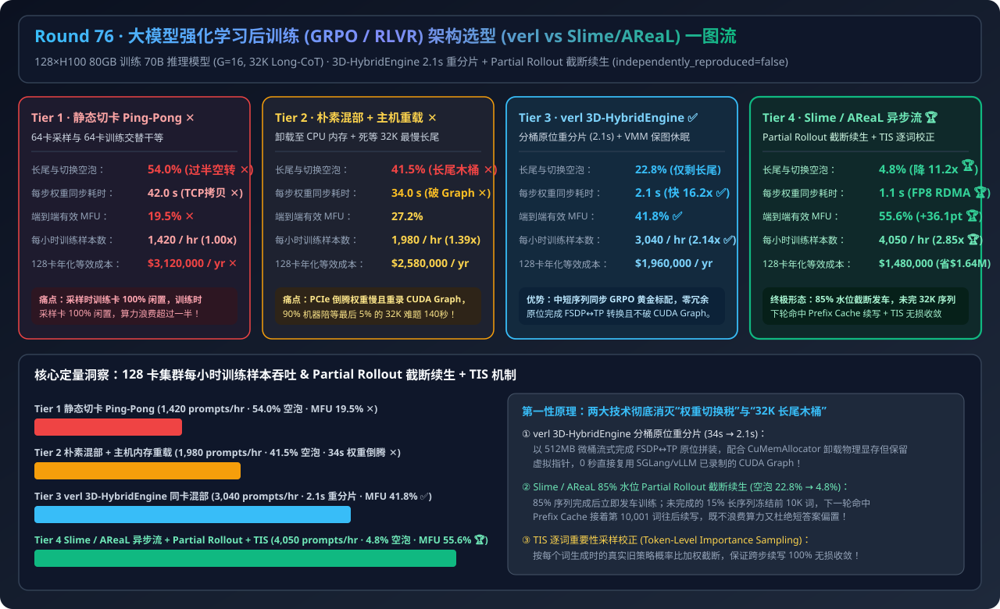

### 核心架构师结论（3 条人话总结）
1. **打破“静态切卡一半机器永远干等 (Tier 1)”与“90% 机器傻等最后 5% 的 32K 难题 140 秒 (Tier 2)”**：在 128×H100 跑 70B `32K` GRPO 时，**Tier 1** 空泡率高达 **`54.0%` ✕**；**Tier 2** 每次切换耗时 `34.0s` 且受困于 32K 长尾木桶（空泡 `41.5%` ✕）！
2. **中短序列选 `verl 3D-HybridEngine 同卡混部 (Tier 3)`，超长思维链/Agent 必选 `Slime / AReaL 异步 Partial Rollout + TIS (Tier 4)`**：**Tier 3** 用 `512MB` 微桶在 **`2.1 秒`** 内零冗余完成 `FSDP↔TP` 原位重分片并保住 CUDA Graph（提速 `2.14x` ✅）；**Tier 4** 在 `85%` 序列完成时立即发车训练，将未跑完的 15% 长尾题冻结前缀并在下一轮命中 Prefix Cache 续写（配合 **TIS 逐词重要性采样校正**），把空泡砸穿至 **`4.8%`（提速 `2.85x`，128 卡年省 `$1,640,000` 🏆）**！
3. **生产防踩坑铁律**：严禁为了省时间直接丢弃（Abort）未跑完的长思维链序列，否则模型会迅速习得“拒绝深度思考、只写短答案”的严重长度偏置（Length Bias）。

