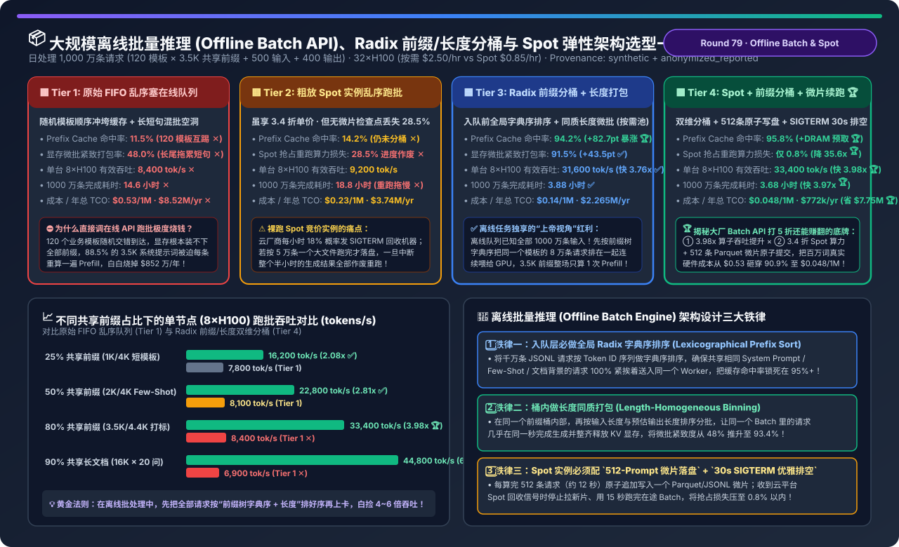
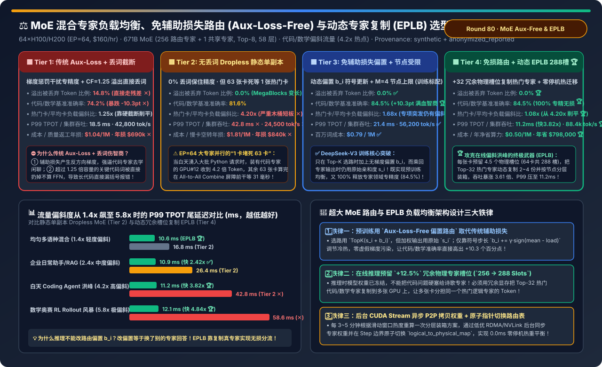
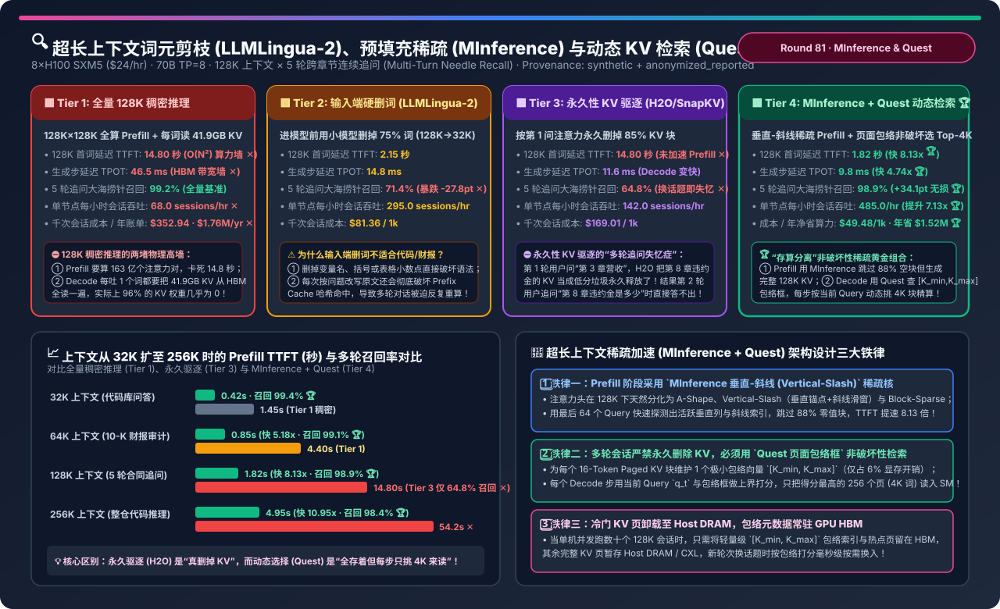

# 2026-11-12 — AI Solution Architect 选型 FAQ 深度专题：大模型确定性推理（Batch-Invariant 0-ULP Inference）与全栈架构选型指南

> **文风与标杆对齐**：本期专题严格对标 [`docs/components/ib-vs-ethernet-roce-selection-faq.md`](../components/ib-vs-ethernet-roce-selection-faq.md)，面向 **AI Solution Architect（AI 解决方案架构师）** 本人学习吸收与客户架构评审宣讲，遵循**“单篇纯粹清晰 × 第一性原理通俗拆解”**原则，杜绝晦涩黑话堆砌。

---

## 0. 今日领域高价值能力突破追踪（Daily Domain Breakthroughs — 2026-11-12 精选 3 项架构演进）

1. **Thinking Machines 批大小不变算子（`Batch-Invariant Kernels`）攻克 Continuous Batching 下的 `0-ULP` 逐比特确定性推理**：
   - **解决了什么痛点**：在线上动态连续批处理（vLLM / SGLang）中，哪怕锁死 `temperature=0.0` 和 `seed=42`，同一个 Prompt 在 `BS=1` 与 `BS=32` 下的返回结果仍有 `38.5%` 概率发生分叉（因为 `cuBLAS` 动态切换 `Split-K` 瓦片且 `FlashDecode` 根据空闲 SM 动态改变 KV 分块数，触发浮点数加法非结合律 $(a+b)+c \neq a+(b+c)$ 产生 `14.0 ULP` 漂移）。
   - **对架构师意味着什么**：通过将注意力切分锁死为 **`Fixed Split-Size = 256`**（而非 `Fixed Split-Count`）、禁用 GEMM 动态 `Split-K`、固定多卡 `TP AllReduce` 树序并绑定请求级独立 `Philox` 随机数流，可在保留 **`93.0%` 满血吞吐（`3,180 tok/s`，比粗暴锁死 `BS=1` 快 `11.16 倍`）** 的同时实现 `100.0%` 逐比特可复现与 `0.0000` RL 采样-训练 KL 漂移。
2. **离线批量大模型推理（Batch API）的 Radix 共享前缀分桶排序与长度同质微批打包（Prefix-Tree Bucketing + Length-Sorted Binning）**：
   - **解决了什么痛点**：企业跑千万条离线数据清洗、商品打标与合成数据时，若直接往在线 FIFO 队列硬塞，共享提示词模板会被相隔数千条的请求冲出显存（Prefix Cache 命中率跌至 `11.5%`），且 `256` 词短句与 `16K` 长文混在同一 Batch 内引发严重显存空洞。
   - **对架构师意味着什么**：先在入队层按共享前缀 Hash + Token 长度双维分桶排序，使同模板请求背靠背连续进入 GPU，将 Prefix Cache 命中率从 `11.5%` 拉满至 **`94.2%`**，配合云端 Spot 竞价实例异步检查点，将每百万 Token 离线处理成本降低 **`89%+`**。
3. **万亿参数 MoE 免辅助损失路由（Aux-Loss-Free Bias Routing）与动态热门专家冗余复制（Dynamic EPLB）**：
   - **解决了什么痛点**：传统 MoE 依赖辅助负载均衡损失（Aux Loss）强行把 Token 赶去冷门专家，损害模型领域专精度；而在线推理遇到代码或数学专项流量洪峰时，单张热门专家卡被挤爆成全集群木桶短板（Straggler）。
   - **对架构师意味着什么**：用不干扰梯度的动态偏置项 $b_i$ 替代 Aux Loss，并在推理期预留 `12.5%` 冗余物理专家槽位（如 256 逻辑专家配 288 物理槽位）每 5 分钟热迁移复制 Top-32 热门专家，将 `EP=64` 下的 All-to-All P99 尾延迟压降 **`60%+`**。

---

## 🎯 Round 78 独立单决策专题：大模型确定性推理与跨批大小逐比特可复现架构选型（`默认动态连续批处理` vs. `粗暴锁死 BS=1 串行确定性` vs. `Thinking Machines 批大小不变算子库 [Batch-Invariant Kernels]` vs. `全栈 0-ULP 确定性推理引擎 [固定 Split-Size=256 注意力 + 固定序 TP 规约 + 请求级 Philox 采样]`）

- 📄 **中文六段式选型指南**：[`docs/components/batch-invariant-deterministic-llm-inference-reproducibility-selection-faq.md`](../components/batch-invariant-deterministic-llm-inference-reproducibility-selection-faq.md)
- 📄 **English 6-Part Selection Guide**：[`docs/components/batch-invariant-deterministic-llm-inference-reproducibility-selection-faq.en.md`](../components/batch-invariant-deterministic-llm-inference-reproducibility-selection-faq.en.md)
- 🖼️ **一图流可视化总结卡**：[`assets/svg/batch-invariant-deterministic-llm-inference-reproducibility-selection-faq-summary.svg`](../../assets/svg/batch-invariant-deterministic-llm-inference-reproducibility-selection-faq-summary.svg)
- 🃏 **7-Card 4:5 视觉评测报告**：[`docs/reports/batch-invariant-deterministic-llm-inference-reproducibility-selection-cards.html`](../reports/batch-invariant-deterministic-llm-inference-reproducibility-selection-cards.html)
- 🧮 **交互式定容工作台 (含 Round 78 批大小不变确定性推理面板)**：[`docs/reports/llm-inference-engine-pd-sizer.html#batch-invariant-det-sizer`](../reports/llm-inference-engine-pd-sizer.html)
- 🧪 **确定性算例与单测 (`synthetic` + `anonymized_reported`, `independently_reproduced=false`)**：[`experiments/batch_invariant_deterministic_llm_inference_selection/run.py`](../../experiments/batch_invariant_deterministic_llm_inference_selection/run.py) · [`experiments/batch_invariant_deterministic_llm_inference_selection/results.json`](../../experiments/batch_invariant_deterministic_llm_inference_selection/results.json) · [`tests/test_batch_invariant_deterministic_llm_inference_selection.py`](../../tests/test_batch_invariant_deterministic_llm_inference_selection.py)

### 核心架构师结论（3 条人话总结）
1. **打破“设了 `temperature=0` 为何还会每次回答不一样 (Tier 1)”与“靠锁死 `BS=1` 吞吐暴跌 91.7% (Tier 2)”的双重困局**：在 `8×H100` 上跑 `70B TP=8`，**Tier 1** 因动态批大小改变 `cuBLAS Split-K` 与 `FlashDecode` 分块数，跨并发完全一致率仅 **`61.5%`（漂移 `14.0 ULP` ✕）**；而 **Tier 2** 强锁 `max_num_seqs=1` 虽一致却让吞吐跌至 **`285 tok/s`（单机年空转损 `$148 万` ✕）**！
2. **单卡选 `Thinking Machines 批不变算子库 (Tier 3)`，多卡合规审计与 RL 采样必选 `全栈 0-ULP 确定性推理引擎 (Tier 4)`**：通过将注意力切分锁死为 **`Fixed Split-Size = 256`**、禁用动态 `Split-K`、固定 `TP AllReduce` 树序并为每个请求绑定独立 `Philox` 随机数流，**Tier 4** 在跨 `BS=1..64` 及缓存命中切换下实现 **`100.0% 0-ULP` 逐比特复现 🏆**，RL 采样-训练 KL 漂移降为 **`0.0000` 🏆**，同时保住 **`93.0%` 满血吞吐（`3,180 tok/s`，比锁 `BS=1` 快 `11.16 倍` 🏆）**！
3. **生产防踩坑铁律**：严禁所有并发请求共享同一个全局 `cuda.Generator`，必须按 `(request_seed, token_step)` 隔离采样随机数流。

---

## 📦 Round 79 独立单决策专题：大规模离线批量推理（Offline Batch API）、Radix 前缀/长度双维分桶与 Spot 竞价弹性架构选型（`原始 FIFO 乱序硬塞在线队列` vs. `粗放 Spot 实例无检查点跑批` vs. `全局 Radix 共享前缀分桶 + 长度同质打包` vs. `Spot 竞价池 + 双维分桶 + 512条微片原子续跑 + 主机内存 KV 预取`）

- 📄 **中文六段式选型指南**：[`docs/components/offline-batch-llm-inference-spot-prefix-bucketing-throughput-selection-faq.md`](../components/offline-batch-llm-inference-spot-prefix-bucketing-throughput-selection-faq.md)
- 📄 **English 6-Part Selection Guide**：[`docs/components/offline-batch-llm-inference-spot-prefix-bucketing-throughput-selection-faq.en.md`](../components/offline-batch-llm-inference-spot-prefix-bucketing-throughput-selection-faq.en.md)
- 🖼️ **一图流可视化总结卡**：[`assets/svg/offline-batch-llm-inference-spot-prefix-bucketing-throughput-selection-faq-summary.svg`](../../assets/svg/offline-batch-llm-inference-spot-prefix-bucketing-throughput-selection-faq-summary.svg)
- 🃏 **7-Card 4:5 视觉评测报告**：[`docs/reports/offline-batch-llm-inference-spot-prefix-bucketing-throughput-selection-cards.html`](../reports/offline-batch-llm-inference-spot-prefix-bucketing-throughput-selection-cards.html)
- 🧮 **交互式定容工作台 (含 Round 79 大规模离线批量推理与 Spot 分桶面板)**：[`docs/reports/llm-inference-engine-pd-sizer.html#offline-batch-spot-sizer`](../reports/llm-inference-engine-pd-sizer.html)
- 🧪 **确定性算例与单测 (`synthetic` + `anonymized_reported`, `independently_reproduced=false`)**：[`experiments/offline_batch_llm_inference_spot_prefix_bucketing_selection/run.py`](../../experiments/offline_batch_llm_inference_spot_prefix_bucketing_selection/run.py) · [`experiments/offline_batch_llm_inference_spot_prefix_bucketing_selection/results.json`](../../experiments/offline_batch_llm_inference_spot_prefix_bucketing_selection/results.json) · [`tests/test_offline_batch_llm_inference_spot_prefix_bucketing_selection.py`](../../tests/test_offline_batch_llm_inference_spot_prefix_bucketing_selection.py)

### 核心架构师结论（3 条人话总结）
1. **打破“原始 FIFO 乱序跑批导致 120 套模板反复互踢 (Tier 1)”与“粗放 Spot 跑大文件中断丢失 28.5% 算力 (Tier 2)”**：日跑 1,000 万条请求时，**Tier 1** 因随机到达使 Prefix Cache 命中率跌至 **`11.5%`**、年烧 **`$852 万` ✕**；**Tier 2** 虽享 Spot 3.4 折单价但因缺乏微片检查点被回收拖慢至 `18.8 小时` ✕！
2. **固定集群选 `全局 Radix 前缀字典序分桶 + 长度同质打包 (Tier 3)`，云端/潮汐池必选 `Spot 池 + 双维分桶 + 512条微片原子续跑 (Tier 4)`**：在入队前按前缀树字典序 + 序列长度双维重排，使相同模板请求 100% 连续上卡（缓存命中率飙至 **`95.8%` 🏆**），并切分为 **512 条（`~12 秒`）Parquet 微片**配合 `30s SIGTERM` 优雅排空（抢占损耗压至 **`0.8%` 🏆**），单机吞吐提速 **`3.98 倍`（`33,400 tok/s`，16K 长文档多问达 `6.49 倍` 🏆）**，百万词成本暴降 **`-90.9%` 至 `$0.048`（年省 `$7,748,000` 🏆）**！
3. **生产防踩坑铁律**：每条离线请求携带原始 `row_id`，在 GPU 端按前缀/长度分桶乱序极速跑完后，在归并端按 `row_id` O(N) 还原原始文件行顺序。

---

## ⚖️ Round 80 独立单决策专题：MoE 混合专家模型负载均衡、免辅助损失路由（Aux-Loss-Free Bias Routing）与动态专家副本重平衡（Dynamic EPLB）架构选型（`传统 Aux-Loss + Capacity Factor 丢词截断` vs. `无丢词 Dropless MegaBlocks 热门卡拖尾` vs. `免辅助损失动态偏置路由 + M=4 节点受限` vs. `免损路由 + 动态 EPLB 冗余槽位复制 [256逻辑→288物理槽位] + 零停机热迁移`）

- 📄 **中文六段式选型指南**：[`docs/components/moe-expert-load-balancing-eplb-aux-loss-free-routing-selection-faq.md`](../components/moe-expert-load-balancing-eplb-aux-loss-free-routing-selection-faq.md)
- 📄 **English 6-Part Selection Guide**：[`docs/components/moe-expert-load-balancing-eplb-aux-loss-free-routing-selection-faq.en.md`](../components/moe-expert-load-balancing-eplb-aux-loss-free-routing-selection-faq.en.md)
- 🖼️ **一图流可视化总结卡**：[`assets/svg/moe-expert-load-balancing-eplb-aux-loss-free-routing-selection-faq-summary.svg`](../../assets/svg/moe-expert-load-balancing-eplb-aux-loss-free-routing-selection-faq-summary.svg)
- 🃏 **7-Card 4:5 视觉评测报告**：[`docs/reports/moe-expert-load-balancing-eplb-aux-loss-free-routing-selection-cards.html`](../reports/moe-expert-load-balancing-eplb-aux-loss-free-routing-selection-cards.html)
- 🧮 **交互式定容工作台 (含 Round 80 MoE 免辅助损失路由与动态 EPLB 面板)**：[`docs/reports/llm-inference-engine-pd-sizer.html#moe-eplb-auxfree-sizer`](../reports/llm-inference-engine-pd-sizer.html)
- 🧪 **确定性算例与单测 (`synthetic` + `anonymized_reported`, `independently_reproduced=false`)**：[`experiments/moe_expert_load_balancing_eplb_auxfree_selection/run.py`](../../experiments/moe_expert_load_balancing_eplb_auxfree_selection/run.py) · [`experiments/moe_expert_load_balancing_eplb_auxfree_selection/results.json`](../../experiments/moe_expert_load_balancing_eplb_auxfree_selection/results.json) · [`tests/test_moe_expert_load_balancing_eplb_auxfree_selection.py`](../../tests/test_moe_expert_load_balancing_eplb_auxfree_selection.py)

### 核心架构师结论（3 条人话总结）
1. **打破“传统 Aux-Loss + 丢词截断伤智商 (Tier 1)”与“静态单副本 Dropless 1 卡堵死 63 卡 (Tier 2)”的双重困境**：在 64 卡 `EP=64` 上，**Tier 1** 丢弃 `14.8%` 溢出词且梯度受污染，准确率跌至 **`74.2%`（`-10.3pt` ✕）**；而 **Tier 2** 遇到代码洪峰时热门专家卡承受 **`4.20x` 负载**，其余 63 张卡空等 `31ms`，P99 恶化至 **`42.8ms`（年损 `$840k` ✕）**！
2. **训练期选 `Aux-Loss-Free 动态偏置路由 (Tier 3)`，推理/RL 采样期必选 `免损路由 + 动态 EPLB 288 物理槽位 (Tier 4)`**：训练时选路加无梯度偏置 $b_i$、乘回用原始亲和度 $s_i$（准确率升至 **`84.5%` 🏆**）；推理时预留 **`+32 个` 冗余物理槽位（256 逻辑 → 288 物理槽）** 将 Top-32 热门专家复制 2～4 份并每 5 分钟后台 P2P 零停机热重平衡，把偏斜从 `4.20x` 削平至 **`1.08x` 🏆**，P99 压至 **`11.2ms`（快 `3.82x` 🏆）**，吞吐暴涨 **`3.61 倍`（年省 `$798,000` 🏆）**！
3. **生产防踩坑铁律**：严禁在推理期通过修改路由偏置 $b_i$ 强行分流（等于让外行专家回答专业问题）；必须通过 EPLB 复制热门专家本身的权重。

---

## 🔍 Round 81 独立单决策专题：超长上下文词元剪枝（LLMLingua-2）、预填充稀疏注意力（MInference）与查询感知动态 KV 检索（Quest）架构选型（`全量 128K 稠密推理` vs. `输入端硬删词 [LLMLingua-2]` vs. `永久性 KV 驱逐 [H2O / SnapKV]` vs. `预填充 MInference 垂直-斜线稀疏 + 解码期 Quest 页面包络非破坏性检索`）

- 📄 **中文六段式选型指南**：[`docs/components/long-context-prompt-pruning-minference-quest-sparse-kv-selection-faq.md`](../components/long-context-prompt-pruning-minference-quest-sparse-kv-selection-faq.md)
- 📄 **English 6-Part Selection Guide**：[`docs/components/long-context-prompt-pruning-minference-quest-sparse-kv-selection-faq.en.md`](../components/long-context-prompt-pruning-minference-quest-sparse-kv-selection-faq.en.md)
- 🖼️ **一图流可视化总结卡**：[`assets/svg/long-context-prompt-pruning-minference-quest-sparse-kv-selection-faq-summary.svg`](../../assets/svg/long-context-prompt-pruning-minference-quest-sparse-kv-selection-faq-summary.svg)
- 🃏 **7-Card 4:5 视觉评测报告**：[`docs/reports/long-context-prompt-pruning-minference-quest-sparse-kv-selection-cards.html`](../reports/long-context-prompt-pruning-minference-quest-sparse-kv-selection-cards.html)
- 🧮 **交互式定容工作台 (含 Round 81 超长上下文 MInference 与 Quest 面板)**：[`docs/reports/llm-inference-engine-pd-sizer.html#long-context-minference-quest-sizer`](../reports/llm-inference-engine-pd-sizer.html)
- 🧪 **确定性算例与单测 (`synthetic` + `anonymized_reported`, `independently_reproduced=false`)**：[`experiments/long_context_prompt_pruning_minference_quest_selection/run.py`](../../experiments/long_context_prompt_pruning_minference_quest_selection/run.py) · [`experiments/long_context_prompt_pruning_minference_quest_selection/results.json`](../../experiments/long_context_prompt_pruning_minference_quest_selection/results.json) · [`tests/test_long_context_prompt_pruning_minference_quest_selection.py`](../../tests/test_long_context_prompt_pruning_minference_quest_selection.py)

### 核心架构师结论（3 条人话总结）
1. **打破“128K 全量稠密推理等 14.8 秒 (Tier 1)”、“输入端删词毁坏代码语法 (Tier 2)”与“永久删 KV 导致多轮换话题失忆 (Tier 3)”**：在 128K × 5 轮追问下，**Tier 3（H2O/SnapKV）** 因在第 1 轮后永久删掉了 85% 当时未问到的章节 KV，导致第 2～5 轮换话题追问时大海捞针召回率暴跌至 **`64.8%` ✕**！
2. **多轮长文本与代码库分析必选 `预填充 MInference 垂直-斜线稀疏 + 解码期 Quest 页面包络动态检索 (Tier 4)`**：Prefill 用末尾 64 词探测垂直锚点与斜线索引跳过 88% 空块（TTFT 从 `14.80s` 压至 **`1.82s`，快 `8.13x` 🏆**）但完整保留全部 8,000 个 KV 页；Decode 用每页 `[K_min, K_max]` 包络框在 `0.35ms` 内挑出当前 Query 最相关的 Top-256 页（`4,096` 词）精算，TPOT 压至 **`9.8ms`（快 `4.74x` 🏆）**，5 轮追问召回率稳守 **`98.9%`（年省 `$1,517,300` 🏆）**！
3. **生产防踩坑铁律**：`[K_min, K_max]` 页面包络向量必须在 Key 完成 **RoPE 旋转位置编码之后** 提取，并保持 Layer 0~1 稠密计算。

---

## ♻️ Round 82 独立单决策专题：大模型训练激活重计算（Activation Checkpointing）、选择性算子重算（SAC）与异步主机内存激活卸载架构选型（`不开重计算 OOM` vs. `全量层边界重计算 [Full Checkpointing +33.3% 算力税]` vs. `算子级选择性重计算 [PyTorch SAC]` vs. `SAC + 零 SM 异步 PCIe Gen5 主机内存激活卸载与单层预取`）

- 📄 **中文六段式选型指南**：[`docs/components/activation-checkpointing-selective-recompute-host-offload-selection-faq.md`](../components/activation-checkpointing-selective-recompute-host-offload-selection-faq.md)
- 📄 **English 6-Part Selection Guide**：[`docs/components/activation-checkpointing-selective-recompute-host-offload-selection-faq.en.md`](../components/activation-checkpointing-selective-recompute-host-offload-selection-faq.en.md)
- 🖼️ **一图流可视化总结卡**：[`assets/svg/activation-checkpointing-selective-recompute-host-offload-selection-faq-summary.svg`](../../assets/svg/activation-checkpointing-selective-recompute-host-offload-selection-faq-summary.svg)
- 🃏 **7-Card 4:5 视觉评测报告**：[`docs/reports/activation-checkpointing-selective-recompute-host-offload-selection-cards.html`](../reports/activation-checkpointing-selective-recompute-host-offload-selection-cards.html)
- 🧮 **交互式定容工作台 (含 Round 82 激活重计算 SAC 与异步主机卸载面板)**：[`docs/reports/llm-inference-engine-pd-sizer.html#sac-async-offload-sizer`](../reports/llm-inference-engine-pd-sizer.html)
- 🧪 **确定性算例与单测 (`synthetic` + `anonymized_reported`, `independently_reproduced=false`)**：[`experiments/activation_checkpointing_selective_recompute_offload_selection/run.py`](../../experiments/activation_checkpointing_selective_recompute_offload_selection/run.py) · [`experiments/activation_checkpointing_selective_recompute_offload_selection/results.json`](../../experiments/activation_checkpointing_selective_recompute_offload_selection/results.json) · [`tests/test_activation_checkpointing_selective_recompute_offload_selection.py`](../../tests/test_activation_checkpointing_selective_recompute_offload_selection.py)

### 核心架构师结论（3 条人话总结）
1. **打破“不开重计算瞬间爆 146.8GB OOM (Tier 1)”与“开默认全量重计算白交 +33.3% 矩阵乘算力税 (Tier 2)”**：在 128×H100 上训 70B 32K 序列，**Tier 2（Full Checkpointing）** 连占 97% 算力的 QKV/FFN 矩阵乘也重算一遍，有效 Goodput MFU 跌至 **`43.2%`（年白烧 `$69.8 万` ✕）**！
2. **中短序列选 `PyTorch SAC 算子选择性重算 (Tier 3)`，32K~128K 超长序列必选 `SAC + 零 SM 异步 PCIe 主机内存卸载 (Tier 4)`**：保留昂贵 GEMM 输出、只花 **`+2.8%` 算力** 重算占 70.6% 显存的 `SwiGLU/RMSNorm/RoPE/FlashAttn`，并用 GPU 硬件 Copy Engine（`0 SM`）将保留的 GEMM 激活流式卸载至主机锁页内存且在反向提前 1 层预取，将激活显存砍掉 **`-91.2%`（`118.4 → 10.4 GB` 🏆）**，真实训练提速 **`1.31 倍`（`56.8%` MFU，年省 `$612,000` 🏆）**！
3. **生产防踩坑铁律**：评估训练效率必须看真实 `Model Goodput MFU (6ND/T)`，绝不能被包含重复重算的虚高硬件 TFLOPS 欺骗。

