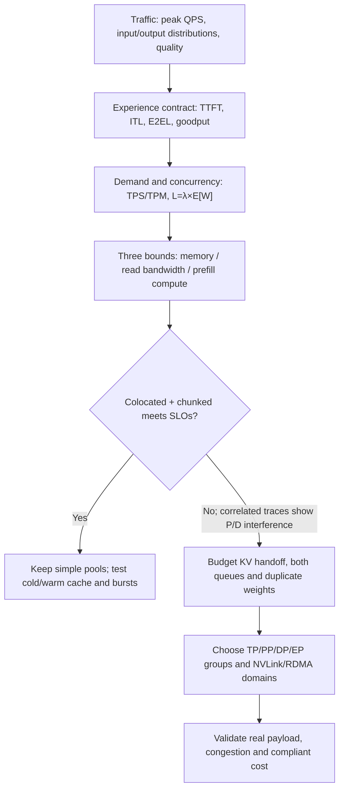

# Inference Performance, AI Fabric and Capacity: Architect FAQ

**Language**: [简体中文](faq.md) | English · [H5 academy](../h5-academy/index.html?lang=en) · [Course index](README.en.md)

> **Evidence contract**: An enterprise Cloud & AI Solution Architect learning guide, not a hardware benchmark. Worked examples and scenario targets are `synthetic` teaching assumptions. Official specifications and implementation sources are in the [source catalog](../h5-academy/sources.json), reviewed 2026-11-21. No independently reproduced hardware performance is promised.

## Executive Summary: experience, capacity, then partitioning and fabric

1. **User side**: measure first-token wait, stream smoothness, completion time and quality. **Machine side**: size compliant goodput, not unconstrained peak TPS.
2. **Business side**: derive demand from peak QPS and input/output token distributions. Little's Law requires mean residence, not P99 in an exact equation.
3. **GPU side**: separately satisfy memory, decode-read bandwidth and prefill-compute bounds. A 671B MoE's 37B active count cannot replace loaded weights.
4. **Architecture side**: validate colocated + chunked prefill before PD's net benefit. No universal “PD is mandatory above 16 GPUs” threshold.
5. **Fabric side**: normalize GB/GiB, Gb/s/GB/s, direction, one-port/aggregate and NCCL size definitions before diagnosing bottlenecks.



## Chapter 1: user-facing AI metrics

### Q1. How do TTFT, TPOT/ITL and E2EL differ?

TTFT runs from request submission to first visible token, including client/gateway, queue, prefill, first-token compute and delivery. Name server-side and end-to-end TTFT separately.

For `N` output tokens:

```text
TPOT = (last-token time − first-token time)/(N−1)
ITL_i = token_i time − token_(i−1) time
E2EL = TTFT + (N−1)×TPOT
```

TPOT is a request's mean subsequent interval; P99 ITL reveals transient stalls. For a one-token output, TPOT is **N/A**, not zero. A network chunk may hold several tokens; do not substitute chunk count for tokenizer token count.

Collection conventions differ: vLLM's per-request TPOT Prometheus histogram can record `N_out≤1` as zero, while `vllm bench serve` can exclude those samples. ITL may also be sampled per stream-output event, not token. Distinguish mathematical N/A, a collection zero and benchmark filtering; zero does not imply infinite TPS. Separate histograms cannot exactly correlate output length/request cohorts; retain joined traces.

### Q2. Can stage P99s be added to produce total P99?

No. Quantiles are not additive, and stages are correlated. Retain each request's trace, compute its total latency, then take the total distribution percentile. Summed stage budgets may be engineering budgets, not observed E2EL P99.

### Q3. What matters in five business scenarios?

| Scenario | Teaching target, not a universal SLA | Evaluation priority |
|---|---|---|
| Real-time voice | End-to-end turn response `<300 ms`; illustrative LLM TTFT 120 ms | VAD/ASR/network/LLM/TTS budget; first audio is not first text |
| IDE completion | TTFT 200 ms, TPOT 15 ms, 64 output tokens | Short requests, cancel stale outputs, low queues |
| Enterprise chat | TTFT 800 ms, TPOT 35 ms, 512 output tokens | RAG length, cold/warm prefixes, stream tails |
| R1 deep reasoning | TTFT 2 s, TPOT 50 ms, 4096 output tokens | Quality, completion time, visible answer versus hidden reasoning |
| Offline batch | Hours-scale deadline; interactive TTFT is N/A | Cost, completion deadline, failure/retry, goodput |

Voice-budget exercise: VAD 20 + ASR 40 + LLM 120 + TTS 60 + network/gateway 30 = **270 ms**. This teaches budget allocation, not a real-system 270 ms guarantee. Batch is not plotted as “TTFT=0.”

### Q4. Why can throughput and goodput diverge?

Define the throughput population first: completed requests, model-generated tokens and client-visible tokens are different scopes. Tokens emitted before a failure can count as raw traffic, but not as a successfully completed request. Goodput counts the work meeting agreed SLO and quality gates. Larger batches can raise TPS while violating TTFT or ITL, reducing goodput to zero.

H5 tradeoff curves derive from adjustable deterministic teaching models, not hardware Pareto frontiers. With equal output lengths, request pass fraction can multiply token TPS. Unequal lengths require actual token weighting.

The numeric timestamp workbench keeps seven teaching requests and 18 visible tokens, including failures, rejection, quality failure and a single token. The burst gaps `0,0,60 ms` average 20 ms: they pass a mean-TPOT 35 ms contract but fail a max-ITL 35 ms contract. The same raw 18 tok/s therefore yields **9 versus 5 compliant tok/s**. These synthetic traces do not predict production P99, and repeated chunk timestamps do not mean zero-ms GPU decode.

Concurrency is calculated from interval area. With a one-second, fully contained client-boundary trace, `L=1.475` equals `λ×meanW` as a finite-trace identity, not proof of steady capacity. Clip the window to 200 ms: area `L=4.695`, but in-window terminal rate×terminal mean residence is **1.345**. Do not turn boundary bias into a scaling decision. The admitted boundary can include server queueing, not just GPU busy time.

For new profiling, consider **NVIDIA AIPerf**. As reviewed on 2026-11-21, official GenAI-Perf docs announce phased-out feature development and recommend AIPerf. The learning page installs nothing, connects to no serving endpoint and does not borrow example performance from different machines.

**Lifecycle example**: queue 120 ms + prefill/first-token compute 300 ms + delivery 30 ms = TTFT 450 ms. At 128 output tokens and TPOT 20 ms, E2EL = 450 + 127×20 = **2990 ms**, with about **50 tok/s** subsequent streaming.

## Chapter 2: TPM/TPS and enterprise capacity

### Q5. Do per-user TPS, system TPS and TPM share one formula?

```text
Per-user subsequent streaming TPS ≈ 1000/TPOT_ms
System Input TPS = steady completed QPS×mean input tokens
System Output TPS = steady completed QPS×mean output tokens (including first)
Same-scope TPM = 60×TPS
```

At 10 QPS with 2048 input and 512 output tokens/request, demand is **20,480 input TPS** and **5120 output TPS**. A 50 tok/s user does not mean a 50 tok/s system. Offered QPS and completed QPS diverge under overload.

### Q6. What does Little's Law concurrency actually mean?

`L=λ×E[W]`: L is mean requests in the system, λ is the stable flow rate and W is mean residence within the same system boundary. It is not DAU, online users or a fixed batch.

Start from 10 QPS, add 30% demand headroom: λ=13. With assumed mean TTFT 800 ms, TPOT 20 ms and 512 output tokens:

```text
W = 0.8 + 511×0.02 = 11.02 s
L = 13×11.02 = 143.26
Input TPM = 13×2048×60 = 1,597,440
Output TPM = 13×512×60 = 399,360
```

Targets are **assumed planning means**, not established observations. Replace with measured E[W] for observed verification; test bursts, growing queues and rejection separately.

Do not multiply separately averaged output length and TPOT for mixed traffic. The teaching IDE/RAG/reasoning mix is 50%/40%/10%, with residence 1.145/18.685/206.75 s. Mean W is **28.7215 s** and 13 planned QPS gives L=373.3795. Reasoning is 10% of requests but **71.98% of mean in-flight population**; the incorrect separate-mean shortcut gives 17.7231 s. Verify class means on the same workload; L is not automatically GPU residency.

Burst end is not immediate recovery: service 10 RPS, base 8 QPS and a 30-second 3× burst yield **420 request-equivalents**. Two spare RPS need **210 seconds** to drain. A 300 ms queue-only budget holds about three fluid request-equivalents, so about 417 need rejection/routing. This fixed-average-μ approximation neither predicts actual P99 nor creates extra service capacity.

### Q7. How are instance counts derived?

Measure input/output throughput and the active-request cap on **the same mixed workload**:

```text
Instance floor = max(
  ceil(Input TPS/usable input capacity),
  ceil(Output TPS/usable output capacity),
  ceil(L/active-request cap)
)
```

Teaching capacities: 20K input TPS, 1500 output TPS and 128 active requests/instance; use 70% of measured throughput. The prior example requires 2 input-bound, 7 output-bound and 2 concurrency-bound instances. Start testing from **7 instances**. One instance can span multiple TP/PP/EP GPUs; it is not one GPU.

### Q8. Can PTU convert directly into TPM or GPUs? How is cost calculated?

There is no universal conversion. Normalize using the specific model, version, deployment, cache and context weights, then round to its minimum and scale increment. Two-weight teaching example:

```text
Normalized TPM = Input TPM×[(1−cache)+cache×cached_weight]
               +Output TPM×output_weight
```

Microsoft Learn's GPT-5.2 Data Zone example: 200K input TPM, 20K output TPM, output weight 8 and 3400 input-equivalent TPM/PTU. With 50% cache and zero cached weight: **260K normalized TPM → 76.47 PTU → 80 PTU**. H5 minimum is a manual example field; verify the real deployment table. GPT-6+, cache writes, images and context tiers may need extra weights, not an assumed free category.

The 2026-11-21 GPT-6.1/6.2 snapshot assigns each token once to short/long ordinary input, cached read, 30-minute write, 12-hour write or output. Short/long weights are: cached read 0.05/0.1, ordinary input 1/2, output 5/7.5, 30-minute write 1.25/2.5, 12-hour write 2.5/5. GPT-6 Sol/Luna/Astra reads use 0.1/0.2. Context tiers follow the specific model/pricing definition, not a universal 128K cutoff.

H5 default categories convert 264K raw TPM into **271K normalized TPM**. `gpt-6.2-sol / 2026-11-17` supplies 2950 normalized TPM/PTU: raw 91.86, rounded **95 PTU** for Global/Data Zone minimum 15/increment 5 or **100 PTU** for Regional 25/25. Incorrectly treating reads as free gives 90 Global PTU. Do not count cache writes again as ordinary input. This is not a subscription-quota, regional-capacity or price query; no new demand does not erase idle costs of existing deployments.

Whole self-hosted cluster cost `$40/h`, compliant output `5000 tok/s`:

```text
$/1M compliant output = 40×10⁶/(3600×5000) = $2.22
```

Calculate API input/output prices separately; do not confuse them with a self-hosted output-only denominator. At zero goodput, unit cost is undefined, not `$0`.

**Cloud quota has its own admission meter**. Direct reads of the current/classic Microsoft Learn quota pages on 2026-11-21 both describe actual input/generated tokens, not reserving the configured maximum output value against TPM. Older search snippets still describe `max_tokens` / `best_of` estimates; prefer the live text, without claiming a service-transition date or tested deployment behavior. RPM can use 1- or 10-second windows: the official 600-RPM example can reject more than 10 requests/s under a 1-second check, despite fewer than 600 in the minute. Check deployment remaining/reset headers, `retry-after-ms` and usage; PTU uses separate utilization-based evaluation. Confidence is high for the matching live documentation, not untested runtime behavior; recheck both before commitments. See the [current page](https://learn.microsoft.com/en-us/azure/foundry/openai/how-to/quota#understanding-rate-limits) and [classic page](https://learn.microsoft.com/azure/foundry-classic/openai/how-to/quota#understanding-rate-limits).

## Chapter 3: three GPU bounds

### Q9. Why separate total and active parameters for dense versus MoE?

Size GPU-resident main weights using total parameters. DeepSeek-V3/original R1 has about 671B main parameters and 37B active/token; 37B does not erase the other expert weights. Loading the extra MTP module adds **14B**. CPU/NVMe offload changes the deployment boundary and requires transfer/CPU-compute accounting.

```text
M_weight_GB = (total_params_B+optional_MTP_B)×weight_bytes×(1+metadata_fraction)
```

BF16/FP16 2 B, FP8 1 B and INT4 0.5 B are raw-storage approximations. Budget scales, padding, unquantized layers, runtime and extra states separately.

### Q10. How do MHA, GQA and MLA KV formulas differ?

```text
MHA/GQA KV bytes = 2×L×n_KV×d_head×S×B×KV_bytes
MLA compressed KV bytes = L×(latent_rank+RoPE_dim)×S×B×KV_bytes
```

Llama 70B GQA: 80 layers, 8 KV heads, head dimension 128. BF16 uses **327,680 B/token**. At S=8192 and B=32: **85.89934592 GB=80 GiB**.

DeepSeek compressed MLA: 61 layers, latent 512 and RoPE 64; BF16 uses **70,272 B/token**. A uniform-FP8 assumption yields **35,136 B**. This requires a kernel storing every component at one byte, not a universal implementation guarantee. TP replication, MTP state and scales change occupancy.

### Q11. How is the minimum memory-fit count for 70B on H200 computed?

70.6B FP8 with 5% metadata allowance gives 74.13 GB weights; prior-example KV adds 85.90 GB. At 85% safe memory and 3 GB runtime reserve/GPU:

```text
Safe payload/GPU = 141×0.85−3 = 116.85 GB
Ideal memory floor = ceil((74.13+85.90)/116.85) = 2 GPUs
```

This is an ideal aggregate-sharding floor, not a complete SLO recommendation. Weights/KV may not shard ideally; the busiest rank's actual peak is decisive.

### Q12. Why can a two-GPU memory floor produce an eight-GPU candidate?

Read bandwidth and compute are separate:

```text
TPOT_weight_floor ≈ active_weight_GB/(N_GPU×BW_GBps×MBU)
The bandwidth scenario also includes full KV reads per step
Prefill FLOPs ≈ 2×active_params×S_p×B_prefill
              +2×L×hidden×S_p²×B_prefill
```

The default example uses H200 4.8 TB/s, MBU 0.6 and TPOT 20 ms: weight+KV-read scenario floor **3 GPUs**. For one full 8K prefill, dense BF16 989.5 TFLOPS, MFU 0.4 and TTFT 800 ms minus 100 ms reserve give a compute floor of **5 GPUs**. Take the maximum and suggest the next power-of-two test candidate, **8 GPUs**. This is still not procurement assurance or a validated TP layout.

Separate cold input `S_p` from peak resident KV `S`: 8192 input plus up to 512 output gives `S_p=8192`, `S≈8704`. Future output increases KV, not the FLOPs of that cold prefill. `B` includes all KV-resident requests in the instance and `B_prefill≤B`; 32 decodes plus a new prefill cannot still budget only 32 KV slots.

Per-rank reality: vLLM LlamaAttention uses `KV_heads/rank=max(1,n_KV/TP)` with valid divisibility. For 70B's eight KV heads, TP=8/16 both retain one KV head/rank: **TP=16 doubles total KV versus TP=8**, rather than continuing to divide by 16. A reference MLA layout can retain complete latent/RoPE; opaque formats need confirmed row bytes instead of head_size×dtype guesses.

The per-rank workbench verifies ordinary `TP×PP×replica-DP`, stage layers, weight-skew allowance, busiest-replica batch and visible device capacity. Ordinary DP copies the whole model; it is not attention DP+EP. Measured fields require confirmed user input and retain illustrative defaults. Do not enter post-weight-load free memory as total capacity and subtract weights twice. PP saves memory but does not grant a serial request `N×HBM` decode speed.

MoE's batch expert union accesses more total weights. H5's uniform independent routing is explanatory, not a real-route predictor; a whole batch does not necessarily read only the single-token 37B.

Spec corrections: L40S 48 GB uses **GDDR6**, 864 GB/s and **no NVLink**. H100/H200 presets select SXM specifications. B200 **192 GB design/what-if** is distinct from official DGX B200 **180 GB/GPU**. An 80–85% margin is architecture planning, not vLLM's current default.

## Chapter 4: PD disaggregation

### Q13. What causes interference, and what can chunking not remove?

Prefill is often compute-heavy and low-batch decode bandwidth-heavy; both also contend for SMs, kernel scheduling, cache, memory and communication. Chunking reduces a single prefill stall while retaining shared resources. Smaller chunks can help ITL while increasing long-prompt wait; no universal optimum.

### Q14. When is PD worth evaluating?

Correlated traces show prefill-driven decode tails; chunking still fails both gates; handoff + both queues + compute fits TTFT; sustained bandwidth, failure headroom and duplicate-pool costs remain viable. No universal “PD above 16 GPUs” rule.

Low-QPS/small-KV TCP PD can work; “no RDMA means always prohibited” is too absolute. RDMA/NVLink helps large-KV low-latency deployments but still requires version, topology and real-payload validation.

### Q15. How is cross-node KV transfer calculated?

70B FP8 KV with 8192 input tokens produces **1,342,177,280 B**. A 400 Gb/s one-way port gives 50 GB/s theoretical or 40 GB/s at 80% efficiency:

```text
Raw transfer = 1,342,177,280/(40×10⁹)×1000 = 33.554432 ms
Exposed handoff = max(0, raw−verified_overlap)+setup
```

With 10 ms verified overlap and 0.2 ms fixed overhead: **23.754432 ms** exposed. At 10 QPS, sustained payload consumes **33.55%** of this direction's budget. Arrival exceeding effective bandwidth makes sustained queues unstable; a fixed serialization estimate cannot promise compliant TTFT.

Logical KV, actual wire bytes and D referenced state are different quantities. Multiply wire traffic only when the real transport sends extra copies; D-local NVLink broadcast need not double network bytes. A D-cached prefix reduces new transfer but still consumes referenced state, including future output. Opaque packing/scales can override theoretical bytes/token only with the unique, nonduplicated logical size.

The PD workbench inherits one transfer case and takes the minimum P-input, D-output, D-slot and network capacity. Default teaching bounds P: 200K input TPS, D: 12K output TPS, 256 D slots and 10 QPS yield a D-output constraint of **23.4375 requests/s** and 12K candidate system-output TPS, not measured goodput. Verify per-rank memory, model/tokenizer/dtype/block/layout and same-workload latency separately.

First-visible-token origin changes the contract: after D handoff, TTFT budget is about **573.75 ms**; early P output can be about **500 ms** yet produce a **93.75 ms** first subsequent gap, missing a 35 ms streaming budget. These sum engineering budgets, not stage P99s. Deduct overlap only when the backend supports it and traces confirm it; some pull paths begin transfer after P finishes.

### Q16. Are Mooncake, Dynamo, vLLM and SGLang mutually exclusive?

No. Dynamo provides orchestration/routing/scaling; Mooncake a KV-centric transfer/store ecosystem; vLLM/SGLang serving engines and connectors/runtimes. A deployment can combine them. Verify backend release, KV layout/dtype, TP reshaping, cache correctness, recovery and both pools.

Each H5 point generates **200 requests with 32 output tokens**, 31 subsequent gaps/request and **6200 ITL samples**. Request-P99 TPOT uses the 200 per-request means; pooled-P99 ITL uses the same 6200 gaps, not the same statistic. Ordinary requests interfere about once per 20 gaps, with extra bursts in 2% of requests. First output is assumed already D-visible, excluding startup handoff and overload prediction. PD retains residual jitter rather than promising none.

GitHub release metadata observed 2026-11-21 lists Dynamo **v1.6.2**, vLLM **v0.34.0**, SGLang **v0.5.23** and Mooncake **v0.3.14**. This is not a validated combined stack; main/indexed docs can be newer. Some hybrid-attention recipes require matching P/D TP or restrict MTP+PD, and NIXL pull/push differ in PCP/DCP support. Available NVLink does not prove cross-Pod CUDA IPC; verify PID namespaces and actual transfer logs.

## Chapter 5: parallelism and acceleration

### Q17. What do TP, PP, DP and EP partition?

| Mode | Partition | Communication and main cost |
|---|---|---|
| TP | Layer tensors/weights | AllReduce or RS+AG; frequent synchronization |
| PP | Layers/pipeline stages | SendRecv activations; bubbles and serial path |
| Ordinary inference DP | Independent request replicas | Routing and duplicated weights/cache; no training gradient reduction |
| Attention DP + EP | Attention request shards with shared expert groups | Engine-specific group semantics; not full expert replication |
| EP | MoE experts | AllToAll dispatch/combine; skew and token exchange |

### Q18. How are NVLink-local and cross-node partitions chosen?

Prefer frequent TP synchronization in the fast domain, but server names do not define domain boundaries. NVSwitch/MNNVL supernodes expand them. PP/DP often span domains; EP needs efficient all-to-all. Record GPU↔NIC affinity, actual groups, oversubscription and overlap. No universal absolute ban.

### Q19. Why not promise fixed gains from speculation, prefix caching and FP8?

Speculation depends on acceptance, draft/verification cost, batch saturation, sampling and constraints, with extra draft/MTP memory. Prefix reuse needs identical tokenized prefixes and mainly saves prefill, not a direct decode doubling. FP8/INT4 changes storage/kernels, but quality, hardware, scales, dequantization and implementation determine net gain.

Speculative hand check: with i.i.d. acceptance α=0.8 and γ=4 drafts, expected committed tokens are `1+0.8+0.64+0.512+0.4096=3.3616`, not five every cycle. With baseline target 20 ms, draft 2 ms/token, extra verification 1 ms/draft and commit overhead 1 ms, a cycle costs 33 ms: conditional mean service **9.82 ms/token, 2.04×**. This formula example does not replace measured acceptance, verification, quality or P99 ITL; multi-token bursts can conceal periodic stalls.

Prefix hand check: 4096 shared tokens within an 8192-token input and 70% request hits avoid `0.7×4096=2867.2 tokens`, only **35% of input work**. At 20K prefill TPS and 2 ms lookup, mean prefill falls from 409.6 ms to **268.24 ms**. All misses add 2 ms instead. Ten independent 70B BF16 prefix entries require about **13.42 GB KV**, with shared blocks, duplication and eviction budgeted separately.

### Q20. Are more PP microbatches always better?

Ideal balanced-pipeline utilization `m/(m+p−1)` rises with microbatches. Real systems add unequal request lengths, slow stages, KV residency, queues and communication. A request still visits every stage; system throughput does not automatically imply low TTFT.

Four stages and eight microbatches take `8+4−1=11` ideal forward-only stage slots, yielding **8/11=72.73%** utilization. The first request still traverses four stages; extra batches do not shorten its serial path. H5 follows one microbatch diagonally through stages and switches among TP column/row shards, DP replicas and toy EP top-2 dispatch/combine. Toy top-2 is not DeepSeek's real top-8.

## Chapter 6: RDMA, RoCEv2, NVLink and NCCL

### Q21. Does GPUDirect RDMA “zero copy” remove the CPU?

Payload bypasses host-DRAM staging; a NIC DMAs into registered GPU memory. CPU/drivers still set up connections, registration, pinning, queues, control and errors. Check PCIe affinity, IOMMU/ACS, peer-memory/DMA-BUF and drivers. Zero host copy is not zero overhead.

Payload still crosses actual PCIe endpoints/switch paths. Gen3/4/5 one-way encoded bandwidth is `GT/s×lanes×128/130÷8`: Gen5x16 is about **63.02 GB/s**, or **53.56 GB/s** at the assumed 85% payload fraction. An 800G port's 100 GB/s line rate can still hit PCIe first. Active ports differ from NIC PCIe-card links; dual ports share their card budget. Gen6/7 PAM4/FLIT needs different accounting.

Default eight GPU endpoints/eight 400G single-port cards provide 320 GB/s at 80% network efficiency. Shared-path 300 and allocated-fabric 240 cap the model at **240 GB/s**, with a 4.27 ms fully striped 1024 MB floor. One participating GPU endpoint can reduce it to 53.56 GB/s. Branding does not determine negotiated generation/lanes, and these are not model-throughput promises.

Same-node pods do not prove NVLink. Indexed Dynamo/UCX CUDA IPC requires PID namespace/peer-GPU visibility conditions; otherwise RDMA/TCP fallback can occur without a NIXL error. Inspect logs/payloads rather than making privileged/hostPID a default fix; tenant isolation needs approved configuration.

### Q22. What do PFC, ECN and DCQCN each do?

Classic lossless-RoCE baseline: switch ECN marks CE early → receiver RNIC sends CNP → sender RNIC DCQCN reduces/recover rates. If queues keep approaching overflow, PFC pauses an upstream hop/priority and resumes below Xon.

ECN is early feedback; PFC is a hop-level brake, not end-to-end congestion control. Validate deadlock/HOL mitigation, watchdogs, counters and incast. Modern fabrics may use alternative congestion control, receiver credits or loss-tolerant RDMA; this guide is not the sole configuration recipe.

Headroom absorbs traffic arriving before pause takes effect. An engineering floor is `link_Bps×reaction_seconds+max_frame+guard`: 400G, 10 µs, 9 KB frame and 50 KB guard need about **0.559 MB**. A 16 MB teaching buffer keeps 3.2 MB beyond 80% Xoff. At 800G/100 µs, the requirement is about **10.059 MB**, so the same threshold fails. Percentages are not vendor profiles; verify ASIC/line-card/shared-buffer limits.

### Q23. How are 900/1800 GB/s NVLink and 400/800G NICs compared?

Normalize scope first. NVLink 4/5 advertises 900/1800 GB/s per-GPU aggregate bidirectional bandwidth, not one port/flow. A 400/800 Gb/s one-port one-way link gives **50/100 GB/s**, before efficiency, protocol and contention. Verify lane/port/cable combinations for NDR 400G / XDR 800G.

Rail optimization maps corresponding GPU/NIC indices onto rails for affinity and controllable paths. Cross-rail traffic still uses spine/routing; “rails×line rate” is not automatic.

In the toy mapping, eight GPUs send 1 GB each over four 400G rails at 80% efficiency. Balanced 2/2/2/2 GB yields a **50 ms** floor; one-rail collision yields **200 ms**. Remapping after one failed rail gives 3/3/2 GB and **75 ms**, not automatic 3×40 GB/s full bandwidth. Without remapping the whole transfer cannot finish; blocked bytes remain rather than becoming successful throughput. Hotspots/fabric budgets add bottlenecks; actual routing/recovery is not simulated.

### Q24. Why do NCCL algbw and busbw differ?

```text
algbw = S/t
AllReduce busbw = algbw×2(n−1)/n
AllGather / ReduceScatter / AllToAll busbw = algbw×(n−1)/n
Broadcast / Reduce / SendRecv: factor=1
```

1000 MB/20 ms gives algbw **50 GB/s**. An 8-rank AllReduce gives busbw **87.5 GB/s**. This normalizes communication volume, not one-port wire overspeed. AllGather/ReduceScatter S is the total array, not one rank's shard. Align operation, size scope, path, topology, dtype, warmup and errors.

When entering API `count×dtype_bytes`, AllGather(sendcount), ReduceScatter(recvcount) and fixed AllToAll(per-peer count) multiply by n to get total S; AllReduce does not. At eight ranks, 1000 MB/API chunk and 20 ms, AllGather has S=8000 MB, algbw=400 and busbw=350 GB/s, not 50/43.75. Use actual aligned counts/reported sizes. Variable AllToAllv needs max send/recv bytes, not mean expert traffic in the fixed formula.

## Decision matrix: identify the failure before choosing a technique

| Observed failure | Inspect first | Possible action | Revalidate |
|---|---|---|---|
| High TTFT, smooth decode | Queue, long inputs, cold/warm prefix, prefill compute | Routing, reuse, input governance, compute capacity | Same-distribution TTFT, quality and cost |
| Long prefill causes ITL tails | Correlated traces and chunk budget | Chunking; PD if justified | Both gates and KV handoff |
| GPU OOM | Total weights, KV, per-rank replication/fragmentation/graphs | Valid TP/PP/EP, precision/KV, concurrency limits | Busiest-rank peak and quality |
| Poor large-batch MoE throughput | Expert union/skew, all-to-all, attention | Groups, affinity and expert balance | Skew, communication and goodput |
| Queue/PFC storm | ECN/CNP, mappings, incast and congestion | Flow control/topology/admission, watchdog validation | One-rail failure and real EP+KV coexistence |
| Low quoted cost but users time out | Failed throughput denominator and omitted idle cost | Recompute complete compliant-output cost | SLOs, windows and quality |

## Production checklist

- [ ] Same model/version/tokenizer, token distributions, quality and sampling contract.
- [ ] Name server TTFT, end-to-end TTFT, first audio and first visible answer separately.
- [ ] Mean W for Little's Law; separately verify bursts, overload and rejection.
- [ ] Total weights, KV representation/dtype, MTP, per-rank runtime and actual memory bytes.
- [ ] GPU form factor, dense/sparse FLOPs, GB/GiB and direction.
- [ ] Chunked baseline plus raw/overlapped/exposed PD handoff measured separately.
- [ ] Parallel groups, GPU/NIC affinity, expert skew, KV layout and recovery.
- [ ] Small-message latency, large-message bandwidth, incast, PFC/ECN/CNP and rail failures.
- [ ] Cost based on compliant goodput/quality, not unconstrained peak throughput.

**Recalculate**: [H5](../h5-academy/index.html?lang=en) · [Sources](../h5-academy/sources.json) · [Formula kernel](../h5-academy/academy-math.cjs).
