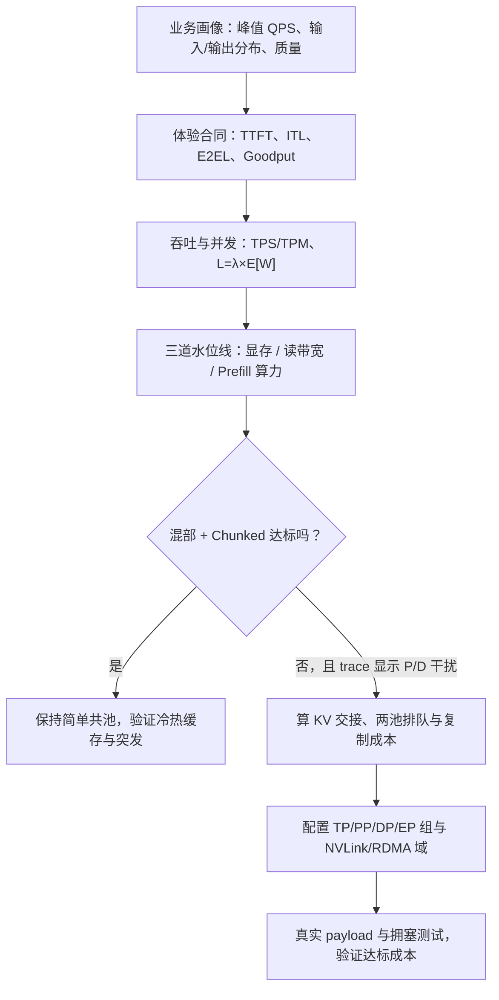

# 推理性能、智算网络与容量测算：架构师深度 FAQ

**语言**：简体中文 | [English](faq.en.md) · [H5 精学馆](../h5-academy/index.html) · [双语课程索引](README.md)

> **证据合同**：本文是企业 Cloud & AI Solution Architect 学习指南，不是硬件 benchmark。公式算例与场景目标均为 `synthetic` 教学假设；官方规格与实现依据见[来源目录](../h5-academy/sources.json)，复核于 2026-11-21。不存在独立复现实机的性能承诺。

## Executive Summary：先体验，再容量，后拆分与网络

1. **用户侧**同时看首字等待、流式平滑度、完成时间与质量；机器侧看达标 Goodput，不只看无限制峰值 TPS。
2. **业务侧**用峰值 QPS 和输入/输出 Token 分布求需求；Little's Law 需要平均停留时间，不能拿 P99 当等式。
3. **GPU 侧**分别跨过显存、Decode 读带宽和 Prefill 算力三道水位线；671B MoE 的 37B 激活不能替代总权重。
4. **架构侧**先验证混部 + Chunked Prefill，再比较 PD 的净收益；没有固定的“16 卡必须 PD”阈值。
5. **网络侧**统一 GB/GiB、Gb/s/GB/s、单向/双向、单端口/聚合与 NCCL 消息口径，再讨论瓶颈。



## 专题 1：用户 AI 核心评估指标

### Q1. TTFT、TPOT/ITL 和 E2EL 怎么区分？

TTFT 是请求发出到首 Token 可见的时间，包含客户端/网关、排队、Prefill、首字计算和交付。服务端 TTFT 与端到端 TTFT 要分别命名。

对于输出 `N` 枚 Token：

```text
TPOT = (最后 Token 时间 − 首 Token 时间) / (N−1)
ITL_i = 第 i 枚 Token 时间 − 第 i−1 枚 Token 时间
E2EL = TTFT + (N−1)×TPOT
```

TPOT 是单请求后续间隔的平均值；P99 ITL 能揭示短时卡顿。输出仅一枚 Token 时 TPOT 为 **N/A**，不是 0。网络 chunk 可能包含多枚 Token；不要用 chunk 数冒充 tokenizer Token 数。

### Q2. 可以把各阶段 P99 相加当作整体 P99 吗？

不能。分位数不线性可加，且请求阶段彼此相关。保留同一请求 trace，先对每个请求求总时延，再取整体分位数。相加的阶段预算可以是工程预算，但不能宣称是观测到的 E2EL P99。

### Q3. 五种业务场景该优先看什么？

| 场景 | 教学目标，不是通用 SLA | 评估重点 |
|---|---|---|
| 实时语音 | 端到端 turn response `<300 ms`；示例给 LLM TTFT 120 ms | VAD/ASR/网络/LLM/TTS 预算；首音频不等于首文本 |
| IDE 补全 | TTFT 200 ms、TPOT 15 ms、64 输出 Token | 短请求、取消过时结果、低排队 |
| 企业对话 | TTFT 800 ms、TPOT 35 ms、512 输出 Token | RAG 输入长度、冷热 prefix、流式尾延迟 |
| R1 深度推理 | TTFT 2 s、TPOT 50 ms、4096 输出 Token | 质量、总完成时间、首可见答案与隐藏推理 Token |
| 离线批处理 | 小时级完成截止时间；交互 TTFT 为 N/A | 成本、总完成时间、失败/重试、达标吞吐 |

语音手算预算示例：VAD 20 + ASR 40 + LLM 120 + TTS 60 + 网络/网关 30 = **270 ms**。这是拆预算练习，不保证真实系统在 270 ms 完成。离线场景不画成“TTFT=0”。

### Q4. Throughput 和 Goodput 为什么会背离？

Throughput 计所有完成的请求/Token；Goodput 只计同时满足约定 SLA 和质量门槛的部分。高 batch 可能增加 TPS，却使 TTFT 或 ITL 超标；此时 Goodput 下降甚至为零。

H5 的 tradeoff 曲线来自可调确定性教学模型，不是硬件帕累托前沿。等输出长度下可用请求达标比例乘 Token TPS；不等输出长度要按实际 Token 加权。

**生命周期算例**：排队 120 ms + Prefill/首字 300 ms + 交付 30 ms = TTFT 450 ms。128 输出 Token、TPOT 20 ms，则 E2EL = 450 + 127×20 = **2990 ms**，后续流式约 **50 tok/s**。

## 专题 2：TPM/TPS 与企业容量

### Q5. 单用户 TPS、System TPS 与 TPM 的公式一样吗？

```text
单用户后续流式 TPS ≈ 1000 / TPOT_ms
System Input TPS = 稳态完成 QPS × 平均输入 Token
System Output TPS = 稳态完成 QPS × 平均输出 Token（含首 Token）
同口径 TPM = 60×TPS
```

10 QPS、每请求输入 2048、输出 512，则需求为 **20,480 Input TPS** 和 **5120 Output TPS**。单用户 50 tok/s 不等于整个系统只能处理 50 tok/s。过载时 offered QPS 不等于 completed QPS。

### Q6. Little's Law 的“并发”究竟是什么？

`L=λ×E[W]`：L 为平均在系统内的请求数，λ 为稳定通过系统的请求率，W 为同一系统边界的平均停留时间。它既不是 DAU、在线人数，也不是固定 batch。

按 10 QPS，加 30% 需求余量后 λ=13。规划平均 TTFT 800 ms、TPOT 20 ms、512 输出 Token，则：

```text
W = 0.8 + 511×0.02 = 11.02 s
L = 13×11.02 = 143.26
Input TPM = 13×2048×60 = 1,597,440
Output TPM = 13×512×60 = 399,360
```

这里把目标延迟当成**规划均值假设**，不冒充已证实均值。观测验证必须换成实测 E[W]，突发、排队增长与拒绝需要另外压测。

### Q7. 怎么从吞吐与并发求实例数？

使用**同一混合业务负载**测得每实例输入/输出吞吐以及活跃请求上限：

```text
实例下界 = max(
  ceil(Input TPS / 可用输入容量),
  ceil(Output TPS / 可用输出容量),
  ceil(L / 活跃请求上限)
)
```

教学实例容量：输入 20K TPS、输出 1500 TPS、活跃上限 128；使用 70% 实测吞吐容量。上一例分别得到输入 2、输出 7、并发 2 个实例，先以 **7 个实例**压测。一个实例可以由多张 TP/PP/EP GPU 构成，不是一张卡。

### Q8. PTU 能直接换算 TPM 或 GPU 吗？成本如何算？

没有通用换算。按当前具体模型、版本、部署类型、缓存与上下文权重归一化，再按最小值与扩容步长取整。两权重教学示例：

```text
Normalized TPM = Input TPM×[(1−cache)+cache×cached_weight]
               + Output TPM×output_weight
```

Microsoft Learn 的 GPT-5.2 Data Zone 算例：200K 输入 TPM、20K 输出 TPM、输出权重 8、每 PTU 3400 输入等价 TPM。50% 缓存且缓存权重 0 → **260K normalized TPM → 76.47 PTU → 80 PTU**。H5 最小值为手工演示字段；采购前核对真实部署表。GPT-6+、cache writes、图像和上下文档位可能需要更多权重，不能默认当免费。

自建完整集群成本 `$40/h`、达标输出 `5000 tok/s`：

```text
$/1M 达标输出 = 40×10⁶/(3600×5000) = $2.22
```

API 输入/输出价格分别算，不与自建单输出分母混用。Goodput=0 时单位成本未定义，不显示 `$0`。

## 专题 3：GPU 三道水位线

### Q9. 为什么 Dense 与 MoE 必须区分总参数与激活参数？

GPU 常驻的全模型主权重用总参数算。DeepSeek-V3/原始 R1 主模型约 671B，单 Token 激活约 37B；37B 不会让其他专家权重消失。额外加载 MTP 模块需再预算 **14B**。CPU/NVMe offload 属于另一种部署边界，必须计搬运和 CPU 计算。

```text
M_weight_GB = (total_params_B + optional_MTP_B)×weight_bytes×(1+metadata_fraction)
```

BF16/FP16 2 B、FP8 1 B、INT4 0.5 B 是原始存储近似。量化 scales、padding、未量化层、runtime 和额外状态要单独预算。

### Q10. MHA、GQA 与 MLA 的 KV 公式怎么用？

```text
MHA/GQA KV bytes = 2×L×n_KV×d_head×S×B×KV_bytes
MLA compressed KV bytes = L×(latent_rank+RoPE_dim)×S×B×KV_bytes
```

Llama 70B GQA：80 层、8 KV heads、128 head dim，BF16 每 Token **327,680 B**。S=8192、B=32 → **85.89934592 GB=80 GiB**。

DeepSeek 压缩 MLA：61 层、latent 512、RoPE 64，BF16 每 Token **70,272 B**；均匀 FP8 假设为 **35,136 B**。后者要求实际 kernel 对所有分量使用 1 B，不能默认认为每种实现都如此。TP 复制、额外 MTP state 与 scales 会改占用。

### Q11. 70B 在 H200 上“放得下”的最低卡数怎么手算？

FP8 70.6B，5% 元数据余量 → 权重 74.13 GB；加上一例 KV 85.90 GB。每卡安全水位 85%、运行时预留 3 GB：

```text
每卡安全 payload = 141×0.85−3 = 116.85 GB
理想显存下界 = ceil((74.13+85.90)/116.85) = 2 GPU
```

这是理想聚合分片下界，不是完整 SLA 推荐。KV 与权重未必按理想比例分片；最后看最忙 rank 的实际峰值。

### Q12. 为什么显存 2 卡下界，沙盘候选却可能是 8 卡？

读带宽与算力是另两道约束：

```text
TPOT_weight_floor ≈ active_weight_GB/(N_GPU×BW_GBps×MBU)
带宽场景还要加每步 KV 读取
Prefill FLOPs ≈ 2×active_params×S×B_prefill
              +2×L×hidden×S²×B_prefill
```

同一默认算例使用 H200 4.8 TB/s、MBU 0.6、目标 TPOT 20 ms，权重+KV 读带宽场景下界为 **3 卡**。Prefill 使用 dense BF16 989.5 TFLOPS、MFU 0.4、TTFT 800 ms 减预留 100 ms，1 个完整 8K Prefill 的算力下界为 **5 卡**。取三者最大值，再给待压测的 2 的幂候选 **8 卡**，仍不是采购保证或已验证 TP 配置。

MoE 大 batch 的专家并集会接近更多总权重。H5 的均匀独立路由模型用于解释，不能把单 Token 37B 流量直接用于整个 batch。

规格需纠偏：L40S 48 GB 为 **GDDR6**，864 GB/s，**没有 NVLink**；H100/H200 为 SXM 指定规格；B200 **192 GB design/what-if** 与官方 DGX B200 **180 GB/卡**分开。80–85% 是规划余量，不是宣称 vLLM 当前默认。

## 专题 4：PD 分离

### Q13. 混部干扰的根源和 Chunked Prefill 的上限是什么？

Prefill 常更吃算力，低 batch Decode 常更吃内存带宽；二者同时争 SM、kernel 时序、缓存、显存与通信。Chunking 减少单段 Prefill 阻塞，但资源仍共用。更小 chunk 可能改善 ITL，却拉长长输入等待；没有通用最优 chunk。

### Q14. 什么时候值得进入 PD 验证？

trace 证实 Prefill 干扰 Decode，chunking 后双 SLA 仍失败，且 KV 交接+两池排队+计算能落入 TTFT 预算，并有持续网络、故障与复制成本余量。没有通用“16 卡以上必须 PD”规则。

低 QPS/小 KV 的 TCP PD 也可能成立；“没有 RDMA 一律禁止”是过度绝对化。RDMA/NVLink 对大 KV 低延迟场景更有价值，但仍需版本、拓扑与真实 payload 验证。

### Q15. KV 跨节点传输如何手算？

70B FP8 KV、8192 输入 → **1,342,177,280 B**。400 Gb/s 单向为 50 GB/s，80% 效率为 40 GB/s：

```text
Raw transfer = 1,342,177,280/(40×10⁹)×1000 = 33.554432 ms
Exposed handoff = max(0, raw−verified_overlap) + setup
```

已证实重叠 10 ms、固定 0.2 ms → **23.754432 ms**。10 QPS 的持续 payload 占该方向预算 **33.55%**。若到达量超过有效带宽，持续队列不稳定；不能继续套一个固定传输时间宣称 TTFT 达标。

### Q16. Mooncake、Dynamo、vLLM、SGLang 是互斥替代品吗？

不是。Dynamo 是编排/路由/弹性层；Mooncake 提供 KV-centric 架构与 transfer/store 生态；vLLM/SGLang 是推理引擎与相应 connector/runtime。部署可能组合这些层。真正核对后端 release、KV layout/dtype、TP reshaping、缓存正确性、故障恢复和两池容量。

H5 P99 曲线来自每点 **200 个确定性 ITL 样本**、5% 干扰和 nearest-rank 分位数。PD 保留可调残留抖动，不承诺“无抖动”；一次交接主要影响首字路径，不加到每个后续 Token 的 ITL。

## 专题 5：并行和推理加速

### Q17. TP、PP、DP、EP 到底切什么？

| 方式 | 切分维度 | 通信与主要代价 |
|---|---|---|
| TP | 同一层张量/权重 | AllReduce 或 RS+AG；高频同步 |
| PP | 层/流水 stage | SendRecv activations；bubble 与串行路径 |
| 普通推理 DP | 独立请求副本 | 路由、权重与缓存复制；没有训练梯度归约 |
| Attention DP + EP | Attention 请求分片与共享专家组 | 组语义依引擎；不是所有专家全复制 |
| EP | MoE 专家 | AllToAll dispatch/combine；热点与 token 交换 |

### Q18. 怎么决定 NVLink 域内与跨节点切分？

高频 TP 优先快域，但不要把节点名当作快域边界。NVSwitch/MNNVL 超节点可以扩展域。PP/DP 常跨域，EP 需要高质量 AllToAll。记录 GPU↔NIC 亲和、实际并行组、oversubscription 与通信重叠；不存在普遍适用的绝对禁令。

### Q19. 为什么投机、Prefix Caching、FP8 不该承诺固定倍数？

投机收益依接受率、draft/验证成本、batch 饱和、采样与约束模式；额外 draft/MTP 占显存。Prefix Caching 只复用相同 tokenized 前缀，主要节省 Prefill，不直接把 Decode 翻倍。FP8/INT4 改变存储/算子，但质量、硬件、scale、反量化和 kernel 决定净收益。

### Q20. PP microbatch 越多越好么？

理想平衡流水线利用率 `m/(m+p−1)` 随 microbatch 增多而提高，但真实系统还有不等长请求、慢 stage、KV 驻留、队列与通信。单请求仍走所有 stages；高系统吞吐不自动等于低 TTFT。

## 专题 6：RDMA、RoCEv2、NVLink 与 NCCL

### Q21. GPUDirect RDMA “零拷贝”是不是完全没有 CPU？

它让 payload 避免 host DRAM staging，NIC 直接 DMA 到注册 GPU 内存。CPU/驱动仍负责连接、注册、页固定、队列、控制与错误处理。检查 GPU/NIC PCIe 亲和、IOMMU/ACS、peer-memory/DMA-BUF 与驱动支持。零 host-copy 不等于零开销。

### Q22. PFC、ECN 和 DCQCN 分别做什么？

传统 lossless RoCE 基线：交换机 ECN 提前标 CE → 接收 RNIC 发 CNP → 发送 RNIC DCQCN 降速/恢复。若继续逼近溢出，PFC 在单跳单 priority 上暂停上游，队列低于 Xon 后恢复。

ECN 是早反馈；PFC 是逐跳急刹，不是端到端拥塞控制。要防 PFC 死锁/HOL，验证 watchdog、计数器与 incast。现代 fabric 也可能采用不同拥塞控制、receiver credits 或 loss-tolerant RDMA；本指南不是唯一组合的配置命令。

### Q23. 900/1800 GB/s NVLink 与 400/800G 网络怎么比较？

先统一口径。NVLink 4/5 的 900/1800 GB/s 为每 GPU 聚合双向宣传规格，非一个端口或单流独享。400/800 Gb/s 单端口单向理论分别是 **50/100 GB/s**，还需扣协议、效率与争用。NDR 400G / XDR 800G 需核对 lane、port、cable 实际组合。

Rail-Optimized 把对应 GPU/NIC 索引映射到轨，提高亲和与路径可控性；跨轨仍依赖 spine/路由，不能自动承诺“轨数×线速”。

### Q24. NCCL algbw 与 busbw 为什么不同？

```text
algbw = S/t
AllReduce busbw = algbw×2(n−1)/n
AllGather / ReduceScatter / AllToAll busbw = algbw×(n−1)/n
Broadcast / Reduce / SendRecv: factor=1
```

1000 MB/20 ms → algbw **50 GB/s**。8 ranks AllReduce → busbw **87.5 GB/s**。这是通信量标准化，不是单端口凭空超线速。AllGather/ReduceScatter 的 S 使用总数组，不是每 rank 单块。对比必须同操作、消息大小定义、路径、topology、dtype、warmup 与错误状态。

## 决策矩阵：先找到哪一种失败，再选手段

| 观测失败 | 优先排查 | 可能动作 | 必须复验 |
|---|---|---|---|
| TTFT 高、decode 平滑 | 排队、长输入、冷热 prefix、Prefill 算力 | 路由、缓存、输入治理、算力扩容 | 同分布 TTFT、质量、成本 |
| ITL 尾部被长 Prefill 拉高 | 请求关联 trace、chunk budget | Chunked Prefill，必要时 PD | TTFT+ITL 双门槛、KV 交接 |
| GPU OOM | 总权重、KV、每 rank 复制/碎片/图捕获 | 合法 TP/PP/EP、精度/KV、限制并发 | 最忙 rank 峰值、质量 |
| 大 batch MoE 吞吐差 | 专家并集/热点、AllToAll、attention | 调并行组、亲和、专家负载均衡 | 热点、通信、Goodput |
| 网络队列/PFC 风暴 | ECN/CNP、映射、incast、拥塞 | 调流控/拓扑/接入，验证 watchdog | 单轨故障、真实 EP+KV 共载 |
| 成本很低但用户超时 | 分母是否用了失败吞吐、闲置是否忽略 | 用达标输出重算全成本 | 明确 SLA、时间窗与质量 |

## 上线前核对清单

- [ ] 同一模型/version/tokenizer、输入输出分布、质量与采样合同。
- [ ] 服务端 TTFT、端到端 TTFT、首音频、首可见答案分别命名。
- [ ] Little's Law 使用平均 W；突发/过载/拒绝另外验证。
- [ ] 权重总参数、KV 表示/dtype、MTP、每 rank runtime 与实际显存字节。
- [ ] GPU form factor、dense/sparse FLOPs、GB/GiB、单向/双向口径。
- [ ] 混部 chunked 基线与 PD 原始/重叠/暴露交接分别测量。
- [ ] 并行组、GPU/NIC 亲和、专家热点、KV layout 与故障恢复。
- [ ] 网络小消息 latency、大消息带宽、incast、PFC/ECN/CNP 与轨故障。
- [ ] 用达标 Goodput/质量评估成本，不用无限制峰值。

**复算入口**：[H5](../h5-academy/index.html) · [来源](../h5-academy/sources.json) · [测试内核](../h5-academy/academy-math.cjs)。
