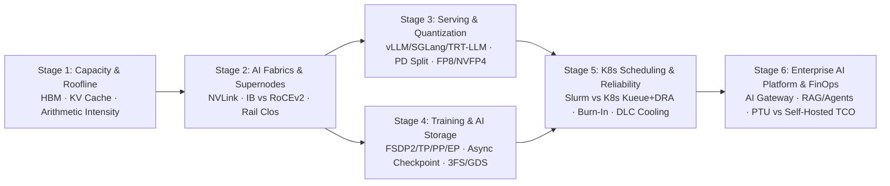

# Cloud Architect to AI Infrastructure Solution Architect Competency Roadmap

> **Language / 语言**: [简体中文](./roadmap.md) | **English** · [🎓 6-Volume H5 Academy](../h5-academy/index.html) · [🔥 Interactive H5 Learning Hub](../h5/ai-infra-learning-hub.en.html) · [10-Layer Stack Map](../stack-map.en.md) · [Full Bilingual Catalog](../full-catalog-en.md)

> **Executive Summary**: Built for experienced Cloud Solution Architects transitioning into **Enterprise AI Infrastructure & GenAI Platform Architecture**, this six-stage roadmap focuses on **quantitative sizing, architectural trade-offs, and production failure boundaries** across GPU memory rooflines, lossless AI fabrics, disaggregated LLM serving, distributed training/storage, Kubernetes GPU scheduling, and Token FinOps.

---

## Six-Stage Solution Architect Mastery Path

| Stage | Core Architectural Capability | Essential Bilingual Playbooks & Sizers | Practical SA Design Gate |
|---|---|---|---|
| **1. GPU Memory & Capacity Roofline** | Decompose weights, optimizer states, activations, and KV Cache; separate compute-bound Prefill from bandwidth-bound Decode | [GPU Hardware SKU & TCO](../components/ai-gpu-hardware-sku-h100-h200-b200-gb200-mi325x-tco-selection-faq.en.md) · [Cloud GPU Instance SKUs](../components/cloud-gpu-instance-sku-l40s-a10g-a100-h100-h200-capacity-sizing-selection-faq.en.md) · [`capacity_roofline` Model](../../experiments/capacity_roofline/README.md) | Size minimum GPU count, HBM headroom, and theoretical TPOT floor for `70B Dense` or `671B MoE` at `32K` context in 5 minutes |
| **2. Scale-Up & Scale-Out AI Fabrics** | Respect intra-node NVLink boundaries; choose between InfiniBand and AI Ethernet (RoCEv2) with Rail-Optimized Clos topologies | [IB vs RoCEv2 Guide](../components/ib-vs-ethernet-roce-selection-faq.en.md) · [RoCE Congestion & DLB](../components/rocev2-load-balancing-congestion-selection-faq.en.md) · [Rail-Optimized Fat-Tree](../components/ai-cluster-rdma-network-topology-rail-optimized-fat-tree-dragonfly-selection-faq.en.md) | Explain why `TP` must stay inside NVLink, why 5-tuple ECMP polarizes RDMA elephant flows, and when IB beats or loses to RoCEv2 |
| **3. Serving Engines, PD Split & Quantization** | Match workloads to vLLM, SGLang, or TensorRT-LLM; design PD disaggregation and FP8/NVFP4/AWQ quantization | [Serving Engine Guide](../components/llm-inference-engine-selection-faq.en.md) · [PD Disaggregation](../components/pd-disaggregation-kv-offload-selection-faq.en.md) · [Quantization Guide](../components/llm-quantization-selection-faq.en.md) · [MoE Parallelism](../components/moe-parallelism-selection-faq.en.md) | Produce an engine, Prefix Cache, PD ratio, and `$/1M SLA tokens` recommendation for a high-concurrency multi-turn Agent workload |
| **4. Distributed Training, RL & AI Storage** | Combine FSDP2 / TP / PP / EP, async RLHF/GRPO post-training, two-phase async checkpoints, and GDS parallel storage | [FSDP2 vs TP/PP](../components/distributed-training-memory-parallelism-selection-faq.en.md) · [RLHF/GRPO Architecture](../components/llm-rl-post-training-colocated-vs-disaggregated-verl-slime-architecture-selection-faq.en.md) · [Checkpoint Storage](../components/training-checkpoint-architecture-selection-faq.en.md) · [Tiered KV Offload](../components/kv-cache-tiered-offload-selection-faq.en.md) | Architect a 1,000-GPU checkpoint and storage pipeline keeping multi-TB save stalls `< 3.5 s` and node failover `< 90 s` |
| **5. K8s Orchestration, Burn-In & Liquid Cooling** | Govern Kueue TAS + DRA gang scheduling, MIG slicing, Day-0 burn-in gates, SDC telemetry, and `>45 kW` cold-plate DLC racks | [Slurm vs K8s Kueue+DRA](../components/ai-cluster-slurm-vs-kubernetes-kueue-dra-gang-scheduling-selection-faq.en.md) · [MIG vs MPS](../components/enterprise-gpu-sharing-mig-mps-timeslicing-fractional-scheduling-selection-faq.en.md) · [Day-0 Burn-In](../components/ai-cluster-burn-in-acceptance-dcgm-nccl-validation-selection-faq.en.md) · [Cooling & Power](../components/ai-datacenter-cooling-power-selection-faq.en.md) | Deliver an end-to-end Day-0 burn-in, tidal serving/training quota, and automated straggler/Xid cordon runbook |
| **6. Enterprise AI Platform & Token FinOps** | Unify AI Gateways, billion-scale RAG, MCP/A2A agents, confidential GPU TEEs, and PAYGO vs. PTU vs. self-hosted TCO | [Enterprise AI Gateway](../components/enterprise-ai-gateway-apim-litellm-kong-envoy-higress-selection-faq.en.md) · [PAYGO vs PTU vs Self-Hosted](../components/cloud-llm-deployment-paygo-ptu-self-hosted-aks-kaito-tco-selection-faq.en.md) · [Alibaba Cloud Review](../alibaba-cloud-ai-infra/README.en.md) · [1,024-GPU Case Study](../architectures/end-to-end-ai-infra-case.en.md) | Use the [Interactive Architect Workbench](../reports/ai-infra-architect-workbench.html) to defend a complete 3-year enterprise AI platform TCO & SLA proposal |

---

## How Cloud Architecture Skills Translate to AI Infrastructure

| Existing Cloud Skill | Directly Reusable Foundation | Critical New AI Infrastructure Constraints |
|---|---|---|
| **Stateless Autoscaling** | Demand forecasting, KEDA/HPA control loops, multi-AZ HA | Multi-hundred-GB weight cold-start, HBM fragmentation, KV prefix affinity, and safe queueing headroom (`ρ ≤ 0.65`) |
| **Cloud VPC / Clos Networking** | Spine-Leaf design, BGP routing, oversubscription analysis | Synchronous collective tail latency (`AllReduce` / `All-to-All`), Rail locality, and lossless RDMA congestion control (`PFC/ECN/DLB`) |
| **Kubernetes Platform Ops** | Declarative APIs, quota trees, GitOps CI/CD | All-or-nothing Gang Scheduling, NVLink/PCIe NUMA affinity (`DRA`), and hardware `MIG` fault isolation |
| **Resilience & DR Engineering** | RTO/RPO contracts, chaos drills, health probes | Single straggler or silent data corruption (`SDC`) stalling 1,024 GPUs simultaneously; sub-3s pinned-memory checkpointing |
| **Cloud FinOps** | Reserved capacity (`RI/SP`) blending, chargeback tags | Measuring `$/1M SLA-compliant tokens` rather than raw GPU utilization; leveraging Prefix Cache PTU multipliers, PD split, and FP8/NVFP4 |

---

## Focused Architecture Sprints

- **[TPU & AI Hypercomputer — 7-Day Sprint](./tpu-7day-sprint.en.md)** ([中文](./tpu-7day-sprint.md)): A structured 7-day path from data center fabrics to JAX covering TPU system anatomy (`v5p / v6e Trillium / TPU7x Ironwood / TPU 8t & 8i`), 3D Torus ICI & OCS topology, JAX/XLA/Shardy distributed training, vLLM-TPU & XProf profiling, GKE Kueue/Slurm control planes, and partner data center site qualification & turn-up.

