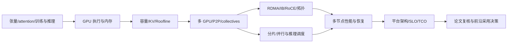

# 云架构师 → AI Infra：按先修进阶

起点是熟悉云与方案架构，但 GPU/CUDA/RDMA/分布式训练需要系统补课。没有日历承诺；一个阶段以解释、计算和设计证据结束，不以读完页数结束。

| 阶段 | 先修与学习 | 验收 |
|---|---|---|
| A. 工作负载语言 | 矩阵形状、attention、KV、前向/反向、精度与质量 | 解释 prefill/decode 为什么是不同资源问题，画张量/状态路径 |
| B. 单 GPU | SM/warp、kernel、寄存器、shared memory、cache/HBM、coalescing、spill、AOT/TMA/`tcgen05` 分派 | 用 [GPU/HBM 报告](../components/gpu-hbm.md) 与 [Kernel 分派链路](../components/kernel-dispatch-layout.md) 找出“local memory 是片上内存”等误解并解释 64K 寄存器重分配 |
| C. 容量与带宽 | 权重/激活/KV/优化器/工作区、GB/GiB、Roofline | 独立复算 [离线实验](../../experiments/capacity_roofline/README.md) 与 [Innovator 权衡算例](../../experiments/innovator_arch_tradeoffs/README.md)，列出它不能证明什么 |
| D. 多 GPU | P2P/NVLink/PCIe、AllReduce/AllGather/ReduceScatter、TP/DP/PP/EP | 从 [分层报告](../components/interconnect-network.md) 推导 Ring 通信量并说明适用条件 |
| E. 多节点 | MR/PD/QP/CQ、verbs、IB/RoCE、GPUDirect、拓扑/拥塞、Port-Failover | 阅读 [NCCL 固定路径](../components/nccl-topology-transport.md)、[图搜索/Channel 映射](../components/nccl-graph-channel-mapping.md)与 [IB Port-Failover 不变量](../components/nccl-port-recovery-invariants.md)，独立复算 [Ring cut](../../experiments/ring_cut/README.md)、[Rail channel cut](../../experiments/rail_channel_cut/README.md) 与 [IB failover invariants](../../experiments/ib_failover_invariants/README.md)，设计区分回退/拥塞/负载不均的诊断证据 |
| F. 训练与推理平台 | FSDP/ZeRO、MoE、batching/KV、checkpoint、调度/隔离、机架液冷/功耗与非 GPU 芯片 | 结合 [6D 分布式训练状态与通信账本](../components/training-parallelism.md)、[分布式 Checkpoint/恢复契约](../components/storage-checkpoint.md)、[vLLM V1 推理调度与 SLO 边界](../components/inference-slo.md)、[AI 集群拓扑调度与弹性恢复契约](../components/cluster-orchestration.md)、[容量、成本与吞吐经济学](../components/capacity-economics.md)、[机架功率、液冷与机柜级故障域](../components/rack-power-cooling.md)、[端到端综合架构案例](../architectures/end-to-end-ai-infra-case.md)及 [AI Infra 创新公司深挖](../components/ai-infra-innovators.md)，独立复算 [Training parallelism](../../experiments/training_parallelism/README.md)、[Checkpoint recovery](../../experiments/checkpoint_recovery/README.md)、[Inference SLO scheduler](../../experiments/inference_slo_scheduler/README.md)、[Cluster orchestration](../../experiments/cluster_orchestration/README.md)、[Capacity economics](../../experiments/capacity_economics/README.md) 与 [Rack power & cooling](../../experiments/rack_power_cooling/README.md)，设计有 SLO/质量门槛、存储层次取舍、通信域、液冷/功率边界、故障域和恢复步骤的系统 |
| G. 架构专家能力 | 真实 profiling/故障演练、成本/功率、论文质疑 | 带证据评审方案，能提出反例和最小可证伪实验 |

D/E 需要 C；训练与推理可以在基础完成后作为分支深化，不能因为熟悉 Kubernetes 就跳过数据流/通信。

## 学习循环

先独立回答 [练习](exercises.md)，再核对答案；把解释、错误原因、假设和下一个问题记录在个人学习反馈中。代理默认只更新研究进度，不替用户填“已掌握”。

没有 GPU 时允许完成算术、模型和静态代码路径；真实 GPU profiling、RDMA 调优、多节点故障恢复保持未验证。后续实践需另外确认环境与预算。

## 云架构经验怎样迁移，而不是从零重学

| 已有云架构能力 | 可以复用 | AI Infra 必须补充的约束 |
|---|---|---|
| 容量与弹性 | 需求预测、余量、伸缩、成本模型 | 权重/KV/训练状态驻留、分片、模型加载、GPU 碎片；不是增加 stateless 副本即可 |
| 网络设计 | 故障域、隔离、路由、带宽预算 | Collective/All-to-all、rank/rail、跨卡/节点拓扑、RDMA 完成与拥塞 |
| Kubernetes/平台 | 声明式运维、配额、升级、控制面 | GPU/driver/runtime 兼容、拓扑感知、gang/联合调度、设备分区与通信隔离 |
| 可用性设计 | SLO、冗余、恢复、演练 | 一次参与 rank 失败可能影响整个作业；checkpoint、一致恢复与重调度成本 |
| 服务性能 | p95/p99、排队、负载测试 | TTFT/TPOT、输入/输出分布、质量门槛、prefill/decode/KV 与 SLO-goodput |
| 成本优化 | TCO、利用率、保留容量 | 有效 token/训练进展、故障/恢复分母、功率/冷却；GPU 忙不等于业务效率 |
| 技术评审 | 需求、约束、取舍、风险 | 固定源码/规范、性能模型、实验反证；不能由厂商峰值替代 workload 证据 |

先用熟悉的架构方法定义目标，再向下追实现；不把全部时间花在厂商 SKU 记忆，也不把算法理论和系统运维割裂。

## 阅读来源顺序

工作负载基础 → CUDA 官方执行/内存契约 → ROCm 的对应模型/兼容说明 → NCCL collectives 与固定代码 → rdma-core verbs/生命周期 → 指定训练/推理 runtime 实现 → 系统论文及作者制品。

来源入口与已读范围见 [台账](../../research/sources.json)，不要把可变 `latest` 页面当不可变规范，也不要把 GPU 代际营销数字当设计参数。

## 怎样积累前沿研究能力

将 MLSys、SC、SIGCOMM、ISCA/ASPLOS、OSDI/SOSP、NeurIPS 等论文入口作为发现渠道，按实际工作负载选择文章，不以会议名代替证据。arXiv 版本、正式论文和作者制品分别锁定，不自动视为同行评审或可运行。

一篇论文读完要留下：它解决哪个瓶颈、旧方案/基线是什么、机制在哪里实现、实验分母与质量/拓扑怎样固定、哪些结果不可外推、什么反例会推翻结论。读一篇后形成自己的问题或小实验，而不是只有翻译摘要。

每当几个相互关联的问题完成，重做一份架构方案并比较“哪些选择因新增证据改变”。能解释改变与不改变的原因，才是知识向架构判断的积累。
