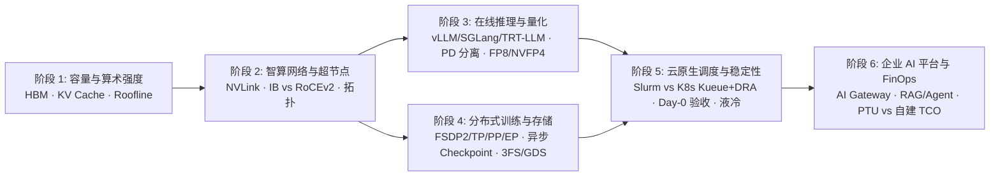

# 云架构师进阶 AI 基础设施解决方案架构师（SA）能力地图

> **Language / 语言**: **简体中文** | [English](./roadmap.en.md) · [全栈分层地图](../stack-map.md) · [完整总目录](../full-catalog-zh.md)

> **核心理念**：面向已经具备云原生、网络、存储与高可用设计经验的云解决方案架构师，不把时间浪费在生僻底层语法或脱离业务的纸面峰值记忆上，而是围绕 **“容量屋脊线 → 智算网络 → 训推并行 → 存储与 KV 分层 → 云原生编排 → Token FinOps”** 六阶段建立可量化、可验证的架构决策能力。

---

## 六阶段实战进阶路径与验收标准

| 阶段 | 核心能力目标 | 必读双语选型指南与交互工具 | 架构师实战验收标准（能独立回答并测算） |
|---|---|---|---|
| **1. 硬件、显存与容量屋脊线** | 掌握权重、优化器状态、激活与 KV Cache 显存分解；区分算力受限（Prefill）与带宽受限（Decode） | [GPU 硬件 SKU 与 TCO 选型](../components/ai-gpu-hardware-sku-h100-h200-b200-gb200-mi325x-tco-selection-faq.md) · [云 GPU 实例选型](../components/cloud-gpu-instance-sku-l40s-a10g-a100-h100-h200-capacity-sizing-selection-faq.md) · [`capacity_roofline` 算例](../../experiments/capacity_roofline/README.md) | 给定 `70B Dense` 或 `671B MoE` 模型及 `32K` 上下文并发目标，5 分钟内手算出最小卡数、HBM 余量与理论 TPOT 下界 |
| **2. Scale-Up / Scale-Out 智算网络** | 理解机内 NVLink/NVSwitch 边界，掌握 InfiniBand vs AI 以太网（RoCEv2）与 Rail-Optimized 拓扑设计 | [IB vs RoCEv2 选型](../components/ib-vs-ethernet-roce-selection-faq.md) · [RoCE 负载均衡与拥塞控制](../components/rocev2-load-balancing-congestion-selection-faq.md) · [多轨 Fat-Tree 拓扑](../components/ai-cluster-rdma-network-topology-rail-optimized-fat-tree-dragonfly-selection-faq.md) | 清晰解释为什么 `TP` 不能跨节点、为什么传统静态 ECMP 跑 RDMA 会发生哈希极化，以及何时该选 IB vs RoCEv2 |
| **3. 大模型推理引擎、PD 分离与 MoE 量化** | 根据业务特征选择 vLLM / SGLang / TRT-LLM、设计 PD 分离架构与 FP8/NVFP4/AWQ 量化方案 | [推理引擎选型](../components/llm-inference-engine-selection-faq.md) · [PD 分离选型](../components/pd-disaggregation-kv-offload-selection-faq.md) · [量化选型](../components/llm-quantization-selection-faq.md) · [MoE 并行](../components/moe-parallelism-selection-faq.md) | 为高并发多轮 Agent 方案给出引擎选型、Prefix Cache 提效测算、PD 配比与 `$/1M SLA 达标 Tokens` 对比表 |
| **4. 分布式训练、后训练与高性能存储** | 掌握 FSDP2 / Megatron TP+PP、RLHF/GRPO 训推混合架构，以及异步 Checkpoint 与 GDS 并行文件系统 | [FSDP2 vs TP/PP](../components/distributed-training-memory-parallelism-selection-faq.md) · [RLHF/GRPO 架构](../components/llm-rl-post-training-colocated-vs-disaggregated-verl-slime-architecture-selection-faq.md) · [Checkpoint 存储](../components/training-checkpoint-architecture-selection-faq.md) · [分层 KV 卸载](../components/kv-cache-tiered-offload-selection-faq.md) | 设计一套千卡训练存储与容错方案，使多 TB Checkpoint 停顿 `< 3.5 s` 且单节点故障恢复 `< 90 s` |
| **5. K8s 智算编排、高可靠运维与液冷供电** | 设计成组拓扑调度、GPU 切分共享、Day-0 压测验收、静默错误排障与 `>45 kW` 冷板液冷机柜 | [Slurm vs K8s Kueue+DRA](../components/ai-cluster-slurm-vs-kubernetes-kueue-dra-gang-scheduling-selection-faq.md) · [MIG vs MPS](../components/enterprise-gpu-sharing-mig-mps-timeslicing-fractional-scheduling-selection-faq.md) · [Day-0 压测验收](../components/ai-cluster-burn-in-acceptance-dcgm-nccl-validation-selection-faq.md) · [液冷与供电](../components/ai-datacenter-cooling-power-selection-faq.md) | 为客户制定从服务器上架压测、K8s 训推潮汐混部配额到慢节点/Xid 自动隔离的完整生产运维方案 |
| **6. 企业级 AI 平台、安全合规与 FinOps** | 统筹 AI Gateway、企业级 RAG、MCP/A2A 多智能体以及 PAYGO / PTU / 自建集群 3 年 TCO 治理 | [企业 AI Gateway](../components/enterprise-ai-gateway-apim-litellm-kong-envoy-higress-selection-faq.md) · [PAYGO vs PTU vs 自建 TCO](../components/cloud-llm-deployment-paygo-ptu-self-hosted-aks-kaito-tco-selection-faq.md) · [阿里云全栈测评](../alibaba-cloud-ai-infra/README.md) · [1024-GPU 综合案例](../architectures/end-to-end-ai-infra-case.md) | 结合 [交互式全栈架构师工作台](../reports/ai-infra-architect-workbench.html) 交付兼顾 SLA、安全合规与最优单 Token 成本的端到端客户架构书 |

---

## 传统云架构能力向 AI Infra 迁移对照表

| 既有云架构经验 | 可直接复用的方法论 | 进入 AI Infra 必须补齐的关键维度 |
|---|---|---|
| **无状态微服务弹性伸缩** | 流量预测、HPA/KEDA 自动扩缩容、多可用区容灾 | 数百 GB 模型权重加载延迟、显存碎片、KV Cache 会话亲和性与安全排队水位（`ρ ≤ 0.65`） |
| **云数据中心 VPC/Clos 网络** | 叶脊拓扑、BGP 路由设计、带宽收敛比规划 | 集合通信（AllReduce / All-to-All）同步木桶效应、Rail 亲和性、RDMA 无损拥塞控制（PFC/ECN/DLB） |
| **Kubernetes 容器平台治理** | 声明式运维、RBAC/多租户配额、GitOps 发布 | Gang Scheduling（全有或全无成组调度）、NVLink/PCIe 拓扑感知分配、硬件 MIG 故障隔离 |
| **企业高可用与灾备设计** | RTO/RPO 定义、混沌演练、健康检查探针 | 单张坏卡或慢节点（Straggler）拖垮千卡同步作业、静默数值翻转（SDC）、秒级内存态 Checkpoint 恢复 |
| **云 FinOps 成本治理** | 预留实例（RI/SP）组合、按部门成本分摊 | 区分“GPU 表面忙”与“SLA 达标有效 Token 产出”，量化 Prefix Cache 折扣、PD 分离与低精度量化带来的单价下降 |
