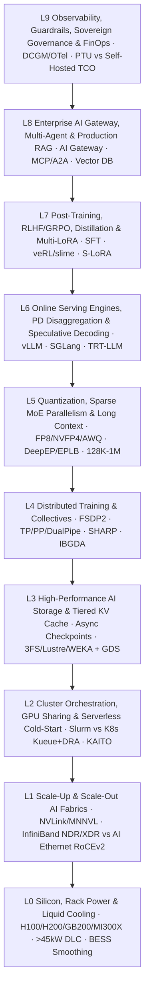

# Cloud & AI Infrastructure Solution Architect 10-Layer Stack Map (`L0–L9`)

> **Language / 语言**: [简体中文](./stack-map.md) | **English** · [Full Bilingual Catalog](./full-catalog-en.md) · [Repository Home](../README.en.md)

> **Executive Summary**: Designed for **Cloud & AI Infrastructure Solution Architects**, this stack map organizes enterprise AI factories and GenAI platforms into **10 architectural layers (`L0` Power & Cooling → `L9` Observability, Security & FinOps)** — mapping each layer's **decision scenario, architectural trade-offs, quantitative guardrails, and bilingual selection playbooks**.

| Layer | Core SA Decision Scenario | Architectural Trade-offs & Quantitative Guardrails | Flagship Bilingual Playbooks |
|---|---|---|---|
| **L0 Silicon, Power & Liquid Cooling** | Selecting H100 / H200 / B200 / GB200 NVL72 / MI300X SKUs & designing AI datacenter racks | Transition from air to **Cold-Plate Direct Liquid Cooling (DLC) above `45 kW/rack`**; enforce busbar `dP/dt` ramp limits + BESS buffering; prioritize high-HBM SKUs for memory-bound decode | [GPU SKU & TCO Guide](components/ai-gpu-hardware-sku-h100-h200-b200-gb200-mi325x-tco-selection-faq.en.md) · [Cooling & Power](components/ai-datacenter-cooling-power-selection-faq.en.md) · [Grid Transients & BESS](components/ai-cluster-grid-power-transients-bess-smoothing-selection-faq.en.md) |
| **L1 Scale-Up & Scale-Out Fabrics** | Designing fabrics for ≥1K-GPU pretraining, MoE All-to-All, or PD-disaggregated serving | **Never stretch `TP` outside intra-node/intra-rack NVLink**; choose **InfiniBand (SHARP + AR)** for `≥1K-GPU` synchronous pretraining; choose **AI Ethernet RoCEv2 (Rail-Optimized + ECN/DCQCN + DLB/Spray)** for `≤512-GPU` tuning & PD serving | [IB vs RoCEv2 Guide](components/ib-vs-ethernet-roce-selection-faq.en.md) · [RoCE Congestion](components/rocev2-load-balancing-congestion-selection-faq.en.md) · [NVLink/MNNVL](components/gb200-mnnvl-imex-channels-nvlink-fabric-manager-isolation-selection-faq.en.md) |
| **L2 Orchestration, Sharing & Serverless** | Slurm vs. Kubernetes platform choice, multi-tenant GPU slicing, sub-second sandbox cold-start | Use **Kubernetes + Kueue TAS + DRA** for cloud-native gang & topology scheduling; enforce **hardware MIG** for multi-tenant isolation; accelerate K8s scale-out via **KAITO + OCI lazy streaming / CRIU GPU snapshots** | [Slurm vs K8s Kueue](components/ai-cluster-slurm-vs-kubernetes-kueue-dra-gang-scheduling-selection-faq.en.md) · [MIG vs MPS](components/enterprise-gpu-sharing-mig-mps-timeslicing-fractional-scheduling-selection-faq.en.md) · [AKS + KAITO](components/enterprise-k8s-aks-kaito-keda-autoscaling-model-asset-fast-load-selection-faq.en.md) |
| **L3 AI Storage & Tiered KV Cache** | Eliminating multi-TB checkpoint stalls, high-IOPS training ingestion, and 64K multi-turn KV recomputation | Stage checkpoints via **Pinned Host DRAM Two-Phase Async Flush** (`72×` lower GPU stall) + **3FS/Lustre/WEKA + GDS**; offload multi-turn KV to **Pinned DRAM / RDMA+GDS pools** (`15×` faster resume TTFT) | [Checkpoint Architecture](components/training-checkpoint-architecture-selection-faq.en.md) · [Tiered KV Offload](components/kv-cache-tiered-offload-selection-faq.en.md) · [3FS/Lustre/WEKA](components/ai-storage-3fs-lustre-weka-parallel-filesystem-selection-faq.en.md) |
| **L4 Distributed Training & Collectives** | Sharding 70B–671B training runs and minimizing pipeline bubbles across 64–4,096 GPUs | Default to **FSDP2 + selective activation checkpointing** up to `64 GPUs`; combine **intra-node TP=8 × inter-node FSDP2 × DualPipe/1F1B PP** at multi-hundred/thousand-GPU scale | [FSDP2 vs TP/PP](components/distributed-training-memory-parallelism-selection-faq.en.md) · [DualPipe/Zero-Bubble](components/llm-pipeline-parallelism-1f1b-interleaved-zero-bubble-dualpipe-selection-faq.en.md) · [SHARP Collectives](components/ai-cluster-in-network-computing-sharp-collective-selection-faq.en.md) |
| **L5 Quantization, MoE & Long Context** | Sizing DeepSeek-R1 671B / Qwen MoE fleets, choosing FP8 vs. NVFP4 vs. AWQ, scaling to 128K–1M context | Standardize on **Block-Scaled FP8 + Attention DP + Expert EP + DeepEP + EPLB** on Hopper/MI300X (`-62%` TCO) and **native NVFP4** on Blackwell; pair **Ring/Ulysses CP + hybrid linear attention** above 128K context | [Quantization FP8/NVFP4/AWQ](components/llm-quantization-selection-faq.en.md) · [MoE Parallelism](components/moe-parallelism-selection-faq.en.md) · [DeepSeek 671B Sizing](components/deepseek-v3-r1-671b-enterprise-private-deployment-sizing-selection-faq.en.md) |
| **L6 Serving Engines & PD Disaggregation** | Choosing vLLM vs. SGLang vs. TensorRT-LLM, decoupling Prefill/Decode, speculative & structured decoding | Pick **vLLM V1** for broad model/hardware breadth; **SGLang (RadixAttention)** for shared-prefix Agents/RAG & MoE; **TensorRT-LLM** for pinned NVIDIA peak throughput; enable **Dynamo/Mooncake PD Disaggregation** on `≥16 GPUs` + RDMA | [vLLM vs SGLang vs TRT-LLM](components/llm-inference-engine-selection-faq.en.md) · [PD Disaggregation](components/pd-disaggregation-kv-offload-selection-faq.en.md) · [Speculative Decoding](components/speculative-decoding-selection-faq.en.md) |
| **L7 Post-Training, RLHF/GRPO & LoRA** | Deciding Prompt/RAG vs. SFT vs. RL, scaling reasoning RL rollouts, serving 100+ tenant LoRAs | Use **RAG** for dynamic facts, **SFT/Distillation** for style/schema internalization, **async veRL/slime GRPO** for verifiable reasoning, and **single-base S-LoRA** for multi-tenant adapters | [RAG vs SFT vs RL](components/enterprise-llm-customization-prompt-rag-sft-distillation-selection-faq.en.md) · [RLHF/GRPO Architecture](components/llm-rl-post-training-colocated-vs-disaggregated-verl-slime-architecture-selection-faq.en.md) · [Multi-LoRA Serving](components/enterprise-multi-lora-serving-hundred-tenant-adapter-architecture-selection-faq.en.md) |
| **L8 AI Gateway, Multi-Agent & RAG** | Building unified LLM gateways, billion-scale vector search, GraphRAG, and MCP/A2A agent fabrics | Front fleets with an **AI Gateway (semantic routing + token quotas + cross-cloud failover)**; size **Milvus / Qdrant / DiskANN** by RAM-to-NVMe ratio; standardize tool/agent interoperability on **MCP + A2A** | [Enterprise AI Gateway](components/enterprise-ai-gateway-apim-litellm-kong-envoy-higress-selection-faq.en.md) · [Billion-Scale Vector DB](components/vector-database-billion-scale-hnsw-diskann-gpu-cagra-selection-faq.en.md) · [Production RAG](components/enterprise-production-rag-architecture-acl-cdc-hybrid-graphrag-selection-faq.en.md) |
| **L9 Observability, Security & FinOps** | Catching stragglers/SDC, optimizing PAYGO vs. PTU vs. self-hosted TCO, confidential GPU governance | Gate clusters with **Day-0 pairwise burn-in + DCGM/OTel telemetry**; size **PTU (with prefix-cache discounts) for P50–P75 baseline + PAYGO spillover**; protect regulated workloads with **GPU TEE + runtime guardrails** | [GPU Observability & FinOps](components/enterprise-gpu-observability-dcgm-otel-genai-finops-governance-selection-faq.en.md) · [PAYGO vs PTU vs Self-Hosted](components/cloud-llm-deployment-paygo-ptu-self-hosted-aks-kaito-tco-selection-faq.en.md) · [Confidential GPU TEE](components/enterprise-confidential-ai-tee-gpu-attestation-privacy-selection-faq.en.md) |

---

## Flagship Full-Stack Case Studies & Tools

- **Hyperscaler Full-Stack Vertical Co-Design**: [Alibaba Cloud AI Infrastructure Deep Review (`L0` T-Head → `L1` Panjiu/HPN 7.0 → `L2` Lingjun/PAI → `L3` Bailian)](./alibaba-cloud-ai-infra/README.en.md)
- **Hybrid 1,024-GPU Cluster Reference Design**: [End-to-End 1,024-GPU Training & PD-Disaggregated Serving Reference Architecture](./architectures/end-to-end-ai-infra-case.en.md)
- **Interactive Sizing & TCO Console**: [`docs/reports/ai-infra-architect-workbench.html`](./reports/ai-infra-architect-workbench.html)
- **Complete 150-Playbook Bilingual Catalog**: [`docs/full-catalog-en.md`](./full-catalog-en.md)
