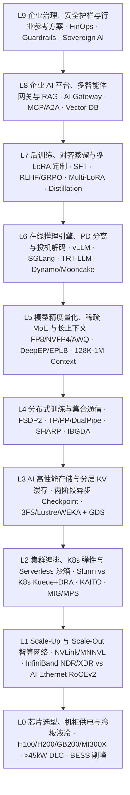

# 云与 AI 基础设施解决方案架构师全栈分层地图（L0–L9）

> **Language / 语言**: **简体中文** | [English](./stack-map.en.md) · [完整选型总目录](./full-catalog-zh.md) · [首页](../README.md)

> **核心定位**：面向 **Cloud & AI Infrastructure Solution Architect（云与 AI 基础设施解决方案架构师）**，将智算中心与企业大模型平台拆解为 **L0 供电液冷 → L9 行业落地与 FinOps 治理** 十个清晰架构层，明确每一层的 **典型业务场景、核心架构权衡（Trade-offs）、量化选型红线与代表双语指南**。

| 分层 | 核心决策场景 (SA Scenario) | 架构权衡与定量选型红线 (Architecture Trade-offs & Guardrails) | 代表双语选型指南 |
|---|---|---|---|
| **L0 芯片、液冷与供电底座** | 新建智算机房或评估 H100 / H200 / B200 / GB200 NVL72 / MI300X / 云实例 SKU | 单柜功率 **`>45 kW` 必须从风冷切换至冷板式液冷（DLC）**；高密唤醒配置令牌桶爬坡限流与 BESS 储能缓冲；显存带宽型推理优先大 HBM SKU（H200/MI300X/B200） | [GPU SKU 选型](components/ai-gpu-hardware-sku-h100-h200-b200-gb200-mi325x-tco-selection-faq.md) · [液冷与供电](components/ai-datacenter-cooling-power-selection-faq.md) · [电网瞬态与 BESS](components/ai-cluster-grid-power-transients-bess-smoothing-selection-faq.md) |
| **L1 Scale-Up / Scale-Out 智算网络** | 千卡预训练、跨机 MoE 通信或 PD 分离推理网络规划 | **`TP` 严禁跨出机内/机柜 NVLink 域**；`≥1,000 GPU` 同步预训练选 **InfiniBand (SHARP + 自适应路由)**；`≤512 GPU` 微调与 PD 分离推理选 **AI 以太网 RoCEv2（Rail-Optimized + ECN/DCQCN + DLB/喷洒路由）** | [IB vs RoCEv2 选型](components/ib-vs-ethernet-roce-selection-faq.md) · [RoCE 拥塞控制](components/rocev2-load-balancing-congestion-selection-faq.md) · [NVLink/MNNVL](components/gb200-mnnvl-imex-channels-nvlink-fabric-manager-isolation-selection-faq.md) |
| **L2 集群编排、切分与 Serverless 弹性** | K8s vs Slurm 平台建设、多租户 GPU 共享、Agent 沙箱秒级冷启动 | 云原生训推混部选 **K8s + Kueue TAS + DRA** 成组拓扑调度；小模型高密度隔离用 **硬件 MIG**（禁跨租户裸开 MPS）；K8s 推理冷启动用 **KAITO + OCI 流式镜像 / CRIU 显存快照** | [Slurm vs K8s Kueue](components/ai-cluster-slurm-vs-kubernetes-kueue-dra-gang-scheduling-selection-faq.md) · [MIG vs MPS](components/enterprise-gpu-sharing-mig-mps-timeslicing-fractional-scheduling-selection-faq.md) · [AKS + KAITO](components/enterprise-k8s-aks-kaito-keda-autoscaling-model-asset-fast-load-selection-faq.md) |
| **L3 高性能存储与分层 KV 缓存** | TB 级训练 Checkpoint 防停顿、百万文件训练读取、多轮长对话 KV 卸载 | 训练采用 **Host Pinned DRAM 两阶段异步 Checkpoint**（阻塞压缩 72× 至 ~3 s）+ **3FS/Lustre/WEKA + GDS**；64K 多轮对话开启 **Pinned DRAM / RDMA 内存池 KV 卸载** | [Checkpoint 架构](components/training-checkpoint-architecture-selection-faq.md) · [分层 KV 卸载](components/kv-cache-tiered-offload-selection-faq.md) · [3FS/Lustre/WEKA](components/ai-storage-3fs-lustre-weka-parallel-filesystem-selection-faq.md) |
| **L4 分布式训练与集合通信** | 70B–671B 预训练/长序列微调切分策略与流水线气泡消除 | `≤64 GPU` 优先 **FSDP2 + 激活检查点**；百卡至千卡采用 **机内 TP=8 × 跨机 FSDP2 × DualPipe/1F1B PP**，开启低精度 `FP8` 主权重分片重叠通信 | [FSDP2 vs TP/PP](components/distributed-training-memory-parallelism-selection-faq.md) · [DualPipe/Zero-Bubble](components/llm-pipeline-parallelism-1f1b-interleaved-zero-bubble-dualpipe-selection-faq.md) · [SHARP 网内归约](components/ai-cluster-in-network-computing-sharp-collective-selection-faq.md) |
| **L5 模型量化、MoE 与超长上下文** | DeepSeek-R1 671B / Qwen MoE 部署定容、精度选型、128K–1M 上下文扩展 | Hopper/MI300X 生产首选 **Block-Scaled FP8 + Attention DP + Expert EP + DeepEP + EPLB**（省 62% TCO）；Blackwell 首选 **硬件 NVFP4**；128K+ 结合 **Ring/Ulysses 序列并行与混合线性注意力** | [量化选型 FP8/NVFP4/AWQ](components/llm-quantization-selection-faq.md) · [MoE EP 并行](components/moe-parallelism-selection-faq.md) · [DeepSeek 671B 定容](components/deepseek-v3-r1-671b-enterprise-private-deployment-sizing-selection-faq.md) |
| **L6 在线推理引擎与 PD 分离** | 高并发低延迟推理引擎选型、长短请求解耦、投机解码与结构化输出 | 多模型标准化选 **vLLM V1**；长共享前缀 Agent/RAG 与 MoE 选 **SGLang（RadixAttention）**；同构 NVIDIA 极致吞吐选 **TensorRT-LLM**；`≥16 GPU` + RDMA 启用 **Dynamo/Mooncake PD 分离** | [vLLM vs SGLang vs TRT-LLM](components/llm-inference-engine-selection-faq.md) · [PD 分离选型](components/pd-disaggregation-kv-offload-selection-faq.md) · [投机解码 EAGLE-3/MTP](components/speculative-decoding-selection-faq.md) |
| **L7 后训练、RLHF/GRPO 与定制化** | 企业选 Prompt/RAG 还是 SFT/RL、大规模推理模型强化学习、百租户 LoRA 服务 | 知识高频更新选 **RAG**，格式与领域风格内化选 **SFT/蒸馏**，复杂推理与代码验证选 **veRL/slime 异步 GRPO**；多租户微调采用 **单底座 S-LoRA 热加载** | [RAG vs SFT vs RL 决策](components/enterprise-llm-customization-prompt-rag-sft-distillation-selection-faq.md) · [RLHF/GRPO 架构](components/llm-rl-post-training-colocated-vs-disaggregated-verl-slime-architecture-selection-faq.md) · [Multi-LoRA 服务](components/enterprise-multi-lora-serving-hundred-tenant-adapter-architecture-selection-faq.md) |
| **L8 企业 AI 网关、Agent 与生产 RAG** | 统一模型网关建设、十亿向量检索、GraphRAG 与多智能体编排 | 入口部署 **AI Gateway（语义路由 + Token 配额 + 跨云故障切换）**；亿级稠密+稀疏混合检索按驻留内存预算选 **Milvus / Qdrant / DiskANN**；工具标准统一 **MCP + A2A** | [企业 AI Gateway](components/enterprise-ai-gateway-apim-litellm-kong-envoy-higress-selection-faq.md) · [十亿级向量库](components/vector-database-billion-scale-hnsw-diskann-gpu-cagra-selection-faq.md) · [企业级生产 RAG](components/enterprise-production-rag-architecture-acl-cdc-hybrid-graphrag-selection-faq.md) |
| **L9 可观测性、可靠性与 Token FinOps** | 集群静默错误排障、PAYGO vs PTU vs 自建成本测算、主权云与隐私安全 | 建立 **Day-0 压测 + DCGM/OTel 双端遥测** 拦截慢节点与静默损坏；按稳态基线买 **PTU（吃满前缀缓存折扣）+ 波峰溢出 PAYGO / 自建弹性池**；高敏数据启用 **GPU 机密计算 TEE + 双层护栏** | [GPU 可观测与 FinOps](components/enterprise-gpu-observability-dcgm-otel-genai-finops-governance-selection-faq.md) · [PAYGO vs PTU vs 自建](components/cloud-llm-deployment-paygo-ptu-self-hosted-aks-kaito-tco-selection-faq.md) · [机密计算 TEE](components/enterprise-confidential-ai-tee-gpu-attestation-privacy-selection-faq.md) |

---

## 全栈参考案例与完整索引入口

- **公有云垂直整合全栈拆解**：[阿里云 AI Infra 全栈架构深度测评（平头哥芯片 → 磐久/HPN 7.0 → 灵骏/PAI → 百炼）](./alibaba-cloud-ai-infra/README.md)
- **自建/混合云千卡级参考设计**：[1024-GPU 训练与 PD 分离推理混合集群全栈参考架构](./architectures/end-to-end-ai-infra-case.md)
- **交互式容量与 TCO 测算工作台**：[`docs/reports/ai-infra-architect-workbench.html`](./reports/ai-infra-architect-workbench.html)
- **全部 150 篇双语指南分类总表**：[`docs/full-catalog-zh.md`](./full-catalog-zh.md)
